# Imaging contests: gallery

virgil's images of the SPIE interferometric imaging contest data, beside the truth
where we hold one. Every panel has North up and East left, the same colour map
and the same stretch, asinh(I / 0.02 Ipeak), which keeps faint emission beside a
bright central star visible; the panels in a row share
one field, which holds 97% of the flux of each image.

**Method.** virgil 8562a39, campaign 1. Eight CLEAN-started Gaussian-process images per dataset with randomised starts, half with a central point star; members within 1.5x of the best χ²/N are kept, and the panel shows the kept member with the highest evidence. Truths are used for scoring and display only, never for fitting.

**Captions.** The raw χ²/N against the quoted errors comes first; the error scale is the
factor that brings it to 1, and a fit with a scale above 2 is marked failed.
Where we hold the truth, the score uses that contest's own metric
([scoring sources](contest_scoring_sources.md)).

**Paper figures.** The contest papers' truth panels and entries are not shown: no copy
we found carries a licence that allows republication. Each row links to the paper on ADS.
See the [plan](plan_imaging_contests.md) for the status of each dataset.

## 2004: NPOI, simulated, 550 nm

### 2004 data1

imaged no truth LkHα 101 model (star in an asymmetric shell), image by P. Tuthill.

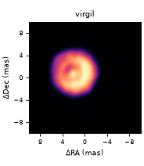

χ²/N 0.893 against the quoted errors (V² 0.92, closure phase 0.853); error scale 1.05; member m6 (star), 8/8 kept.

### 2004 data2

failed fit (s > 2) truth rebuilt binary: limb-darkened elliptical disk with a spot, and a 0.5 mas companion 10 mas east.

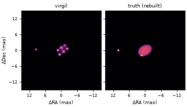

χ²/N 20.7 against the quoted errors (V² 30.6, closure phase 5.85); error scale 4.65; member m1 (no star), 4/8 kept. σ/peak 0.234 against the rebuilt truth (Lawson et al. 2004, Eq. 2; lower is better; published: BSMEM 0.116, WISARD 0.163, MIRA 0.532, VLBMEM 0.798).

Paper: [2004SPIE.5491..886L](https://ui.adsabs.harvard.edu/abs/2004SPIE.5491..886L/abstract); winner: BSMEM (Thorsteinsson & Young, Cambridge).

## 2006: VLTI/AMBER, simulated, grey

### 2006 MIR0001

imaged no truth thin-disk model by O. Chesneau.

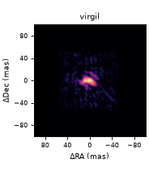

χ²/N 0.899 against the quoted errors (V² 1.04, closure phase 0.508); error scale 1.07; member m0 (star), 8/8 kept.

Paper: [2006SPIE.6268E..1UL](https://ui.adsabs.harvard.edu/abs/2006SPIE.6268E..1UL/abstract); winner: BSMEM (Baron & Young).

## 2008: CHARA, simulated, J/H/K

### 2008 Alp_Vic J

imaged no truth AGB star.

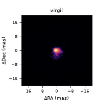

χ²/N 0.69 against the quoted errors (V² 0.87, closure phase 0.419); error scale 0.87; member m6 (star), 8/8 kept.

### 2008 Alp_Vic H

imaged no truth AGB star.

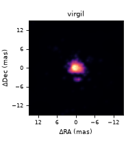

χ²/N 0.724 against the quoted errors (V² 0.844, closure phase 0.543); error scale 0.88; member m2 (star), 8/8 kept.

### 2008 Alp_Vic K

imaged no truth AGB star.

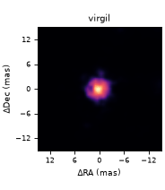

χ²/N 0.76 against the quoted errors (V² 0.948, closure phase 0.478); error scale 0.91; member m7 (no star), 8/8 kept.

### 2008 Bet_Vic J

imaged no truth AGN.

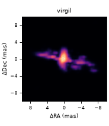

χ²/N 0.767 against the quoted errors (V² 0.884, closure phase 0.591); error scale 0.94; member m5 (no star), 8/8 kept.

### 2008 Bet_Vic H

imaged no truth AGN.

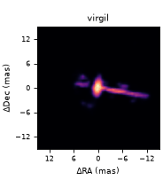

χ²/N 0.782 against the quoted errors (V² 0.942, closure phase 0.543); error scale 0.94; member m0 (star), 8/8 kept.

### 2008 Bet_Vic K

imaged no truth AGN.

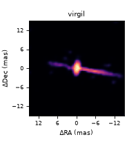

χ²/N 0.775 against the quoted errors (V² 0.931, closure phase 0.541); error scale 0.95; member m4 (star), 8/8 kept.

Paper: [2008SPIE.7013E..1NC](https://ui.adsabs.harvard.edu/abs/2008SPIE.7013E..1NC/abstract); winner: MiRA (Thiebaut).

## 2010: VLTI/AMBER, simulated, polychromatic

### 2010 Mystery, low resolution, H

failed fit (s > 2) no truth red-supergiant surface (CO5BOLD) with a faint companion at 84 mas.

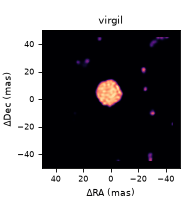

χ²/N 2.52e+03 against the quoted errors (V² 1.82e+03, closure phase 4.63e+03); error scale 52.00; member m4 (star), 6/6 kept. Paper figures: truth, Fig. 4 (lower left (Low Res H)); winner BSMEM (Baron), Fig. 5 (lower left (Low Res H)).

### 2010 Mystery, low resolution, K

failed fit (s > 2) no truth red-supergiant surface (CO5BOLD) with a faint companion at 84 mas.

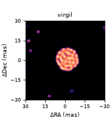

χ²/N 3.77e+03 against the quoted errors (V² 3.21e+03, closure phase 5.43e+03); error scale 62.55; member m2 (star), 7/8 kept. Paper figures: truth, Fig. 4 (lower right (Low Res K)); winner BSMEM (Baron), Fig. 5 (lower right (Low Res K)).

### 2010 Mystery, medium resolution, H

not imaged no truth the same, AMBER medium resolution with differential phases.

Paper figures: truth, Fig. 4 (upper left (Med Res H)); winner BSMEM (Baron), Fig. 5 (upper left (Med Res H)).

Paper: [2010SPIE.7734E..2NM](https://ui.adsabs.harvard.edu/abs/2010SPIE.7734E..2NM/abstract); [arXiv:1007.4473](https://arxiv.org/abs/1007.4473); winner: BSMEM (Baron).

## 2012: CHARA/MIRC-6T, simulated, H

### 2012 Alp_Fak

not imaged no truth T Tauri star and disk (TORUS).

Truth listed on OLBIN but never archived. Paper figures: truth, Fig. 1 (left (Alp Fak)); winner MACIM (Monnier), Fig. 3 (middle row, right (Monnier, MACIM)).

### 2012 Bet_Fak

not imaged no truth spotted red supergiant.

Truth listed on OLBIN but never archived. Paper figures: truth, Fig. 1 (right (Bet Fak)); winner MACIM (Monnier), Fig. 4 (middle row, right (Monnier, MACIM)).

Paper: [2012SPIE.8445E..1EB](https://ui.adsabs.harvard.edu/abs/2012SPIE.8445E..1EB/abstract); [arXiv:1207.7141](https://arxiv.org/abs/1207.7141); winner: MACIM (Monnier).

## 2014: VLTI/PIONIER, real data, H

### 2014 VY CMa

not imaged no truth red supergiant.

Real data: compared with the published consensus image.

### 2014 R Car

not imaged no truth Mira.

Real data; waits for a virgil reader fix.

Paper: [2014SPIE.9146E..1QM](https://ui.adsabs.harvard.edu/abs/2014SPIE.9146E..1QM/abstract); winner: Joel Sanchez-Bermudez (BSMEM; IAA-CSIC).

## 2016: VLTI GRAVITY and MATISSE, simulated, chromatic

### 2016 Object1 (GRAVITY)

not imaged no truth chromatic object with an OI_FLUX spectrum.

### 2016 Object2 (MATISSE N)

not imaged no truth protoplanetary disk with one gap.

Paper: [2016SPIE.9907E..1DS](https://ui.adsabs.harvard.edu/abs/2016SPIE.9907E..1DS/abstract); winner: Karl-Heinz Hofmann and the MPIfR group (probably IRBis).

## 2018: CHARA/MIRC and VLTI/PIONIER, simulated, grey

### 2018 star, disk and planet

imaged truth partial 0.4 mas star (65%), inner disk with a bright rim (29%), planet at 3.75 mas PA 27° (2%), outer disk to 20 mas.

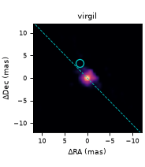

χ²/N 1.13 against the quoted errors (V² 1.52, closure phase 0.639); error scale 1.11; member m2 (star), 8/8 kept. The published truth omits the ring radii, so only the planet (circle) and the disk's major-axis PA 44.2° (dashed) are drawn on our image.

Paper: [2018SPIE10701E..1UM](https://ui.adsabs.harvard.edu/abs/2018SPIE10701E..1UM/abstract); winner: Sanchez-Bermudez, Alberdi & Schodel (SQUEEZE, then BSMEM).

## 2022: VLTI/GRAVITY and JWST/NIRISS AMI, simulated

### 2022 Obj1 (GRAVITY K)

imaged no truth high-contrast test.

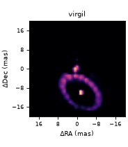

χ²/N 1.14 against the quoted errors (V² 1.12, closure phase 1.18); error scale 1.13; member m6 (star), 2/8 kept.

### 2022 Obj2 (NIRISS AMI)

imaged no truth high-contrast test.

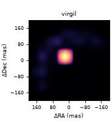

χ²/N 0.106 against the quoted errors (V² 0.179, closure phase 0.00475); error scale 1.05; member m7 (no star), 5/8 kept.

Paper: [2022SPIE12183E..1GS](https://ui.adsabs.harvard.edu/abs/2022SPIE12183E..1GS/abstract); winner: John Young (BSMEM); honourable mention Jacques Kluska.

## 2024: VLTI PIONIER, GRAVITY and MATISSE, simulated, grey reconstructions

### 2024 Obj1 PIONIER H

imaged no truth Wolf-Rayet pinwheel spiral.

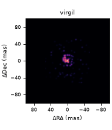

χ²/N 1.04 against the quoted errors (V² 0.987, closure phase 1.12); error scale 1.04; member m2 (star), 8/8 kept. Paper figures: truth, Fig. 2 (1 of 4, 1.30 um); winner MiRA (J. Drevon), Fig. 6 (top row, 1 of 4, 1.58 um).

### 2024 Obj1 GRAVITY K

imaged no truth Wolf-Rayet pinwheel spiral.

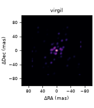

χ²/N 0.981 against the quoted errors (V² 1.03, closure phase 0.81); error scale 1.03; member m2 (star), 8/8 kept. Paper figures: truth, Fig. 2 (2 of 4, 2.20 um); winner MiRA (J. Drevon), Fig. 6 (top row, 2 of 4, 2.19 um).

### 2024 Obj1 MATISSE L

imaged no truth Wolf-Rayet pinwheel spiral.

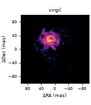

χ²/N 0.35 against the quoted errors (V² 0.012, closure phase 1.08); error scale 0.60; member m0 (star), 8/8 kept. Paper figures: truth, Fig. 2 (3 of 4, 4.00 um); winner MiRA (J. Drevon), Fig. 6 (top row, 3 of 4, 2.99 um).

### 2024 Obj1 MATISSE N

imaged no truth Wolf-Rayet pinwheel spiral.

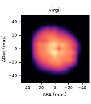

χ²/N 0.117 against the quoted errors (V² 0.00534, closure phase 0.486); error scale 0.34; member m0 (star), 8/8 kept. Paper figures: truth, Fig. 2 (4 of 4, 10.50 um); winner MiRA (J. Drevon), Fig. 6 (top row, 4 of 4, 10.48 um).

### 2024 Obj2 PIONIER H

imaged no truth Herbig disk with rings, gaps and planets.

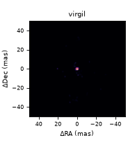

χ²/N 1.71 against the quoted errors (V² 2.18, closure phase 0.766); error scale 1.35; member m4 (star), 8/8 kept. Paper figures: truth, Fig. 4 (1 of 4, 1.61 um); winner MiRA (J. Drevon), Fig. 7 (top row, 1 of 4, 1.63 um).

### 2024 Obj2 GRAVITY K

failed fit (s > 2) no truth Herbig disk with rings, gaps and planets.

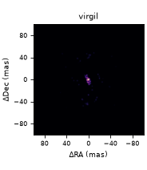

χ²/N 185 against the quoted errors (V² 271, closure phase 12.2); error scale 13.91; member m2 (star), 8/8 kept. Paper figures: truth, Fig. 4 (2 of 4, 2.22 um); winner MiRA (J. Drevon), Fig. 7 (top row, 2 of 4, 2.22 um).

### 2024 Obj2 MATISSE L

imaged no truth Herbig disk with rings, gaps and planets.

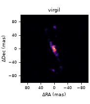

χ²/N 0.38 against the quoted errors (V² 0.0332, closure phase 1.09); error scale 0.62; member m0 (star), 8/8 kept. Paper figures: truth, Fig. 4 (3 of 4, 3.04 um); winner MiRA (J. Drevon), Fig. 7 (top row, 3 of 4, 3.01 um).

### 2024 Obj2 MATISSE N

imaged no truth Herbig disk with rings, gaps and planets.

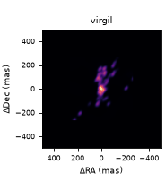

χ²/N 0.272 against the quoted errors (V² 0.0719, closure phase 0.951); error scale 0.52; member m4 (star), 8/8 kept. Paper figures: truth, Fig. 4 (4 of 4, 10.58 um); winner MiRA (J. Drevon), Fig. 7 (top row, 4 of 4, 10.53 um).

Paper: [2024SPIE13095E..14M](https://ui.adsabs.harvard.edu/abs/2024SPIE13095E..14M/abstract); [arXiv:2609.35064](https://arxiv.org/abs/2609.35064); winner: Julien Drevon (MiRA); special mention Ryan Norris (SQUEEZE + OITOOLS.jl).

## 2026: data not yet released

### 2026 K, LM and N bands

not imaged no truth globular-cluster simulation.

Truth cubes are held (J. Young), but are not shown while the contest is open.
