# Imaging contests: gallery

Every two years from 2004, the interferometry community has run a blind image-reconstruction
contest: simulated or real optical interferometer data are released without the true image,
and teams submit their reconstructions. This page runs virgil on those data and shows what it
recovers, beside the truth where we hold one.
A fit counts only as far as it reaches the data (the raw χ²/N against the quoted errors) and,
where there is a truth, its score with the contest's own metric.

**How to read the panels.** North up and East left, the `magma` colour map and one stretch,
asinh(I / 0.02 Ipeak), which keeps faint emission beside a bright central star
visible; the panels in a row share one field, holding 97% of every image's flux.

**Blind fits.** virgil 8562a39, campaign 1. Eight CLEAN-started Gaussian-process images per dataset with randomised starts, half with a central point star; members within 1.5x of the best χ²/N are kept, and the panel shows the kept member with the highest evidence. Truths are used for scoring and display only, never for fitting.

**Informed fits.** Where Ben's visual review of the blind images asked for a different model (smoother or sparser priors, a halo, point sources), those runs and the 2004 parametric ladder use knowledge of what the object is. They are badged *informed*: the method was chosen after seeing the truth or the contest page, so they are not blind reconstructions, and they are shown only where their raw χ²/N is closer to 1 than the blind fit's, or where the dataset has no blind fit.

**Captions.** The raw χ²/N against the quoted errors comes first; the error scale is the
factor that brings it to 1, and a fit with a scale above 2 is marked failed.
The images were made before virgil's field and beam scaling change (virgil#361, in the current pin); a rerun may change them.

**Paper figures.** The contest papers' truth panels and entries are cited, not shown: no copy
we found carries a licence that allows republication. See the
[scoring sources](contest_scoring_sources.md) and the [plan](plan_imaging_contests.md).

## Where we stand

22 of 30 datasets are imaged blind; 18 of those fit the quoted errors (error scale at most 2) and 4 fail. A fit that reaches the data is not yet a good image: the visual review under each dataset notes where the recovery breaks up (chains of dots, blobs).

| Contest | Dataset | Blind raw χ²/N | Blind | Informed raw χ²/N |
|---|---|---|---|---|
| 2004 | data1 | 0.893 | fits | – |
| 2004 | data2 | 20.7 | failed | 20.5 (advice-seeded), 0.985 (parametric ladder) |
| 2006 | MIR0001 | 0.899 | fits | 1 (advice-seeded) |
| 2008 | Alp_Vic J | 0.69 | fits | – |
| 2008 | Alp_Vic H | 0.724 | fits | 0.73 (advice-seeded) |
| 2008 | Alp_Vic K | 0.76 | fits | – |
| 2008 | Bet_Vic J | 0.767 | fits | 0.897 (advice-seeded) |
| 2008 | Bet_Vic H | 0.782 | fits | – |
| 2008 | Bet_Vic K | 0.775 | fits | – |
| 2010 | Mystery, low resolution, H | 2.52e+03 | failed | – |
| 2010 | Mystery, low resolution, K | 3.77e+03 | failed | – |
| 2010 | Mystery, medium resolution, H | – | not imaged blind | – |
| 2012 | Alp_Fak | – | not imaged blind | 3.06 (advice-seeded) |
| 2012 | Bet_Fak | – | not imaged blind | 0.997 (advice-seeded) |
| 2014 | VY CMa | – | not imaged blind | 1.76 (advice-seeded) |
| 2014 | R Car | – | not imaged blind | – |
| 2016 | Object1 (GRAVITY) | – | not imaged blind | 96.5 (advice-seeded) |
| 2016 | Object2 (MATISSE N) | – | not imaged blind | – |
| 2018 | star, disk and planet | 1.13 | fits | 1.04 (advice-seeded) |
| 2022 | Obj1 (GRAVITY K) | 1.14 | fits | 0.934 (advice-seeded) |
| 2022 | Obj2 (NIRISS AMI) | 0.106 | fits, χ²/N below 0.5 | – |
| 2024 | Obj1 PIONIER H | 1.04 | fits | 1.01 (advice-seeded) |
| 2024 | Obj1 GRAVITY K | 0.981 | fits | – |
| 2024 | Obj1 MATISSE L | 0.35 | fits, χ²/N below 0.5 | 0.51 (advice-seeded) |
| 2024 | Obj1 MATISSE N | 0.117 | fits, χ²/N below 0.5 | – |
| 2024 | Obj2 PIONIER H | 1.71 | fits | – |
| 2024 | Obj2 GRAVITY K | 185 | failed | – |
| 2024 | Obj2 MATISSE L | 0.38 | fits, χ²/N below 0.5 | – |
| 2024 | Obj2 MATISSE N | 0.272 | fits, χ²/N below 0.5 | – |
| 2026 | K, LM and N bands | – | not imaged blind | – |

## 2004: NPOI, simulated, 550 nm

### 2004 data1

imaged no truth LkHα 101 model (star in an asymmetric shell), image by P. Tuthill.

<figure class="cg-card cg-ours"><a href="assets/contests/2004_data1_virgil.png">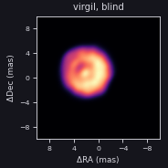</a><figcaption>virgil, blind</figcaption></figure>
<figure class="cg-card cg-cite">
<a href="https://ui.adsabs.harvard.edu/abs/2004SPIE.5491..886L/abstract">Fig. 1</a> left (source image, Data Set 1)
<figcaption>truth, Fig. 1 (left (source image, Data Set 1))</figcaption></figure>
<figure class="cg-card cg-cite">
<a href="https://ui.adsabs.harvard.edu/abs/2004SPIE.5491..886L/abstract">Fig. 8</a> upper right (Data 1 Model: Greyscale Plot)
<figcaption>truth, Fig. 8 (upper right (Data 1 Model: Greyscale Plot))</figcaption></figure>
<figure class="cg-card cg-cite">
<a href="https://ui.adsabs.harvard.edu/abs/2004SPIE.5491..886L/abstract">Fig. 3</a> left (Data Set 1)
<figcaption>winner BSMEM (Thorsteinsson &amp; Young), Fig. 3 (left (Data Set 1))</figcaption></figure>

Blind: χ²/N 0.893 against the quoted errors (V² 0.92, closure phase 0.853); error scale 1.05; member m6 (star), 8/8 kept. 1 informed run (advice-seeded, f643e07) came no closer to 1 than the blind fit. The informed parametric ladder does not reach this data set: its best rung (elliptical LD + 2 spots + companion) has raw χ²/N 24.1.

Visual review (2026-10-12)
This is already fairly good, though it is off-centre.

### 2004 data2

failed fit (s > 2) informed fit, not blind informed fit, not blind truth rebuilt binary: limb-darkened elliptical disk with a spot, and a 0.5 mas companion 10 mas east.

<figure class="cg-card cg-ours"><a href="assets/contests/2004_data2_virgil.png">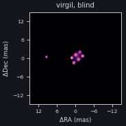</a><figcaption>virgil, blind</figcaption></figure>
<figure class="cg-card cg-ours"><a href="assets/contests/2004_data2_informed.png">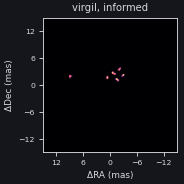</a><figcaption>virgil, informed (gp point-gauss halo-image)</figcaption></figure>
<figure class="cg-card cg-ours"><a href="assets/contests/2004_data2_ladder.png">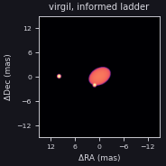</a><figcaption>virgil, informed parametric ladder (elliptical LD + spot + companion)</figcaption></figure>
<figure class="cg-card cg-ours"><a href="assets/contests/2004_data2_truth.png">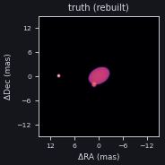</a><figcaption>truth, rebuilt from the paper&#x27;s model</figcaption></figure>
<figure class="cg-card cg-cite">
<a href="https://ui.adsabs.harvard.edu/abs/2004SPIE.5491..886L/abstract">Fig. 9</a> upper right (Data 2 Model: Greyscale Plot)
<figcaption>truth, Fig. 9 (upper right (Data 2 Model: Greyscale Plot))</figcaption></figure>
<figure class="cg-card cg-cite">
<a href="https://ui.adsabs.harvard.edu/abs/2004SPIE.5491..886L/abstract">Fig. 3</a> right (Data Set 2)
<figcaption>winner BSMEM (Thorsteinsson &amp; Young), Fig. 3 (right (Data Set 2))</figcaption></figure>

Blind: χ²/N 20.7 against the quoted errors (V² 30.6, closure phase 5.85); error scale 4.65; member m1 (no star), 4/8 kept. σ/peak 0.234 against the rebuilt truth (Lawson et al. 2004, Eq. 2; lower is better). Informed (gp point-gauss halo-image): raw χ²/N 20.5 (V² 30.3, closure phase 5.78); closer to 1 than the blind fit&#x27;s 20.7. Failed (error scale above 2). Its method was chosen after seeing the truth or the contest page, so it is not a blind result. Informed parametric ladder (elliptical LD + spot + companion): raw χ²/N 0.985 (V² 0.968, closure phase 1.01). σ/peak 0.180 against the rebuilt truth (informed; the blind fit&#x27;s is 0.234). Published σ/peak: BSMEM 0.116, WISARD 0.163, MIRA 0.532, VLBMEM 0.798.

Visual review (2026-10-12)
The virgil fit has broken up into a chain of dots. This is indicating a problem with regularization perhaps. The real data consist of a dot (which we correctly recover) at about (5, 0), and a large faint ellipse (broken up into a chain of dots in our recovery) with a small circle overlapping its edge. Consider TV as an optimal regularizer for this sort of piecewise constant data, and whether the smaller dots should be point sources.

Paper: <a href="https://ui.adsabs.harvard.edu/abs/2004SPIE.5491..886L/abstract">2004SPIE.5491..886L</a>; winner: BSMEM (Thorsteinsson &amp; Young, Cambridge).

## 2006: VLTI/AMBER, simulated, grey

### 2006 MIR0001

imaged informed fit, not blind no truth thin-disk model by O. Chesneau.

<figure class="cg-card cg-ours"><a href="assets/contests/2006_disk_virgil.png">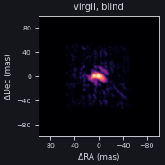</a><figcaption>virgil, blind</figcaption></figure>
<figure class="cg-card cg-ours"><a href="assets/contests/2006_disk_informed.png">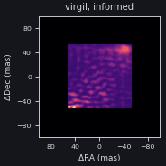</a><figcaption>virgil, informed (gp2)</figcaption></figure>
<figure class="cg-card cg-cite">
<a href="https://ui.adsabs.harvard.edu/abs/2006SPIE.6268E..1UL/abstract">Fig. 1</a> left (greyscale)
<figcaption>truth, Fig. 1 (left (greyscale))</figcaption></figure>
<figure class="cg-card cg-cite">
<a href="https://ui.adsabs.harvard.edu/abs/2006SPIE.6268E..1UL/abstract">Fig. 4</a> single panel (contours over greyscale residuals)
<figcaption>winner BSMEM (Baron &amp; Young), Fig. 4 (single panel (contours over greyscale residuals))</figcaption></figure>

Blind: χ²/N 0.899 against the quoted errors (V² 1.04, closure phase 0.508); error scale 1.07; member m0 (star), 8/8 kept. Informed (gp2): raw χ²/N 1 (V² 1.29, closure phase 0.974); closer to 1 than the blind fit&#x27;s 0.899. Its method was chosen after seeing the truth or the contest page, so it is not a blind result.

Visual review (2026-10-12)
This is an absolutely terrible recovery. Just dreadful. The real thing has a bright core, and flares out to the corners of a rectangle. Consider a variety of priors to solve this.

Paper: <a href="https://ui.adsabs.harvard.edu/abs/2006SPIE.6268E..1UL/abstract">2006SPIE.6268E..1UL</a>; winner: BSMEM (Baron &amp; Young).

## 2008: CHARA, simulated, J/H/K

### 2008 Alp_Vic J

imaged no truth AGB star.

<figure class="cg-card cg-ours"><a href="assets/contests/2008_agb_J_virgil.png">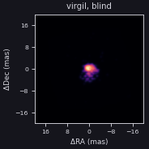</a><figcaption>virgil, blind</figcaption></figure>
<figure class="cg-card cg-cite">
<a href="https://ui.adsabs.harvard.edu/abs/2008SPIE.7013E..1NC/abstract">Fig. 3</a> left column (AGB model), J band
<figcaption>truth, Fig. 3 (left column (AGB model), J band)</figcaption></figure>
<figure class="cg-card cg-cite">
<a href="https://ui.adsabs.harvard.edu/abs/2008SPIE.7013E..1NC/abstract">Fig. 8</a> left column (AGB model), J band
<figcaption>winner MiRA (Thiébaut), Fig. 8 (left column (AGB model), J band)</figcaption></figure>

Blind: χ²/N 0.69 against the quoted errors (V² 0.87, closure phase 0.419); error scale 0.87; member m6 (star), 8/8 kept. 2 informed runs (advice-seeded, f643e07) came no closer to 1 than the blind fit.

Visual review (2026-10-12)
The real thing is a circle embedded in a broader halo. The virgil recovery is terrible and blobby; consider a uniform disk with a halo, or consider a two-component image fit with different scales.

### 2008 Alp_Vic H

imaged informed fit, not blind no truth AGB star.

<figure class="cg-card cg-ours"><a href="assets/contests/2008_agb_H_virgil.png">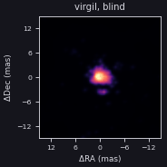</a><figcaption>virgil, blind</figcaption></figure>
<figure class="cg-card cg-ours"><a href="assets/contests/2008_agb_H_informed.png">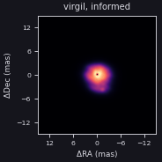</a><figcaption>virgil, informed (gp ud-gauss halo-image)</figcaption></figure>
<figure class="cg-card cg-cite">
<a href="https://ui.adsabs.harvard.edu/abs/2008SPIE.7013E..1NC/abstract">Fig. 3</a> left column (AGB model), H band
<figcaption>truth, Fig. 3 (left column (AGB model), H band)</figcaption></figure>
<figure class="cg-card cg-cite">
<a href="https://ui.adsabs.harvard.edu/abs/2008SPIE.7013E..1NC/abstract">Fig. 8</a> left column (AGB model), H band
<figcaption>winner MiRA (Thiébaut), Fig. 8 (left column (AGB model), H band)</figcaption></figure>

Blind: χ²/N 0.724 against the quoted errors (V² 0.844, closure phase 0.543); error scale 0.88; member m2 (star), 8/8 kept. Informed (gp ud-gauss halo-image): raw χ²/N 0.73 (V² 0.855, closure phase 0.541); closer to 1 than the blind fit&#x27;s 0.724. Its method was chosen after seeing the truth or the contest page, so it is not a blind result.

Visual review (2026-10-12)
The real thing is a circle embedded in a broader halo. The virgil recovery is terrible and blobby; consider a uniform disk with a halo, or consider a two-component image fit with different scales.

### 2008 Alp_Vic K

imaged no truth AGB star.

<figure class="cg-card cg-ours"><a href="assets/contests/2008_agb_K_virgil.png">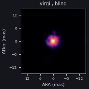</a><figcaption>virgil, blind</figcaption></figure>
<figure class="cg-card cg-cite">
<a href="https://ui.adsabs.harvard.edu/abs/2008SPIE.7013E..1NC/abstract">Fig. 3</a> left column (AGB model), K band
<figcaption>truth, Fig. 3 (left column (AGB model), K band)</figcaption></figure>
<figure class="cg-card cg-cite">
<a href="https://ui.adsabs.harvard.edu/abs/2008SPIE.7013E..1NC/abstract">Fig. 8</a> left column (AGB model), K band
<figcaption>winner MiRA (Thiébaut), Fig. 8 (left column (AGB model), K band)</figcaption></figure>

Blind: χ²/N 0.76 against the quoted errors (V² 0.948, closure phase 0.478); error scale 0.91; member m7 (no star), 8/8 kept. 2 informed runs (advice-seeded, f643e07) came no closer to 1 than the blind fit.

Visual review (2026-10-12)
The real thing is a circle embedded in a broader halo. The virgil recovery is terrible and blobby; consider a uniform disk with a halo, or consider a two-component image fit with different scales.

### 2008 Bet_Vic J

imaged informed fit, not blind no truth AGN.

<figure class="cg-card cg-ours"><a href="assets/contests/2008_agn_J_virgil.png">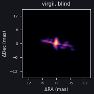</a><figcaption>virgil, blind</figcaption></figure>
<figure class="cg-card cg-ours"><a href="assets/contests/2008_agn_J_informed.png">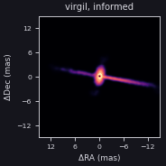</a><figcaption>virgil, informed (gp sparco)</figcaption></figure>
<figure class="cg-card cg-cite">
<a href="https://ui.adsabs.harvard.edu/abs/2008SPIE.7013E..1NC/abstract">Fig. 3</a> right column (AGN model), J band
<figcaption>truth, Fig. 3 (right column (AGN model), J band)</figcaption></figure>
<figure class="cg-card cg-cite">
<a href="https://ui.adsabs.harvard.edu/abs/2008SPIE.7013E..1NC/abstract">Fig. 8</a> right column (AGN model), J band
<figcaption>winner MiRA (Thiébaut), Fig. 8 (right column (AGN model), J band)</figcaption></figure>

Blind: χ²/N 0.767 against the quoted errors (V² 0.884, closure phase 0.591); error scale 0.94; member m5 (no star), 8/8 kept. Informed (gp sparco): raw χ²/N 0.897 (V² 1.07, closure phase 0.734); closer to 1 than the blind fit&#x27;s 0.767. Its method was chosen after seeing the truth or the contest page, so it is not a blind result.

Visual review (2026-10-12)
We want to fit all three bands simultaneously with a SPARCO approach. The image consists of an anisotropic blob in the middle with two thin jets coming out; the virgil recovery in K band is good but not the other bands, where the jets are broken into blobs.

### 2008 Bet_Vic H

imaged no truth AGN.

<figure class="cg-card cg-ours"><a href="assets/contests/2008_agn_H_virgil.png">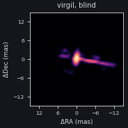</a><figcaption>virgil, blind</figcaption></figure>
<figure class="cg-card cg-cite">
<a href="https://ui.adsabs.harvard.edu/abs/2008SPIE.7013E..1NC/abstract">Fig. 3</a> right column (AGN model), H band
<figcaption>truth, Fig. 3 (right column (AGN model), H band)</figcaption></figure>
<figure class="cg-card cg-cite">
<a href="https://ui.adsabs.harvard.edu/abs/2008SPIE.7013E..1NC/abstract">Fig. 8</a> right column (AGN model), H band
<figcaption>winner MiRA (Thiébaut), Fig. 8 (right column (AGN model), H band)</figcaption></figure>

Blind: χ²/N 0.782 against the quoted errors (V² 0.942, closure phase 0.543); error scale 0.94; member m0 (star), 8/8 kept.

Visual review (2026-10-12)
We want to fit all three bands simultaneously with a SPARCO approach. The image consists of an anisotropic blob in the middle with two thin jets coming out; the virgil recovery in K band is good but not the other bands, where the jets are broken into blobs.

### 2008 Bet_Vic K

imaged no truth AGN.

<figure class="cg-card cg-ours"><a href="assets/contests/2008_agn_K_virgil.png">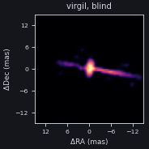</a><figcaption>virgil, blind</figcaption></figure>
<figure class="cg-card cg-cite">
<a href="https://ui.adsabs.harvard.edu/abs/2008SPIE.7013E..1NC/abstract">Fig. 3</a> right column (AGN model), K band
<figcaption>truth, Fig. 3 (right column (AGN model), K band)</figcaption></figure>
<figure class="cg-card cg-cite">
<a href="https://ui.adsabs.harvard.edu/abs/2008SPIE.7013E..1NC/abstract">Fig. 8</a> right column (AGN model), K band
<figcaption>winner MiRA (Thiébaut), Fig. 8 (right column (AGN model), K band)</figcaption></figure>

Blind: χ²/N 0.775 against the quoted errors (V² 0.931, closure phase 0.541); error scale 0.95; member m4 (star), 8/8 kept.

Visual review (2026-10-12)
We want to fit all three bands simultaneously with a SPARCO approach. The image consists of an anisotropic blob in the middle with two thin jets coming out; the virgil recovery in K band is good but not the other bands, where the jets are broken into blobs.

Paper: <a href="https://ui.adsabs.harvard.edu/abs/2008SPIE.7013E..1NC/abstract">2008SPIE.7013E..1NC</a>; winner: MiRA (Thiebaut).

## 2010: VLTI/AMBER, simulated, polychromatic

### 2010 Mystery, low resolution, H

failed fit (s > 2) no truth red-supergiant surface (CO5BOLD) with a faint companion at 84 mas.

<figure class="cg-card cg-ours"><a href="assets/contests/2010_lowH_virgil.png">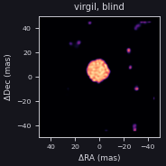</a><figcaption>virgil, blind</figcaption></figure>
<figure class="cg-card cg-cite">
<a href="https://ui.adsabs.harvard.edu/abs/2010SPIE.7734E..2NM/abstract">Fig. 4</a> lower left (Low Res H)
<figcaption>truth, Fig. 4 (lower left (Low Res H))</figcaption></figure>
<figure class="cg-card cg-cite">
<a href="https://ui.adsabs.harvard.edu/abs/2010SPIE.7734E..2NM/abstract">Fig. 5</a> lower left (Low Res H)
<figcaption>winner BSMEM (Baron), Fig. 5 (lower left (Low Res H))</figcaption></figure>

Blind: χ²/N 2.52e+03 against the quoted errors (V² 1.82e+03, closure phase 4.63e+03); error scale 52.00; member m4 (star), 6/6 kept. 3 informed runs (advice-seeded, f643e07) came no closer to 1 than the blind fit.

Visual review (2026-10-12)
This is actually a pretty good recovery in general of the central object but there are chains of dots throughout the FOV. Consider whether we can iteratively remove these, or whether we can just fit a smaller FOV of 20x20 mas.

### 2010 Mystery, low resolution, K

failed fit (s > 2) no truth red-supergiant surface (CO5BOLD) with a faint companion at 84 mas.

<figure class="cg-card cg-ours"><a href="assets/contests/2010_lowK_virgil.png">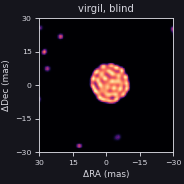</a><figcaption>virgil, blind</figcaption></figure>
<figure class="cg-card cg-cite">
<a href="https://ui.adsabs.harvard.edu/abs/2010SPIE.7734E..2NM/abstract">Fig. 4</a> lower right (Low Res K)
<figcaption>truth, Fig. 4 (lower right (Low Res K))</figcaption></figure>
<figure class="cg-card cg-cite">
<a href="https://ui.adsabs.harvard.edu/abs/2010SPIE.7734E..2NM/abstract">Fig. 5</a> lower right (Low Res K)
<figcaption>winner BSMEM (Baron), Fig. 5 (lower right (Low Res K))</figcaption></figure>

Blind: χ²/N 3.77e+03 against the quoted errors (V² 3.21e+03, closure phase 5.43e+03); error scale 62.55; member m2 (star), 7/8 kept. 3 informed runs (advice-seeded, f643e07) came no closer to 1 than the blind fit.

Visual review (2026-10-12)
This is actually a pretty good recovery in general of the central object but there are chains of dots throughout the FOV. Consider whether we can iteratively remove these, or whether we can just fit a smaller FOV of 20x20 mas.

### 2010 Mystery, medium resolution, H

not imaged no truth the same, AMBER medium resolution with differential phases.

<figure class="cg-card cg-empty">
Not imaged yet
<figcaption>virgil</figcaption></figure>
<figure class="cg-card cg-cite">
<a href="https://ui.adsabs.harvard.edu/abs/2010SPIE.7734E..2NM/abstract">Fig. 4</a> upper left (Med Res H)
<figcaption>truth, Fig. 4 (upper left (Med Res H))</figcaption></figure>
<figure class="cg-card cg-cite">
<a href="https://ui.adsabs.harvard.edu/abs/2010SPIE.7734E..2NM/abstract">Fig. 5</a> upper left (Med Res H)
<figcaption>winner BSMEM (Baron), Fig. 5 (upper left (Med Res H))</figcaption></figure>

Visual review (2026-10-12)
Is this a duplicate of the other H band?

Paper: <a href="https://ui.adsabs.harvard.edu/abs/2010SPIE.7734E..2NM/abstract">2010SPIE.7734E..2NM</a>; <a href="https://arxiv.org/abs/1007.4473">arXiv:1007.4473</a>; winner: BSMEM (Baron).

## 2012: CHARA/MIRC-6T, simulated, H

### 2012 Alp_Fak

not imaged blind informed fit, not blind no truth T Tauri star and disk (TORUS).

<figure class="cg-card cg-ours"><a href="assets/contests/2012_alp_informed.png">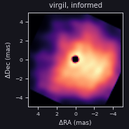</a><figcaption>virgil, informed (gp point-image)</figcaption></figure>
<figure class="cg-card cg-cite">
<a href="https://ui.adsabs.harvard.edu/abs/2012SPIE.8445E..1EB/abstract">Fig. 1</a> left (Alp Fak)
<figcaption>truth, Fig. 1 (left (Alp Fak))</figcaption></figure>
<figure class="cg-card cg-cite">
<a href="https://ui.adsabs.harvard.edu/abs/2012SPIE.8445E..1EB/abstract">Fig. 3</a> middle row, right (Monnier, MACIM)
<figcaption>winner MACIM (Monnier), Fig. 3 (middle row, right (Monnier, MACIM))</figcaption></figure>

Informed (gp point-image): raw χ²/N 3.06 (V² 2.13, closure phase 4.47). Its method was chosen after seeing the truth or the contest page, so it is not a blind result. Truth listed on OLBIN but never archived.

Visual review (2026-10-12)
Two bright stripes at the side, parallel to each other, and a bright core.

### 2012 Bet_Fak

not imaged blind informed fit, not blind no truth spotted red supergiant.

<figure class="cg-card cg-ours"><a href="assets/contests/2012_bet_informed.png">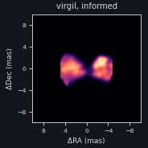</a><figcaption>virgil, informed (gp)</figcaption></figure>
<figure class="cg-card cg-cite">
<a href="https://ui.adsabs.harvard.edu/abs/2012SPIE.8445E..1EB/abstract">Fig. 1</a> right (Bet Fak)
<figcaption>truth, Fig. 1 (right (Bet Fak))</figcaption></figure>
<figure class="cg-card cg-cite">
<a href="https://ui.adsabs.harvard.edu/abs/2012SPIE.8445E..1EB/abstract">Fig. 4</a> middle row, right (Monnier, MACIM)
<figcaption>winner MACIM (Monnier), Fig. 4 (middle row, right (Monnier, MACIM))</figcaption></figure>

Informed (gp): raw χ²/N 0.997 (V² 1.17, closure phase 0.735). Its method was chosen after seeing the truth or the contest page, so it is not a blind result. Truth listed on OLBIN but never archived.

Visual review (2026-10-12)
Spotted star, use harmonix and compare it to a TV regularization.

Paper: <a href="https://ui.adsabs.harvard.edu/abs/2012SPIE.8445E..1EB/abstract">2012SPIE.8445E..1EB</a>; <a href="https://arxiv.org/abs/1207.7141">arXiv:1207.7141</a>; winner: MACIM (Monnier).

## 2014: VLTI/PIONIER, real data, H

### 2014 VY CMa

not imaged blind informed fit, not blind no truth red supergiant.

<figure class="cg-card cg-ours"><a href="assets/contests/2014_vycma_informed.png">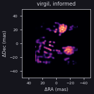</a><figcaption>virgil, informed (gp)</figcaption></figure>
<figure class="cg-card cg-cite">
<a href="https://ui.adsabs.harvard.edu/abs/2014SPIE.9146E..1QM/abstract">Fig. 5</a> Sanchez/BSMEM, 1.61 um
<figcaption>winner BSMEM (Sanchez-Bermudez et al.), Fig. 5 (Sanchez/BSMEM, 1.61 um)</figcaption></figure>
<figure class="cg-card cg-cite">
<a href="https://ui.adsabs.harvard.edu/abs/2014SPIE.9146E..1QM/abstract">Fig. 5</a> Sanchez/BSMEM, 1.67 um
<figcaption>winner BSMEM (Sanchez-Bermudez et al.), Fig. 5 (Sanchez/BSMEM, 1.67 um)</figcaption></figure>
<figure class="cg-card cg-cite">
<a href="https://ui.adsabs.harvard.edu/abs/2014SPIE.9146E..1QM/abstract">Fig. 5</a> Sanchez/BSMEM, 1.73 um
<figcaption>winner BSMEM (Sanchez-Bermudez et al.), Fig. 5 (Sanchez/BSMEM, 1.73 um)</figcaption></figure>
<figure class="cg-card cg-cite">
<a href="https://ui.adsabs.harvard.edu/abs/2014SPIE.9146E..1QM/abstract">Fig. 8</a> VY CMa median image, 1.61 um
<figcaption>entry median of entries, Fig. 8 (VY CMa median image, 1.61 um)</figcaption></figure>
<figure class="cg-card cg-cite">
<a href="https://ui.adsabs.harvard.edu/abs/2014SPIE.9146E..1QM/abstract">Fig. 8</a> VY CMa median image, 1.67 um
<figcaption>entry median of entries, Fig. 8 (VY CMa median image, 1.67 um)</figcaption></figure>
<figure class="cg-card cg-cite">
<a href="https://ui.adsabs.harvard.edu/abs/2014SPIE.9146E..1QM/abstract">Fig. 8</a> VY CMa median image, 1.73 um
<figcaption>entry median of entries, Fig. 8 (VY CMa median image, 1.73 um)</figcaption></figure>

Informed (gp): raw χ²/N 1.76 (V² 1.97, closure phase 1.31). Its method was chosen after seeing the truth or the contest page, so it is not a blind result. Real data: compared with the published consensus image.

Visual review (2026-10-12)
Blobby thing.

### 2014 R Car

not imaged no truth Mira.

<figure class="cg-card cg-empty">
Not imaged yet
<figcaption>virgil</figcaption></figure>
<figure class="cg-card cg-cite">
<a href="https://ui.adsabs.harvard.edu/abs/2014SPIE.9146E..1QM/abstract">Fig. 6</a> Sanchez/BSMEM, 1.61 um
<figcaption>winner BSMEM (Sanchez-Bermudez et al.), Fig. 6 (Sanchez/BSMEM, 1.61 um)</figcaption></figure>
<figure class="cg-card cg-cite">
<a href="https://ui.adsabs.harvard.edu/abs/2014SPIE.9146E..1QM/abstract">Fig. 6</a> Sanchez/BSMEM, 1.67 um
<figcaption>winner BSMEM (Sanchez-Bermudez et al.), Fig. 6 (Sanchez/BSMEM, 1.67 um)</figcaption></figure>
<figure class="cg-card cg-cite">
<a href="https://ui.adsabs.harvard.edu/abs/2014SPIE.9146E..1QM/abstract">Fig. 6</a> Sanchez/BSMEM, 1.73 um
<figcaption>winner BSMEM (Sanchez-Bermudez et al.), Fig. 6 (Sanchez/BSMEM, 1.73 um)</figcaption></figure>
<figure class="cg-card cg-cite">
<a href="https://ui.adsabs.harvard.edu/abs/2014SPIE.9146E..1QM/abstract">Fig. 8</a> R Car median image, 1.61 um
<figcaption>entry median of entries, Fig. 8 (R Car median image, 1.61 um)</figcaption></figure>
<figure class="cg-card cg-cite">
<a href="https://ui.adsabs.harvard.edu/abs/2014SPIE.9146E..1QM/abstract">Fig. 8</a> R Car median image, 1.67 um
<figcaption>entry median of entries, Fig. 8 (R Car median image, 1.67 um)</figcaption></figure>
<figure class="cg-card cg-cite">
<a href="https://ui.adsabs.harvard.edu/abs/2014SPIE.9146E..1QM/abstract">Fig. 8</a> R Car median image, 1.73 um
<figcaption>entry median of entries, Fig. 8 (R Car median image, 1.73 um)</figcaption></figure>

Real data; waits for a virgil reader fix.

Visual review (2026-10-12)
Blobby thing.

Paper: <a href="https://ui.adsabs.harvard.edu/abs/2014SPIE.9146E..1QM/abstract">2014SPIE.9146E..1QM</a>; winner: Joel Sanchez-Bermudez (BSMEM; IAA-CSIC).

## 2016: VLTI GRAVITY and MATISSE, simulated, chromatic

### 2016 Object1 (GRAVITY)

not imaged blind informed fit, not blind no truth chromatic object with an OI_FLUX spectrum.

<figure class="cg-card cg-ours"><a href="assets/contests/2016_obj1_informed.png">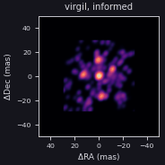</a><figcaption>virgil, informed (clean ms)</figcaption></figure>
<figure class="cg-card cg-cite">
<a href="https://ui.adsabs.harvard.edu/abs/2016SPIE.9907E..1DS/abstract">Fig. 1</a> left (Object 1, wavelength-averaged)
<figcaption>truth, Fig. 1 (left (Object 1, wavelength-averaged))</figcaption></figure>
<figure class="cg-card cg-cite">
<a href="https://ui.adsabs.harvard.edu/abs/2016SPIE.9907E..1DS/abstract">Fig. 7</a> top row, middle (Hofmann)
<figcaption>winner IRBis (Hofmann, Heininger, Schertl &amp; Weigelt, MPIfR), Fig. 7 (top row, middle (Hofmann))</figcaption></figure>

Informed (clean ms): raw χ²/N 96.5 (V² 83.4, closure phase 122). Failed (error scale above 2). Its method was chosen after seeing the truth or the contest page, so it is not a blind result.

Visual review (2026-10-12)
Field of point sources. Consider CLEAN, consider parametric models, and consider L1 regularisation.

### 2016 Object2 (MATISSE N)

not imaged no truth protoplanetary disk with one gap.

<figure class="cg-card cg-empty">
Not imaged yet
<figcaption>virgil</figcaption></figure>
<figure class="cg-card cg-cite">
<a href="https://ui.adsabs.harvard.edu/abs/2016SPIE.9907E..1DS/abstract">Fig. 2</a> left (Object 2, wavelength-averaged)
<figcaption>truth, Fig. 2 (left (Object 2, wavelength-averaged))</figcaption></figure>
<figure class="cg-card cg-cite">
<a href="https://ui.adsabs.harvard.edu/abs/2016SPIE.9907E..1DS/abstract">Fig. 9</a> top row, right (Hofmann)
<figcaption>winner IRBis (Hofmann, Heininger, Schertl &amp; Weigelt, MPIfR), Fig. 9 (top row, right (Hofmann))</figcaption></figure>

Visual review (2026-10-12)
Bright central object with rings. 

Paper: <a href="https://ui.adsabs.harvard.edu/abs/2016SPIE.9907E..1DS/abstract">2016SPIE.9907E..1DS</a>; winner: Karl-Heinz Hofmann and the MPIfR group (probably IRBis).

## 2018: CHARA/MIRC and VLTI/PIONIER, simulated, grey

### 2018 star, disk and planet

imaged informed fit, not blind truth partial 0.4 mas star (65%), inner disk with a bright rim (29%), planet at 3.75 mas PA 27° (2%), outer disk to 20 mas.

<figure class="cg-card cg-ours"><a href="assets/contests/2018_disk_virgil.png">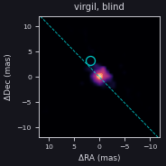</a><figcaption>virgil, blind</figcaption></figure>
<figure class="cg-card cg-ours"><a href="assets/contests/2018_disk_informed.png">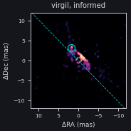</a><figcaption>virgil, informed (tv)</figcaption></figure>
<figure class="cg-card cg-cite">
<a href="https://ui.adsabs.harvard.edu/abs/2018SPIE10701E..1UM/abstract">Fig. 1</a> centre, large upper right (synthetic image)
<figcaption>truth, Fig. 1 (centre, large upper right (synthetic image))</figcaption></figure>
<figure class="cg-card cg-cite">
<a href="https://ui.adsabs.harvard.edu/abs/2018SPIE10701E..1UM/abstract">Fig. 2</a> third panel
<figcaption>winner SQUEEZE then BSMEM (Sanchez-Bermudez, Alberdi &amp; Schödel), Fig. 2 (third panel)</figcaption></figure>
<figure class="cg-card cg-cite">
<a href="https://ui.adsabs.harvard.edu/abs/2018SPIE10701E..1UM/abstract">Fig. 2</a> fourth panel
<figcaption>entry BSMEM (Young), Fig. 2 (fourth panel)</figcaption></figure>
<figure class="cg-card cg-cite">
<a href="https://ui.adsabs.harvard.edu/abs/2018SPIE10701E..1UM/abstract">Fig. 2</a> first panel
<figcaption>entry MiRA + SPARCO (Kluska), Fig. 2 (first panel)</figcaption></figure>

Blind: χ²/N 1.13 against the quoted errors (V² 1.52, closure phase 0.639); error scale 1.11; member m2 (star), 8/8 kept. Informed (tv): raw χ²/N 1.04 (V² 1.28, closure phase 0.554); closer to 1 than the blind fit&#x27;s 1.13. Its method was chosen after seeing the truth or the contest page, so it is not a blind result. The published truth omits the ring radii, so only the planet (circle) and the disk&#x27;s major-axis PA 44.2° (dashed) are drawn on our image.

Visual review (2026-10-12)
Several smooth elliptical disks with azimuthal modulation, and embedded point sources (1 in the middle and 1 in a disk gap). Consider TV and consider adding point sources. Consider CLEAN too. 

Paper: <a href="https://ui.adsabs.harvard.edu/abs/2018SPIE10701E..1UM/abstract">2018SPIE10701E..1UM</a>; winner: Sanchez-Bermudez, Alberdi &amp; Schodel (SQUEEZE, then BSMEM).

## 2022: VLTI/GRAVITY and JWST/NIRISS AMI, simulated

### 2022 Obj1 (GRAVITY K)

imaged informed fit, not blind no truth high-contrast test.

<figure class="cg-card cg-ours"><a href="assets/contests/2022_gravity_virgil.png">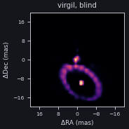</a><figcaption>virgil, blind</figcaption></figure>
<figure class="cg-card cg-ours"><a href="assets/contests/2022_gravity_informed.png">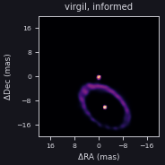</a><figcaption>virgil, informed (gp)</figcaption></figure>
<figure class="cg-card cg-cite">
<a href="https://ui.adsabs.harvard.edu/abs/2022SPIE12183E..1GS/abstract">Fig. 1</a> left (Object 1 model)
<figcaption>truth, Fig. 1 (left (Object 1 model))</figcaption></figure>
<figure class="cg-card cg-cite">
<a href="https://ui.adsabs.harvard.edu/abs/2022SPIE12183E..1GS/abstract">Fig. 5</a> first column, top row (Object No. 1)
<figcaption>winner BSMEM (John Young), Fig. 5 (first column, top row (Object No. 1))</figcaption></figure>

Blind: χ²/N 1.14 against the quoted errors (V² 1.12, closure phase 1.18); error scale 1.13; member m6 (star), 2/8 kept. Informed (gp): raw χ²/N 0.934 (V² 0.887, closure phase 1.03); closer to 1 than the blind fit&#x27;s 1.14. Its method was chosen after seeing the truth or the contest page, so it is not a blind result.

Visual review (2026-10-12)
We recover the ring and two dots pretty well but we should consider the individual dots as point sources and the ring to be smoother.

### 2022 Obj2 (NIRISS AMI)

imaged no truth high-contrast test.

<figure class="cg-card cg-ours"><a href="assets/contests/2022_ami_virgil.png">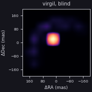</a><figcaption>virgil, blind</figcaption></figure>
<figure class="cg-card cg-cite">
<a href="https://ui.adsabs.harvard.edu/abs/2022SPIE12183E..1GS/abstract">Fig. 3</a> left (Object 2 model)
<figcaption>truth, Fig. 3 (left (Object 2 model))</figcaption></figure>
<figure class="cg-card cg-cite">
<a href="https://ui.adsabs.harvard.edu/abs/2022SPIE12183E..1GS/abstract">Fig. 5</a> first column, bottom row (Object No. 2)
<figcaption>winner BSMEM (John Young), Fig. 5 (first column, bottom row (Object No. 2))</figcaption></figure>

Blind: χ²/N 0.106 against the quoted errors (V² 0.179, closure phase 0.00475); error scale 1.05; member m7 (no star), 5/8 kept. 1 informed run (advice-seeded, f643e07) came no closer to 1 than the blind fit.

Visual review (2026-10-12)
Banana shaped thing around a dot; our recovery breaks the dot into a square and the banana into points.

Paper: <a href="https://ui.adsabs.harvard.edu/abs/2022SPIE12183E..1GS/abstract">2022SPIE12183E..1GS</a>; winner: John Young (BSMEM); honourable mention Jacques Kluska.

## 2024: VLTI PIONIER, GRAVITY and MATISSE, simulated, grey reconstructions

### 2024 Obj1 PIONIER H

imaged informed fit, not blind no truth Wolf-Rayet pinwheel spiral.

<figure class="cg-card cg-ours"><a href="assets/contests/2024_obj1_pionier_virgil.png">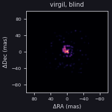</a><figcaption>virgil, blind</figcaption></figure>
<figure class="cg-card cg-ours"><a href="assets/contests/2024_obj1_pionier_informed.png">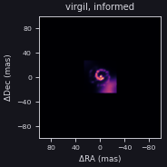</a><figcaption>virgil, informed (gp2)</figcaption></figure>
<figure class="cg-card cg-cite">
<a href="https://ui.adsabs.harvard.edu/abs/2024SPIE13095E..14M/abstract">Fig. 2</a> 1 of 4, 1.30 um
<figcaption>truth, Fig. 2 (1 of 4, 1.30 um)</figcaption></figure>
<figure class="cg-card cg-cite">
<a href="https://ui.adsabs.harvard.edu/abs/2024SPIE13095E..14M/abstract">Fig. 6</a> top row, 1 of 4, 1.58 um
<figcaption>winner MiRA (J. Drevon), Fig. 6 (top row, 1 of 4, 1.58 um)</figcaption></figure>

Blind: χ²/N 1.04 against the quoted errors (V² 0.987, closure phase 1.12); error scale 1.04; member m2 (star), 8/8 kept. Informed (gp2): raw χ²/N 1.01 (V² 0.995, closure phase 1.02); closer to 1 than the blind fit&#x27;s 1.04. Its method was chosen after seeing the truth or the contest page, so it is not a blind result.

Visual review (2026-10-12)
Spiral where we recover a bit but it&#x27;s broken up into a chain of dots.

### 2024 Obj1 GRAVITY K

imaged no truth Wolf-Rayet pinwheel spiral.

<figure class="cg-card cg-ours"><a href="assets/contests/2024_obj1_gravity_virgil.png">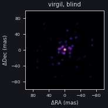</a><figcaption>virgil, blind</figcaption></figure>
<figure class="cg-card cg-cite">
<a href="https://ui.adsabs.harvard.edu/abs/2024SPIE13095E..14M/abstract">Fig. 2</a> 2 of 4, 2.20 um
<figcaption>truth, Fig. 2 (2 of 4, 2.20 um)</figcaption></figure>
<figure class="cg-card cg-cite">
<a href="https://ui.adsabs.harvard.edu/abs/2024SPIE13095E..14M/abstract">Fig. 6</a> top row, 2 of 4, 2.19 um
<figcaption>winner MiRA (J. Drevon), Fig. 6 (top row, 2 of 4, 2.19 um)</figcaption></figure>

Blind: χ²/N 0.981 against the quoted errors (V² 1.03, closure phase 0.81); error scale 1.03; member m2 (star), 8/8 kept. 3 informed runs (advice-seeded, f643e07) came no closer to 1 than the blind fit.

Visual review (2026-10-12)
Spiral where we recover it very poorly but it&#x27;s broken up into a chain of dots.

### 2024 Obj1 MATISSE L

imaged informed fit, not blind no truth Wolf-Rayet pinwheel spiral.

<figure class="cg-card cg-ours"><a href="assets/contests/2024_obj1_matisseL_virgil.png">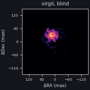</a><figcaption>virgil, blind</figcaption></figure>
<figure class="cg-card cg-ours"><a href="assets/contests/2024_obj1_matisseL_informed.png">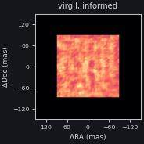</a><figcaption>virgil, informed (mem)</figcaption></figure>
<figure class="cg-card cg-cite">
<a href="https://ui.adsabs.harvard.edu/abs/2024SPIE13095E..14M/abstract">Fig. 2</a> 3 of 4, 4.00 um
<figcaption>truth, Fig. 2 (3 of 4, 4.00 um)</figcaption></figure>
<figure class="cg-card cg-cite">
<a href="https://ui.adsabs.harvard.edu/abs/2024SPIE13095E..14M/abstract">Fig. 6</a> top row, 3 of 4, 2.99 um
<figcaption>winner MiRA (J. Drevon), Fig. 6 (top row, 3 of 4, 2.99 um)</figcaption></figure>

Blind: χ²/N 0.35 against the quoted errors (V² 0.012, closure phase 1.08); error scale 0.60; member m0 (star), 8/8 kept. Informed (mem): raw χ²/N 0.51 (V² 0.317, closure phase 0.927); closer to 1 than the blind fit&#x27;s 0.35. Its method was chosen after seeing the truth or the contest page, so it is not a blind result.

Visual review (2026-10-12)
Spiral where we recover it very poorly but it&#x27;s broken up into a chain of dots.

### 2024 Obj1 MATISSE N

imaged no truth Wolf-Rayet pinwheel spiral.

<figure class="cg-card cg-ours"><a href="assets/contests/2024_obj1_matisseN_virgil.png">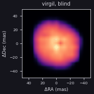</a><figcaption>virgil, blind</figcaption></figure>
<figure class="cg-card cg-cite">
<a href="https://ui.adsabs.harvard.edu/abs/2024SPIE13095E..14M/abstract">Fig. 2</a> 4 of 4, 10.50 um
<figcaption>truth, Fig. 2 (4 of 4, 10.50 um)</figcaption></figure>
<figure class="cg-card cg-cite">
<a href="https://ui.adsabs.harvard.edu/abs/2024SPIE13095E..14M/abstract">Fig. 6</a> top row, 4 of 4, 10.48 um
<figcaption>winner MiRA (J. Drevon), Fig. 6 (top row, 4 of 4, 10.48 um)</figcaption></figure>

Blind: χ²/N 0.117 against the quoted errors (V² 0.00534, closure phase 0.486); error scale 0.34; member m0 (star), 8/8 kept. 2 informed runs (advice-seeded, f643e07) came no closer to 1 than the blind fit.

Visual review (2026-10-12)
We barely recover this spiral. We shouldn&#x27;t use TV here, which I think has been used.

### 2024 Obj2 PIONIER H

imaged no truth Herbig disk with rings, gaps and planets.

<figure class="cg-card cg-ours"><a href="assets/contests/2024_obj2_pionier_virgil.png">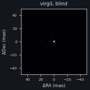</a><figcaption>virgil, blind</figcaption></figure>
<figure class="cg-card cg-cite">
<a href="https://ui.adsabs.harvard.edu/abs/2024SPIE13095E..14M/abstract">Fig. 4</a> 1 of 4, 1.61 um
<figcaption>truth, Fig. 4 (1 of 4, 1.61 um)</figcaption></figure>
<figure class="cg-card cg-cite">
<a href="https://ui.adsabs.harvard.edu/abs/2024SPIE13095E..14M/abstract">Fig. 7</a> top row, 1 of 4, 1.63 um
<figcaption>winner MiRA (J. Drevon), Fig. 7 (top row, 1 of 4, 1.63 um)</figcaption></figure>

Blind: χ²/N 1.71 against the quoted errors (V² 2.18, closure phase 0.766); error scale 1.35; member m4 (star), 8/8 kept.

Visual review (2026-10-12)
We just get a dot; we need to play with dynamic range here carefully.

### 2024 Obj2 GRAVITY K

failed fit (s > 2) no truth Herbig disk with rings, gaps and planets.

<figure class="cg-card cg-ours"><figcaption>virgil, blind</figcaption></figure>
<figure class="cg-card cg-cite">
<a href="https://ui.adsabs.harvard.edu/abs/2024SPIE13095E..14M/abstract">Fig. 4</a> 2 of 4, 2.22 um
<figcaption>truth, Fig. 4 (2 of 4, 2.22 um)</figcaption></figure>
<figure class="cg-card cg-cite">
<a href="https://ui.adsabs.harvard.edu/abs/2024SPIE13095E..14M/abstract">Fig. 7</a> top row, 2 of 4, 2.22 um
<figcaption>winner MiRA (J. Drevon), Fig. 7 (top row, 2 of 4, 2.22 um)</figcaption></figure>

Blind: χ²/N 185 against the quoted errors (V² 271, closure phase 12.2); error scale 13.91; member m2 (star), 8/8 kept.

Visual review (2026-10-12)
We just get a dot; we need to play with dynamic range here carefully.

### 2024 Obj2 MATISSE L

imaged no truth Herbig disk with rings, gaps and planets.

<figure class="cg-card cg-ours"><a href="assets/contests/2024_obj2_matisseL_virgil.png">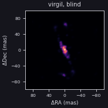</a><figcaption>virgil, blind</figcaption></figure>
<figure class="cg-card cg-cite">
<a href="https://ui.adsabs.harvard.edu/abs/2024SPIE13095E..14M/abstract">Fig. 4</a> 3 of 4, 3.04 um
<figcaption>truth, Fig. 4 (3 of 4, 3.04 um)</figcaption></figure>
<figure class="cg-card cg-cite">
<a href="https://ui.adsabs.harvard.edu/abs/2024SPIE13095E..14M/abstract">Fig. 7</a> top row, 3 of 4, 3.01 um
<figcaption>winner MiRA (J. Drevon), Fig. 7 (top row, 3 of 4, 3.01 um)</figcaption></figure>

Blind: χ²/N 0.38 against the quoted errors (V² 0.0332, closure phase 1.09); error scale 0.62; member m0 (star), 8/8 kept.

Visual review (2026-10-12)
We just get a few dots; we need to play with dynamic range here carefully.

### 2024 Obj2 MATISSE N

imaged no truth Herbig disk with rings, gaps and planets.

<figure class="cg-card cg-ours"><a href="assets/contests/2024_obj2_matisseN_virgil.png">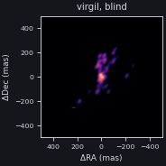</a><figcaption>virgil, blind</figcaption></figure>
<figure class="cg-card cg-cite">
<a href="https://ui.adsabs.harvard.edu/abs/2024SPIE13095E..14M/abstract">Fig. 4</a> 4 of 4, 10.58 um
<figcaption>truth, Fig. 4 (4 of 4, 10.58 um)</figcaption></figure>
<figure class="cg-card cg-cite">
<a href="https://ui.adsabs.harvard.edu/abs/2024SPIE13095E..14M/abstract">Fig. 7</a> top row, 4 of 4, 10.53 um
<figcaption>winner MiRA (J. Drevon), Fig. 7 (top row, 4 of 4, 10.53 um)</figcaption></figure>

Blind: χ²/N 0.272 against the quoted errors (V² 0.0719, closure phase 0.951); error scale 0.52; member m4 (star), 8/8 kept.

Visual review (2026-10-12)
We have a total mess. 

Paper: <a href="https://ui.adsabs.harvard.edu/abs/2024SPIE13095E..14M/abstract">2024SPIE13095E..14M</a>; <a href="https://arxiv.org/abs/2609.35064">arXiv:2609.35064</a>; winner: Julien Drevon (MiRA); special mention Ryan Norris (SQUEEZE + OITOOLS.jl).

## 2026: data not yet released

### 2026 K, LM and N bands

not imaged no truth globular-cluster simulation.

<figure class="cg-card cg-empty">
Not imaged yet
<figcaption>virgil</figcaption></figure>

Truth cubes are held (J. Young), but are not shown while the contest is open.

