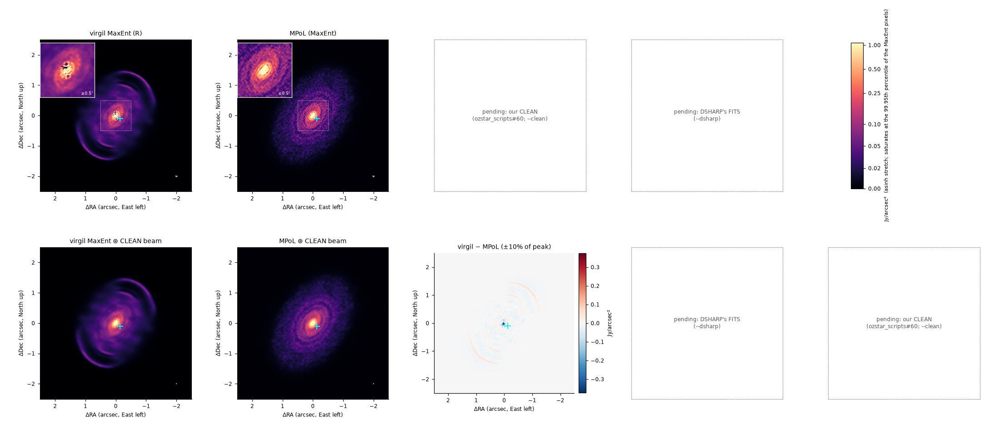
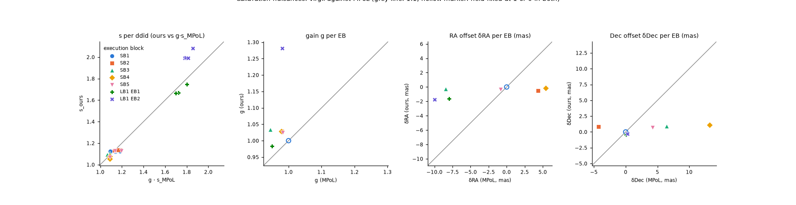
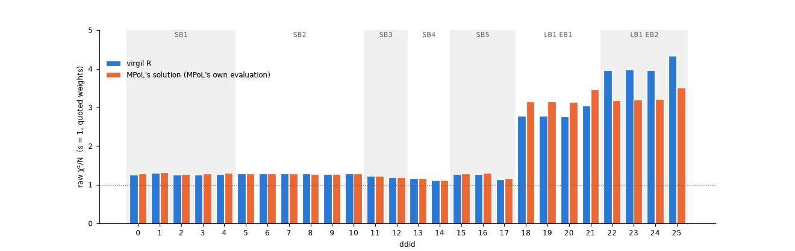
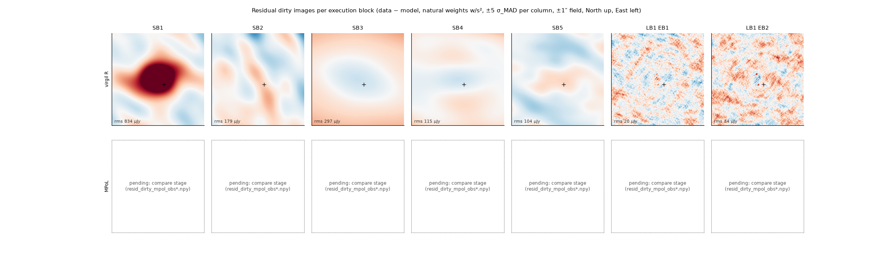
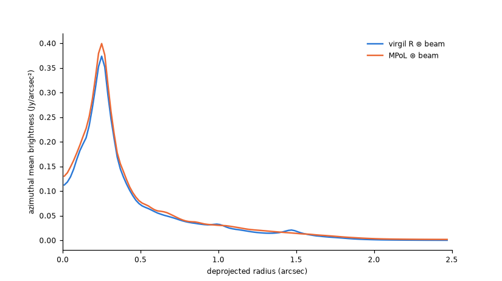

# Disc images: IM Lup, virgil against MPoL and CLEAN

IM Lup is a hard test for an imaging code: 42.4 million visibilities from seven ALMA execution blocks, a bright ringed disc and an
m = 2 spiral inside about 1″. The question here is whether virgil's ALMA code (`virgil.radio` and `virgil.radio_clean`), given
the public DSHARP data, finds the same objective and the same image as [MPoL](https://github.com/MPoL-dev/examples/tree/main/04-IMLup-multi-EB)'s
multi-execution-block example (Czekala and collaborators), and how both compare with a CLEAN image of the same data, ours and DSHARP's
(Andrews et al. 2018, [DSHARP I](https://ui.adsabs.harvard.edu/abs/2018ApJ...869L..41A)).

We replicate MPoL's *method* with the same objective (its entropy, 30 mas taper, per-observation gains and offsets, per-ddid σ factors,
1028² × 5 mas grid), the same data column and a different optimiser (full-batch L-BFGS on the exact NUFFT instead of AdamW on mini-batches),
so a disagreement in the objective is a statement about the optimiser, and one in the image is a statement about the model or the data.
Raw χ²/N is reported with the quoted weights (s = 1); a χ² rescaled to 1 by the fitted σ is true by construction and proves nothing.

!!! info "This page is generated"
    The blocks below are written by `scripts/alma_imlup_page.py` from the saved results of the OzSTAR jobs (see [How to rerun](#how-to-rerun)).
    Anything whose input has not landed yet says **Pending** and names what produces it.

## Verdict

<!-- gen:verdict -->

!!! warning "Placeholder: the fit shown was read from the DATA column, which MPoL did not use; rerun on CORRECTED_DATA"
    **Gate**: our R objective −ln L + λ S_M must be ≤ MPoL's -108,232,184. Raw χ²/N (s = 1, the quoted weights) is the honest fit measure; a χ² rescaled to 1 by the fitted s is tautological.

    | run | objective | − MPoL's | raw χ²/N | − MPoL's | gate | C8 (converged) | stopped because | data column | pin | job |
    | --- | ---: | ---: | ---: | ---: | --- | --- | --- | --- | --- | --- |
    | **MPoL** (`sgd.py`, 2 × 10 epochs) | -108,232,184 | | 2.7062 | | | | 20 epochs | CORRECTED_DATA | virgil-validation@bd3f748+mpol-examples@5a7c3f0. `sgd.py` ran unmodified (C14). | not recorded |
    | R: our P3 workflow | -106,445,422 | +1,786,762 | 2.8956 | +0.1893 | **not reached** | no | max_steps | DATA | 03531b4 | not recorded |
    | R_mpol: warm-started at MPoL's solution | *pending* | | | | | | | | |  |
    | R_mpolwf: MPoL's own start | *pending* | | | | | | | | |  |

    **Data:** 7 execution blocks, 26 spectral windows (ddids), 42,421,131 visibilities (42.4 M); MPoL's export has 42,421,131. Fit: 1028² pixels of 5 mas, 30 mas taper, λ_R = 0.0848423.
    The pinned fit ran on the DATA column; the DSHARP measurement set also holds CORRECTED_DATA, which MPoL's export read, and the two differ by up to 1.6 Jy on the long baselines (design note, decision D1). Every number and image in the fit panels below is therefore a placeholder until the three R runs on CORRECTED_DATA land.

<!-- /gen:verdict -->

## Images

<!-- gen:images -->



*Top row:* virgil's R fit, MPoL's MaxEnt image, our CLEAN and DSHARP's CLEAN on one asinh stretch (colour bar in Jy/arcsec²; the CLEAN images are divided by their beam area), North up, East left. The cyan **+** is DSHARP's CLEAN-mask centre, the white **×** the centroid of each panel's emission within 2″ of it. The inset is the inner ±0.5″. The solid ellipse is the CLEAN beam (44.0 × 43.0 mas, PA 115° (DSHARP Table 4, nominal)). *Bottom row:* the two MaxEnt images convolved to that beam, and virgil minus MPoL, DSHARP and our CLEAN (diverging scale, ±10% of the convolved peak).

**Orientation check.** The mask centre is 0.13″ West and 0.11″ South of the phase centre, so a mirrored or rotated image would put its emission about 0.3″ away from the **+**. Offset of each image's emission centroid from it (mas, East and North):

| image | ΔEast | ΔNorth |
| --- | ---: | ---: |
| virgil | +140 | +115 |
| MPoL | +137 | +103 |

| difference | rms over the ±2.5″ field / convolved peak | max abs / peak |
| --- | ---: | ---: |
| virgil − MPoL | 0.0026 | 0.1695 |

<!-- /gen:images -->

## Calibration nuisances

Each execution block has a gain g (observation 0 held at 1) and a phase-centre offset (observation 0 held at 0); each spectral window has a
noise scale s. The data were self-calibrated and aligned by DSHARP, so g should come out near 1 and the offsets near 0; they test the machinery,
not DSHARP's calibration.

<!-- gen:calibration -->



| EB | g (virgil) | g (MPoL) | δRA virgil / MPoL (mas) | δDec virgil / MPoL (mas) |
| --- | ---: | ---: | ---: | ---: |
| SB1 | 1.0000 | 1.0000 | +0.00 / +0.00 | +0.00 / +0.00 |
| SB2 | 1.0285 | 0.9793 | -0.54 / +4.35 | +0.82 / -4.25 |
| SB3 | 1.0332 | 0.9448 | -0.24 / -8.43 | +0.91 / +6.45 |
| SB4 | 1.0288 | 0.9784 | -0.16 / +5.39 | +1.09 / +13.23 |
| SB5 | 1.0248 | 0.9824 | -0.35 / -0.87 | +0.72 / +4.24 |
| LB1 EB1 | 0.9833 | 0.9505 | -1.66 / -7.97 | -0.47 / +0.09 |
| LB1 EB2 | 1.2814 | 0.9813 | -1.77 / -10.00 | -0.29 / +0.26 |

s_ours / (g s_MPoL) over the 26 ddids: min 0.945, max 1.121; max |gain difference| 0.3001; max |offset difference| 12.14 mas.

??? note "s per ddid"

    | ddid | EB | s virgil | g · s MPoL | ratio |
    | ---: | --- | ---: | ---: | ---: |
    | 0 | SB1 | 1.1246 | 1.0943 | 1.028 |
    | 1 | SB1 | 1.1411 | 1.1822 | 0.965 |
    | 2 | SB1 | 1.1201 | 1.1387 | 0.984 |
    | 3 | SB1 | 1.1249 | 1.1837 | 0.950 |
    | 4 | SB1 | 1.1289 | 1.1389 | 0.991 |
    | 5 | SB2 | 1.1366 | 1.1587 | 0.981 |
    | 6 | SB2 | 1.1387 | 1.1817 | 0.964 |
    | 7 | SB2 | 1.1352 | 1.1720 | 0.969 |
    | 8 | SB2 | 1.1320 | 1.1315 | 1.000 |
    | 9 | SB2 | 1.1316 | 1.1476 | 0.986 |
    | 10 | SB2 | 1.1358 | 1.1668 | 0.973 |
    | 11 | SB3 | 1.1050 | 1.0873 | 1.016 |
    | 12 | SB3 | 1.0930 | 1.0665 | 1.025 |
    | 13 | SB4 | 1.0770 | 1.0878 | 0.990 |
    | 14 | SB4 | 1.0547 | 1.0885 | 0.969 |
    | 15 | SB5 | 1.1271 | 1.1341 | 0.994 |
    | 16 | SB5 | 1.1308 | 1.1968 | 0.945 |
    | 17 | SB5 | 1.0680 | 1.0902 | 0.980 |
    | 18 | LB1 EB1 | 1.6664 | 1.7262 | 0.965 |
    | 19 | LB1 EB1 | 1.6692 | 1.7212 | 0.970 |
    | 20 | LB1 EB1 | 1.6648 | 1.6983 | 0.980 |
    | 21 | LB1 EB1 | 1.7457 | 1.8010 | 0.969 |
    | 22 | LB1 EB2 | 1.9907 | 1.7812 | 1.118 |
    | 23 | LB1 EB2 | 1.9953 | 1.7926 | 1.113 |
    | 24 | LB1 EB2 | 1.9922 | 1.8139 | 1.098 |
    | 25 | LB1 EB2 | 2.0819 | 1.8566 | 1.121 |

<!-- /gen:calibration -->

## Fit quality

<!-- gen:fit -->



Raw χ²/N per ddid (s = 1, quoted weights) at each solution's own gains, offsets and image: virgil R 2.8956 overall against MPoL's solution 2.7062. Both are evaluated at their own fitted nuisances; `compare` (OzSTAR) adds MPoL's solution evaluated in virgil with `--compare`.

<!-- /gen:fit -->

## Residual dirty images

<!-- gen:residuals -->



!!! warning "Pending: MPoL's residual dirty images"
    The `compare` stage writes `resid_dirty_mpol_obs{0..6}.npy` when run with `--data` (OzSTAR, A100); pass its directory as `--compare`.

<!-- /gen:residuals -->

## Cross-validation

The regularisation strength of the full model (config F) is chosen by 5-fold dartboard cross-validation on all execution blocks together, as in
Zawadzki et al. (2023) and as MPoL's example left undone.

<!-- gen:cv -->

!!! warning "Pending: cross-validation"
    Dartboard cross-validation of config F (`alma_imlup_cv`, 45 tasks, then `cv-aggregate`) has not run. `--cv DIR` takes the `cv-aggregate` output (`cv_summary.json`, `cv_curve.png`, `cv_annulus.png`) and shows the held-out −ln L against λ and per uv annulus here.

<!-- /gen:cv -->

## Science

<!-- gen:science -->



Azimuthal means in deprojected radius (i = 47.5°, PA = 144.5°, DSHARP II) about the mask centre; the MaxEnt images are convolved to the CLEAN beam, the CLEAN images are as released.
!!! warning "Pending: the DSHARP II profile"
    `--dsharp-profile IMLup.profile.txt` adds DSHARP's own profile (columns: radius in arcsec, brightness in Jy/beam, error).


!!! warning "Pending: spiral pitch angle and arm phase"
    Metric 4 of the design (P5): the m = 2 trailing spiral inside about 1″, against DSHARP III, compared in sky coordinates. Not yet measured.

<!-- /gen:science -->

## Provenance

<!-- gen:provenance -->

| item | value |
| --- | --- |
| virgil-validation commit (generator) | `9dfc1a2c2a338f7b600b4a1fc00c61ea3479aefb (+ uncommitted changes)` |
| R | tag `03531b4`, vv `not recorded`, virgil 0.3.0, jax 0.12.0, cuda:0; workflow `p3`; DATA; max_steps, 20,000 steps in the last stage; wall 6.0 h |
| R_mpol | pending |
| R_mpolwf | pending |
| MPoL | MPoL 0.3.1 (torch 2.14.1+cu126, torchkbnufft 1.5.2, visread 0.0.5); virgil-validation@bd3f748+mpol-examples@5a7c3f0. `sgd.py` ran unmodified (C14).; `sgd.py` unmodified, λ_ent 1e-9, 30 mas, AdamW 1e-2, 2 × 10 epochs |
| our CLEAN | pending (ozstar_scripts#60) |
| DSHARP image | pending |
| job ids | none given (`--job-id NAME=ID`) |

**Conventions** (`docs/alma_conventions.md`, Part 3):

- Gains: both codes multiply the model of an observation by its gain g and rescale its weights by g², with observation 0 held at 1, so gains are directly comparable. virgil's per-ddid scale absorbs the weight scaling, s = g · s_MPoL, which is what the s panel plots.
- Offsets: the phase exp(−2πi(δRA·u + δDec·v)) on the model, in mas for virgil and arcsec for MPoL (×1000), the same sign; observation 0 is fixed at 0 in both.
- Images: row 0 North, column 0 East; the phase centre sits in cell (N/2 − 1, N/2 − 1) of MPoL's 1028² grid (the half-pixel map D11). CLEAN images are read from FITS (row 0 South) and flipped.
- Raw χ²/N is χ²/(2N) with the quoted weights (s = 1); the fitted-s version is 1 by construction and is not shown as a result.
- MaxEnt images are shown untapered (the 30 mas taper is part of the likelihood, not of the sky); MPoL's `base_image` is the same quantity.
- CLEAN images are converted from Jy/beam to Jy/arcsec² by their own beam area.

**Inputs of this build:**

- `--r`: `~/data/alma_imlup/maxent/out/03531b4/R`
- `--r-mpol`: *not given*
- `--r-mpolwf`: *not given*
- `--mpol`: `~/data/alma_imlup/mpol_ref/out/p3a`
- `--compare`: *not given*
- `--clean`: *not given*
- `--dsharp`: *not given*
- `--dsharp-profile`: *not given*
- `--cv`: *not given*

<!-- /gen:provenance -->

## How to rerun

The generator takes every input as an argument and leaves a marked placeholder for any that is missing. After the three R fits (`R`,
`R_mpol`, `R_mpolwf`, on CORRECTED_DATA), `compare` and our CLEAN have been downloaded:

```bash
python scripts/alma_imlup_page.py \
    --r ~/data/alma_imlup/maxent/out/<tag>-cd/R --r-mpol ~/data/alma_imlup/maxent/out/<tag>-cd/R_mpol --r-mpolwf ~/data/alma_imlup/maxent/out/<tag>-cd/R_mpolwf \
    --mpol ~/data/alma_imlup/mpol_ref/out/<tag> --compare ~/data/alma_imlup/maxent/out/<tag>-cd/compare \
    --clean ~/data/alma_imlup/clean/out/<tag> --dsharp ~/data/alma_imlup/clean/IMLup_continuum.fits --dsharp-profile ~/data/alma_imlup/IMLup.profile.txt \
    --job-id R=<id> --job-id R_mpol=<id> --job-id R_mpolwf=<id> --job-id MPoL=<id>
```

Only NumPy, matplotlib and astropy are needed; the figures are small PNGs (under 1 MB) and the page's own Markdown is rewritten in place.
The residual dirty images of MPoL's solution come from the `compare` stage (`scripts/alma_imlup_maxent.py compare --data ...`), which grids the
42 M visibilities on the A100; the page never does.

## References

- Andrews et al. 2018, ApJL 869, L41, DSHARP I: motivation, sample, calibration and overview ([arXiv:1812.04040](https://arxiv.org/abs/1812.04040)).
- Huang et al. 2018, ApJL 869, L42 and L43, DSHARP II and III: annular substructures; spirals in Elias 27, IM Lup and WaOph 6.
- Czekala et al. 2025, MPoL: a PyTorch library for radio interferometric imaging ([arXiv:2502.00100](https://arxiv.org/abs/2502.00100)).
- Zawadzki et al. 2023, PASP 135, 064503: regularized maximum likelihood image synthesis and validation for ALMA disks.
