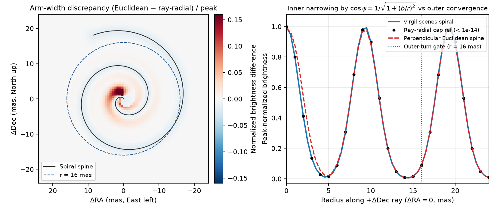
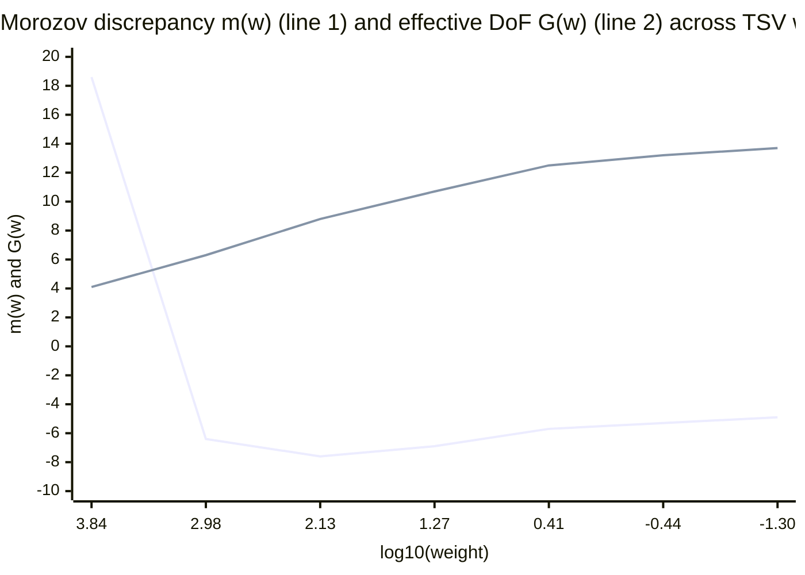
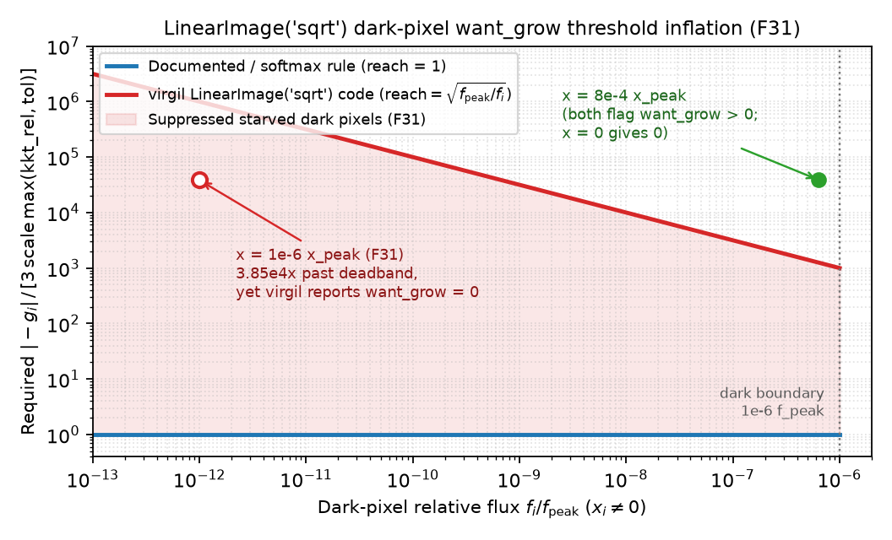

# Imaging and grid machinery

This page checks the imaging grids, beams and transforms against analytic results, then the regularisers against eht-imaging and MPoL, CLEAN against simulated scenes, and the L-curve against our own recomputation.

`tests/test_grids.py` covers the grids and transforms.

| virgil | Reference | Tag | Agreement |
| --- | --- | --- | --- |
| `imaging.dirty_image` of an offset point, uv disk uniformly filled | Airy beam `2 J1(2πqr)/(2πqr)` centred on the source, East left, North up | Analytic | 3e-3 (sampling of the uv disk) |
| `imaging.beam`, filled uv disk | FWHM = 2√(2 ln 2)/(π q) | Analytic | 1e-4 |
| `imaging.beam`, filled uv ellipse (axis ratio 0.4, PA 0, 30, 100°) | FWHMs in inverse ratio; beam PA = coverage PA + 90° | Analytic | 1e-3; PA to 0.05° |
| `imaging.nyquist_pixel_scale` | λ / 2 B_max | Analytic | 1e-9 |
| `imaging.field_of_view` | min(λ / B_min, `largest_mas`) | Analytic | 1e-9 |
| `imaging.convolve_beam` of a delta (PA 0, 35, 120°) | unit sum; second moments of the beam Gaussian | Analytic | 2e-3 mas² |
| `SourceModel.render` of an offset point | lands on the expected pixel, East left, North up | Analytic | exact |
| `SourceModel.render` of a Gaussian, transformed back | Gaussian transform | Analytic | 1e-9 |
| `Image.from_model` → `Image.model` round trip | Gaussian transform | Analytic | 1e-9 (with the brightness floor off; finding 4) |
| `find_uv_grid` on rotated lattices (0, 17, −38°) | the lattice we built | Analytic | rotation to 1e-6° |
| `Image.model_on_grid` (two-sided matrix Fourier transform) and `Image.model` on those lattices | direct sum over rotated pixel centres | Quadrature | 1e-12 |

## Regularisers

`tests/test_imaging_regularisers.py`. eht-imaging 1.3.2 (`imager_utils`,
normalisation off) and MPoL 0.3.1 (`losses`) run in their own
environments. The test images are random, on a circular support, so their
outer ring of pixels is zero, so the three codes' different edge
conventions give the same sums. The mapping (signs, flips, the softening's
square, the cells each code counts) is in the test's docstring. Gradients
are virgil's, with respect to the log-brightness, against eht-imaging's
hand-written and MPoL's autograd pixel gradients through the softmax
chain rule.

| virgil | Reference | Tag | Agreement (value and gradient) |
| --- | --- | --- | --- |
| `TSV` | `stv2` (eht-imaging), `TSV` (MPoL) | eht-imaging, MPoL | 1e-15 |
| `TV` | `stv` and `TV_image` averaged over the four flips, plus the softening of the extra edge cells | eht-imaging, MPoL | 1e-15 |
| `MaxEntropy`, flat and random default image | `ssimple` (eht-imaging); `entropy` (MPoL, no support) | eht-imaging, MPoL | 1e-15 |
| `Laplacian` | SciPy's five-point Laplacian of the zero-padded image | Mathematics | 1e-15 |
| `StarletL1` and `starlet` (1, 3, 4 scales) | à-trous B3-spline transform written with SciPy (`mode="constant", cval=0.0`, Starck, Murtagh & Fadili 2010): exact `details.sum(0) + coarse = image`, linearity, and dyadic scale separation (`test_042_scenes_starlet_kkt.py`) | Mathematics | 1e-14; details + coarse = image |
| `LogSum` | its formula and pixel gradient | Mathematics | 1e-15 |

## Synthetic scenes and field sizing

`tests/test_042_scenes_starlet_kkt.py` and `tests/test_042_lcurve_ensemble_radio.py` check the synthetic test scenes (`virgil.scenes`), sky-coordinate centroids and priors, and short-baseline field-sizing rules against `crosscheck.starlet_kkt_ref`. Notably ([D27](../method/findings.md#D27)), `scenes.spiral` parameterizes arm cross-sectional width by Gaussian standard deviation `width_mas` (not FWHM), winds counter-clockwise from North through East (`pa_deg`), measures radial distance `|r - r_arm|` along each ray from the origin (which narrows the perpendicular spine cross-section near the origin by `cos ψ = 1 / √(1 + (step_mas / (2πr))²)` relative to exact Euclidean distance to the curve — differing by `> 8 %` of peak inside `r < 8 mas` while converging to `< 4 %` on outer turns `r >= 16 mas`), terminates both inner (`θ = 0`) and outer (`θ = 2π × turns`) arm ends in circular Euclidean caps, and applies an optional radial exponential envelope `exp(-r / fade_mas)`.

| virgil | Reference | Tag | Agreement |
| --- | --- | --- | --- |
| `scenes.gaussian_blob` | unit-sum circular Gaussian at `(dra, ddec)` (East left, North up); wrong East-sign control fails | Mathematics | 1e-14 |
| `scenes.ring` | inclined deprojected Gaussian ring (`cos i` foreshortening, major axis at `pa_deg`) times `1 + asymmetry cos(PA - asymmetry_pa_deg)`; wrong modulation-PA control fails | Mathematics | 1e-14 |
| `scenes.spiral` | face-on Archimedean locus `r = step_mas θ / (2π)` with radial cross-section `σ = width_mas`, inner/outer rounded caps (`1e-14`), inner-turn narrowing vs Euclidean (`> 0.08` inside `r < 8 mas`) and outer-turn agreement (`< 0.04` at `r >= 16 mas`), and `exp(-r / fade_mas)` (`1e-13`); FWHM-instead-of-σ and CW-winding controls fail ([D27](../method/findings.md#D27)) | Mathematics | 1e-14 (radial-cap); < 0.04 (`r >= 16 mas` Euclidean) |
| `imaging.Centroid` on `Image` and `LinearImage` (`rotation_deg` = 0°, +32°, `"grid"`, −22°) | flux-weighted sky `(dra, ddec)` and Gaussian penalty `½((c_x/σ)² + (c_y/σ)²)`; flipped rotation-sign control fails | Mathematics | 1e-13 |
| `imaging.image_priors` | `Normal(0, 1)` on `GaussianField.latent`, improper flat prior (`log_prob = 0`) on plain `Image.log_brightness` and `LinearImage.pixels` | Mathematics | 1e-13 |
| `imaging.second_moment_fwhm` | weighted least squares of `−ln V² = π² θ² ρ² / (2 ln 2)` with weights `V² / σ_{V²}` above `v2_min`; 0 for unresolved, `None` for `< 2` samples or DISCO data | Mathematics | 1e-11 mas |
| `imaging.image_field` and `imaging.Beam` | `field_fwhms × FWHM` clipped to `[inner_elements × λ/(2 B_max), min(λ/B_min, largest_mas, aperture_mas)]` (ceiling wins on crossover; unclipped and floor-over-ceiling controls fail, [D27](../method/findings.md#D27)); `convolve_beam` recovers `Beam` second moments | Mathematics | 1e-9 mas |
| `imaging.envelope_fwhm` and `imaging.starting_image` | joint point-plus-Gaussian fit recovers undiluted envelope FWHM where raw `second_moment_fwhm` is biased low by stellar dilution (control); `moments` and `dirty` starts, central `hole_mas` mask, and `pad_to_mas` | Mathematics | FWHM within 8 % |

## CLEAN

`imaging.clean`, virgil's gradient CLEAN, must recover the scenes it is given
and keep its χ² finite.

Recovery: [`test_clean_scenes.py`](https://github.com/benjaminpope/virgil-validation/blob/main/tests/test_clean_scenes.py)
runs on every pull request. Two scenes from our simulator: four UTs, seven
snapshots, two channels, little noise. One is a point at the phase centre;
the other adds a companion at 30 % of its flux, on a pixel centre. CLEAN
runs without a base scene on a 31 × 31 grid of 0.4 mas.

The residual dirty image is ours, not virgil's. We take the complex
visibilities of the truth minus those of the components (a direct sum over
pixel centres) at every sampled (u, v, λ). A NumPy DFT turns them back into
an image, divided by the number of samples, so the dirty beam peaks at 1.
[`test_clean_recovery.py`](https://github.com/benjaminpope/virgil-validation/blob/main/tests/test_clean_recovery.py)
(slow) adds a companion next to an analytic star used as the base.

| virgil | Reference | Tag | Agreement |
| --- | --- | --- | --- |
| `imaging.clean`, point and binary, no base | flux within one pixel of each true position | Mathematics | 0.02 of the total (found 8e-5); centre within 0.5 pixel (found 0) |
| `imaging.clean`, point and binary, no base | peak of our residual dirty image | Mathematics | < 0.01 of the total (found 1e-4; the companion alone is 0.23) |
| control | the binary's components rotated by 180°, no components, or the point in a corner | Mathematics | residual peak > 0.1 |
| `imaging.clean`, companion beside a uniform-disk base (slow) | the companion's flux and position; nothing at its mirror image | Mathematics | 5 %; 0.5 pixel |
| `imaging.clean` without a base scene, three and four UTs | χ² finite at every iteration | Regression | finite |
| `CleanResult.restored`, `imaging.residual_image`, and `rotation_deg="grid"` (`Image`, `dirty_image`, `clean`, `residual_image`) | pure-NumPy squared-visibility Fourier sensitivity map `−(∂χ²/∂f_p) / ‖J e_p‖₂` (`1e-12`, plus 3rd-order 4-point non-negative forward differences on DISCO data to `< 1e-8` and peak localization on an injected off-axis companion) and SciPy rotated elliptical Gaussian restoration in sky coordinates (`pa_deg - rotation_deg`, catching `+rot` sign flips; `test_042_scenes_starlet_kkt.py`) | Mathematics | 1e-12 (V²); < 1e-8 (DISCO FD) |

The finiteness tests,
[`test_clean_finite.py`](https://github.com/benjaminpope/virgil-validation/blob/main/tests/test_clean_finite.py),
use four-UT files (correlated closure phases) and three-UT controls at 40,
41 and 60 pixels of 0.4 mas.

Without a base scene, `clean` seeds the central pixel, where the Jacobian
column |J e_p| is zero. On even grids that pixel sits half a pixel off the
origin, so rounding left |J e_p|² near 1e-24; its score won and its step was
infinite, giving a NaN χ² on every even size from 34 to 68 pixels
([F12](../index.md#F12)). virgil#190 treats such pixels as dead.

## L-curve

`imaging.l_curve` fits an Image for each weight of one regularizer and
reports χ², χ² per point and the unweighted penalty per weight.
[`test_l_curve.py`](https://github.com/benjaminpope/virgil-validation/blob/main/tests/test_l_curve.py)
checks this on an 8 × 8 Image with TSV at five weights, fitted to a
three-UT file of a Gaussian blob with a point beside it. Everything is
recomputed with our own code: χ² from our direct-sum visibilities of the
fitted pixels, and TSV from its formula.

| virgil | Reference | Tag | Agreement |
| --- | --- | --- | --- |
| `LCurve.chi2`, `chi2_red`, `penalty` | our χ², χ²/N and Σ (Δx b)² + (Δy b)² of each fitted image | Mathematics | 1e-8 (found 3e-15) |
| each fitted image | stationary point of χ² + κ w TSV in the log-brightness, our finite-difference gradients | Mathematics | κ = 2 to 1 % (found 1.4e-3); gradient left < 1e-5 of the starting gradient (found 1e-7) |
| control | κ = 1, χ² + w TSV | Mathematics | gradient left > 1e-4 |
| the sweep | χ² does not fall and TSV does not rise as w grows (exact minimizers) | Mathematics | 1e-6 |
| `LCurve.discrepancy` | linear interpolation of χ²/N in log w | Mathematics | 1e-8 |
| `LCurve.corner` and `LCurve.classic_maxent` | [Hansen & O'Leary (1993)](https://doi.org/10.1137/0914086) maximum log-log curvature on 3-point Lagrange stencils (`1e-12`) and Gull (1989) `2 w S(b) = γ(w)` root from the brightness-weighted Gauss-Newton spectrum (`1e-5`; `test_042_lcurve_ensemble_radio.py`) | Mathematics | corner 1e-12; classic 1e-5 |
| `LCurve.dof_discrepancy` and `DofDiscrepancy` | Morozov discrepancy `m(w) = χ²/s² − (n − G)` over positive free `LinearImage` pixels (`parametrization="linear"` with bounded L-BFGS-B for `TSV`, `parametrization="sqrt"` against dense Skilling-entropy curvature `diag(w / f)` for `MaxEntropy`) checked against exact [Craven & Wahba (1979)](https://doi.org/10.1007/BF01404567) influence trace `G = tr[K(K + H_R)⁻¹]` and exact [Hutchinson (1989)](https://doi.org/10.1080/03610918908812806) / [Bekas, Kokiopoulou & Saad (2007)](https://doi.org/10.1016/j.apnum.2007.01.003) Rademacher probe variance, `MaxEntropy` `h(w) = 2(w/s²) KL − G`, custom `curvature=`, and over-regularized no-crossing control (`weight=None`, `accepted=False`) | Mathematics + Statistics | within Hutchinson SE |

`fit` documents regularizers as "penalties added to the loss" without saying
whether the loss is χ² or ½χ². The optimality test settles it: the loss is
½χ² + w TSV, the negative log likelihood plus the penalty.

## KKT optimality certificates

A flat loss trace does not by itself certify a constrained or reparameterized minimum. `virgil.fitting.kkt_report` (`tests/test_042_scenes_starlet_kkt.py`, checked against `crosscheck.starlet_kkt_ref` following [Nocedal & Wright 2006](https://doi.org/10.1007/978-0-387-40065-5), ch. 12 and §16.7, at both converged optima and non-stationary points) evaluates stationarity and complementary slackness directly in pixel-flux space:

- **Simplex (`Image`)**: on unit-sum brightness `b`, each term's centred simplex gradient is `d_data = g_data - sum(b * g_data)` and `d_pen = g_pen - sum(b * g_pen)`, with residual `res_b = d_data + d_pen` and scale `sqrt(mean(d_data[lit]^2 + d_pen[lit]^2))` on lit support pixels (`b_i > 1e-3 * max(b)`). Without `start=`, `kkt_rel` divides `rms(res_b[lit])` by `|mu| + scale` when flux `F` is fixed (`mu = sum(b * (g_data + g_pen))`) or by `scale` alone when `F` is free (`mu = 0`); when `start=` is passed, `scale` becomes `max(scale_cur, scale_start)` (agreed to `< 1e-11` against `kkt_simplex_metrics_ref`). Dark support pixels (`b_i < 1e-6 * max(b)`) count toward `want_grow` only past the deadband `res_b < -3 * scale * max(kkt_rel, KKT_TOL)`.
- **Square-root (`LinearImage("sqrt")`)**: unconstrained in `x` with pixel flux `f_i = x_i^2`, so the equality multiplier vanishes, `kkt_w` normalizes `rms(g[lit])` by `w / F_0` (`F_0 = sum(f)`), `start=` updates `scale = max(scale_cur, scale_start)` (`< 1e-11`), and an exact `x_i = 0` pixel at a starved companion peak flips `want_grow` from `1 / n^2 > 0` (at `x_i = 8e-4 x_peak`) to `0.0`. Contrary to `kkt_report`'s docstring (which states `'sqrt'` uses the same `want_grow` rule as `'softmax'`), `virgil` 0.4.2 multiplies the dark-pixel deadband on `0 < f_i < 1e-6 * f_peak` by `sqrt(f_peak / f_i) > 1000`, suppressing starved `O(1)` negative flux gradients (`> 3.8e4×` past the documented deadband at `x_i = 1e-6 x_peak`) and certifying `converged=True` ([F31](../method/findings.md#F31)). Under a lone `MaxEntropy` penalty, `virgil`'s `band_limit` tapers `ln b` with a smoothed lit-support mask on a `2n × 2n` zero-padded FFT and divides fractional super-cutoff power `P_hi(η) / P_tot(η)` by that of its hard low-pass projection onto `|q| <= q_max = max(hypot(u, v) / λ)` (whereas `starlet_kkt_ref.maxent_band_limit_ref` evaluates an independent unpadded `n × n` 2D-Hann power-ratio proxy): both hit `1.0` (`< 1e-12`) on strictly band-limited periodic log-brightness (`low == η`), return `NaN` when corner pixel Nyquist `√2 / (2 Δx) <= q_max`, and separate band-consistent fits (`< BAND_TOL`) from injected checkerboard ripples (`> BAND_TOL`, `converged=False`).
- **Box-constrained (`LinearImage("linear")`)**: uses the Nocedal & Wright (§16.7, Eq. 16.71) projected gradient `pg = f - clip(f - g, lower, upper)` on support, normalized (`pg_rel = ‖pg‖_∞ / top`) by `top = max(‖g_data[sup]‖_∞, ‖g_pen[sup]‖_∞)` when `start=` is omitted or by `top = ‖g_start[sup]‖_∞` when `start=` is supplied (`< 1e-11`), and flags `zero_violation` on clamped `f_i == 0` pixels only past the tolerance deadband `g_i < -KKT_TOL * top` (clamping a bright peak pixel to zero triggers `zero_violation > 0` and fails `converged`).
- **Nuisance `start=` gate**: when `start=` is supplied, `kkt_report` constructs `_Objective(..., boxed=True)` and evaluates `grad_rel = ‖pg_cur‖_∞ / ‖pg_start‖_∞` in **linear value space** (`< 1e-11` against `kkt_nuisance_grad_rel_ref` on `Uniform` priors, where flat and value coordinates share zero interior prior slope; perturbing flux while re-optimizing image pixels passes without `start=` and fails `grad_rel < NUISANCE_TOL` when `start=` is passed). Because `fit()` optimizes `LogUniform` parameters in flat `ln F` (`∂(−ln L)/∂F = 0`) whereas `kkt_report` sets `boxed=True` and adds `−∂(ln p)/∂F = +1/F`, an exact `gtol=1e-13` `LogUniform` optimum retains `grad_norm ≈ 1/F` and falsely fails `converged` from nearby starts ([F30](../method/findings.md#F30)).

| virgil | Reference | Tag | Agreement |
| --- | --- | --- | --- |
| `fitting.kkt_report` on `LinearImage("sqrt")`, `LinearImage("linear")`, and fixed/free-flux `Image` | independent flux-space gradients (`crosscheck.starlet_kkt_ref`) at non-stationary points and converged optima (with and without `start=`), non-vacuous `x = 0` exclusion at a companion peak, `MaxEntropy` `band_limit` (`1.0` low-pass fixed point to `1e-12`, coarse-pixel `NaN`, and `< BAND_TOL` vs `> BAND_TOL` ripple separation), plus open `sqrt(f_peak / f_i)` dark-pixel suppression ([F31](../method/findings.md#F31)) | Mathematics | 1e-11 (metrics & `start=`); 1e-12 (`low == η` fixed point) |
| `fitting.kkt_report` nuisance `start=` gate and non-optimal controls | exact `Uniform` `nuisances[...]["grad_rel"]` (`1e-11`, `grad_norm < 1e-3` at optimum), 2-step truncated fit (`kkt_rel > KKT_TOL`), clamped-peak `zero_violation > 0`, perturbed nuisance flux (`converged=False` iff `start=` passed), and open `LogUniform` `+1/F` `boxed=True` mismatch ([F30](../method/findings.md#F30)) | Mathematics | 1e-11; exact gate |

## Laplace GP evidence and imaging diagnostics

For `Image(GaussianField(...))` models with standard-normal whitened DCT latents `z ~ N(0, I)`, `virgil.imaging` provides [MacKay (1992)](https://doi.org/10.1162/neco.1992.4.3.415) Laplace evidence (including Schur-complement marginalization over extra parameters such as log-uniform envelope flux), posterior sampling, self-consistent empirical-Bayes error scaling, and post-fit pitfall checks (`tests/test_042_lcurve_ensemble_radio.py`). Rescaling measurement uncertainties by `s` divides the whitened-residual Jacobian singular values `s_k` by `s` inside the effective parameter count, so `error_scale` solves the implicit fixed-point equation rather than freezing `s = 1` in a one-step plug-in:

$$
\ln Z \approx \ln L(z_{\star}) - \tfrac{1}{2}\|z_{\star}\|_2^2 - \tfrac{1}{2}\ln\det(I + J^{\mathsf{T}}J), \qquad s^2 = \frac{\chi^2}{N_{\mathrm{ind}} - \sum_k \frac{(s_k / s)^2}{1 + (s_k / s)^2}}.
$$

| virgil | Reference | Tag | Agreement |
| --- | --- | --- | --- |
| `imaging.log_evidence`, `laplace_samples`, `error_scale` | Cholesky MacKay (1992) `ln Z` (`1e-4`, and `1e-9` with joint `ln flux` Schur complement), posterior covariance `(I + JᵀJ)⁻¹`, and scalar + coupled per-observable QR-projected fixed-point `error_scale` (`1e-9`, where unrescaled plug-in misses by `> 1e-2` on 3× over-quoted noise bars; `crosscheck.starlet_kkt_ref`) | Mathematics + Statistics | `ln Z` to 1e-4; `error_scale` to 1e-9 |
| `imaging.chi2_by_observable` and `short_baseline_residual` | independent V² and rank-projected closure-phase counts, exact `γ`, shortest-quantile signed mean residual `mean((V² − |V_model|²) / σ_{V²})` (`1e-12`) and standard error `1/√n_short` (`1e-12`; missing extended envelope gives > 4σ positive bias) | Mathematics | `γ` to 1e-10; mean & SE to 1e-12 |
| `imaging.diagnose` and `Diagnosis` | flags unanchored single-`Image` translations (`anchored=False`) and outer-2-pixel border flux (`edge_flux`), cleared when anchored by a star or `Centroid` prior | Mathematics | exact flags |
