# Post-AGB discs (VLTI/PIONIER)

The imaging-contest data cannot all be shown in public, so this page tests
virgil's image reconstruction on data that anyone can fetch and against
images that experts have already published: the VLTI/PIONIER observations of
post-AGB circumbinary discs in ESO programme 1103.D-0797, reconstructed
independently by De Prins et al. (2026) with SPARCO + ORGANIC. We
reconstruct each target with a SPARCO-like model (below), put both images on
one grid and one beam, and say plainly whether they agree. One tab per
target; IRAS 08544-4431 is still to come.

| Target | Published method | virgil verdict | Image cross-correlation |
| --- | --- | --- | --- |
| [IW Car](#iw-car) | SPARCO + ORGANIC (De Prins+2026; SQUEEZE check) | agree on morphology, differ in outer-arc detail | 0.95 |
| [HR 4049](#hr-4049) | SPARCO + ORGANIC | same disc, virgil more compact | 0.95 |
| [HD 108015](#hd-108015) | SPARCO + ORGANIC | agree | 0.99 |
| [AI Sco](#ai-sco) | SPARCO + ORGANIC | agree | 0.96 |
| [EN TrA](#en-tra) | SPARCO + ORGANIC | agree on size, differ in orientation | 0.95 |
| [HD 95767](#hd-95767) | SPARCO + ORGANIC | agree | 0.99 |
| [IRAS 15469-5311](#iras-15469-5311) | SPARCO + ORGANIC | agree | 0.99 |
| [PS Gem](#ps-gem) | SPARCO + ORGANIC | do not agree; data cannot decide | 0.63 |
| IRAS 08544-4431 | SPARCO image (Hillen+2016) | pending | pending |

=== "IW Car"

    ### IW Car { #iw-car }

    <figure markdown>
    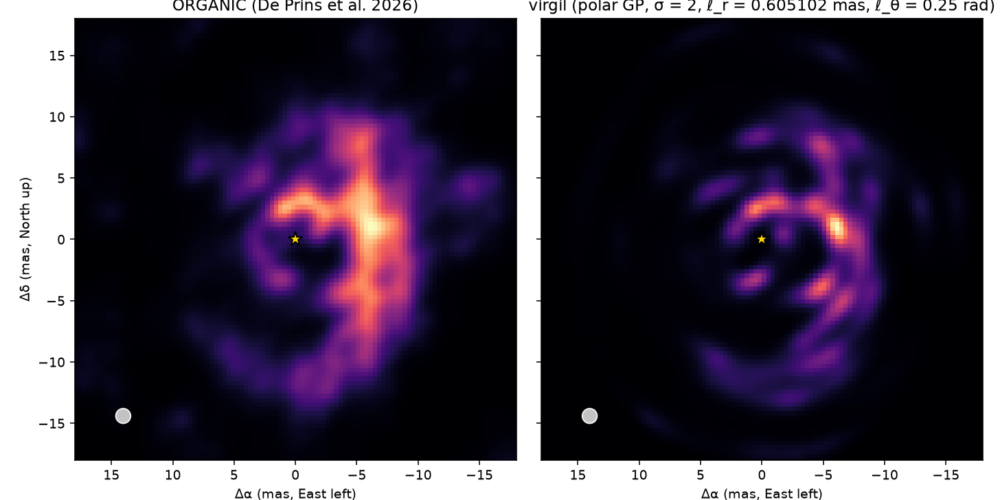
    <figcaption>IW Car in H band, 23 PIONIER exposures (MJD 58812 to 58893, up to 2020-02-14). Left: the
    ORGANIC image of De Prins et al. (2026), re-rendered here from their Zenodo FITS
    (10.5281/zenodo.20155600). Right: virgil, MaxEntropy with the weight at the
    L-curve corner. Both are the star-and-secondary-subtracted disc emission, convolved to the PIONIER
    beam (grey ellipse), peak-normalised, North up, East left; the star is the gold marker.</figcaption>
    </figure>

    !!! success "Verdict: the two reconstructions agree"
        At the PIONIER beam the images correlate at 0.95 (0.95 after the best sub-beam shift): the same inner arcs
        near the star and the same large western arc. They differ in detail: the outer arc
        sits further out and is oriented differently in virgil (flux-weighted radius 11.0 against 9.9 mas,
        major-axis PA 42° against 17°), and the south-east inner arc is weaker in virgil. De Prins et al.
        themselves note that the inner arcs' azimuthal profile is not well constrained (Appendix D, SQUEEZE).

    **Parameters.** De Prins et al. could not fit a PMOIRED geometric model to IW Car (a single disc does not
    reproduce it), so there is no PMOIRED row to compare with. The comparison is with what the paper does
    report for IW Car: the SPARCO parameters of the ORGANIC reconstruction (FITS headers), and the inner-rim
    ellipses fitted to the image (Table 2; inner arcs and outer arc separately). The "virgil" columns are two
    fits to the same 23 files: the SPARCO parameters fitted together with the image, and a
    PMOIRED-style parametric model (UD star + point secondary + power-law rim with an m = 1 modulation +
    resolved background). virgil's fits are point estimates; the σ column uses the paper's uncertainty, where it gives one.

    | Parameter | De Prins+2026 | virgil (image fit) | virgil (parametric) | Difference |
    | --- | --- | --- | --- | --- |
    | Primary flux fraction, H (%) | 63.6 | 63.4 | 63.5 | −0.2 / −0.1 points |
    | Secondary flux fraction, H (%) | 1.99 | 2.44 | 1.86 | +0.45 / −0.13 points |
    | Secondary offset (Δα, Δδ) (mas) | (1.12, −1.90) | (1.16, −1.72) | (1.14, −1.83) | ≤ 0.2 mas |
    | Primary UD diameter (mas) | 0.50 | 0.53 | 0.45 | +0.03 / −0.05 mas |
    | Disc spectral index (image) | 0.89 | 0.885 | not comparable (rim 3.2) | −0.005 |
    | Inner-arc rim diameter (mas) | 6.9 ± 0.5 | see metrics | 16.1 (outer-arc scale) | not the same structure |
    | Rim inclination (°) | 48 ± 5 (inner), 57 ± 2 (outer) | n/a | 55.5 | −0.7σ against the outer arc |
    | Rim position angle (°) | 144 (+8, −7) (inner), 176 ± 3 (outer) | n/a | 165.8 | −3.4σ against the outer arc, +2.7σ against the inner |
    | Rim azimuthal modulation (m = 1) | not reported | n/a | amplitude 0.85 at 313° | none to compare |

    The parametric rim lands between the two orientations the paper finds for the inner and outer arcs
    (and near the SPHERE outer disc, i = 41.7°, PA = 161°, Andrych et al. 2023), which says the single-ring
    model is describing a blend of structures, as the paper concluded. Its χ² per point is 3.3, against
    0.46 for the image fit, for the same reason.

    **Image metrics** (both images on one 0.35 mas grid, convolved to the beam; inner = within 5 mas of the star,
    outer = beyond; the paper's own rim fit needs per-pixel significances, so both images get the same moments):

    | Metric | ORGANIC | virgil |
    | --- | --- | --- |
    | Normalised cross-correlation | 1 | 0.95 |
    | Inner flux fraction / outer flux fraction | 16.7 % / 77.5 % | 14.9 % / 75.9 % |
    | Inner flux-weighted radius (mas) | 3.38 | 3.35 |
    | Outer flux-weighted radius (mas) | 9.93 | 11.05 |
    | Inner major-axis PA (°) | 61 | 58 |
    | Outer major-axis PA (°) | 17 | 42 |
    | Asymmetry angle, inner flux centroid (° East of North), offset (mas) | 219, 1.08 | 200, 1.11 |
    | Asymmetry angle, outer flux centroid (°), offset (mas) | 272, 4.04 | 280, 2.94 |

    ??? note "Data and method"

        **Data.** Phase 3 calibrated OIFITS from the ESO archive, programme 1103.D-0797 (PI J. Kluska,
        INSPIRING), the 23 exposures listed in the paper's observation log: 828 V² and 552
        closure-phase rows across the H band (1.51–1.76 µm). `postagb_data.py check` confirms
        these are the same exposures as the earlier reduced copy. The PIONIER beam is 3.26 × 2.29 mas at PA 142°.

        **Model.** SPARCO: a uniform-disc primary (power-law index −3.165, as in the paper) plus a point
        secondary plus a `virgil.models.Image` environment (128 × 128 pixels of 0.35 mas, the paper's grid),
        each with a power-law spectrum from `virgil.spectra`. The secondary starts at the paper's position
        (so it is not independent of ORGANIC) and the fit then moves it. Regulariser `MaxEntropy`; weight from
        `l_curve` over nine weights (10⁴ to 10⁻²), taking the corner (weight 56); start from
        `starting_image`. ORGANIC differs: a GAN generator as its regulariser, with the primary's parameters tuned with pyBADS. Neither is a ground truth.

        **Fit quality.** On the same data the virgil image has χ² per point 0.46 and the ORGANIC image, with its
        published SPARCO parameters unchanged, 2.06 (V² residual rms 0.88 against 1.53σ; T3 0.68 against 2.09σ).
        This does not say virgil's image is better: it has about 16 000 free pixels for 1 794 data points and
        is over-fitted at this weight, while ORGANIC is a more strongly regularised image. The test that matters here is the image agreement above.
        Flipping the published image East-West or North-South worsens its χ² to 60 and 8.9, so the
        orientation is right.

        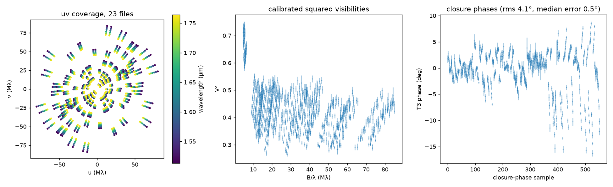

        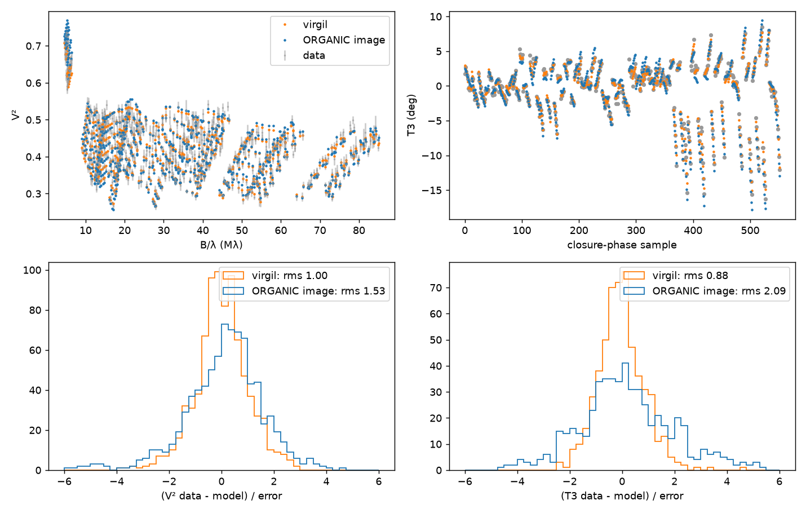

        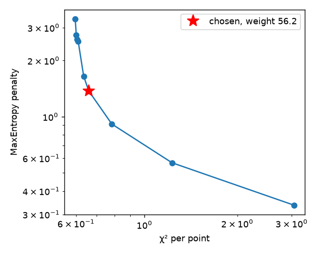

        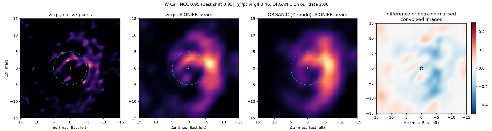

        <figure markdown>
        
        <figcaption>ORGANIC (left) against SQUEEZE (right) for IRAS 15469-5311 and IW Car (inner and outer
        arcs). Reproduced from arXiv:2605.13445v2, Fig. 15 (Appendix D), the arXiv version, with the authors'
        permission. The authors find both methods recover the inner arcs and the large outer arc.</figcaption>
        </figure>

        <figure markdown>
        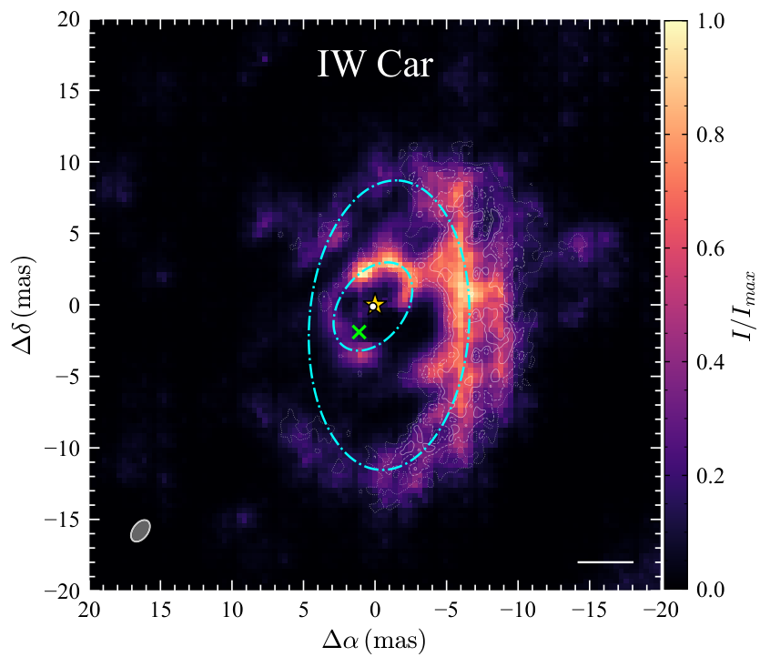
        <figcaption>As published: the ORGANIC image of IW Car with the fitted rims of the inner and outer arcs,
        arXiv:2605.13445v2, Fig. 4. Reproduced from the arXiv version with the authors' permission.</figcaption>
        </figure>

        <figure markdown>
        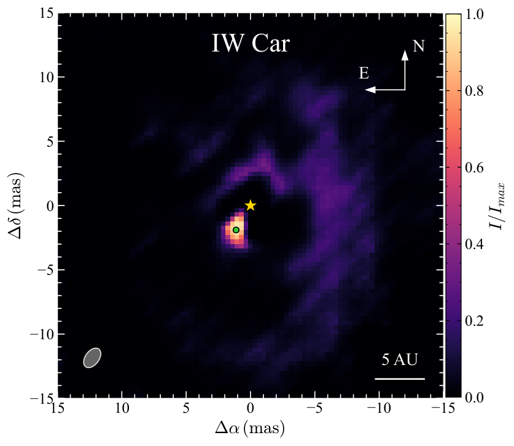
        <figcaption>The same reconstruction with no secondary in the SPARCO model: the unresolved flux peak
        near the green cross is the secondary. arXiv:2605.13445v2, Fig. 2. Reproduced from the arXiv version
        with the authors' permission.</figcaption>
        </figure>

        <figure markdown>
        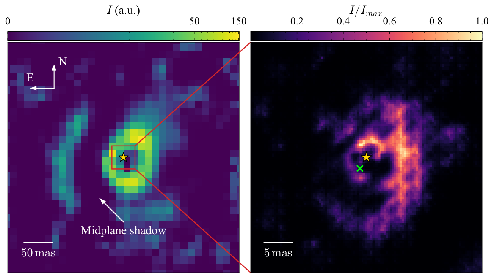
        <figcaption>SPHERE/IRDIS polarised light (Andrych et al. 2023) against the PIONIER image,
        arXiv:2605.13445v2, Fig. 6. Reproduced from the arXiv version with the authors' permission.</figcaption>
        </figure>

        Provenance, permissions and credits: [`DATA_ATTRIBUTION.md`](https://github.com/benjaminpope/virgil-validation/blob/main/DATA_ATTRIBUTION.md).
        Reproduce with `scripts/postagb_data.py fetch`, `scripts/postagb_literature.py` and
        `scripts/postagb_imaging.py {inspect,parametric,image,compare,replot} docs/imaging/postagb`.

=== "HR 4049"

    ### HR 4049 { #hr-4049 }

    <figure markdown>
    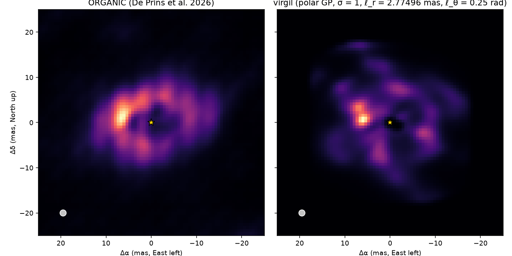
    <figcaption>HR 4049 in H band, 19 PIONIER exposures (MJD 58884 to 58899). Left: the ORGANIC image of De Prins et al. (2026), re-rendered here from their Zenodo FITS (10.5281/zenodo.20155600). Right: virgil, MaxEntropy with the weight at the L-curve corner. Both are the star-and-secondary-subtracted disc emission, convolved to the PIONIER beam (grey ellipse), peak-normalised, North up, East left; the star is the gold marker.</figcaption>
    </figure>

    !!! warning "Verdict: the discs agree in shape, not in size"
        The images correlate at 0.95 at the PIONIER beam, but virgil's disc is more compact (flux-weighted radius 10.8 against 15.5 mas) and its major-axis PA differs (142° against 72°). The parametric fit puts the rim at 18.9 mas against the paper's 14.3 and the secondary 2.3 mas from the paper's position, so it is not a clean match. The Zenodo FITS header's secondary offset also disagrees with the paper's tables, so the comparison depends on which one is the reference.

    **Parameters.** The first table compares the PMOIRED geometric model of De Prins et al. (Table 3) with a PMOIRED-style parametric fit of virgil to the same 19 files (UD star, power-law rim with an m = 1 modulation, plus the paper's optional secondary or resolved background). The σ column uses the paper's uncertainty only; virgil's are point estimates, so large σ values mostly say how tight the paper's errors are. The rim diameter is that of a Gaussian ring in virgil and of a power-law rim in PMOIRED, and the modulation phase is not pinned to the paper's convention, so those two rows are not like for like. The parametric fit takes the lowest χ² of 6 starts (1.7, 1.7, 1.7, 1.7, 1.7, 1.7). The second table compares the SPARCO parameters of the ORGANIC image with those fitted together with virgil's image.

    | Parameter | De Prins+2026 (PMOIRED) | virgil (parametric) | Difference |
    | --- | --- | --- | --- |
    | Primary flux fraction, H (%) | 65.9 ± 0.14 | 65.4 | -0.491 (-3.5σ) |
    | Primary UD diameter (mas) | 0.74 ± 0.02 | 0.777 | +0.0367 (+1.8σ) |
    | Secondary flux fraction, H (%) | 0.42 ± 0.05 | 0.758 | +0.338 (+6.8σ) |
    | Secondary offset Δα (mas) | -1.7 ± 0.08 | -4 | -2.3 (-28.7σ) |
    | Secondary offset Δδ (mas) | -0.69 ± 0.1 | -0.313 | +0.377 (+3.8σ) |
    | Rim diameter (mas) | 14.3 ± 0.18 | 18.9 | +4.61 (+28.8σ) |
    | Rim inclination (°) | 56.8 ± 1 | 55.9 | -0.893 (-0.9σ) |
    | Rim position angle (°) | 82.3 ± 1 | 85.2 | +2.92 (+2.9σ) |
    | Rim modulation amplitude (m = 1) | 0.42 ± 0.03 | 0.501 | +0.081 (+2.7σ) |
    | Rim modulation phase (°) | -38 ± 3 | 55.9 | +93.9 (+31.3σ) |
    | χ² per point | 1.71 | 1.68 | |

    ORGANIC/SPARCO parameters (Table 2 and FITS header) against the virgil image fit:

    | Parameter | De Prins+2026 (ORGANIC) | virgil (image fit) | Difference |
    | --- | --- | --- | --- |
    | Primary flux fraction, H (%) | 65.4 | 66 | +0.627 |
    | Primary UD diameter (mas) | 0.72 | 0.778 | +0.0579 |
    | Secondary flux fraction, H (%) | 0.24 | 0.328 | +0.0876 |
    | Image spectral index | 2.39 | 2.41 | +0.0179 |

    **Image metrics** (both images on one 0.64 mas grid, convolved to the beam; the paper's own rim fit needs per-pixel significances, so both images get the same moments):

    | Metric | ORGANIC | virgil |
    | --- | --- | --- |
    | Normalised cross-correlation | 1 | 0.95 (0.95 after the best sub-beam shift) |
    | Flux fraction in the image field | 91 % | 100 % |
    | Flux-weighted radius (mas) | 15.49 | 10.84 |
    | Major-axis PA (°), axis ratio | 168, 0.88 | 94, 0.89 |
    | Asymmetry angle, flux centroid (° East of North), offset (mas) | 72, 0.33 | 142, 0.56 |

    ??? note "Data and method"

        **Data.** Phase 3 calibrated OIFITS from the ESO archive, programme 1103.D-0797 (PI J. Kluska, INSPIRING), the 19 exposures listed in the paper's observation log: 684 V² and 456 closure-phase rows across the H band (1.52–1.77 µm). The PIONIER beam is 5.15 × 2.92 mas at PA 146°.

        **Model.** SPARCO as for IW Car, with the primary, secondary (where the paper fits one) and the grid read from the Zenodo FITS header; regulariser `MaxEntropy`; weight from `l_curve` (corner at 316); start from `starting_image`. ORGANIC uses a GAN generator as its regulariser, with the primary's parameters tuned with pyBADS. Neither is a ground truth.

        **Fit quality.** On the same data the virgil image has χ² per point 0.52 and the ORGANIC image, with its published SPARCO parameters unchanged, 1.94 (1482 data points). This does not say virgil's image is better: it has thousands of free pixels for those points and is over-fitted at this weight, while ORGANIC is more strongly regularised. Flipping the published image East-West or North-South gives χ² 13.0 and 9.4 (so the orientation is right). This target was computed on OzSTAR (job postagb_imaging, library snapshot ea943fa + c80aed7); the parametric fit is a local multi-start rerun.

        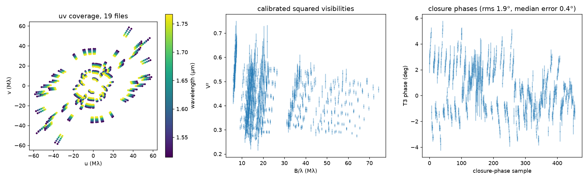

        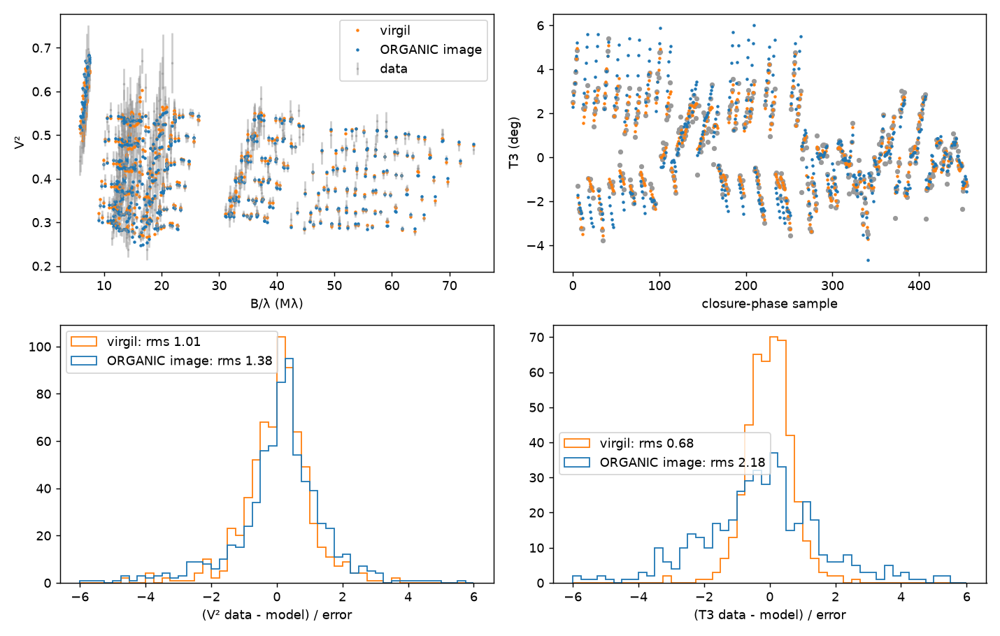

        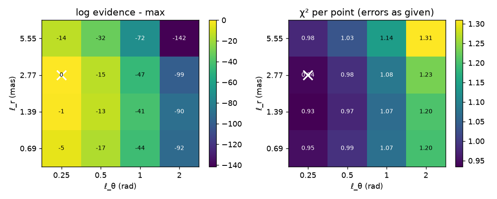

        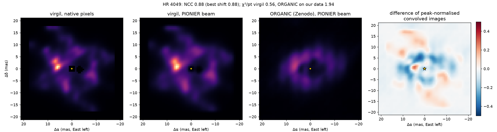

        <figure markdown>
        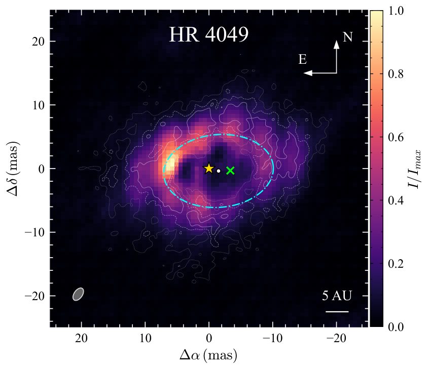
        <figcaption>As published: the ORGANIC image of HR 4049 with the fitted inner rim, arXiv:2605.13445v2, Fig. 4. Reproduced from the arXiv version with the authors' permission.</figcaption>
        </figure>

        <figure markdown>
        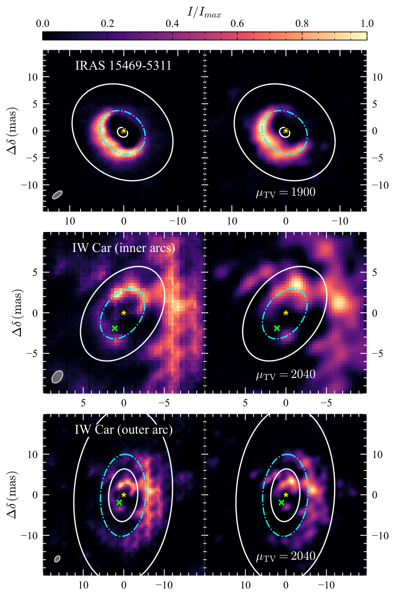
        <figcaption>ORGANIC (left) against SQUEEZE (right) for HR 4049, IRAS 15469-5311, PS Gem and IW Car, arXiv:2605.13445v2, Fig. 15 (Appendix D). Reproduced from the arXiv version with the authors' permission.</figcaption>
        </figure>

        Provenance, permissions and credits: [`DATA_ATTRIBUTION.md`](https://github.com/benjaminpope/virgil-validation/blob/main/DATA_ATTRIBUTION.md).
        Reproduce with `scripts/postagb_data.py fetch`, `scripts/postagb_literature.py` and
        `scripts/postagb_imaging.py {inspect,parametric,image,compare,table,replot} docs/imaging/postagb --target HR4049`.

=== "HD 108015"

    ### HD 108015 { #hd-108015 }

    <figure markdown>
    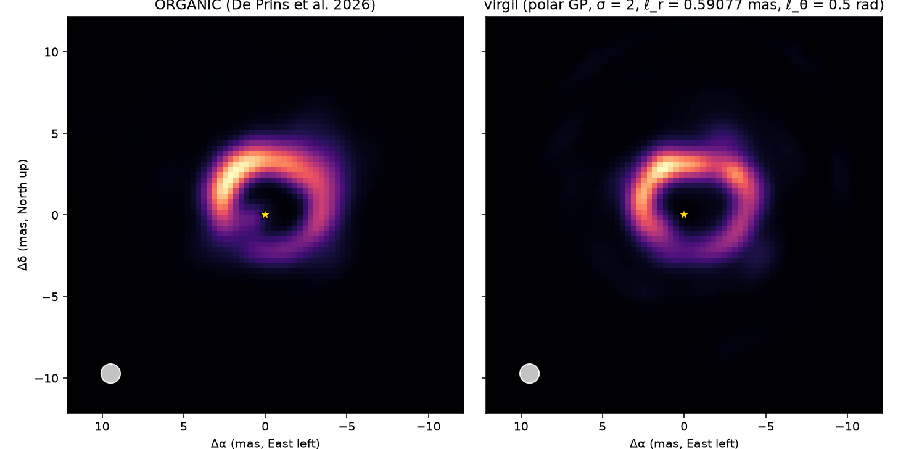
    <figcaption>HD 108015 in H band, 35 PIONIER exposures (MJD 59576 to 59621). Left: the ORGANIC image of De Prins et al. (2026), re-rendered here from their Zenodo FITS (10.5281/zenodo.20155600). Right: virgil, MaxEntropy with the weight at the L-curve corner. Both are the star-subtracted disc emission, convolved to the PIONIER beam (grey ellipse), peak-normalised, North up, East left; the star is the gold marker.</figcaption>
    </figure>

    !!! success "Verdict: the two reconstructions agree"
        The images correlate at 0.99 (1.00 after the best sub-beam shift). The disc is nearly face-on (i about 30°), so the moments are weakly determined: the major-axis PA is 111° in virgil against 83° in ORGANIC at axis ratios 0.94 and 0.86, which is a small difference in a nearly round shape.

    **Parameters.** The first table compares the PMOIRED geometric model of De Prins et al. (Table 3) with a PMOIRED-style parametric fit of virgil to the same 35 files (UD star, power-law rim with an m = 1 modulation, plus the paper's optional secondary or resolved background). The σ column uses the paper's uncertainty only; virgil's are point estimates, so large σ values mostly say how tight the paper's errors are. The rim diameter is that of a Gaussian ring in virgil and of a power-law rim in PMOIRED, and the modulation phase is not pinned to the paper's convention, so those two rows are not like for like. The parametric fit takes the lowest χ² of 6 starts (1.8, 1.8, 1.8, 2.4, 1.8, 1.8). The second table compares the SPARCO parameters of the ORGANIC image with those fitted together with virgil's image.

    | Parameter | De Prins+2026 (PMOIRED) | virgil (parametric) | Difference |
    | --- | --- | --- | --- |
    | Primary flux fraction, H (%) | 61.8 ± 0.3 | 56.5 | -5.28 (-17.6σ) |
    | Resolved-background flux fraction, H (%) | 8.6 ± 0.5 | 11.8 | +3.2 (+6.4σ) |
    | Rim diameter (mas) | 5.63 ± 0.03 | 6.72 | +1.09 (+36.3σ) |
    | Rim inclination (°) | 31.2 ± 0.8 | 29.2 | -1.99 (-2.5σ) |
    | Rim position angle (°) | 82.5 ± 1.2 | 81.6 | -0.861 (-0.8σ) |
    | Rim modulation amplitude (m = 1) | 0.502 ± 0.008 | 0.508 | +0.00644 (+0.8σ) |
    | Rim modulation phase (°) | -66 ± 2 | 16.5 | +82.5 (+41.3σ) |
    | χ² per point | 2.08 | 1.81 | |

    ORGANIC/SPARCO parameters (Table 2 and FITS header) against the virgil image fit:

    | Parameter | De Prins+2026 (ORGANIC) | virgil (image fit) | Difference |
    | --- | --- | --- | --- |
    | Primary flux fraction, H (%) | 56 | 56.6 | +0.64 |
    | Image spectral index | 1.45 | 1.34 | -0.112 |

    **Image metrics** (both images on one 0.33 mas grid, convolved to the beam; the paper's own rim fit needs per-pixel significances, so both images get the same moments):

    | Metric | ORGANIC | virgil |
    | --- | --- | --- |
    | Normalised cross-correlation | 1 | 0.99 (1.00 after the best sub-beam shift) |
    | Flux fraction in the image field | 95 % | 99 % |
    | Flux-weighted radius (mas) | 4.19 | 4.60 |
    | Major-axis PA (°), axis ratio | 83, 0.86 | 111, 0.94 |
    | Asymmetry angle, flux centroid (° East of North), offset (mas) | 192, 1.64 | 201, 1.36 |

    ??? note "Data and method"

        **Data.** Phase 3 calibrated OIFITS from the ESO archive, programme 1103.D-0797 (PI J. Kluska, INSPIRING), the 35 exposures listed in the paper's observation log: 1260 V² and 840 closure-phase rows across the H band (1.52–1.77 µm). The PIONIER beam is 3.28 × 1.96 mas at PA 117°.

        **Model.** SPARCO as for IW Car, with the primary, secondary (where the paper fits one) and the grid read from the Zenodo FITS header; regulariser `MaxEntropy`; weight from `l_curve` (corner at 316); start from `starting_image`. ORGANIC uses a GAN generator as its regulariser, with the primary's parameters tuned with pyBADS. Neither is a ground truth.

        **Fit quality.** On the same data the virgil image has χ² per point 0.58 and the ORGANIC image, with its published SPARCO parameters unchanged, 4.29 (2730 data points). This does not say virgil's image is better: it has thousands of free pixels for those points and is over-fitted at this weight, while ORGANIC is more strongly regularised. Flipping the published image East-West or North-South gives χ² 29.0 and 70.4 (so the orientation is right). This target was computed on OzSTAR (job postagb_imaging, library snapshot ea943fa + c80aed7); the parametric fit is a local multi-start rerun.

        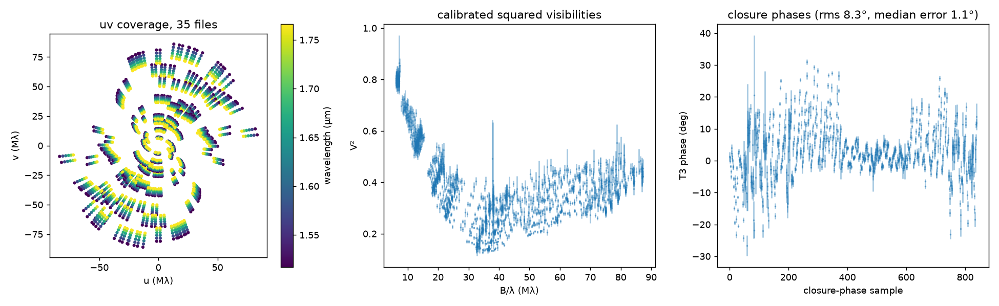

        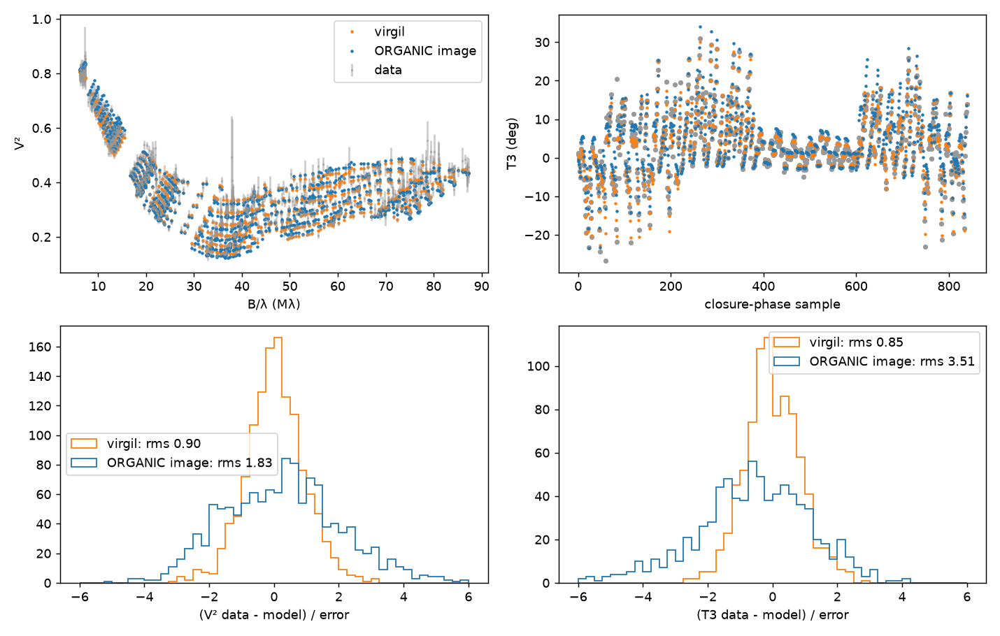

        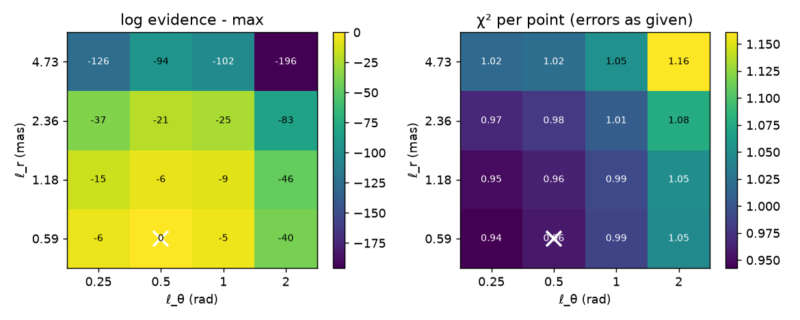

        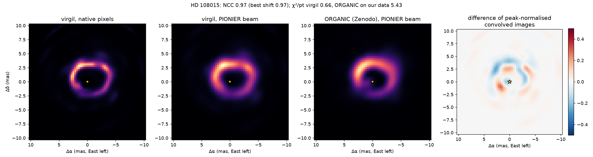

        <figure markdown>
        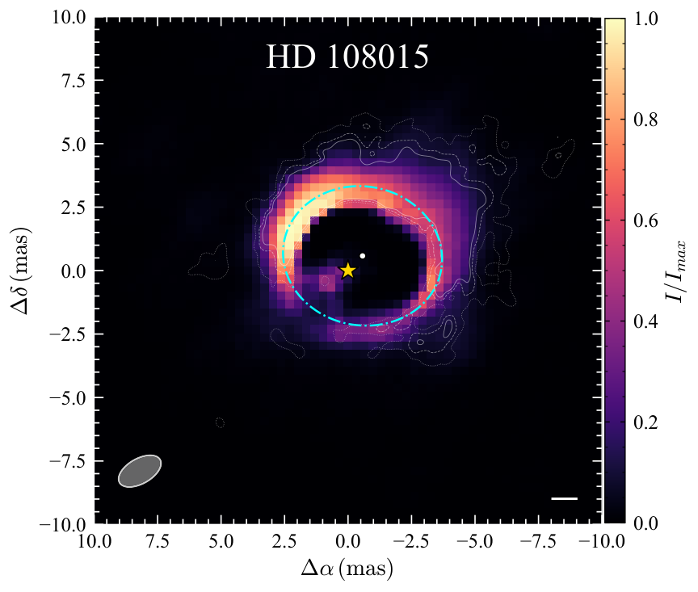
        <figcaption>As published: the ORGANIC image of HD 108015 with the fitted inner rim, arXiv:2605.13445v2, Fig. 3. Reproduced from the arXiv version with the authors' permission.</figcaption>
        </figure>

        <figure markdown>
        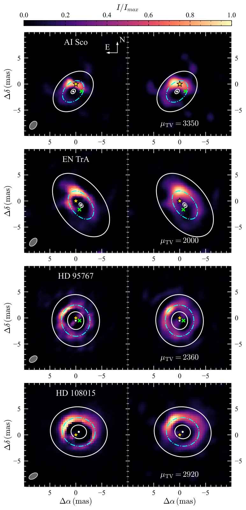
        <figcaption>ORGANIC (left) against SQUEEZE (right) for AI Sco, EN TrA, HD 95767 and HD 108015, arXiv:2605.13445v2, Fig. 14 (Appendix D). Reproduced from the arXiv version with the authors' permission.</figcaption>
        </figure>

        Provenance, permissions and credits: [`DATA_ATTRIBUTION.md`](https://github.com/benjaminpope/virgil-validation/blob/main/DATA_ATTRIBUTION.md).
        Reproduce with `scripts/postagb_data.py fetch`, `scripts/postagb_literature.py` and
        `scripts/postagb_imaging.py {inspect,parametric,image,compare,table,replot} docs/imaging/postagb --target HD108015`.

=== "AI Sco"

    ### AI Sco { #ai-sco }

    <figure markdown>
    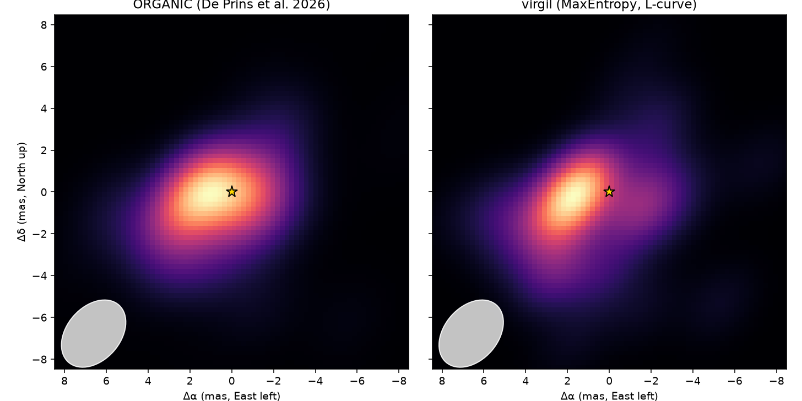
    <figcaption>AI Sco in H band, 28 PIONIER exposures (MJD 58693 to 58726). Left: the ORGANIC image of De Prins et al. (2026), re-rendered here from their Zenodo FITS (10.5281/zenodo.20155600). Right: virgil, MaxEntropy with the weight at the L-curve corner. Both are the star-and-secondary-subtracted disc emission, convolved to the PIONIER beam (grey ellipse), peak-normalised, North up, East left; the star is the gold marker.</figcaption>
    </figure>

    !!! success "Verdict: the two reconstructions agree"
        The images correlate at 0.96 (0.98 after the best sub-beam shift), with the same elongation (major-axis PA 56° against 55°, axis ratio 0.77 in both). virgil's disc is slightly larger (flux-weighted radius 3.5 against 3.0 mas). The image-fit spectral index differs strongly (−1.8 against −0.6); the two images use different power laws for essentially the same flux.

    **Parameters.** The first table compares the PMOIRED geometric model of De Prins et al. (Table 3) with a PMOIRED-style parametric fit of virgil to the same 28 files (UD star, power-law rim with an m = 1 modulation, plus the paper's optional secondary or resolved background). The σ column uses the paper's uncertainty only; virgil's are point estimates, so large σ values mostly say how tight the paper's errors are. The rim diameter is that of a Gaussian ring in virgil and of a power-law rim in PMOIRED, and the modulation phase is not pinned to the paper's convention, so those two rows are not like for like. The parametric fit takes the lowest χ² of 6 starts (2.9, 2.9, 2.9, 3.1, 2.9, 2.9). The second table compares the SPARCO parameters of the ORGANIC image with those fitted together with virgil's image.

    | Parameter | De Prins+2026 (PMOIRED) | virgil (parametric) | Difference |
    | --- | --- | --- | --- |
    | Primary flux fraction, H (%) | 68.1 ± 0.4 | 72.6 | +4.48 (+11.2σ) |
    | Secondary flux fraction, H (%) | 5.9 ± 0.2 | 3.43 | -2.47 (-12.4σ) |
    | Secondary offset Δα (mas) | -1.08 ± 0.04 | -1.78 | -0.699 (-23.3σ) |
    | Secondary offset Δδ (mas) | -1.38 ± 0.06 | -1.01 | +0.366 (+6.1σ) |
    | Rim diameter (mas) | 5.83 ± 0.09 | 4.97 | -0.864 (-12.3σ) |
    | Rim inclination (°) | 45.6 ± 2 | 46.1 | +0.503 (+0.3σ) |
    | Rim position angle (°) | 60 ± 7 | 18.8 | -41.2 (-8.2σ) |
    | Rim modulation amplitude (m = 1) | 0.87 ± 0.05 | 0.714 | -0.156 (-3.1σ) |
    | Rim modulation phase (°) | -9 ± 5 | 33.1 | +42.1 (+10.5σ) |
    | χ² per point | 4.98 | 2.86 | |

    ORGANIC/SPARCO parameters (Table 2 and FITS header) against the virgil image fit:

    | Parameter | De Prins+2026 (ORGANIC) | virgil (image fit) | Difference |
    | --- | --- | --- | --- |
    | Primary flux fraction, H (%) | 64.5 | 69.9 | +5.36 |
    | Secondary flux fraction, H (%) | 2.76 | 2.68 | -0.0847 |
    | Image spectral index | -0.59 | -1.83 | -1.24 |

    **Image metrics** (both images on one 0.23 mas grid, convolved to the beam; the paper's own rim fit needs per-pixel significances, so both images get the same moments):

    | Metric | ORGANIC | virgil |
    | --- | --- | --- |
    | Normalised cross-correlation | 1 | 0.96 (0.98 after the best sub-beam shift) |
    | Flux fraction in the image field | 95 % | 98 % |
    | Flux-weighted radius (mas) | 3.03 | 3.52 |
    | Major-axis PA (°), axis ratio | 55, 0.77 | 56, 0.77 |
    | Asymmetry angle, flux centroid (° East of North), offset (mas) | 48, 0.92 | 43, 1.19 |

    ??? note "Data and method"

        **Data.** Phase 3 calibrated OIFITS from the ESO archive, programme 1103.D-0797 (PI J. Kluska, INSPIRING), the 28 exposures listed in the paper's observation log: 1008 V² and 672 closure-phase rows across the H band (1.51–1.76 µm). The PIONIER beam is 3.65 × 2.55 mas at PA 139°.

        **Model.** SPARCO as for IW Car, with the primary, secondary (where the paper fits one) and the grid read from the Zenodo FITS header; regulariser `MaxEntropy`; weight from `l_curve` (corner at 0.0562); start from `starting_image`. ORGANIC uses a GAN generator as its regulariser, with the primary's parameters tuned with pyBADS. Neither is a ground truth.

        **Fit quality.** On the same data the virgil image has χ² per point 1.13 and the ORGANIC image, with its published SPARCO parameters unchanged, 2.46 (2184 data points). This does not say virgil's image is better: it has thousands of free pixels for those points and is over-fitted at this weight, while ORGANIC is more strongly regularised. Flipping the published image East-West or North-South gives χ² 25.7 and 17.1 (so the orientation is right). This target was computed on OzSTAR (job postagb_imaging, library snapshot ea943fa + c80aed7); the parametric fit is a local multi-start rerun.

        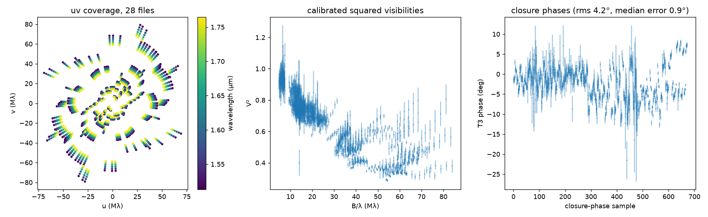

        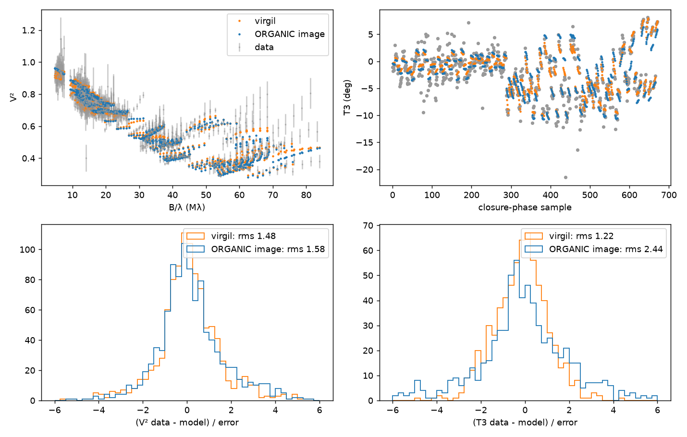

        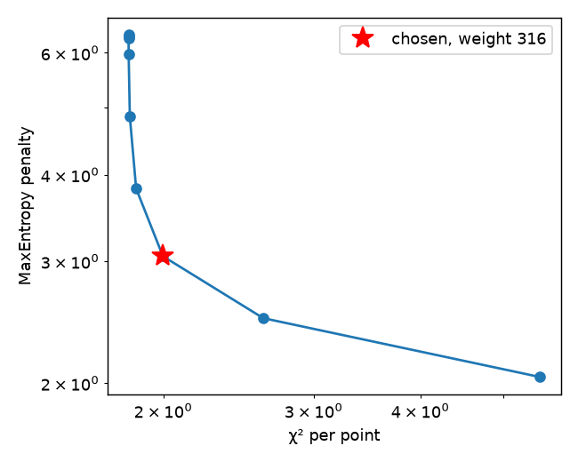

        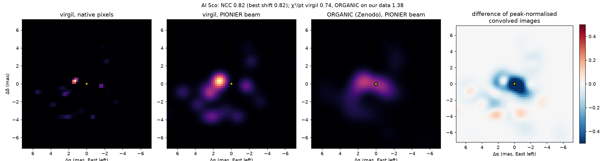

        <figure markdown>
        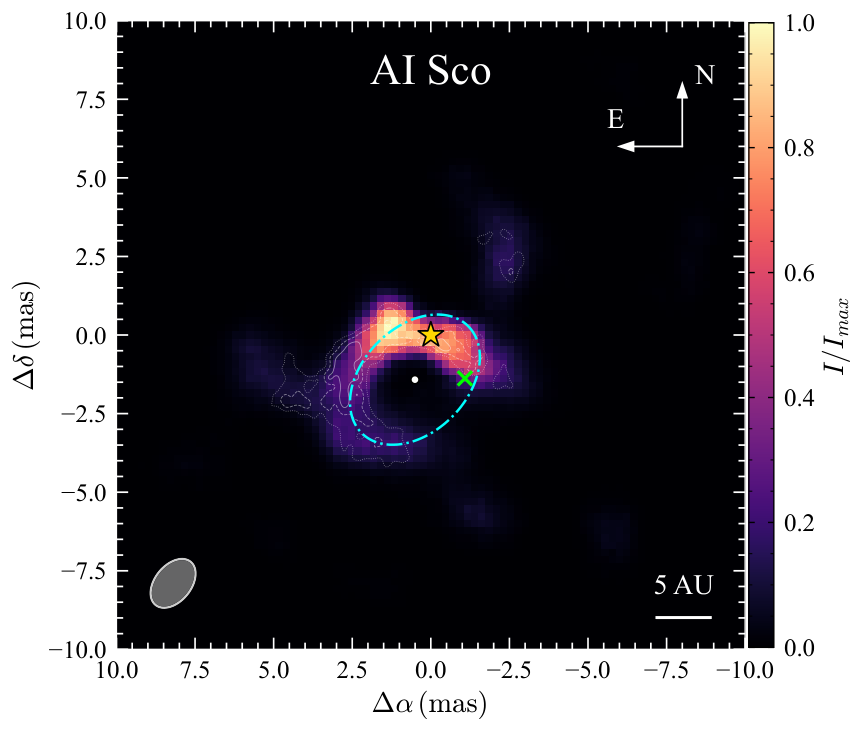
        <figcaption>As published: the ORGANIC image of AI Sco with the fitted inner rim, arXiv:2605.13445v2, Fig. 3. Reproduced from the arXiv version with the authors' permission.</figcaption>
        </figure>

        <figure markdown>
        
        <figcaption>ORGANIC (left) against SQUEEZE (right) for AI Sco, EN TrA, HD 95767 and HD 108015, arXiv:2605.13445v2, Fig. 14 (Appendix D). Reproduced from the arXiv version with the authors' permission.</figcaption>
        </figure>

        Provenance, permissions and credits: [`DATA_ATTRIBUTION.md`](https://github.com/benjaminpope/virgil-validation/blob/main/DATA_ATTRIBUTION.md).
        Reproduce with `scripts/postagb_data.py fetch`, `scripts/postagb_literature.py` and
        `scripts/postagb_imaging.py {inspect,parametric,image,compare,table,replot} docs/imaging/postagb --target AI_Sco`.

=== "EN TrA"

    ### EN TrA { #en-tra }

    <figure markdown>
    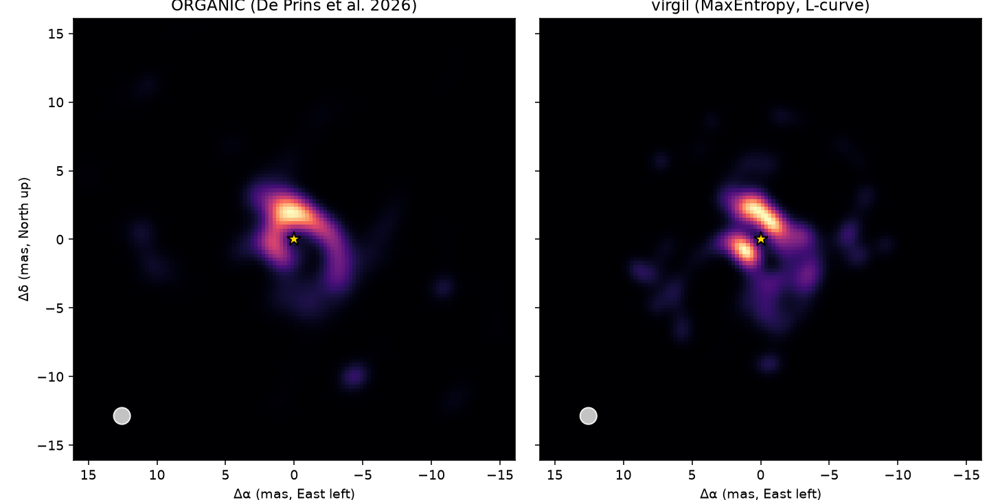
    <figcaption>EN TrA in H band, 20 PIONIER exposures (MJD 59267 to 59295). Left: the ORGANIC image of De Prins et al. (2026), re-rendered here from their Zenodo FITS (10.5281/zenodo.20155600). Right: virgil, MaxEntropy with the weight at the L-curve corner. Both are the star-and-secondary-subtracted disc emission, convolved to the PIONIER beam (grey ellipse), peak-normalised, North up, East left; the star is the gold marker.</figcaption>
    </figure>

    !!! warning "Verdict: the same blob, a different orientation"
        The images correlate at 0.95 (0.97 after the best sub-beam shift) and the flux-weighted radii match (3.9 against 4.3 mas), but the second-moment major axis is at 53° in virgil and 124° in ORGANIC, and virgil's disc is rounder (axis ratio 0.90 against 0.78). The parametric rim, by contrast, matches the paper (PA 32.6° against 32.5 ± 1.9°; inclination 58.8° against 58.9 ± 1.2°). The moments of a compact, beam-sized image are fragile, so treat the orientation difference as real but small compared with the beam.

    **Parameters.** The first table compares the PMOIRED geometric model of De Prins et al. (Table 3) with a PMOIRED-style parametric fit of virgil to the same 20 files (UD star, power-law rim with an m = 1 modulation, plus the paper's optional secondary or resolved background). The σ column uses the paper's uncertainty only; virgil's are point estimates, so large σ values mostly say how tight the paper's errors are. The rim diameter is that of a Gaussian ring in virgil and of a power-law rim in PMOIRED, and the modulation phase is not pinned to the paper's convention, so those two rows are not like for like. The parametric fit takes the lowest χ² of 6 starts (1.7, 1.7, 1.7, 1.7, 1.7, 1.7). The second table compares the SPARCO parameters of the ORGANIC image with those fitted together with virgil's image.

    | Parameter | De Prins+2026 (PMOIRED) | virgil (parametric) | Difference |
    | --- | --- | --- | --- |
    | Primary flux fraction, H (%) | 72.1 ± 0.4 | 72.2 | +0.126 (+0.3σ) |
    | Secondary flux fraction, H (%) | 5 ± 0.2 | 4.56 | -0.439 (-2.2σ) |
    | Secondary offset Δα (mas) | -0.7 ± 0.02 | -0.554 | +0.146 (+7.3σ) |
    | Secondary offset Δδ (mas) | -1.65 ± 0.04 | -1.61 | +0.0427 (+1.1σ) |
    | Rim diameter (mas) | 5.63 ± 0.16 | 6.95 | +1.32 (+8.3σ) |
    | Rim inclination (°) | 58.9 ± 1.2 | 58.8 | -0.0692 (-0.1σ) |
    | Rim position angle (°) | 32.5 ± 1.9 | 32.6 | +0.114 (+0.1σ) |
    | Rim modulation amplitude (m = 1) | 0.72 ± 0.04 | 0.709 | -0.0112 (-0.3σ) |
    | Rim modulation phase (°) | -13 ± 4 | 22.6 | +35.6 (+8.9σ) |
    | χ² per point | 2.40 | 1.71 | |

    ORGANIC/SPARCO parameters (Table 2 and FITS header) against the virgil image fit:

    | Parameter | De Prins+2026 (ORGANIC) | virgil (image fit) | Difference |
    | --- | --- | --- | --- |
    | Primary flux fraction, H (%) | 72.1 | 70.6 | -1.47 |
    | Secondary flux fraction, H (%) | 5.37 | 5.44 | +0.0724 |
    | Image spectral index | 0.3 | 0.0101 | -0.29 |

    **Image metrics** (both images on one 0.27 mas grid, convolved to the beam; the paper's own rim fit needs per-pixel significances, so both images get the same moments):

    | Metric | ORGANIC | virgil |
    | --- | --- | --- |
    | Normalised cross-correlation | 1 | 0.95 (0.97 after the best sub-beam shift) |
    | Flux fraction in the image field | 98 % | 100 % |
    | Flux-weighted radius (mas) | 4.25 | 3.94 |
    | Major-axis PA (°), axis ratio | 124, 0.78 | 53, 0.90 |
    | Asymmetry angle, flux centroid (° East of North), offset (mas) | 256, 0.20 | 344, 0.36 |

    ??? note "Data and method"

        **Data.** Phase 3 calibrated OIFITS from the ESO archive, programme 1103.D-0797 (PI J. Kluska, INSPIRING), the 20 exposures listed in the paper's observation log: 712 V² and 477 closure-phase rows across the H band (1.52–1.77 µm). The PIONIER beam is 3.26 × 1.98 mas at PA 139°.

        **Model.** SPARCO as for IW Car, with the primary, secondary (where the paper fits one) and the grid read from the Zenodo FITS header; regulariser `MaxEntropy`; weight from `l_curve` (corner at 56.2); start from `starting_image`. ORGANIC uses a GAN generator as its regulariser, with the primary's parameters tuned with pyBADS. Neither is a ground truth.

        **Fit quality.** On the same data the virgil image has χ² per point 1.15 and the ORGANIC image, with its published SPARCO parameters unchanged, 1.41 (1548 data points). This does not say virgil's image is better: it has thousands of free pixels for those points and is over-fitted at this weight, while ORGANIC is more strongly regularised. Flipping the published image East-West or North-South gives χ² 7.3 and 16.2 (so the orientation is right). This target was computed on the laptop; the parametric fit is a local multi-start rerun.

        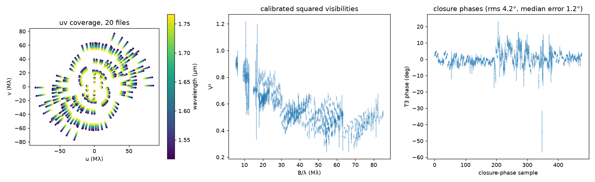

        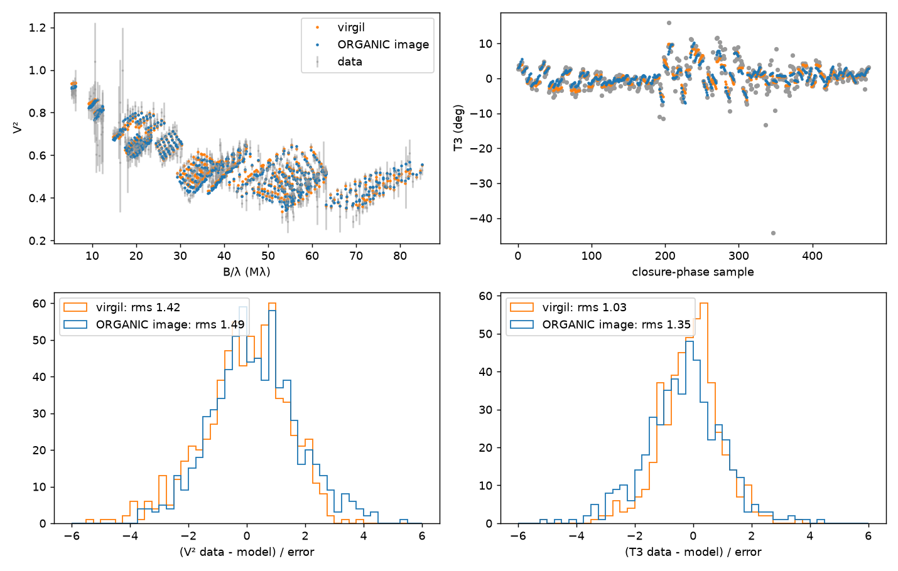

        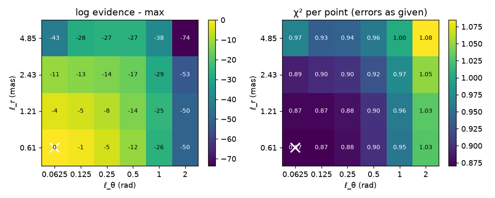

        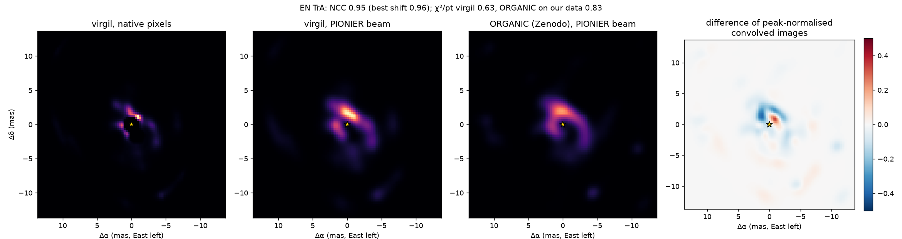

        <figure markdown>
        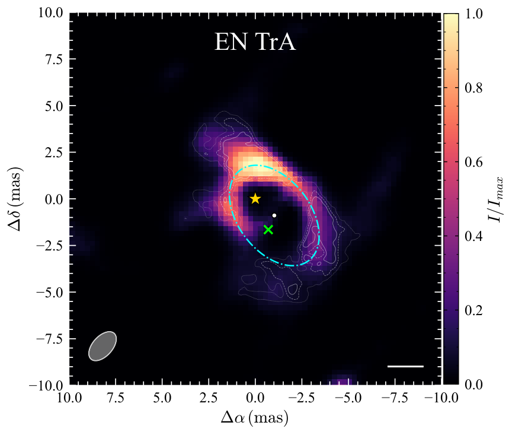
        <figcaption>As published: the ORGANIC image of EN TrA with the fitted inner rim, arXiv:2605.13445v2, Fig. 3. Reproduced from the arXiv version with the authors' permission.</figcaption>
        </figure>

        <figure markdown>
        
        <figcaption>ORGANIC (left) against SQUEEZE (right) for AI Sco, EN TrA, HD 95767 and HD 108015, arXiv:2605.13445v2, Fig. 14 (Appendix D). Reproduced from the arXiv version with the authors' permission.</figcaption>
        </figure>

        Provenance, permissions and credits: [`DATA_ATTRIBUTION.md`](https://github.com/benjaminpope/virgil-validation/blob/main/DATA_ATTRIBUTION.md).
        Reproduce with `scripts/postagb_data.py fetch`, `scripts/postagb_literature.py` and
        `scripts/postagb_imaging.py {inspect,parametric,image,compare,table,replot} docs/imaging/postagb --target EN_TrA`.

=== "HD 95767"

    ### HD 95767 { #hd-95767 }

    <figure markdown>
    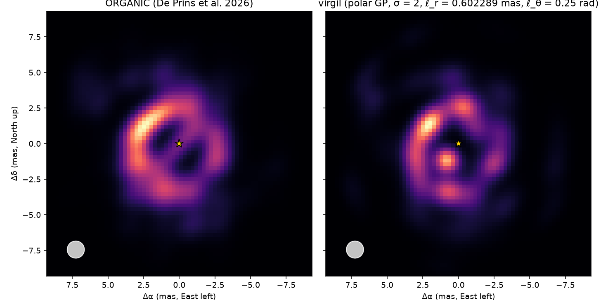
    <figcaption>HD 95767 in H band, 36 PIONIER exposures (MJD 59577 to 59616). Left: the ORGANIC image of De Prins et al. (2026), re-rendered here from their Zenodo FITS (10.5281/zenodo.20155600). Right: virgil, MaxEntropy with the weight at the L-curve corner. Both are the star-and-secondary-subtracted disc emission, convolved to the PIONIER beam (grey ellipse), peak-normalised, North up, East left; the star is the gold marker.</figcaption>
    </figure>

    !!! success "Verdict: the two reconstructions agree"
        The images correlate at 0.99, with the same elongation (axis ratio 0.93 against 0.89) and centroid direction (78° against 80°); virgil's disc is slightly larger (4.1 against 3.8 mas) and the major axes differ by 12°. The parametric fit reproduces the secondary and the modulation phase, but not the rim size or inclination.

    **Parameters.** The first table compares the PMOIRED geometric model of De Prins et al. (Table 3) with a PMOIRED-style parametric fit of virgil to the same 36 files (UD star, power-law rim with an m = 1 modulation, plus the paper's optional secondary or resolved background). The σ column uses the paper's uncertainty only; virgil's are point estimates, so large σ values mostly say how tight the paper's errors are. The rim diameter is that of a Gaussian ring in virgil and of a power-law rim in PMOIRED, and the modulation phase is not pinned to the paper's convention, so those two rows are not like for like. The parametric fit takes the lowest χ² of 6 starts (2.1, 2.1, 2.1, 2.1, 2.1, 2.1). The second table compares the SPARCO parameters of the ORGANIC image with those fitted together with virgil's image.

    | Parameter | De Prins+2026 (PMOIRED) | virgil (parametric) | Difference |
    | --- | --- | --- | --- |
    | Primary flux fraction, H (%) | 48.5 ± 0.7 | 46.9 | -1.64 (-2.3σ) |
    | Secondary flux fraction, H (%) | 21 ± 0.7 | 19.8 | -1.2 (-1.7σ) |
    | Secondary offset Δα (mas) | -0.719 ± 0.013 | -0.695 | +0.0238 (+1.8σ) |
    | Secondary offset Δδ (mas) | -0.51 ± 0.009 | -0.474 | +0.0361 (+4.0σ) |
    | Rim diameter (mas) | 4.67 ± 0.05 | 6.22 | +1.55 (+30.9σ) |
    | Rim inclination (°) | 25.6 ± 1.7 | 37 | +11.4 (+6.7σ) |
    | Rim position angle (°) | 14 ± 4 | 1.97 | -12 (-3.0σ) |
    | Rim modulation amplitude (m = 1) | 0.451 ± 0.02 | 0.504 | +0.0534 (+2.8σ) |
    | Rim modulation phase (°) | 43 ± 4 | 43.3 | +0.313 (+0.1σ) |
    | χ² per point | 1.97 | 2.10 | |

    ORGANIC/SPARCO parameters (Table 2 and FITS header) against the virgil image fit:

    | Parameter | De Prins+2026 (ORGANIC) | virgil (image fit) | Difference |
    | --- | --- | --- | --- |
    | Primary flux fraction, H (%) | 44.1 | 54.9 | +10.8 |
    | Secondary flux fraction, H (%) | 24.8 | 16.5 | -8.28 |
    | Image spectral index | 2.36 | 1.91 | -0.452 |

    **Image metrics** (both images on one 0.26 mas grid, convolved to the beam; the paper's own rim fit needs per-pixel significances, so both images get the same moments):

    | Metric | ORGANIC | virgil |
    | --- | --- | --- |
    | Normalised cross-correlation | 1 | 0.99 (0.99 after the best sub-beam shift) |
    | Flux fraction in the image field | 97 % | 98 % |
    | Flux-weighted radius (mas) | 3.78 | 4.12 |
    | Major-axis PA (°), axis ratio | 174, 0.89 | 162, 0.93 |
    | Asymmetry angle, flux centroid (° East of North), offset (mas) | 80, 0.66 | 78, 0.63 |

    ??? note "Data and method"

        **Data.** Phase 3 calibrated OIFITS from the ESO archive, programme 1103.D-0797 (PI J. Kluska, INSPIRING), the 36 exposures listed in the paper's observation log: 1296 V² and 864 closure-phase rows across the H band (1.52–1.77 µm). The PIONIER beam is 3.31 × 2.19 mas at PA 124°.

        **Model.** SPARCO as for IW Car, with the primary, secondary (where the paper fits one) and the grid read from the Zenodo FITS header; regulariser `MaxEntropy`; weight from `l_curve` (corner at 316); start from `starting_image`. ORGANIC uses a GAN generator as its regulariser, with the primary's parameters tuned with pyBADS. Neither is a ground truth.

        **Fit quality.** On the same data the virgil image has χ² per point 0.61 and the ORGANIC image, with its published SPARCO parameters unchanged, 1.35 (2808 data points). This does not say virgil's image is better: it has thousands of free pixels for those points and is over-fitted at this weight, while ORGANIC is more strongly regularised. Flipping the published image East-West or North-South gives χ² 6.4 and 7.7 (so the orientation is right). This target was computed on OzSTAR (job postagb_imaging, library snapshot ea943fa + c80aed7); the parametric fit is a local multi-start rerun.

        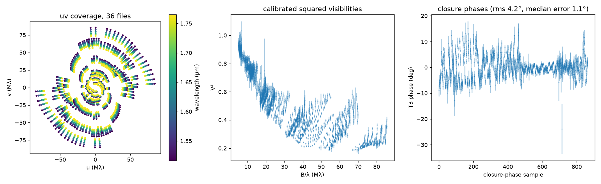

        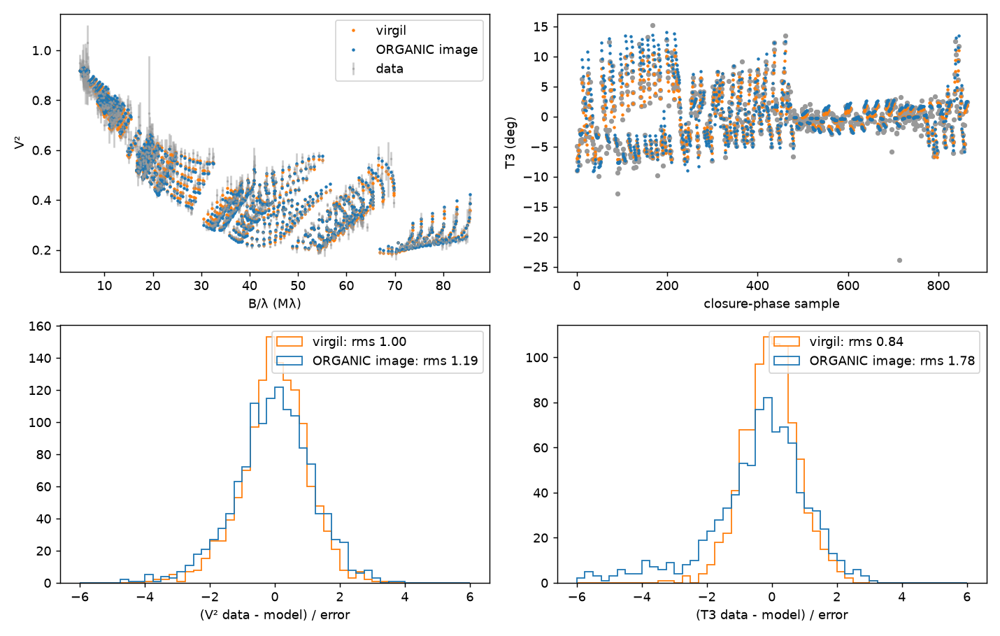

        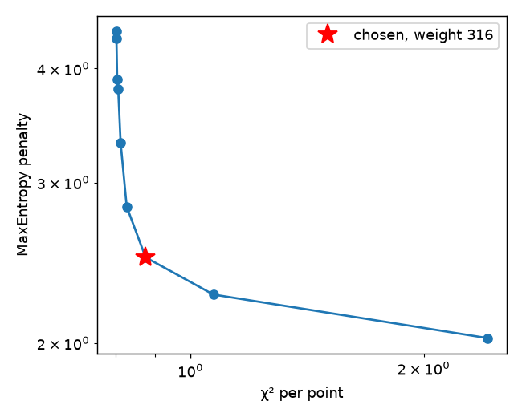

        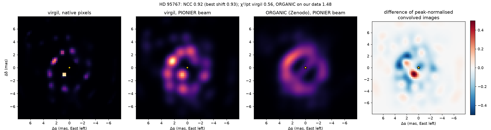

        <figure markdown>
        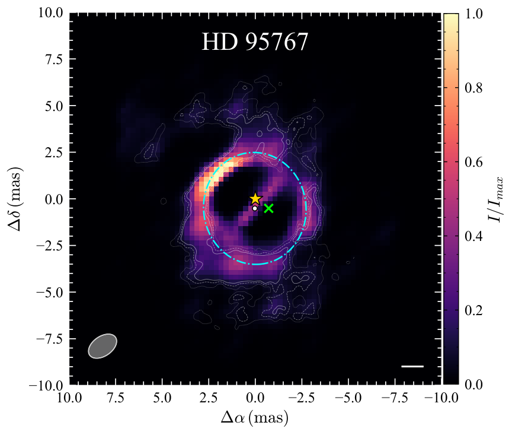
        <figcaption>As published: the ORGANIC image of HD 95767 with the fitted inner rim, arXiv:2605.13445v2, Fig. 3. Reproduced from the arXiv version with the authors' permission.</figcaption>
        </figure>

        <figure markdown>
        
        <figcaption>ORGANIC (left) against SQUEEZE (right) for AI Sco, EN TrA, HD 95767 and HD 108015, arXiv:2605.13445v2, Fig. 14 (Appendix D). Reproduced from the arXiv version with the authors' permission.</figcaption>
        </figure>

        Provenance, permissions and credits: [`DATA_ATTRIBUTION.md`](https://github.com/benjaminpope/virgil-validation/blob/main/DATA_ATTRIBUTION.md).
        Reproduce with `scripts/postagb_data.py fetch`, `scripts/postagb_literature.py` and
        `scripts/postagb_imaging.py {inspect,parametric,image,compare,table,replot} docs/imaging/postagb --target HD95767`.

=== "IRAS 15469-5311"

    ### IRAS 15469-5311 { #iras-15469-5311 }

    <figure markdown>
    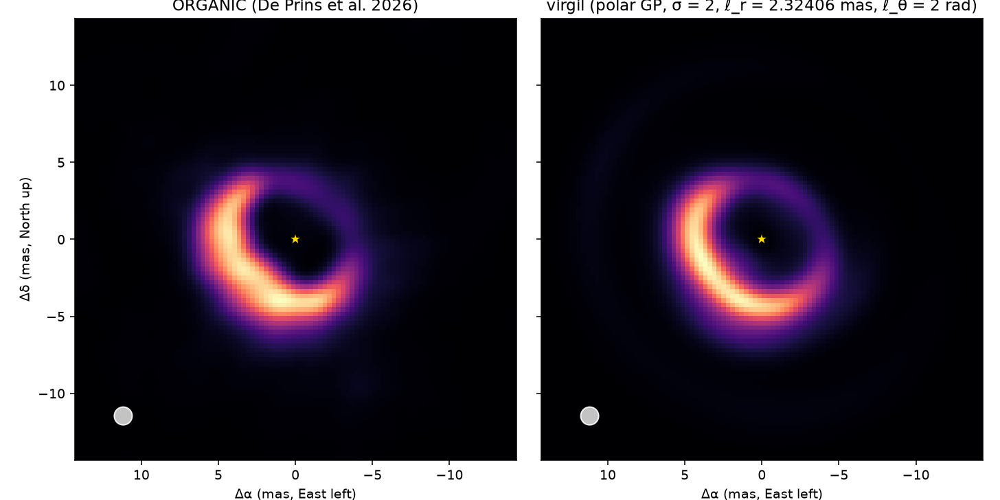
    <figcaption>IRAS 15469-5311 in H band, 20 PIONIER exposures (MJD 59266 to 59296). Left: the ORGANIC image of De Prins et al. (2026), re-rendered here from their Zenodo FITS (10.5281/zenodo.20155600). Right: virgil, MaxEntropy with the weight at the L-curve corner. Both are the star-subtracted disc emission, convolved to the PIONIER beam (grey ellipse), peak-normalised, North up, East left; the star is the gold marker.</figcaption>
    </figure>

    !!! success "Verdict: the two reconstructions agree"
        The images correlate at 0.99. The flux-weighted radii (5.8 against 5.4 mas) and the elongation (axis ratio 0.90 against 0.88) agree; the major axes differ by 23° (145° against 122°). virgil fits the data much better (χ² per point 0.38 against 2.21 for the published image), which is a symptom of over-fitting, not a better image.

    **Parameters.** The first table compares the PMOIRED geometric model of De Prins et al. (Table 3) with a PMOIRED-style parametric fit of virgil to the same 20 files (UD star, power-law rim with an m = 1 modulation, plus the paper's optional secondary or resolved background). The σ column uses the paper's uncertainty only; virgil's are point estimates, so large σ values mostly say how tight the paper's errors are. The rim diameter is that of a Gaussian ring in virgil and of a power-law rim in PMOIRED, and the modulation phase is not pinned to the paper's convention, so those two rows are not like for like. The parametric fit takes the lowest χ² of 6 starts (8.3, 2.3, 4.6, 1.3, 5.0, 1.3). The second table compares the SPARCO parameters of the ORGANIC image with those fitted together with virgil's image.

    | Parameter | De Prins+2026 (PMOIRED) | virgil (parametric) | Difference |
    | --- | --- | --- | --- |
    | Primary flux fraction, H (%) | 59.5 ± 0.7 | 53.8 | -5.68 (-9.5σ) |
    | Resolved-background flux fraction, H (%) | 11.1 ± 1.2 | 15.4 | +4.31 (+3.6σ) |
    | Rim diameter (mas) | 7.8 ± 0.06 | 9.26 | +1.46 (+29.3σ) |
    | Rim inclination (°) | 40.2 ± 0.8 | 35.1 | -5.09 (-7.3σ) |
    | Rim position angle (°) | 53.5 ± 1.1 | 49.6 | -3.92 (-3.6σ) |
    | Rim modulation amplitude (m = 1) | 0.86 ± 0.02 | 0.884 | +0.0243 (+1.2σ) |
    | Rim modulation phase (°) | 74.6 ± 1.6 | 126 | +51.3 (+32.1σ) |
    | χ² per point | 2.08 | 1.29 | |

    ORGANIC/SPARCO parameters (Table 2 and FITS header) against the virgil image fit:

    | Parameter | De Prins+2026 (ORGANIC) | virgil (image fit) | Difference |
    | --- | --- | --- | --- |
    | Primary flux fraction, H (%) | 52.9 | 53.6 | +0.729 |
    | Image spectral index | 1.84 | 1.9 | +0.0551 |

    **Image metrics** (both images on one 0.29 mas grid, convolved to the beam; the paper's own rim fit needs per-pixel significances, so both images get the same moments):

    | Metric | ORGANIC | virgil |
    | --- | --- | --- |
    | Normalised cross-correlation | 1 | 0.99 (0.99 after the best sub-beam shift) |
    | Flux fraction in the image field | 95 % | 94 % |
    | Flux-weighted radius (mas) | 5.43 | 5.79 |
    | Major-axis PA (°), axis ratio | 122, 0.88 | 145, 0.90 |
    | Asymmetry angle, flux centroid (° East of North), offset (mas) | 45, 2.07 | 40, 1.67 |

    ??? note "Data and method"

        **Data.** Phase 3 calibrated OIFITS from the ESO archive, programme 1103.D-0797 (PI J. Kluska, INSPIRING), the 20 exposures listed in the paper's observation log: 720 V² and 480 closure-phase rows across the H band (1.52–1.77 µm). The PIONIER beam is 4.15 × 1.82 mas at PA 127°.

        **Model.** SPARCO as for IW Car, with the primary, secondary (where the paper fits one) and the grid read from the Zenodo FITS header; regulariser `MaxEntropy`; weight from `l_curve` (corner at 56.2); start from `starting_image`. ORGANIC uses a GAN generator as its regulariser, with the primary's parameters tuned with pyBADS. Neither is a ground truth.

        **Fit quality.** On the same data the virgil image has χ² per point 0.38 and the ORGANIC image, with its published SPARCO parameters unchanged, 2.21 (1560 data points). This does not say virgil's image is better: it has thousands of free pixels for those points and is over-fitted at this weight, while ORGANIC is more strongly regularised. Flipping the published image East-West or North-South gives χ² 15.6 and 37.1 (so the orientation is right). This target was computed on OzSTAR (job postagb_imaging, library snapshot ea943fa + c80aed7); the parametric fit is a local multi-start rerun.

        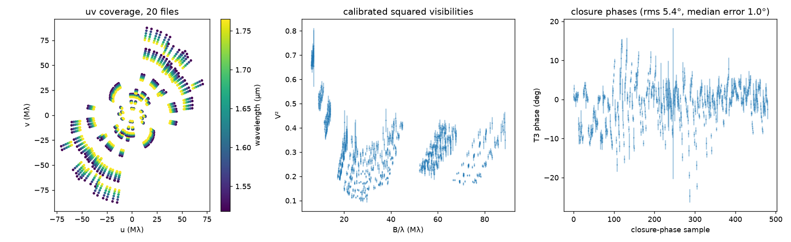

        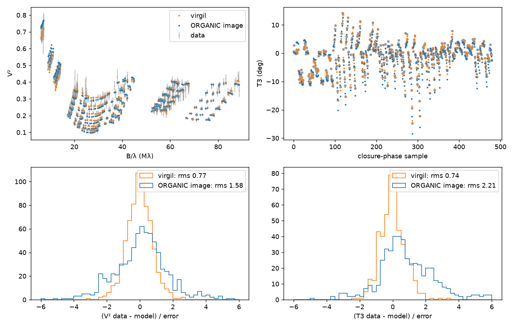

        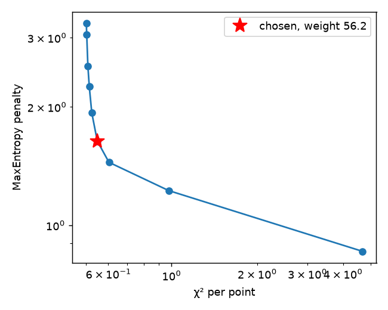

        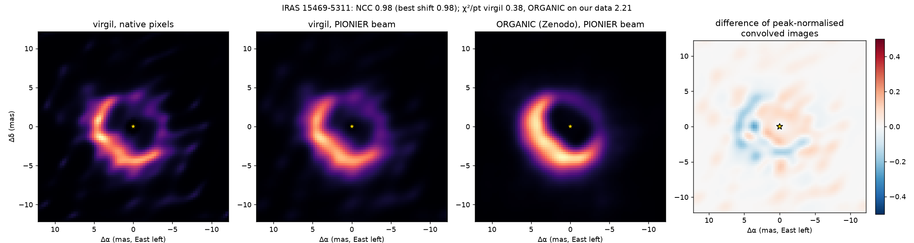

        <figure markdown>
        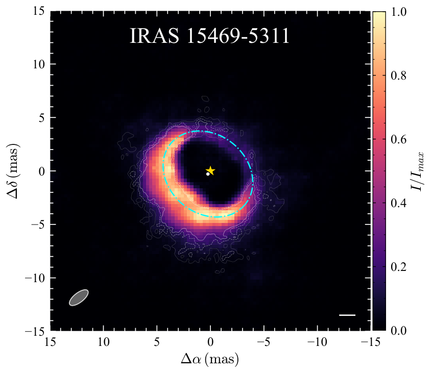
        <figcaption>As published: the ORGANIC image of IRAS 15469-5311 with the fitted inner rim, arXiv:2605.13445v2, Fig. 4. Reproduced from the arXiv version with the authors' permission.</figcaption>
        </figure>

        <figure markdown>
        
        <figcaption>ORGANIC (left) against SQUEEZE (right) for HR 4049, IRAS 15469-5311, PS Gem and IW Car, arXiv:2605.13445v2, Fig. 15 (Appendix D). Reproduced from the arXiv version with the authors' permission.</figcaption>
        </figure>

        <figure markdown>
        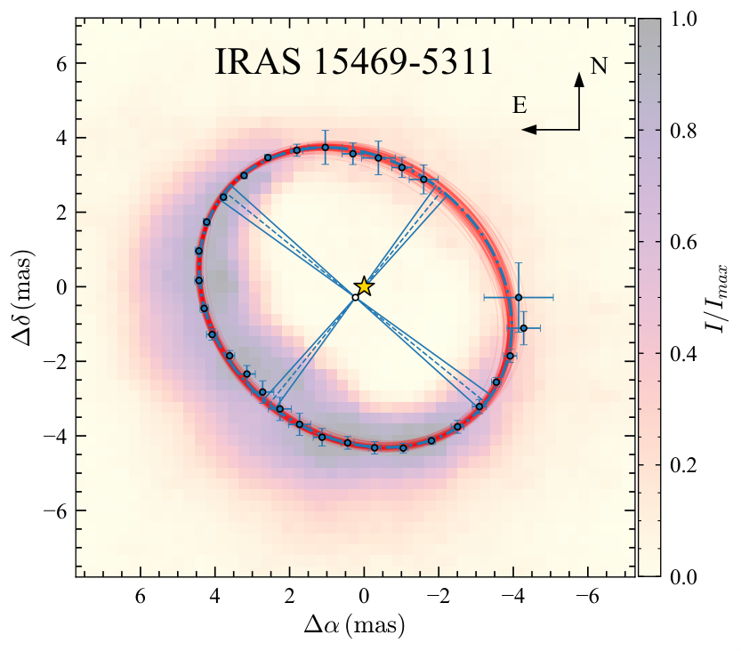
        <figcaption>Example of the paper's inner-rim ellipse fit for IRAS 15469-5311 (radial rays and 100 MCMC ellipses), arXiv:2605.13445v2, Fig. 5. Reproduced from the arXiv version with the authors' permission.</figcaption>
        </figure>

        Provenance, permissions and credits: [`DATA_ATTRIBUTION.md`](https://github.com/benjaminpope/virgil-validation/blob/main/DATA_ATTRIBUTION.md).
        Reproduce with `scripts/postagb_data.py fetch`, `scripts/postagb_literature.py` and
        `scripts/postagb_imaging.py {inspect,parametric,image,compare,table,replot} docs/imaging/postagb --target IRAS15469-5311`.

=== "PS Gem"

    ### PS Gem { #ps-gem }

    <figure markdown>
    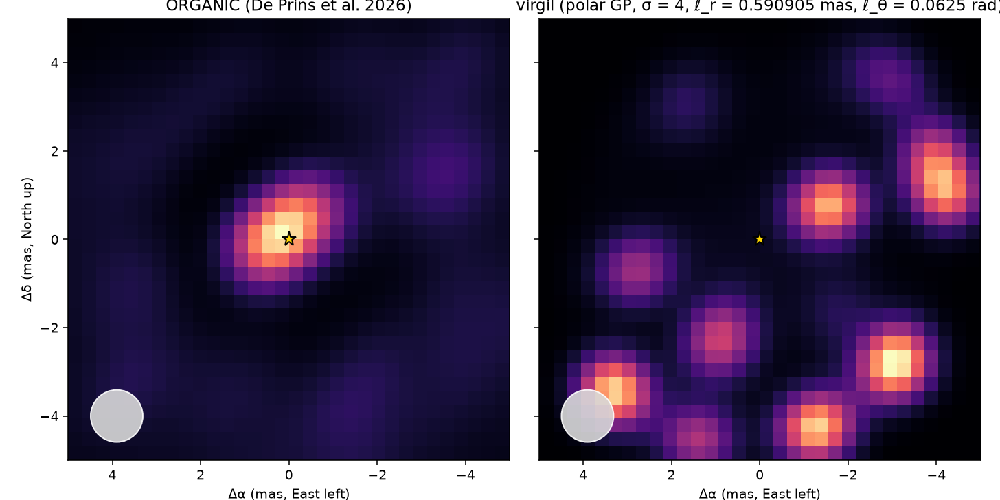
    <figcaption>PS Gem in H band, 12 PIONIER exposures (MJD 58817 to 58928). Left: the ORGANIC image of De Prins et al. (2026), re-rendered here from their Zenodo FITS (10.5281/zenodo.20155600). Right: virgil, MaxEntropy with the weight at the L-curve corner. Both are the star-subtracted disc emission, convolved to the PIONIER beam (grey ellipse), peak-normalised, North up, East left; the star is the gold marker.</figcaption>
    </figure>

    !!! failure "Verdict: the two reconstructions do not agree, and the data cannot say which is right"
        The images correlate at only 0.63 (0.71 after the best shift). virgil's image is a scatter of fragments out to 9 mas (flux-weighted radius 9.1 against 6.3 mas), not a compact disc. Only 12 exposures were observed and the data are met equally well by the published image (χ² per point 0.49), its East-West mirror (1.0) and its North-South mirror (1.2), so the orientation is hardly constrained at all. The L-curve for this target is flat with no clear corner, so the weight (5.6 × 10⁻⁴) is arbitrary. Do not read anything into virgil's image here.

    **Parameters.** The first table compares the PMOIRED geometric model of De Prins et al. (Table 3) with a PMOIRED-style parametric fit of virgil to the same 12 files (UD star, power-law rim with an m = 1 modulation, plus the paper's optional secondary or resolved background). The σ column uses the paper's uncertainty only; virgil's are point estimates, so large σ values mostly say how tight the paper's errors are. The rim diameter is that of a Gaussian ring in virgil and of a power-law rim in PMOIRED, and the modulation phase is not pinned to the paper's convention, so those two rows are not like for like. The parametric fit takes the lowest χ² of 6 starts (0.6, 0.6, 0.6, 0.6, 0.6, 0.6). The second table compares the SPARCO parameters of the ORGANIC image with those fitted together with virgil's image.

    | Parameter | De Prins+2026 (PMOIRED) | virgil (parametric) | Difference |
    | --- | --- | --- | --- |
    | Primary flux fraction, H (%) | 89 ± 0.14 | 88.3 | -0.694 (-5.0σ) |
    | Primary UD diameter (mas) | 0.44 ± 0.02 | 0.344 | -0.0962 (-4.8σ) |
    | Rim diameter (mas) | 8.4 ± 0.6 | 14.4 | +6 (+10.0σ) |
    | Rim inclination (°) | 39 ± 7 | 49.6 | +10.6 (+1.8σ) |
    | Rim position angle (°) | 156 ± 6 | 96.6 | -59.4 (-9.9σ) |
    | Rim modulation amplitude (m = 1) | 0.65 ± 0.06 | 1 | +0.35 (+5.8σ) |
    | Rim modulation phase (°) | 35 ± 11 | 267 | -128 (-11.6σ) |
    | χ² per point | 0.94 | 0.62 | |

    ORGANIC/SPARCO parameters (Table 2 and FITS header) against the virgil image fit:

    | Parameter | De Prins+2026 (ORGANIC) | virgil (image fit) | Difference |
    | --- | --- | --- | --- |
    | Primary flux fraction, H (%) | 87 | 87.3 | +0.275 |
    | Primary UD diameter (mas) | 0.37 | 0.285 | -0.085 |
    | Image spectral index | 0.61 | 0.329 | -0.281 |

    **Image metrics** (both images on one 0.31 mas grid, convolved to the beam; the paper's own rim fit needs per-pixel significances, so both images get the same moments):

    | Metric | ORGANIC | virgil |
    | --- | --- | --- |
    | Normalised cross-correlation | 1 | 0.63 (0.71 after the best sub-beam shift) |
    | Flux fraction in the image field | 95 % | 100 % |
    | Flux-weighted radius (mas) | 6.30 | 9.06 |
    | Major-axis PA (°), axis ratio | 58, 0.82 | 61, 0.61 |
    | Asymmetry angle, flux centroid (° East of North), offset (mas) | 334, 1.27 | 3, 1.36 |

    ??? note "Data and method"

        **Data.** Phase 3 calibrated OIFITS from the ESO archive, programme 1103.D-0797 (PI J. Kluska, INSPIRING), the 12 exposures listed in the paper's observation log: 432 V² and 288 closure-phase rows across the H band (1.52–1.76 µm). The PIONIER beam is 3.10 × 1.78 mas at PA 153°.

        **Model.** SPARCO as for IW Car, with the primary, secondary (where the paper fits one) and the grid read from the Zenodo FITS header; regulariser `MaxEntropy`; weight from `l_curve` (corner at 0.000562); start from `starting_image`. ORGANIC uses a GAN generator as its regulariser, with the primary's parameters tuned with pyBADS. Neither is a ground truth.

        **Fit quality.** On the same data the virgil image has χ² per point 0.32 and the ORGANIC image, with its published SPARCO parameters unchanged, 0.49 (936 data points). This does not say virgil's image is better: it has thousands of free pixels for those points and is over-fitted at this weight, while ORGANIC is more strongly regularised. Flipping the published image East-West or North-South gives χ² 1.0 and 1.2 (so the data barely constrain the orientation). This target was computed on the laptop; the parametric fit is a local multi-start rerun.

        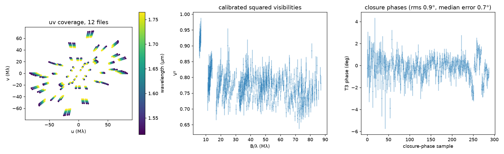

        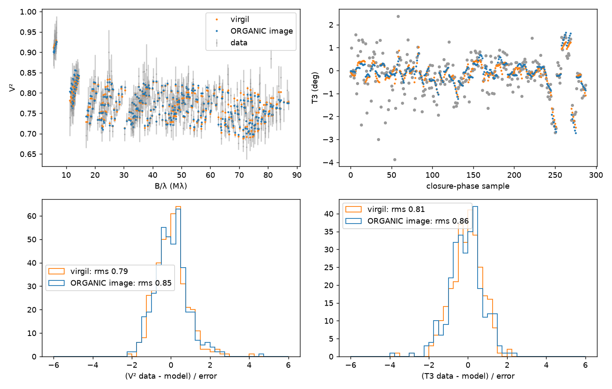

        

        

        <figure markdown>
        
        <figcaption>As published: the ORGANIC image of PS Gem with the fitted inner rim, arXiv:2605.13445v2, Fig. 4. Reproduced from the arXiv version with the authors' permission.</figcaption>
        </figure>

        <figure markdown>
        
        <figcaption>ORGANIC (left) against SQUEEZE (right) for HR 4049, IRAS 15469-5311, PS Gem and IW Car, arXiv:2605.13445v2, Fig. 15 (Appendix D). Reproduced from the arXiv version with the authors' permission.</figcaption>
        </figure>

        Provenance, permissions and credits: [`DATA_ATTRIBUTION.md`](https://github.com/benjaminpope/virgil-validation/blob/main/DATA_ATTRIBUTION.md).
        Reproduce with `scripts/postagb_data.py fetch`, `scripts/postagb_literature.py` and
        `scripts/postagb_imaging.py {inspect,parametric,image,compare,table,replot} docs/imaging/postagb --target PS_Gem`.

## Data and permissions

The targets use public ESO Phase 3 products from programme 1103.D-0797 (PI Kluska).
Published figures are shown only where the authors have given permission, from the arXiv version.

| Target | Data | Published comparison | Status |
| --- | --- | --- | --- |
| IW Car | ESO 1103.D-0797, 23 files used (31 in the archive) | De Prins+2026 (Figs 2, 4, 6, 15; Zenodo FITS) | done |
| HR 4049 | ESO 1103.D-0797 | De Prins+2026 (Fig. 4, Appendix D SQUEEZE; Zenodo FITS) | done |
| HD 108015 | ESO 1103.D-0797 | De Prins+2026 (Fig. 3, Appendix D SQUEEZE; Zenodo FITS) | done |
| AI Sco | ESO 1103.D-0797 | De Prins+2026 (Fig. 3, Appendix D SQUEEZE; Zenodo FITS) | done |
| EN TrA | ESO 1103.D-0797 | De Prins+2026 (Fig. 3, Appendix D SQUEEZE; Zenodo FITS) | done |
| HD 95767 | ESO 1103.D-0797 | De Prins+2026 (Fig. 3, Appendix D SQUEEZE; Zenodo FITS) | done |
| IRAS 15469-5311 | ESO 1103.D-0797 | De Prins+2026 (Fig. 4, Appendix D SQUEEZE; Zenodo FITS) | done |
| PS Gem | ESO 1103.D-0797 | De Prins+2026 (Fig. 4, Appendix D SQUEEZE; Zenodo FITS) | done |
| IRAS 08544-4431 | ESO 1103.D-0797 | Hillen+2016 | pending |

## Method parity

virgil's model follows the published one so that the comparison is like for like: a resolved primary with a
fixed stellar power-law index, a point secondary, and a pixel image with its own power-law spectrum
(SPARCO, Kluska et al. 2014), on the paper's grid and with the same data. What differs on purpose is the
regulariser and optimiser (MaxEntropy and L-BFGS against ORGANIC's GAN and pyBADS), the choice of weight (L-curve
corner against ORGANIC's tuned regularisation), and the uncertainty treatment (here the images are single reconstructions, without the paper's per-pixel significance maps). Images are therefore
compared at the PIONIER beam, never at native resolution, where regularised reconstructions differ by construction.
