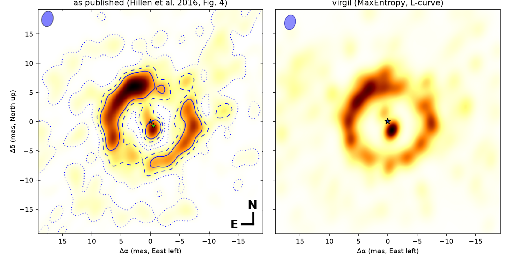
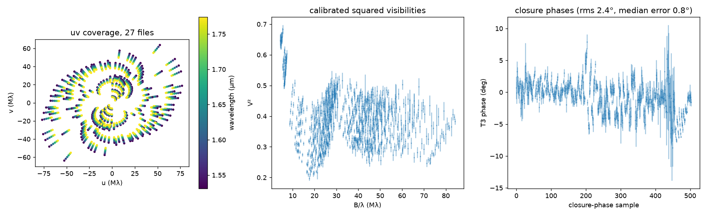
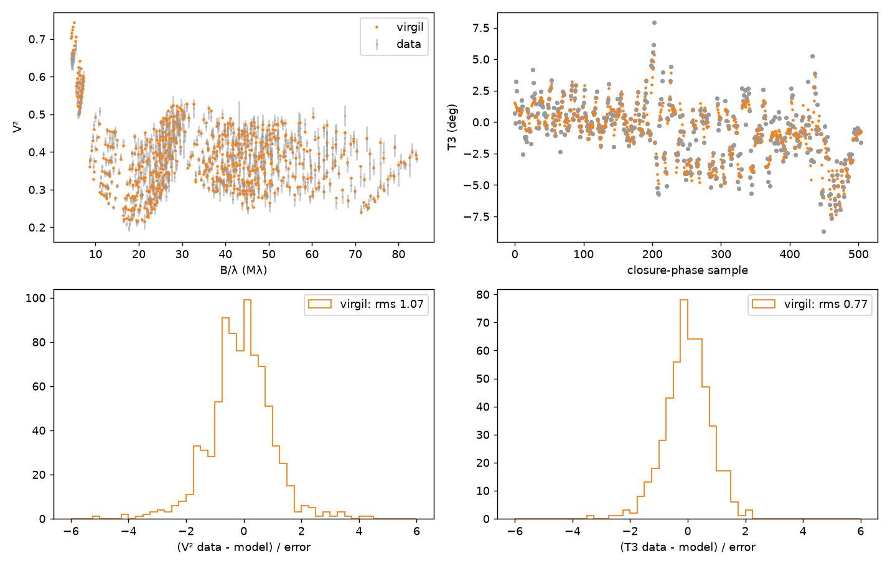
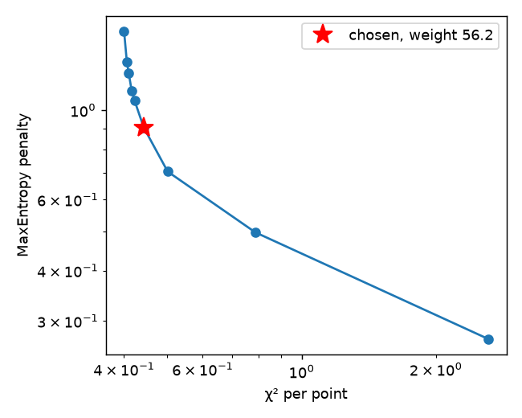
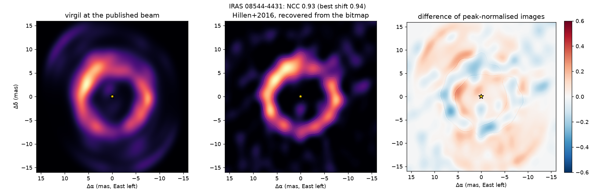
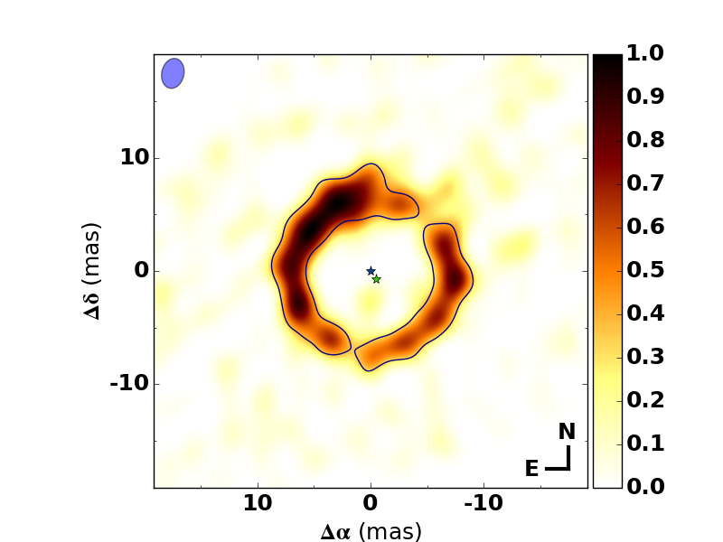
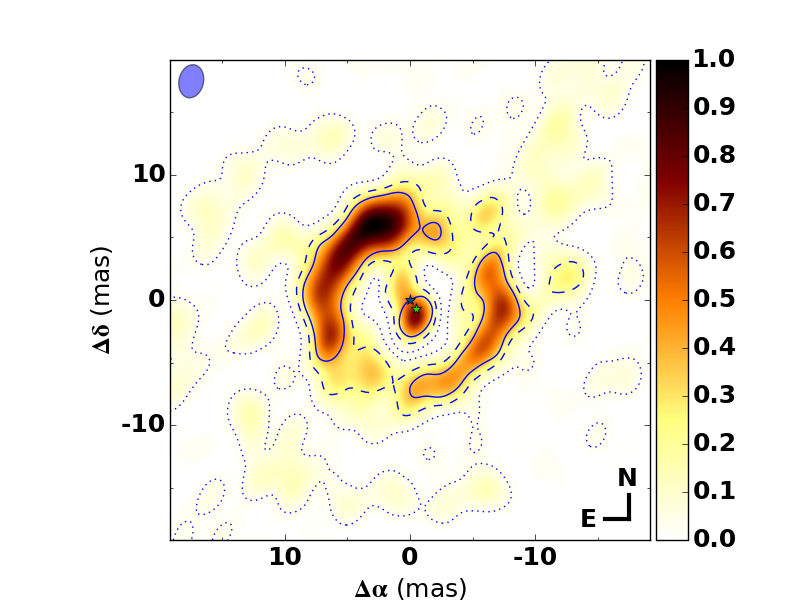

# Post-AGB discs (VLTI/PIONIER)

The imaging-contest data cannot all be shown in public, so this page tests
virgil's image reconstruction on data that anyone can fetch and against
images that experts have already published: the VLTI/PIONIER observations of
post-AGB circumbinary discs in ESO programme 1103.D-0797, reconstructed
independently by De Prins et al. (2026) with SPARCO + ORGANIC. We
reconstruct each target with a SPARCO-like model (below), put both images on
one grid and one beam, and say plainly whether they agree. One tab per
target. IRAS 08544-4431 is compared against Hillen et al. (2016) instead, from the authors' reduced data.

!!! note "Method: the central stars are not in the image"
    The image has no pixels within a window of radius 0.5 × the minor axis of the data's own dirty beam around each central star
    (and around each point-source secondary that the scene models; the radius is given per target in its tab). Extended flux that close to a star
    is degenerate with the star's own flux, so letting the image fill it trades stellar flux for disc flux and
    shifts the fitted stellar fractions. Both images are convolved with a circular Gaussian of FWHM λ_min/(2 B_max), computed from each
    target's own data (the value is in the last column below and drawn on each figure); IRAS 08544-4431 instead uses the beam drawn on
    Hillen's figure. HR 4049 and PS Gem use a Gaussian-process prior on the environment (σ and length chosen by the Laplace evidence);
    the others use MaxEntropy. For both GP targets the MaxEntropy result is kept for comparison and the tab says which is shown.

| Target | Published method | virgil method | virgil verdict | NCC (best control) | Comparison beam (mas) |
| --- | --- | --- | --- | --- | --- |
| [IW Car](#iw-car) | SPARCO + ORGANIC (SQUEEZE check) | MaxEntropy | the inner arcs agree, the outer arc does not | nan (nan) | 1.21 |
| [HR 4049](#hr-4049) | SPARCO + ORGANIC | GP prior | virgil's disc is still too compact; the Gaussian-process prior does not fix it | 0.88 (0.84) | 1.39 |
| [HD 108015](#hd-108015) | SPARCO + ORGANIC | MaxEntropy | the two reconstructions agree | 0.97 (0.84) | 1.18 |
| [AI Sco](#ai-sco) | SPARCO + ORGANIC | MaxEntropy | the same orientation, but virgil's disc is larger | 0.77 (0.48) | 1.22 |
| [EN TrA](#en-tra) | SPARCO + ORGANIC | MaxEntropy | the same size, a different orientation | 0.92 (0.81) | 1.21 |
| [HD 95767](#hd-95767) | SPARCO + ORGANIC | MaxEntropy | the two reconstructions agree | 0.95 (0.87) | 1.20 |
| [IRAS 15469-5311](#iras-15469-5311) | SPARCO + ORGANIC | MaxEntropy | the two reconstructions agree in radius and centroid, less in the major axis | 0.95 (0.82) | 1.16 |
| [PS Gem](#ps-gem) | SPARCO + ORGANIC | GP prior | still poor: the GP fixes the size, not the structure | 0.58 (0.50) | 1.18 |
| [IRAS 08544-4431](#iras-08544-4431) | SPARCO, binary subtracted (Hillen+2016) | MaxEntropy | the two reconstructions agree, with the binary core modelled | 0.97 (0.88) | 2.55 (Hillen: drawn 2.5 × 1.8 ellipse) |

=== "IW Car"

    ### IW Car { #iw-car }

    <figure markdown>
    
    <figcaption>IW Car in H band, 23 PIONIER exposures (MJD 58812 to 58893, up to 2020-02-14). Left: the
    ORGANIC image of De Prins et al. (2026), re-rendered here from their Zenodo FITS
    (10.5281/zenodo.20155600). Right: virgil, MaxEntropy at the L-curve corner. Both are the star-and-secondary-subtracted disc emission, convolved to a circular λ_min/2B_max beam of 1.21 mas FWHM (grey disc), peak-normalised, North up, East left; the star is the gold marker.</figcaption>
    </figure>

    !!! warning "Verdict: the inner arcs agree, the outer arc does not"
        At the λ/2B_max beam (1.21 mas) the images correlate at nan (nan after the best sub-beam shift), against nan for the
        East-West mirror of the published image, nan for its 180° rotation and nan for its azimuthal average (the same flux at
        the same radii with no azimuthal structure). The inner arcs match (flux-weighted radius nan against 3.4 mas,
        major-axis PA nan° against 138°). The outer arc sits further out and is oriented differently in virgil (radius nan
        against 9.8 mas, PA nan° against 163°). De Prins et al. themselves note that the arcs' azimuthal profile is not well
        constrained (Appendix D, SQUEEZE).

    **Parameters.** De Prins et al. could not fit a PMOIRED geometric model to IW Car (a single disc does not
    reproduce it), so there is no PMOIRED row to compare with. The comparison is with what the paper does
    report for IW Car: the SPARCO parameters of the ORGANIC reconstruction (FITS headers), and the inner-rim
    ellipses fitted to the image (Table 2; inner arcs and outer arc separately). The "virgil" columns are two
    fits to the same 23 files: the SPARCO parameters fitted together with the image, and a
    PMOIRED-style parametric model (UD star + point secondary + power-law rim with an m = 1 modulation +
    resolved background). virgil's fits are point estimates; the σ column uses the paper's uncertainty, where it gives one.
    The image fit starts at the paper's SPARCO values (UD 0.5 mas, environment index 0.9, secondary at the
    paper's position under a 1 mas prior) and is a local optimisation, so agreement in this table
    shows that the data do not pull the values away from the published ones, not that virgil recovers them blind.
    The secondary's spectral index is 0 in both models (the paper's SIND2 = 0).

    | Parameter | De Prins+2026 | virgil (image fit) | virgil (parametric) | Difference |
    | --- | --- | --- | --- | --- |
    | Primary flux fraction, H (%) | 63.6 | 63.4 | 63.5 | −0.2 / −0.1 points |
    | Secondary flux fraction, H (%) | 1.99 | 2.44 | 1.86 | +0.45 / −0.13 points |
    | Secondary offset (Δα, Δδ) (mas) | (1.12, −1.90) | (1.16, −1.72) | (1.14, −1.83) | ≤ 0.2 mas |
    | Primary UD diameter (mas) | 0.50 | 0.53 | 0.45 | +0.03 / −0.05 mas |
    | Disc spectral index (image) | 0.89 | 0.885 | not comparable (rim 3.2) | −0.005 |
    | Inner-arc rim diameter (mas) | 6.9 ± 0.5 | see metrics | 16.1 (outer-arc scale) | not the same structure |
    | Rim inclination (°) | 48 ± 5 (inner), 57 ± 2 (outer) | n/a | 55.5 | −0.7σ against the outer arc |
    | Rim position angle (°) | 144 (+8, −7) (inner), 176 ± 3 (outer) | n/a | 165.8 | −3.4σ against the outer arc, +2.7σ against the inner |
    | Rim azimuthal modulation (m = 1) | not reported | n/a | amplitude 0.85 at 313° | none to compare |

    The parametric rim lands between the two orientations the paper finds for the inner and outer arcs
    (and near the SPHERE outer disc, i = 41.7°, PA = 161°, Andrych et al. 2023), which says the single-ring
    model is describing a blend of structures, as the paper concluded. Its χ² per point is 3.3, against
    0.46 for the image fit, for the same reason.

    **Image metrics** (both images on one 0.35 mas grid, convolved to the λ_min/2B_max beam (1.21 mas FWHM); inner = within 5 mas of the star,
    outer = beyond; the paper's own rim fit needs per-pixel significances, so both images get the same moments.
    As an external check, the moments of the ORGANIC image give an outer major axis at PA 163° against the paper's
    176 ± 3° from its rim fit, within 13°, so the two definitions are consistent):

    | Metric | ORGANIC | virgil |
    | --- | --- | --- |
    | Normalised cross-correlation (controls: E-W mirror nan, 180° rotation nan, azimuthal average nan) | 1 | nan (nan after the best sub-beam shift) |
    | Inner flux fraction (%) | 16.6 | nan |
    | Inner flux-weighted radius (mas) | 3.41 | nan |
    | Inner major-axis PA (°), axis ratio | 138, 0.88 | nan, nan |
    | Inner flux centroid (° East of North), offset (mas) | 329, 1.12 | nan, nan |
    | Outer flux fraction (%) | 77.3 | nan |
    | Outer flux-weighted radius (mas) | 9.83 | nan |
    | Outer major-axis PA (°), axis ratio | 163, 0.78 | nan, nan |
    | Outer flux centroid (° East of North), offset (mas) | 268, 4.05 | nan, nan |

    ??? note "Data and method"

        **Data.** Phase 3 calibrated OIFITS from the ESO archive, programme 1103.D-0797 (PI J. Kluska,
        INSPIRING), the 23 exposures listed in the paper's observation log: 828 V² and 552
        closure-phase rows across the H band (1.51–1.76 µm). `postagb_data.py check` confirms
        that the union of ESO's two Phase 3 releases (PIONIER and INSPIRING; 31 exposures) matches the earlier reduced copy, and the 23 used here are the INSPIRING release. The PIONIER beam is 3.26 × 2.29 mas at PA 142°. The comparison beam is circular, FWHM λ_min/(2B_max) = 1.21 mas, for both images. The environment image has a window of radius 1.21 mas (0.5 of the data beam's minor axis; 6182 pixels) blanked around the primary and around the secondary, so that its pixels cannot trade flux with the stellar point sources.

        **Model.** SPARCO: a uniform-disc primary (power-law index −3.165, as in the paper) plus a point
        secondary plus a `virgil.models.Image` environment (128 × 128 pixels of 0.35 mas, the paper's grid),
        each with a power-law spectrum from `virgil.spectra`. The secondary starts at the paper's position
        (so it is not independent of ORGANIC) and the fit then moves it. Regulariser `MaxEntropy`; weight from
        `l_curve` over nine weights (10⁴ to 10⁻²), taking the corner (weight 1.78e+03); start from
        `starting_image`. ORGANIC differs: a GAN generator as its regulariser, with the primary's parameters tuned with pyBADS. Neither is a ground truth.

        **Fit quality.** On the same data the virgil image has χ² per point nan and the ORGANIC image, with its
        published SPARCO parameters unchanged, 2.06 (V² residual rms 0.88 against 1.53σ; T3 0.68 against 2.09σ).
        This does not say virgil's image is better: it has about 16 000 free pixels for 1 794 data points and
        is over-fitted at this weight, while ORGANIC is a more strongly regularised image. The test that matters here is the image agreement above.
        The 1 794 is the length of virgil's whitened-residual vector, not the number of data: the 828 V² and 552
        closure phases (1 380 samples) become 1 794 residuals because each closure phase of four or more
        telescopes also adds a periodic penalty term. Dividing by 1 380 instead would give about 0.59 and 2.67.
        Flipping the published image East-West or North-South worsens its χ² to 60 and 8.9, so the
        orientation is right.

        

        

        

        

        <figure markdown>
        
        <figcaption>ORGANIC (left) against SQUEEZE (right) for IRAS 15469-5311 and IW Car (inner and outer
        arcs). Reproduced from arXiv:2605.13445v2, Fig. 15 (Appendix D), the arXiv version, with the authors'
        permission. The authors find both methods recover the inner arcs and the large outer arc.</figcaption>
        </figure>

        <figure markdown>
        
        <figcaption>As published: the ORGANIC image of IW Car with the fitted rims of the inner and outer arcs,
        arXiv:2605.13445v2, Fig. 4. Reproduced from the arXiv version with the authors' permission.</figcaption>
        </figure>

        <figure markdown>
        
        <figcaption>The same reconstruction with no secondary in the SPARCO model: the unresolved flux peak
        near the green cross is the secondary. arXiv:2605.13445v2, Fig. 2. Reproduced from the arXiv version
        with the authors' permission.</figcaption>
        </figure>

        <figure markdown>
        
        <figcaption>SPHERE/IRDIS polarised light (Andrych et al. 2023) against the PIONIER image,
        arXiv:2605.13445v2, Fig. 6. Reproduced from the arXiv version with the authors' permission.</figcaption>
        </figure>

        Provenance, permissions and credits: [`DATA_ATTRIBUTION.md`](https://github.com/benjaminpope/virgil-validation/blob/main/DATA_ATTRIBUTION.md).
        Reproduce with `scripts/postagb_data.py fetch`, `scripts/postagb_literature.py` and
        `scripts/postagb_imaging.py {inspect,parametric,image,compare,replot} docs/imaging/postagb`.

=== "HR 4049"

    ### HR 4049 { #hr-4049 }

    <figure markdown>
    
    <figcaption>HR 4049 in H band, 19 PIONIER exposures (MJD 58884 to 58899). Left: the ORGANIC image of De Prins et al. (2026), re-rendered here from their Zenodo FITS (10.5281/zenodo.20155600). Right: virgil, a Gaussian-process prior (σ = 1, ℓ = 2.92 mas). Both are the star-and-secondary-subtracted disc emission, convolved to a circular λ_min/2B_max beam of 1.39 mas FWHM (grey disc), peak-normalised, North up, East left; the star is the gold marker.</figcaption>
    </figure>

    !!! failure "Verdict: virgil's disc is still too compact; the Gaussian-process prior does not fix it"
        At the λ/2B_max beam (1.39 mas) the images correlate at 0.88 (0.88 after the best sub-beam shift), against 0.69 for
        the East-West mirror of the published image, 0.70 for its 180° rotation and 0.84 for its azimuthal average (the same
        flux at the same radii with no azimuthal structure). virgil's disc is smaller than the published one (flux-weighted
        radius 10.1 against 15.4 mas); MaxEntropy gave 10.7 mas, so the Gaussian-process prior (σ = 1, ℓ = 2.9 mas, chosen by
        the evidence) does not close the gap, and the correlation (0.88, against 0.90 for MaxEntropy) is barely above its
        azimuthal-average control, so it says little. The data prefer the published orientation (see Fit quality), but
        virgil's image does not reproduce the published extent.

    **Parameters.** The first table compares the PMOIRED geometric model of De Prins et al. (Table 3) with a PMOIRED-style parametric fit of virgil to the same 19 files (UD star, power-law rim with an m = 1 modulation, plus the paper's optional secondary or resolved background). The σ column uses the paper's uncertainty only; virgil's are point estimates, so large σ values mostly say how tight the paper's errors are. The rim diameter is that of a Gaussian ring in virgil and of a power-law rim in PMOIRED, so that row is not like for like; the modulation phase is virgil's `az_pas` minus the rim position angle, which is PMOIRED's `az projang` (docs/method/pmoired.md). The parametric fit takes the lowest χ² of 6 starts (1.7, 1.7, 1.7, 1.7, 1.7, 1.7). The second table compares the SPARCO parameters of the ORGANIC image with those fitted together with virgil's image.

    | Parameter | De Prins+2026 (PMOIRED) | virgil (parametric) | Difference |
    | --- | --- | --- | --- |
    | Primary flux fraction, H (%) | 65.9 ± 0.14 | 65.4 | -0.491 (-3.5σ) |
    | Primary UD diameter (mas) | 0.74 ± 0.02 | 0.777 | +0.0367 (+1.8σ) |
    | Secondary flux fraction, H (%) | 0.42 ± 0.05 | 0.758 | +0.338 (+6.8σ) |
    | Secondary offset Δα (mas) | -1.7 ± 0.08 | -4 | -2.3 (-28.7σ) |
    | Secondary offset Δδ (mas) | -0.69 ± 0.1 | -0.313 | +0.377 (+3.8σ) |
    | Rim diameter (mas) | 14.3 ± 0.18 | 18.9 | +4.61 (+28.8σ) |
    | Rim inclination (°) | 56.8 ± 1 | 55.9 | -0.893 (-0.9σ) |
    | Rim position angle (°) | 82.3 ± 1 | 85.2 | +2.92 (+2.9σ) |
    | Rim modulation amplitude (m = 1) | 0.42 ± 0.03 | 0.501 | +0.081 (+2.7σ) |
    | Rim modulation phase (°) | -38 ± 3 | -29.3 | +8.65 (+2.9σ) |
    | χ² per point | 1.71 | 1.68 | |

    ORGANIC/SPARCO parameters (Table 2 and FITS header) against the virgil image fit:

    | Parameter | De Prins+2026 (ORGANIC) | virgil (image fit) | Difference |
    | --- | --- | --- | --- |
    | Primary flux fraction, H (%) | 65.4 | 66 | +0.627 |
    | Primary UD diameter (mas) | 0.72 | 0.778 | +0.0579 |
    | Secondary flux fraction, H (%) | 0.24 | 0.328 | +0.0876 |
    | Image spectral index | 2.39 | 2.41 | +0.0179 |

    **Image metrics** (both images on one 0.64 mas grid, convolved to the λ_min/2B_max beam (1.39 mas FWHM); the paper's own rim fit needs per-pixel significances, so both images get the same moments):

    | Metric | ORGANIC | virgil |
    | --- | --- | --- |
    | Normalised cross-correlation (controls: E-W mirror 0.69, 180° rotation 0.70, azimuthal average 0.84) | 1 | 0.88 (0.88 after the best sub-beam shift) |
    | Flux fraction in the image field | 91 % | 100 % |
    | Flux-weighted radius (mas) | 15.42 | 10.11 |
    | Major-axis PA (°), axis ratio | 14, 0.87 | 58, 0.89 |
    | Asymmetry angle, flux centroid (° East of North), offset (mas) | 113, 0.32 | 47, 0.90 |

    ??? note "Data and method"

        **Data.** Phase 3 calibrated OIFITS from the ESO archive, programme 1103.D-0797 (PI J. Kluska, INSPIRING), the 19 exposures listed in the paper's observation log: 684 V² and 456 closure-phase rows across the H band (1.52–1.77 µm). The PIONIER beam is 5.15 × 2.92 mas at PA 146°. The comparison beam is circular, FWHM λ_min/(2B_max) = 1.39 mas, for both images. The environment image has a window of radius 1.46 mas (0.5 of the data beam's minor axis; 33 pixels) blanked around the primary and around the secondary, so that its pixels cannot trade flux with the stellar point sources.

        **Model.** SPARCO as for IW Car, with the primary, secondary (where the paper fits one) and the grid read from the Zenodo FITS header; regulariser a `GaussianField` prior on the log-brightness about the Gaussian start image (σ and ℓ chosen on a grid of σ = 1, 2, 4 and ℓ = 0.25 to 2 data beams by the Laplace evidence, after MacKay's error rescaling, s = 0.92: σ = 1, ℓ = 2.92 mas, log evidence -702). MaxEntropy comparison (the earlier run): radius 10.7 mas, NCC 0.90. Start from `starting_image`. ORGANIC uses a GAN generator as its regulariser, with the primary's parameters tuned with pyBADS. Neither is a ground truth.

        **Fit quality.** On the same data the virgil image has χ² per point 0.56 and the ORGANIC image, with its published SPARCO parameters unchanged, 1.94 (1482 data points). This does not say virgil's image is better: it has thousands of free pixels for those points and the Gaussian-process prior is the only regularisation (the χ² is on the errors as given, not rescaled). Flipping the published image East-West or North-South gives χ² 13.0 and 9.4 (so the orientation is right). The images were computed on the laptop for this page; the parametric fit is a local multi-start rerun.

        

        

        

        

        <figure markdown>
        
        <figcaption>As published: the ORGANIC image of HR 4049 with the fitted inner rim, arXiv:2605.13445v2, Fig. 4. Reproduced from the arXiv version with the authors' permission.</figcaption>
        </figure>

        Provenance, permissions and credits: [`DATA_ATTRIBUTION.md`](https://github.com/benjaminpope/virgil-validation/blob/main/DATA_ATTRIBUTION.md).
        Reproduce with `scripts/postagb_data.py fetch`, `scripts/postagb_literature.py` and
        `scripts/postagb_imaging.py {inspect,parametric,image,compare,table,replot} docs/imaging/postagb --target HR4049`.

=== "HD 108015"

    ### HD 108015 { #hd-108015 }

    <figure markdown>
    
    <figcaption>HD 108015 in H band, 35 PIONIER exposures (MJD 59576 to 59621). Left: the ORGANIC image of De Prins et al. (2026), re-rendered here from their Zenodo FITS (10.5281/zenodo.20155600). Right: virgil, MaxEntropy at the L-curve corner. Both are the star-subtracted disc emission, convolved to a circular λ_min/2B_max beam of 1.18 mas FWHM (grey disc), peak-normalised, North up, East left; the star is the gold marker.</figcaption>
    </figure>

    !!! success "Verdict: the two reconstructions agree"
        At the λ/2B_max beam (1.18 mas) the images correlate at 0.97 (0.98 after the best sub-beam shift), against 0.82 for
        the East-West mirror of the published image, 0.49 for its 180° rotation and 0.84 for its azimuthal average (the same
        flux at the same radii with no azimuthal structure). Flux-weighted radius 5.0 against 4.5 mas, flux centroid 343°
        against 350° East of North.

    **Parameters.** The first table compares the PMOIRED geometric model of De Prins et al. (Table 3) with a PMOIRED-style parametric fit of virgil to the same 35 files (UD star, power-law rim with an m = 1 modulation, plus the paper's optional secondary or resolved background). The σ column uses the paper's uncertainty only; virgil's are point estimates, so large σ values mostly say how tight the paper's errors are. The rim diameter is that of a Gaussian ring in virgil and of a power-law rim in PMOIRED, so that row is not like for like; the modulation phase is virgil's `az_pas` minus the rim position angle, which is PMOIRED's `az projang` (docs/method/pmoired.md). The parametric fit takes the lowest χ² of 6 starts (1.8, 1.8, 1.8, 2.4, 1.8, 1.8). The second table compares the SPARCO parameters of the ORGANIC image with those fitted together with virgil's image.

    | Parameter | De Prins+2026 (PMOIRED) | virgil (parametric) | Difference |
    | --- | --- | --- | --- |
    | Primary flux fraction, H (%) | 61.8 ± 0.3 | 56.5 | -5.28 (-17.6σ) |
    | Resolved-background flux fraction, H (%) | 8.6 ± 0.5 | 11.8 | +3.2 (+6.4σ) |
    | Rim diameter (mas) | 5.63 ± 0.03 | 6.72 | +1.09 (+36.3σ) |
    | Rim inclination (°) | 31.2 ± 0.8 | 29.2 | -1.99 (-2.5σ) |
    | Rim position angle (°) | 82.5 ± 1.2 | 81.6 | -0.861 (-0.8σ) |
    | Rim modulation amplitude (m = 1) | 0.502 ± 0.008 | 0.508 | +0.00644 (+0.8σ) |
    | Rim modulation phase (°) | -66 ± 2 | -65.1 | +0.899 (+0.4σ) |
    | χ² per point | 2.08 | 1.81 | |

    ORGANIC/SPARCO parameters (Table 2 and FITS header) against the virgil image fit:

    | Parameter | De Prins+2026 (ORGANIC) | virgil (image fit) | Difference |
    | --- | --- | --- | --- |
    | Primary flux fraction, H (%) | 56 | 56.6 | +0.64 |
    | Image spectral index | 1.45 | 1.34 | -0.112 |

    **Image metrics** (both images on one 0.33 mas grid, convolved to the λ_min/2B_max beam (1.18 mas FWHM); the paper's own rim fit needs per-pixel significances, so both images get the same moments):

    | Metric | ORGANIC | virgil |
    | --- | --- | --- |
    | Normalised cross-correlation (controls: E-W mirror 0.82, 180° rotation 0.49, azimuthal average 0.84) | 1 | 0.97 (0.98 after the best sub-beam shift) |
    | Flux fraction in the image field | 99 % | 100 % |
    | Flux-weighted radius (mas) | 4.49 | 4.99 |
    | Major-axis PA (°), axis ratio | 88, 0.83 | 47, 0.93 |
    | Asymmetry angle, flux centroid (° East of North), offset (mas) | 350, 1.68 | 343, 1.10 |

    ??? note "Data and method"

        **Data.** Phase 3 calibrated OIFITS from the ESO archive, programme 1103.D-0797 (PI J. Kluska, INSPIRING), the 35 exposures listed in the paper's observation log: 1260 V² and 840 closure-phase rows across the H band (1.52–1.77 µm). The PIONIER beam is 3.28 × 1.96 mas at PA 117°. The comparison beam is circular, FWHM λ_min/(2B_max) = 1.18 mas, for both images. The environment image has a window of radius 1.18 mas (0.5 of the data beam's minor axis; 681 pixels) blanked around the primary, so that its pixels cannot trade flux with the stellar point sources.

        **Model.** SPARCO as for IW Car, with the primary, secondary (where the paper fits one) and the grid read from the Zenodo FITS header; regulariser `MaxEntropy`; weight from `l_curve` (corner at 316); start from `starting_image`. ORGANIC uses a GAN generator as its regulariser, with the primary's parameters tuned with pyBADS. Neither is a ground truth.

        **Fit quality.** On the same data the virgil image has χ² per point 0.97 and the ORGANIC image, with its published SPARCO parameters unchanged, 4.29 (2730 data points). This does not say virgil's image is better: it has thousands of free pixels for those points and is over-fitted at this weight, while ORGANIC is more strongly regularised. Flipping the published image East-West or North-South gives χ² 29.0 and 70.4 (so the orientation is right). The images were computed on the laptop for this page; the parametric fit is a local multi-start rerun.

        

        

        

        

        <figure markdown>
        
        <figcaption>As published: the ORGANIC image of HD 108015 with the fitted inner rim, arXiv:2605.13445v2, Fig. 3. Reproduced from the arXiv version with the authors' permission.</figcaption>
        </figure>

        <figure markdown>
        
        <figcaption>ORGANIC (left) against SQUEEZE (right) for AI Sco, EN TrA, HD 95767 and HD 108015, arXiv:2605.13445v2, Fig. 14 (Appendix D). Reproduced from the arXiv version with the authors' permission.</figcaption>
        </figure>

        Provenance, permissions and credits: [`DATA_ATTRIBUTION.md`](https://github.com/benjaminpope/virgil-validation/blob/main/DATA_ATTRIBUTION.md).
        Reproduce with `scripts/postagb_data.py fetch`, `scripts/postagb_literature.py` and
        `scripts/postagb_imaging.py {inspect,parametric,image,compare,table,replot} docs/imaging/postagb --target HD108015`.

=== "AI Sco"

    ### AI Sco { #ai-sco }

    <figure markdown>
    
    <figcaption>AI Sco in H band, 28 PIONIER exposures (MJD 58693 to 58726). Left: the ORGANIC image of De Prins et al. (2026), re-rendered here from their Zenodo FITS (10.5281/zenodo.20155600). Right: virgil, MaxEntropy at the L-curve corner. Both are the star-and-secondary-subtracted disc emission, convolved to a circular λ_min/2B_max beam of 1.22 mas FWHM (grey disc), peak-normalised, North up, East left; the star is the gold marker.</figcaption>
    </figure>

    !!! warning "Verdict: the same orientation, but virgil's disc is larger"
        At the λ/2B_max beam (1.22 mas) the images correlate at 0.77 (0.77 after the best sub-beam shift), against 0.41 for
        the East-West mirror of the published image, 0.46 for its 180° rotation and 0.48 for its azimuthal average (the same
        flux at the same radii with no azimuthal structure). The flux centroid points the same way (133° against 136° East of
        North), but virgil's disc is larger (flux-weighted radius 3.4 against 2.9 mas).

    **Parameters.** The first table compares the PMOIRED geometric model of De Prins et al. (Table 3) with a PMOIRED-style parametric fit of virgil to the same 28 files (UD star, power-law rim with an m = 1 modulation, plus the paper's optional secondary or resolved background). The σ column uses the paper's uncertainty only; virgil's are point estimates, so large σ values mostly say how tight the paper's errors are. The rim diameter is that of a Gaussian ring in virgil and of a power-law rim in PMOIRED, so that row is not like for like; the modulation phase is virgil's `az_pas` minus the rim position angle, which is PMOIRED's `az projang` (docs/method/pmoired.md). The parametric fit takes the lowest χ² of 6 starts (2.9, 2.9, 2.9, 3.1, 2.9, 2.9). The second table compares the SPARCO parameters of the ORGANIC image with those fitted together with virgil's image.

    | Parameter | De Prins+2026 (PMOIRED) | virgil (parametric) | Difference |
    | --- | --- | --- | --- |
    | Primary flux fraction, H (%) | 68.1 ± 0.4 | 72.6 | +4.48 (+11.2σ) |
    | Secondary flux fraction, H (%) | 5.9 ± 0.2 | 3.43 | -2.47 (-12.4σ) |
    | Secondary offset Δα (mas) | -1.08 ± 0.04 | -1.78 | -0.699 (-23.3σ) |
    | Secondary offset Δδ (mas) | -1.38 ± 0.06 | -1.01 | +0.366 (+6.1σ) |
    | Rim diameter (mas) | 5.83 ± 0.09 | 4.97 | -0.864 (-12.3σ) |
    | Rim inclination (°) | 45.6 ± 2 | 46.1 | +0.503 (+0.3σ) |
    | Rim position angle (°) | 60 ± 7 | 18.8 | -41.2 (-8.2σ) |
    | Rim modulation amplitude (m = 1) | 0.87 ± 0.05 | 0.714 | -0.156 (-3.1σ) |
    | Rim modulation phase (°) | -9 ± 5 | 14.3 | +23.3 (+5.8σ) |
    | χ² per point | 4.98 | 2.86 | |

    ORGANIC/SPARCO parameters (Table 2 and FITS header) against the virgil image fit:

    | Parameter | De Prins+2026 (ORGANIC) | virgil (image fit) | Difference |
    | --- | --- | --- | --- |
    | Primary flux fraction, H (%) | 64.5 | 69.9 | +5.36 |
    | Secondary flux fraction, H (%) | 2.76 | 2.68 | -0.0847 |
    | Image spectral index | -0.59 | -1.83 | -1.24 |

    **Image metrics** (both images on one 0.23 mas grid, convolved to the λ_min/2B_max beam (1.22 mas FWHM); the paper's own rim fit needs per-pixel significances, so both images get the same moments):

    | Metric | ORGANIC | virgil |
    | --- | --- | --- |
    | Normalised cross-correlation (controls: E-W mirror 0.41, 180° rotation 0.46, azimuthal average 0.48) | 1 | 0.77 (0.77 after the best sub-beam shift) |
    | Flux fraction in the image field | 99 % | 100 % |
    | Flux-weighted radius (mas) | 2.88 | 3.39 |
    | Major-axis PA (°), axis ratio | 119, 0.80 | 113, 0.81 |
    | Asymmetry angle, flux centroid (° East of North), offset (mas) | 136, 0.90 | 133, 1.43 |

    ??? note "Data and method"

        **Data.** Phase 3 calibrated OIFITS from the ESO archive, programme 1103.D-0797 (PI J. Kluska, INSPIRING), the 28 exposures listed in the paper's observation log: 1008 V² and 672 closure-phase rows across the H band (1.51–1.76 µm). The PIONIER beam is 3.65 × 2.55 mas at PA 139°. The comparison beam is circular, FWHM λ_min/(2B_max) = 1.22 mas, for both images. The environment image has a window of radius 1.22 mas (0.5 of the data beam's minor axis; 5220 pixels) blanked around the primary and around the secondary, so that its pixels cannot trade flux with the stellar point sources.

        **Model.** SPARCO as for IW Car, with the primary, secondary (where the paper fits one) and the grid read from the Zenodo FITS header; regulariser `MaxEntropy`; weight from `l_curve` (corner at 316); start from `starting_image`. ORGANIC uses a GAN generator as its regulariser, with the primary's parameters tuned with pyBADS. Neither is a ground truth.

        **Fit quality.** On the same data the virgil image has χ² per point 1.08 and the ORGANIC image, with its published SPARCO parameters unchanged, 2.46 (2184 data points). This does not say virgil's image is better: it has thousands of free pixels for those points and is over-fitted at this weight, while ORGANIC is more strongly regularised. Flipping the published image East-West or North-South gives χ² 25.7 and 17.1 (so the orientation is right). The images were computed on the laptop for this page; the parametric fit is a local multi-start rerun.

        

        

        

        

        <figure markdown>
        
        <figcaption>As published: the ORGANIC image of AI Sco with the fitted inner rim, arXiv:2605.13445v2, Fig. 3. Reproduced from the arXiv version with the authors' permission.</figcaption>
        </figure>

        <figure markdown>
        
        <figcaption>ORGANIC (left) against SQUEEZE (right) for AI Sco, EN TrA, HD 95767 and HD 108015, arXiv:2605.13445v2, Fig. 14 (Appendix D). Reproduced from the arXiv version with the authors' permission.</figcaption>
        </figure>

        Provenance, permissions and credits: [`DATA_ATTRIBUTION.md`](https://github.com/benjaminpope/virgil-validation/blob/main/DATA_ATTRIBUTION.md).
        Reproduce with `scripts/postagb_data.py fetch`, `scripts/postagb_literature.py` and
        `scripts/postagb_imaging.py {inspect,parametric,image,compare,table,replot} docs/imaging/postagb --target AI_Sco`.

=== "EN TrA"

    ### EN TrA { #en-tra }

    <figure markdown>
    
    <figcaption>EN TrA in H band, 20 PIONIER exposures (MJD 59267 to 59295). Left: the ORGANIC image of De Prins et al. (2026), re-rendered here from their Zenodo FITS (10.5281/zenodo.20155600). Right: virgil, MaxEntropy at the L-curve corner. Both are the star-and-secondary-subtracted disc emission, convolved to a circular λ_min/2B_max beam of 1.21 mas FWHM (grey disc), peak-normalised, North up, East left; the star is the gold marker.</figcaption>
    </figure>

    !!! warning "Verdict: the same size, a different orientation"
        At the λ/2B_max beam (1.21 mas) the images correlate at 0.92 (0.92 after the best sub-beam shift), against 0.71 for
        the East-West mirror of the published image, 0.59 for its 180° rotation and 0.81 for its azimuthal average (the same
        flux at the same radii with no azimuthal structure). The size agrees (flux-weighted radius 3.8 against 4.0 mas), but
        the major-axis PA differs (118° against 56°) and the flux centroid is close to the star in both (0.28 and 0.19 mas),
        so its direction is not meaningful.

    **Parameters.** The first table compares the PMOIRED geometric model of De Prins et al. (Table 3) with a PMOIRED-style parametric fit of virgil to the same 20 files (UD star, power-law rim with an m = 1 modulation, plus the paper's optional secondary or resolved background). The σ column uses the paper's uncertainty only; virgil's are point estimates, so large σ values mostly say how tight the paper's errors are. The rim diameter is that of a Gaussian ring in virgil and of a power-law rim in PMOIRED, so that row is not like for like; the modulation phase is virgil's `az_pas` minus the rim position angle, which is PMOIRED's `az projang` (docs/method/pmoired.md). The parametric fit takes the lowest χ² of 6 starts (1.7, 1.7, 1.7, 1.7, 1.7, 1.7). The second table compares the SPARCO parameters of the ORGANIC image with those fitted together with virgil's image.

    | Parameter | De Prins+2026 (PMOIRED) | virgil (parametric) | Difference |
    | --- | --- | --- | --- |
    | Primary flux fraction, H (%) | 72.1 ± 0.4 | 72.2 | +0.126 (+0.3σ) |
    | Secondary flux fraction, H (%) | 5 ± 0.2 | 4.56 | -0.439 (-2.2σ) |
    | Secondary offset Δα (mas) | -0.7 ± 0.02 | -0.554 | +0.146 (+7.3σ) |
    | Secondary offset Δδ (mas) | -1.65 ± 0.04 | -1.61 | +0.0427 (+1.1σ) |
    | Rim diameter (mas) | 5.63 ± 0.16 | 6.95 | +1.32 (+8.3σ) |
    | Rim inclination (°) | 58.9 ± 1.2 | 58.8 | -0.0692 (-0.1σ) |
    | Rim position angle (°) | 32.5 ± 1.9 | 32.6 | +0.114 (+0.1σ) |
    | Rim modulation amplitude (m = 1) | 0.72 ± 0.04 | 0.709 | -0.0112 (-0.3σ) |
    | Rim modulation phase (°) | -13 ± 4 | -10.1 | +2.94 (+0.7σ) |
    | χ² per point | 2.40 | 1.71 | |

    ORGANIC/SPARCO parameters (Table 2 and FITS header) against the virgil image fit:

    | Parameter | De Prins+2026 (ORGANIC) | virgil (image fit) | Difference |
    | --- | --- | --- | --- |
    | Primary flux fraction, H (%) | 72.1 | 70.6 | -1.47 |
    | Secondary flux fraction, H (%) | 5.37 | 5.44 | +0.0724 |
    | Image spectral index | 0.3 | 0.0101 | -0.29 |

    **Image metrics** (both images on one 0.27 mas grid, convolved to the λ_min/2B_max beam (1.21 mas FWHM); the paper's own rim fit needs per-pixel significances, so both images get the same moments):

    | Metric | ORGANIC | virgil |
    | --- | --- | --- |
    | Normalised cross-correlation (controls: E-W mirror 0.71, 180° rotation 0.59, azimuthal average 0.81) | 1 | 0.92 (0.92 after the best sub-beam shift) |
    | Flux fraction in the image field | 98 % | 100 % |
    | Flux-weighted radius (mas) | 4.03 | 3.76 |
    | Major-axis PA (°), axis ratio | 56, 0.72 | 118, 0.93 |
    | Asymmetry angle, flux centroid (° East of North), offset (mas) | 288, 0.19 | 195, 0.28 |

    ??? note "Data and method"

        **Data.** Phase 3 calibrated OIFITS from the ESO archive, programme 1103.D-0797 (PI J. Kluska, INSPIRING), the 20 exposures listed in the paper's observation log: 712 V² and 477 closure-phase rows across the H band (1.52–1.77 µm). The PIONIER beam is 3.26 × 1.98 mas at PA 139°. The comparison beam is circular, FWHM λ_min/(2B_max) = 1.21 mas, for both images. The environment image has a window of radius 0.99 mas (0.5 of the data beam's minor axis; 85 pixels) blanked around the primary and around the secondary, so that its pixels cannot trade flux with the stellar point sources.

        **Model.** SPARCO as for IW Car, with the primary, secondary (where the paper fits one) and the grid read from the Zenodo FITS header; regulariser `MaxEntropy`; weight from `l_curve` (corner at 56.2); start from `starting_image`. ORGANIC uses a GAN generator as its regulariser, with the primary's parameters tuned with pyBADS. Neither is a ground truth.

        **Fit quality.** On the same data the virgil image has χ² per point 1.16 and the ORGANIC image, with its published SPARCO parameters unchanged, 1.41 (1548 data points). This does not say virgil's image is better: it has thousands of free pixels for those points and is over-fitted at this weight, while ORGANIC is more strongly regularised. Flipping the published image East-West or North-South gives χ² 7.3 and 16.2 (so the orientation is right). The images were computed on the laptop for this page; the parametric fit is a local multi-start rerun.

        

        

        

        

        <figure markdown>
        
        <figcaption>As published: the ORGANIC image of EN TrA with the fitted inner rim, arXiv:2605.13445v2, Fig. 3. Reproduced from the arXiv version with the authors' permission.</figcaption>
        </figure>

        <figure markdown>
        
        <figcaption>ORGANIC (left) against SQUEEZE (right) for AI Sco, EN TrA, HD 95767 and HD 108015, arXiv:2605.13445v2, Fig. 14 (Appendix D). Reproduced from the arXiv version with the authors' permission.</figcaption>
        </figure>

        Provenance, permissions and credits: [`DATA_ATTRIBUTION.md`](https://github.com/benjaminpope/virgil-validation/blob/main/DATA_ATTRIBUTION.md).
        Reproduce with `scripts/postagb_data.py fetch`, `scripts/postagb_literature.py` and
        `scripts/postagb_imaging.py {inspect,parametric,image,compare,table,replot} docs/imaging/postagb --target EN_TrA`.

=== "HD 95767"

    ### HD 95767 { #hd-95767 }

    <figure markdown>
    
    <figcaption>HD 95767 in H band, 36 PIONIER exposures (MJD 59577 to 59616). Left: the ORGANIC image of De Prins et al. (2026), re-rendered here from their Zenodo FITS (10.5281/zenodo.20155600). Right: virgil, MaxEntropy at the L-curve corner. Both are the star-and-secondary-subtracted disc emission, convolved to a circular λ_min/2B_max beam of 1.20 mas FWHM (grey disc), peak-normalised, North up, East left; the star is the gold marker.</figcaption>
    </figure>

    !!! success "Verdict: the two reconstructions agree"
        At the λ/2B_max beam (1.20 mas) the images correlate at 0.95 (0.96 after the best sub-beam shift), against 0.76 for
        the East-West mirror of the published image, 0.72 for its 180° rotation and 0.87 for its azimuthal average (the same
        flux at the same radii with no azimuthal structure). Flux-weighted radius 3.8 against 3.7 mas, flux centroid 99°
        against 100° East of North.

    **Parameters.** The first table compares the PMOIRED geometric model of De Prins et al. (Table 3) with a PMOIRED-style parametric fit of virgil to the same 36 files (UD star, power-law rim with an m = 1 modulation, plus the paper's optional secondary or resolved background). The σ column uses the paper's uncertainty only; virgil's are point estimates, so large σ values mostly say how tight the paper's errors are. The rim diameter is that of a Gaussian ring in virgil and of a power-law rim in PMOIRED, so that row is not like for like; the modulation phase is virgil's `az_pas` minus the rim position angle, which is PMOIRED's `az projang` (docs/method/pmoired.md). The parametric fit takes the lowest χ² of 6 starts (2.1, 2.1, 2.1, 2.1, 2.1, 2.1). The second table compares the SPARCO parameters of the ORGANIC image with those fitted together with virgil's image.

    | Parameter | De Prins+2026 (PMOIRED) | virgil (parametric) | Difference |
    | --- | --- | --- | --- |
    | Primary flux fraction, H (%) | 48.5 ± 0.7 | 46.9 | -1.64 (-2.3σ) |
    | Secondary flux fraction, H (%) | 21 ± 0.7 | 19.8 | -1.2 (-1.7σ) |
    | Secondary offset Δα (mas) | -0.719 ± 0.013 | -0.695 | +0.0238 (+1.8σ) |
    | Secondary offset Δδ (mas) | -0.51 ± 0.009 | -0.474 | +0.0361 (+4.0σ) |
    | Rim diameter (mas) | 4.67 ± 0.05 | 6.22 | +1.55 (+30.9σ) |
    | Rim inclination (°) | 25.6 ± 1.7 | 37 | +11.4 (+6.7σ) |
    | Rim position angle (°) | 14 ± 4 | 1.97 | -12 (-3.0σ) |
    | Rim modulation amplitude (m = 1) | 0.451 ± 0.02 | 0.504 | +0.0534 (+2.8σ) |
    | Rim modulation phase (°) | 43 ± 4 | 41.3 | -1.66 (-0.4σ) |
    | χ² per point | 1.97 | 2.10 | |

    ORGANIC/SPARCO parameters (Table 2 and FITS header) against the virgil image fit:

    | Parameter | De Prins+2026 (ORGANIC) | virgil (image fit) | Difference |
    | --- | --- | --- | --- |
    | Primary flux fraction, H (%) | 44.1 | 54.9 | +10.8 |
    | Secondary flux fraction, H (%) | 24.8 | 16.5 | -8.28 |
    | Image spectral index | 2.36 | 1.91 | -0.452 |

    **Image metrics** (both images on one 0.26 mas grid, convolved to the λ_min/2B_max beam (1.20 mas FWHM); the paper's own rim fit needs per-pixel significances, so both images get the same moments):

    | Metric | ORGANIC | virgil |
    | --- | --- | --- |
    | Normalised cross-correlation (controls: E-W mirror 0.76, 180° rotation 0.72, azimuthal average 0.87) | 1 | 0.95 (0.96 after the best sub-beam shift) |
    | Flux fraction in the image field | 99 % | 100 % |
    | Flux-weighted radius (mas) | 3.75 | 3.82 |
    | Major-axis PA (°), axis ratio | 25, 0.89 | 27, 0.85 |
    | Asymmetry angle, flux centroid (° East of North), offset (mas) | 100, 0.69 | 99, 0.62 |

    ??? note "Data and method"

        **Data.** Phase 3 calibrated OIFITS from the ESO archive, programme 1103.D-0797 (PI J. Kluska, INSPIRING), the 36 exposures listed in the paper's observation log: 1296 V² and 864 closure-phase rows across the H band (1.52–1.77 µm). The PIONIER beam is 3.31 × 2.19 mas at PA 124°. The comparison beam is circular, FWHM λ_min/(2B_max) = 1.20 mas, for both images. The environment image has a window of radius 0.60 mas (0.5 of the data beam's minor axis; 29 pixels) blanked around the primary and around the secondary, so that its pixels cannot trade flux with the stellar point sources.

        **Model.** SPARCO as for IW Car, with the primary, secondary (where the paper fits one) and the grid read from the Zenodo FITS header; regulariser `MaxEntropy`; weight from `l_curve` (corner at 316); start from `starting_image`. ORGANIC uses a GAN generator as its regulariser, with the primary's parameters tuned with pyBADS. Neither is a ground truth.

        **Fit quality.** On the same data the virgil image has χ² per point 0.69 and the ORGANIC image, with its published SPARCO parameters unchanged, 1.35 (2808 data points). This does not say virgil's image is better: it has thousands of free pixels for those points and is over-fitted at this weight, while ORGANIC is more strongly regularised. Flipping the published image East-West or North-South gives χ² 6.4 and 7.7 (so the orientation is right). The images were computed on the laptop for this page; the parametric fit is a local multi-start rerun.

        

        

        

        

        <figure markdown>
        
        <figcaption>As published: the ORGANIC image of HD 95767 with the fitted inner rim, arXiv:2605.13445v2, Fig. 3. Reproduced from the arXiv version with the authors' permission.</figcaption>
        </figure>

        <figure markdown>
        
        <figcaption>ORGANIC (left) against SQUEEZE (right) for AI Sco, EN TrA, HD 95767 and HD 108015, arXiv:2605.13445v2, Fig. 14 (Appendix D). Reproduced from the arXiv version with the authors' permission.</figcaption>
        </figure>

        Provenance, permissions and credits: [`DATA_ATTRIBUTION.md`](https://github.com/benjaminpope/virgil-validation/blob/main/DATA_ATTRIBUTION.md).
        Reproduce with `scripts/postagb_data.py fetch`, `scripts/postagb_literature.py` and
        `scripts/postagb_imaging.py {inspect,parametric,image,compare,table,replot} docs/imaging/postagb --target HD95767`.

=== "IRAS 15469-5311"

    ### IRAS 15469-5311 { #iras-15469-5311 }

    <figure markdown>
    
    <figcaption>IRAS 15469-5311 in H band, 20 PIONIER exposures (MJD 59266 to 59296). Left: the ORGANIC image of De Prins et al. (2026), re-rendered here from their Zenodo FITS (10.5281/zenodo.20155600). Right: virgil, MaxEntropy at the L-curve corner. Both are the star-subtracted disc emission, convolved to a circular λ_min/2B_max beam of 1.16 mas FWHM (grey disc), peak-normalised, North up, East left; the star is the gold marker.</figcaption>
    </figure>

    !!! success "Verdict: the two reconstructions agree in radius and centroid, less in the major axis"
        At the λ/2B_max beam (1.16 mas) the images correlate at 0.95 (0.96 after the best sub-beam shift), against 0.68 for
        the East-West mirror of the published image, 0.43 for its 180° rotation and 0.82 for its azimuthal average (the same
        flux at the same radii with no azimuthal structure). The radius (flux-weighted radius 6.9 against 5.6 mas) and the
        flux centroid (152° against 135°) agree; the major-axis PA differs (107° against 63°, the discs being nearly round).

    **Parameters.** The first table compares the PMOIRED geometric model of De Prins et al. (Table 3) with a PMOIRED-style parametric fit of virgil to the same 20 files (UD star, power-law rim with an m = 1 modulation, plus the paper's optional secondary or resolved background). The σ column uses the paper's uncertainty only; virgil's are point estimates, so large σ values mostly say how tight the paper's errors are. The rim diameter is that of a Gaussian ring in virgil and of a power-law rim in PMOIRED, so that row is not like for like; the modulation phase is virgil's `az_pas` minus the rim position angle, which is PMOIRED's `az projang` (docs/method/pmoired.md). The parametric fit takes the lowest χ² of 6 starts (8.3, 2.3, 4.6, 1.3, 5.0, 1.3). The second table compares the SPARCO parameters of the ORGANIC image with those fitted together with virgil's image.

    | Parameter | De Prins+2026 (PMOIRED) | virgil (parametric) | Difference |
    | --- | --- | --- | --- |
    | Primary flux fraction, H (%) | 59.5 ± 0.7 | 53.8 | -5.68 (-9.5σ) |
    | Resolved-background flux fraction, H (%) | 11.1 ± 1.2 | 15.4 | +4.31 (+3.6σ) |
    | Rim diameter (mas) | 7.8 ± 0.06 | 9.26 | +1.46 (+29.3σ) |
    | Rim inclination (°) | 40.2 ± 0.8 | 35.1 | -5.09 (-7.3σ) |
    | Rim position angle (°) | 53.5 ± 1.1 | 49.6 | -3.92 (-3.6σ) |
    | Rim modulation amplitude (m = 1) | 0.86 ± 0.02 | 0.884 | +0.0243 (+1.2σ) |
    | Rim modulation phase (°) | 74.6 ± 1.6 | 76.3 | +1.72 (+1.1σ) |
    | χ² per point | 2.08 | 1.29 | |

    ORGANIC/SPARCO parameters (Table 2 and FITS header) against the virgil image fit:

    | Parameter | De Prins+2026 (ORGANIC) | virgil (image fit) | Difference |
    | --- | --- | --- | --- |
    | Primary flux fraction, H (%) | 52.9 | 53.6 | +0.729 |
    | Image spectral index | 1.84 | 1.9 | +0.0551 |

    **Image metrics** (both images on one 0.29 mas grid, convolved to the λ_min/2B_max beam (1.16 mas FWHM); the paper's own rim fit needs per-pixel significances, so both images get the same moments):

    | Metric | ORGANIC | virgil |
    | --- | --- | --- |
    | Normalised cross-correlation (controls: E-W mirror 0.68, 180° rotation 0.43, azimuthal average 0.82) | 1 | 0.95 (0.96 after the best sub-beam shift) |
    | Flux fraction in the image field | 98 % | 100 % |
    | Flux-weighted radius (mas) | 5.60 | 6.86 |
    | Major-axis PA (°), axis ratio | 63, 0.85 | 107, 0.96 |
    | Asymmetry angle, flux centroid (° East of North), offset (mas) | 135, 2.00 | 152, 1.09 |

    ??? note "Data and method"

        **Data.** Phase 3 calibrated OIFITS from the ESO archive, programme 1103.D-0797 (PI J. Kluska, INSPIRING), the 20 exposures listed in the paper's observation log: 720 V² and 480 closure-phase rows across the H band (1.52–1.77 µm). The PIONIER beam is 4.15 × 1.82 mas at PA 127°. The comparison beam is circular, FWHM λ_min/(2B_max) = 1.16 mas, for both images. The environment image has a window of radius 0.58 mas (0.5 of the data beam's minor axis; 9 pixels) blanked around the primary, so that its pixels cannot trade flux with the stellar point sources.

        **Model.** SPARCO as for IW Car, with the primary, secondary (where the paper fits one) and the grid read from the Zenodo FITS header; regulariser `MaxEntropy`; weight from `l_curve` (corner at 56.2); start from `starting_image`. ORGANIC uses a GAN generator as its regulariser, with the primary's parameters tuned with pyBADS. Neither is a ground truth.

        **Fit quality.** On the same data the virgil image has χ² per point 0.70 and the ORGANIC image, with its published SPARCO parameters unchanged, 2.21 (1560 data points). This does not say virgil's image is better: it has thousands of free pixels for those points and is over-fitted at this weight, while ORGANIC is more strongly regularised. Flipping the published image East-West or North-South gives χ² 15.6 and 37.1 (so the orientation is right). The images were computed on the laptop for this page; the parametric fit is a local multi-start rerun.

        

        

        

        

        <figure markdown>
        
        <figcaption>As published: the ORGANIC image of IRAS 15469-5311 with the fitted inner rim, arXiv:2605.13445v2, Fig. 4. Reproduced from the arXiv version with the authors' permission.</figcaption>
        </figure>

        <figure markdown>
        
        <figcaption>ORGANIC (left) against SQUEEZE (right) for IRAS 15469-5311 and IW Car, arXiv:2605.13445v2, Fig. 15 (Appendix D). Reproduced from the arXiv version with the authors' permission.</figcaption>
        </figure>

        <figure markdown>
        
        <figcaption>Example of the paper's inner-rim ellipse fit for IRAS 15469-5311 (radial rays and 100 MCMC ellipses), arXiv:2605.13445v2, Fig. 5. Reproduced from the arXiv version with the authors' permission.</figcaption>
        </figure>

        Provenance, permissions and credits: [`DATA_ATTRIBUTION.md`](https://github.com/benjaminpope/virgil-validation/blob/main/DATA_ATTRIBUTION.md).
        Reproduce with `scripts/postagb_data.py fetch`, `scripts/postagb_literature.py` and
        `scripts/postagb_imaging.py {inspect,parametric,image,compare,table,replot} docs/imaging/postagb --target IRAS15469-5311`.

=== "PS Gem"

    ### PS Gem { #ps-gem }

    <figure markdown>
    
    <figcaption>PS Gem in H band, 12 PIONIER exposures (MJD 58817 to 58928). Left: the ORGANIC image of De Prins et al. (2026), re-rendered here from their Zenodo FITS (10.5281/zenodo.20155600). Right: virgil, a Gaussian-process prior (σ = 2, ℓ = 0.45 mas). Both are the star-subtracted disc emission, convolved to a circular λ_min/2B_max beam of 1.18 mas FWHM (grey disc), peak-normalised, North up, East left; the star is the gold marker.</figcaption>
    </figure>

    !!! failure "Verdict: still poor: the GP fixes the size, not the structure"
        At the λ/2B_max beam (1.18 mas) the images correlate at 0.58 (0.63 after the best sub-beam shift), against 0.45 for
        the East-West mirror of the published image, 0.48 for its 180° rotation and 0.50 for its azimuthal average (the same
        flux at the same radii with no azimuthal structure). With the Gaussian-process prior virgil's disc has the right size
        (flux-weighted radius 6.4 against 6.2 mas; MaxEntropy gave 9.0 mas, NCC 0.27 against 0.58 now), but the structure is a
        scatter of clumps and the correlation is only just above its controls. ORGANIC's brightest feature is a clump at the
        star, inside the window virgil blanks around the star (radius 0.89 mas); that is one reason the two cannot agree
        there. Do not read anything into the clumps.

    **Parameters.** The first table compares the PMOIRED geometric model of De Prins et al. (Table 3) with a PMOIRED-style parametric fit of virgil to the same 12 files (UD star, power-law rim with an m = 1 modulation, plus the paper's optional secondary or resolved background). The σ column uses the paper's uncertainty only; virgil's are point estimates, so large σ values mostly say how tight the paper's errors are. The rim diameter is that of a Gaussian ring in virgil and of a power-law rim in PMOIRED, so that row is not like for like; the modulation phase is virgil's `az_pas` minus the rim position angle, which is PMOIRED's `az projang` (docs/method/pmoired.md). The parametric fit takes the lowest χ² of 6 starts (0.6, 0.6, 0.6, 0.6, 0.6, 0.6). The second table compares the SPARCO parameters of the ORGANIC image with those fitted together with virgil's image.

    | Parameter | De Prins+2026 (PMOIRED) | virgil (parametric) | Difference |
    | --- | --- | --- | --- |
    | Primary flux fraction, H (%) | 89 ± 0.14 | 88.3 | -0.694 (-5.0σ) |
    | Primary UD diameter (mas) | 0.44 ± 0.02 | 0.344 | -0.0962 (-4.8σ) |
    | Rim diameter (mas) | 8.4 ± 0.6 | 14.4 | +6 (+10.0σ) |
    | Rim inclination (°) | 39 ± 7 | 49.6 | +10.6 (+1.8σ) |
    | Rim position angle (°) | 156 ± 6 | 96.6 | -59.4 (-9.9σ) |
    | Rim modulation amplitude (m = 1) | 0.65 ± 0.06 | 1 | +0.35 (+5.8σ) |
    | Rim modulation phase (°) | 35 ± 11 | 170 | +135 (+15.0σ) |
    | χ² per point | 0.94 | 0.62 | |

    ORGANIC/SPARCO parameters (Table 2 and FITS header) against the virgil image fit:

    | Parameter | De Prins+2026 (ORGANIC) | virgil (image fit) | Difference |
    | --- | --- | --- | --- |
    | Primary flux fraction, H (%) | 87 | 87.3 | +0.275 |
    | Primary UD diameter (mas) | 0.37 | 0.285 | -0.085 |
    | Image spectral index | 0.61 | 0.329 | -0.281 |

    **Image metrics** (both images on one 0.31 mas grid, convolved to the λ_min/2B_max beam (1.18 mas FWHM); the paper's own rim fit needs per-pixel significances, so both images get the same moments):

    | Metric | ORGANIC | virgil |
    | --- | --- | --- |
    | Normalised cross-correlation (controls: E-W mirror 0.45, 180° rotation 0.48, azimuthal average 0.50) | 1 | 0.58 (0.63 after the best sub-beam shift) |
    | Flux fraction in the image field | 95 % | 100 % |
    | Flux-weighted radius (mas) | 6.16 | 6.38 |
    | Major-axis PA (°), axis ratio | 119, 0.83 | 104, 0.96 |
    | Asymmetry angle, flux centroid (° East of North), offset (mas) | 206, 1.28 | 230, 1.13 |

    ??? note "Data and method"

        **Data.** Phase 3 calibrated OIFITS from the ESO archive, programme 1103.D-0797 (PI J. Kluska, INSPIRING), the 12 exposures listed in the paper's observation log: 432 V² and 288 closure-phase rows across the H band (1.52–1.76 µm). The PIONIER beam is 3.10 × 1.78 mas at PA 153°. The comparison beam is circular, FWHM λ_min/(2B_max) = 1.18 mas, for both images. The environment image has a window of radius 0.89 mas (0.5 of the data beam's minor axis; 24 pixels) blanked around the primary, so that its pixels cannot trade flux with the stellar point sources.

        **Model.** SPARCO as for IW Car, with the primary, secondary (where the paper fits one) and the grid read from the Zenodo FITS header; regulariser a `GaussianField` prior on the log-brightness about the Gaussian start image (σ and ℓ chosen on a grid of σ = 1, 2, 4 and ℓ = 0.25 to 2 data beams by the Laplace evidence, after MacKay's error rescaling, s = 0.84: σ = 2, ℓ = 0.45 mas, log evidence -383). MaxEntropy comparison (the earlier run): radius 9.0 mas, NCC 0.27. Start from `starting_image`. ORGANIC uses a GAN generator as its regulariser, with the primary's parameters tuned with pyBADS. Neither is a ground truth.

        **Fit quality.** On the same data the virgil image has χ² per point 0.43 and the ORGANIC image, with its published SPARCO parameters unchanged, 0.49 (936 data points). This does not say virgil's image is better: it has thousands of free pixels for those points and the Gaussian-process prior is the only regularisation (the χ² is on the errors as given, not rescaled). Flipping the published image East-West or North-South gives χ² 1.0 and 1.2. The images were computed on the laptop for this page; the parametric fit is a local multi-start rerun.

        

        

        

        

        <figure markdown>
        
        <figcaption>As published: the ORGANIC image of PS Gem with the fitted inner rim, arXiv:2605.13445v2, Fig. 4. Reproduced from the arXiv version with the authors' permission.</figcaption>
        </figure>

        Provenance, permissions and credits: [`DATA_ATTRIBUTION.md`](https://github.com/benjaminpope/virgil-validation/blob/main/DATA_ATTRIBUTION.md).
        Reproduce with `scripts/postagb_data.py fetch`, `scripts/postagb_literature.py` and
        `scripts/postagb_imaging.py {inspect,parametric,image,compare,table,replot} docs/imaging/postagb --target PS_Gem`.

=== "IRAS 08544-4431"

    ### IRAS 08544-4431 { #iras-08544-4431 }

    <figure markdown>
    
    <figcaption>IRAS 08544-4431 in H band, 27 PIONIER observing blocks (2015-01-21, 2015-01-24 and 2015-02-23).
    Left: the binary-subtracted SPARCO image of Hillen et al. (2016) as published
    (their Fig. 4, lower panel; the blue contour is their 5σ level). Right: virgil, MaxEntropy with the
    weight at the L-curve corner, primary and secondary subtracted, drawn in the published figure's own colour map, on the same
    field of view, orientation (North up, East left), linear 0 to 1 peak-normalised stretch, and convolved with the beam
    ellipse drawn on the published figure (2.5 × 1.8 mas, PA 168°). The paper's image exists only as a bitmap, so its
    stretch and its beam cannot be matched exactly, so for this target only, virgil is convolved with the beam the paper draws
    rather than with the λ_min/2B_max beam of the other tabs, and the published image, already a restored image, is not convolved
    again. The primary is the marker at the origin.</figcaption>
    </figure>

    !!! success "Verdict: the two reconstructions agree, with the binary core modelled"
        At the beam drawn on the published figure (2.5 × 1.8 mas) the images correlate at 0.97 (0.97 after the best sub-beam
        shift), against 0.80 for the East-West mirror of the published image, 0.78 for its 180° rotation and 0.88 for its
        azimuthal average (the same flux at the same radii with no azimuthal structure). With the binary subtracted in both,
        there is no residual central emission (inside 3.5 mas: 1.9 % of the flux against 1.2 %), and the ring matches:
        flux-weighted radius 8.54 against 8.11 mas, flux centroid 7° against 10°. The secondary's parameters are in the table
        below.

    **Parameters.** Hillen et al. fit a 16-parameter parametric model (Table 1, best model) by MCMC: uniform-disc
    primary (fixed at 0.5 mas), point-source secondary, inclined Gaussian ring with m = 1 and m = 2 azimuthal
    modulations, and a resolved background, each with a black-body or Kurucz spectrum. The "virgil" column is the same
    geometry refitted to the same 27 files with virgil components, the primary fixed at 0.5 mas as in the paper and
    power-law spectra (so the flux fractions are at 1.65 µm and are not exactly the paper's band-averaged ones).
    The fit is blind: four generic starting points (none uses the paper's values) and the best χ² is kept.
    They end in two minima, χ² per point 1.617 (two starts) and 1.535 (two starts, the one shown); the table's
    ring rows are the better one. virgil's fit is a point estimate; the σ column uses the paper's uncertainty.

    | Parameter | Hillen+2016 | virgil | Difference |
    | --- | --- | --- | --- |
    | Primary flux fraction (%) | 59.7 ± 0.6 | 56.6 | −5.2σ |
    | Secondary flux fraction (%) | 3.9 ± 0.7 | 7.0 | +4.4σ |
    | Ring flux fraction (%) | 20.9 ± 0.9 | 20.8 | −0.1σ |
    | Background flux fraction (%) | 15.5 ± 0.5 | 15.6 | +0.2σ |
    | Ring diameter (mas) | 14.15 ± 0.10 | 14.26 | +1.1σ |
    | Ring Gaussian width, FWHM (mas) | 3.2 ± 0.1 | 3.17 | −0.3σ |
    | Ring inclination (°) | 19 ± 2 | 18.5 | −0.2σ |
    | Ring position angle (°) | 6 ± 6 | 0.4 | −0.9σ |
    | Ring m = 1 amplitude | 0.43 ± 0.06 | 0.42 | −0.1σ |
    | Ring m = 2 amplitude | 0.27 ± 0.05 | 0.29 | +0.3σ |
    | Ring m = 1 azimuth (virgil convention, °)\* | 41.5 ± 10 | 40.7 | −0.1σ |
    | Ring m = 2 azimuth (virgil convention, °)\* | 56.3 ± 7 | 57.6 | +0.2σ |
    | Secondary separation (mas) | 0.81 ± 0.05 | 0.63 | −3.6σ |
    | Secondary position angle from the primary (°)\*\* | 236 ± 3 (56 + 180) | 209 | −9σ |
    | Primary UD diameter (mas) | 0.5 (fixed) | 0.5 (fixed) | none |

    The ring (size, width, tilt, orientation, brightness and both modulation amplitudes) is recovered well, from blind starts.
    The secondary is not: it is a sub-beam point source next to the star, and virgil puts more flux in it, nearer the
    star, and at a different angle than the paper.
    A possible cause, the free primary diameter trading off against the secondary, is ruled out: with the primary
    fixed the secondary rows barely moved. The flux rows depend on the spectral assumptions (power laws here, Kurucz and
    black bodies there), and the primary's fraction trades off against the secondary's.

    \* Hillen et al. define the modulation through coefficients c₁, s₁, c₂, s₂ with the convention in Kluska et al.
    (2012), which the paper does not restate. The paper's coefficients give modulation phases atan2(s₁, c₁) = −35.5° and
    ½ atan2(s₂, c₂) = −50.3°. They agree with virgil's fitted azimuths (which are in-plane azimuths from North, in the
    sense of position angle) if the paper counts its azimuth from the ring's major axis (PA 6°) in the opposite sense:
    6° − (−35.5°) = 41.5° and 6° + 50.3° = 56.3°. That mapping was chosen after seeing the fit, so these two rows show
    the two readings are consistent, not that the convention is pinned. The independent check is in image space: the
    ring's flux-centroid direction agrees (below).

    \*\* Fig. 4 puts the secondary south-west of the primary, so 56° is taken to be the primary's position from the
    secondary (236° from the primary). The published image's own central source lies at 200° (below), 36° from the
    paper's 236°, and virgil's parametric 209° is close to it, so this row is as much a statement about the paper's
    image against its model as about virgil.

    **The binary core in the image fit.** The core is a binary, so the image scene is a uniform-disc primary (0.5 mas, fixed,
    flux ∝ λ⁻⁴) plus a point-source secondary plus the hole-masked image. The secondary's position, flux and power-law index are free,
    started at Hillen's separation, position angle and flux ratio (index −2.5, the local slope of a 4000 K black body), with a prior of
    ±1 mas on each coordinate and an index range of −5 to 2. This replaces the earlier single-star-subtracted scene, which left the
    secondary in the image. The fitted binary next to Hillen et al. (Table 1; the environment index is their grid value against a λ⁻⁴ primary;
    σ is the paper's uncertainty, virgil's are point estimates):

    <!-- binary-table -->

    | Parameter | Hillen+2016 | virgil (image fit) | Difference |
    | --- | --- | --- | --- |
    | Primary flux fraction, H (%) | 59.7 ± 0.6 | 60.0 | +0.31 (+0.5σ) |
    | Secondary flux fraction, H (%) | 3.9 ± 0.7 | 3.7 | -0.22 (-0.3σ) |
    | Secondary separation (mas) | 0.81 ± 0.05 | 0.92 | +0.11 (+2.3σ) |
    | Secondary position angle from the primary (°) | 236 ± 3 | 208 | -28 (-9.4σ) |
    | Secondary spectral index (power law at 1.65 µm) | −2.5 (−3.1 to −0.6; from 4000 ± 2000 K) | -5.0 | at the prior's lower bound (−5) |
    | Environment spectral index | 0.42 | 0.30 | -0.12 |

    <!-- /binary-table -->

    The secondary's flux and the primary's agree with the paper. Its separation is 2σ larger and its angle differs from the table's
    236° by 28°. That table value is itself in doubt: the star markers drawn on the published figure, measured from the bitmap, sit at about
    0.86 mas and 213° (reading uncertainty about 0.1 mas and 8°), which virgil's position matches. The secondary's index runs to the
    lower bound of its prior, so it is not measured: a faint companion this close to the primary (inside the 1.2 mas hole) trades
    flux and slope with the primary.
    The reduced χ² of the parametric fit is 1.5 and the paper quotes 2.3 after inflating its uncertainties by √6, but the
    two are not shown to be on the same error basis. The files' own errors (median V² error 2.4 % of V², closure phase
    about 1°) look like pipeline errors, and nothing in them says whether the √6 inflation is already applied. If it is
    not, the paper's χ² on these errors would be about 14, nine times virgil's for the same geometry, which would be an
    unexplained disagreement (the χ² counts also depend on how spectral channels are binned). If it is, 1.5 against 2.3
    compares like with like and virgil fits slightly better. This is unresolved here, so the χ² values are not used as evidence.

    **Image metrics** (both images on one 0.08 mas grid, virgil convolved to the published beam, the published bitmap
    used as it stands; the binary is subtracted in both, so there is no central source to compare; both images get the same moments):

    | Metric | Hillen+2016 | virgil |
    | --- | --- | --- |
    | Normalised cross-correlation (controls: E-W mirror 0.80, 180° rotation 0.78, azimuthal average 0.88) | 1 | 0.97 (0.97 after the best sub-beam shift) |
    | Inside 3.5 mas / ring (3.5 to 16 mas) flux fraction | 1.2 % / 84.2 % | 1.9 % / 80.3 % |
    | Ring flux-weighted radius (mas) | 8.11 | 8.54 |
    | Ring major-axis PA (°) | 116 | 85 (the ring is nearly circular, axis ratio 0.95 and 0.92, so this is ill-defined) |
    | Asymmetry angle, ring flux centroid (° East of North), offset (mas) | 10, 0.95 | 7, 0.88 |

    ??? note "Data and method"

        **Data.** The 27 PIONIER observing blocks of ESO programme 094.D-0865 (PI Hillen), reduced by the authors
        with `pndrs`; ESO has no Phase 3 products for this programme, so this is the authors' reduced copy.
        They are two folders, which we identified from the MJDs: `A` has the nights of 2015-01-21 (9 blocks) and
        2015-01-24 (10), dated a day later in UT in the file names, and `B` has 2015-02-23 (8). The paper uses all three
        nights, as do we. The data are 828 V² points and 504 closure-phase rows (we use all four triangles per
        block, the paper's count of independent closure phases is 390), across the H band (1.53–1.77 µm).
        virgil's own dirty beam is 3.2 × 2.5 mas at PA 164°; the images above use the published ellipse (2.5 × 1.8 mas, PA 168°)
        instead, so that both are shown at the resolution of the figure in the paper. This target does not use the
        λ_min/2B_max beam of the other tabs, because the published image is already restored at its own beam and cannot be sharpened.
        The environment image has a window of radius 1.23 mas (0.5 of the data beam's minor axis; 299 pixels) blanked around
        the primary and around the published position of the secondary.

        **Model.** The paper's binary-subtracted scene: a uniform-disc primary (0.5 mas, fixed, flux ∝ λ⁻⁴ as in
        the paper), a point-source secondary (free position, flux and power-law index, started at the published binary) and a
        `virgil.models.Image` environment with a power-law spectrum from `virgil.spectra` on the paper's grid (256 × 256 pixels
        of 0.15 mas), starting from `starting_image`. Regulariser `MaxEntropy`, weight from `l_curve` over nine weights
        (10⁴ to 10⁻²), taking the corner (weight 56). The paper instead fixes the primary's flux fraction and the environment index from a
        20 × 20 grid and uses a regularisation weight of 10¹² in its own units, so the two are not the same
        optimisation. Neither image is a ground truth.

        **Fit quality.** The virgil image has χ² per point 0.32 on 1 722 residuals. That is low because there are about
        65 000 free pixels for those residuals, so it says little about the image's quality, and the error basis is not settled (see the parametric fit above); the paper does not tabulate a χ² for its image.

        **The published image.** The published image is recovered from the bitmap by mapping each pixel's colour to
        its value through the figure's colour bar; the blue contours, star markers, beam ellipse and compass are
        filled from their neighbours. That gives morphology only, with the published stretch and beam, never
        photometry. It is a restored image already, so it is not convolved again.

        

        

        

        

        <figure markdown>
        
        <figcaption>As published: the binary-subtracted reconstruction of IRAS 08544-4431 with the 5σ contour,
        Hillen et al. (2016), arXiv:1603.03023, Fig. 4 (lower panel). Reproduced from the arXiv version; Devika Kamath
        (Macquarie University), a co-author, permits its use here.</figcaption>
        </figure>

        <figure markdown>
        
        <figcaption>For reference, the upper panel of the same figure: the single-star-subtracted reconstruction (primary only),
        with 5, 3 and 1σ contours, in which the secondary shows as a point source south-west of the star. Same source and permission.</figcaption>
        </figure>

        Data: authors' reduced copy of ESO 094.D-0865, in `~/code/nuHor/data/ep1/{A,B}` (not committed).
        Provenance, permissions and credits: [`DATA_ATTRIBUTION.md`](https://github.com/benjaminpope/virgil-validation/blob/main/DATA_ATTRIBUTION.md).
        Reproduce with `scripts/postagb_literature.py --targets IRAS08544` and
        `scripts/postagb_imaging.py {inspect,parametric,image,compare,replot} docs/imaging/postagb --target IRAS08544`
        (about two minutes on a laptop).

## Data and permissions

Most targets use public ESO Phase 3 products from programme 1103.D-0797 (PI Kluska); IRAS 08544-4431 uses the authors' reduced copy of programme 094.D-0865.
Published figures are shown only where the authors have given permission, from the arXiv version.

| Target | Data | Published comparison | Status |
| --- | --- | --- | --- |
| IW Car | ESO 1103.D-0797, 23 files used (31 in the archive) | De Prins+2026 (Figs 2, 4, 6, 15; Zenodo FITS) | done |
| HR 4049 | ESO 1103.D-0797 | De Prins+2026 (Fig. 4; Zenodo FITS) | done |
| HD 108015 | ESO 1103.D-0797 | De Prins+2026 (Fig. 3, Appendix D SQUEEZE; Zenodo FITS) | done |
| AI Sco | ESO 1103.D-0797 | De Prins+2026 (Fig. 3, Appendix D SQUEEZE; Zenodo FITS) | done |
| EN TrA | ESO 1103.D-0797 | De Prins+2026 (Fig. 3, Appendix D SQUEEZE; Zenodo FITS) | done |
| HD 95767 | ESO 1103.D-0797 | De Prins+2026 (Fig. 3, Appendix D SQUEEZE; Zenodo FITS) | done |
| IRAS 15469-5311 | ESO 1103.D-0797 | De Prins+2026 (Fig. 4, Appendix D SQUEEZE; Zenodo FITS) | done |
| PS Gem | ESO 1103.D-0797 | De Prins+2026 (Fig. 4; Zenodo FITS) | done |
| IRAS 08544-4431 | ESO 094.D-0865 (PI Hillen), reduced by the authors; no Phase 3 products | Hillen+2016 (Fig. 4; bitmap from the arXiv source) | done |

## Method parity

virgil's model follows the published one so that the comparison is like for like: a resolved primary with a
fixed stellar power-law index, a point secondary, and a pixel image with its own power-law spectrum
(SPARCO, Kluska et al. 2014), on the paper's grid and with the same data. What differs on purpose is the
regulariser and optimiser (MaxEntropy and L-BFGS against ORGANIC's GAN and pyBADS), the choice of weight (L-curve
corner against ORGANIC's tuned regularisation), and the uncertainty treatment (here the images are single reconstructions, without the paper's per-pixel significance maps). Images are therefore
compared at a common beam (λ_min/2B_max, or the published beam for IRAS 08544-4431), never at native resolution, where regularised reconstructions differ by construction.

A caution on the cross-correlation for the seven near-round discs of De Prins et al.: it is dominated by the radial profile. The azimuthal average of the published image already correlates at 0.44 to 0.88 with virgil's (the high values for the compact, round discs), and the wrong-orientation controls at 0.10 to 0.81, so a value of 0.95 to 0.99 means the radial structure agrees and says less about the azimuthal structure. The orientation-flip χ² of the published image on our data is the sharper test of orientation, and the published orientation wins it for all seven targets.
