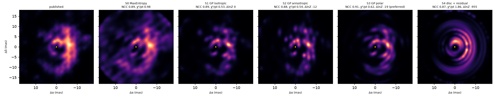
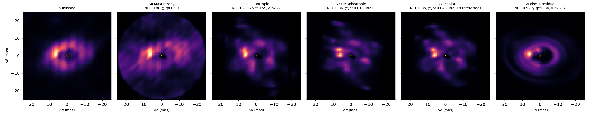
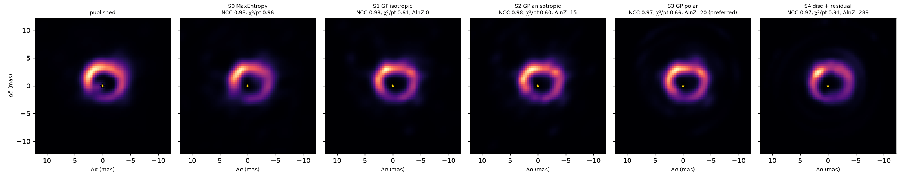
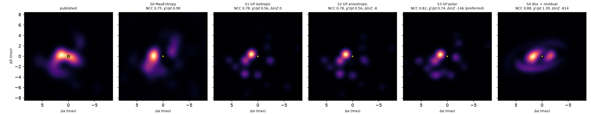
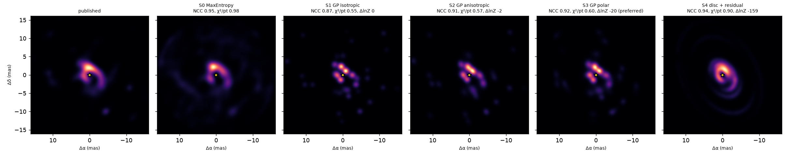
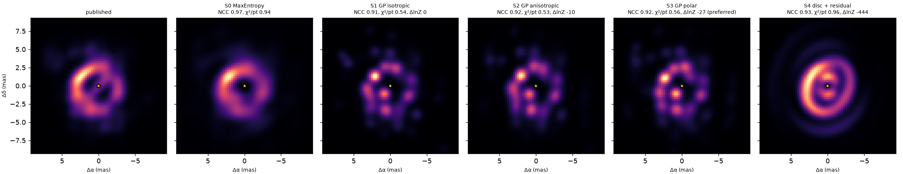
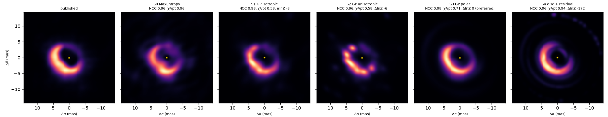
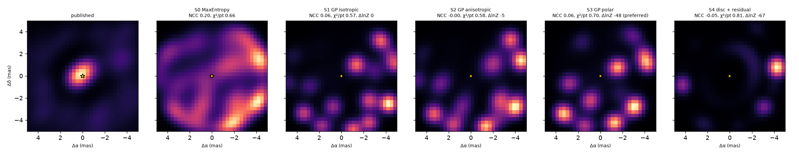
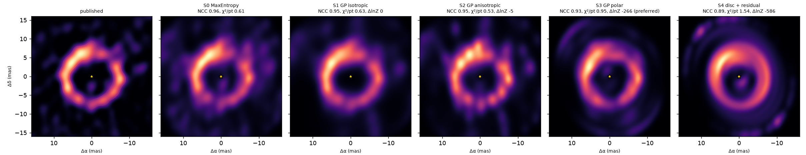

# Disc images: post-AGB binaries with VLTI/PIONIER

Post-AGB binaries are wrapped in dusty discs a few milliarcseconds across, which only an interferometer
such as the VLTI can resolve. Given the same public PIONIER data, does virgil draw the same discs as the experts?
We reconstruct eight systems imaged by De Prins et al. (2026) with SPARCO + ORGANIC, and IRAS 08544-4431 imaged by
Hillen et al. (2016), and compare the images at a common beam.

Each tab shows the published and virgil images side by side, the verdict, a parameter table against the paper and
how to reproduce it. The [summary table](#summary), the [method](#how-the-images-were-made) and the
[Methods note](#methods-note) follow the gallery.

## Gallery

=== "IW Car"

    ### IW Car { #iw-car }

    <!-- gen:figure IW_Car -->

    <figure markdown>
    
    <figcaption>IW Car in H band, 23 PIONIER exposures (MJD 58812 to 58893, up to 2020-02-14). Left: the ORGANIC image of De Prins et al. (2026), re-rendered here from their Zenodo FITS (10.5281/zenodo.20155600). Right: virgil, the polar Gaussian-process prior (σ = 2, ℓ_r = 0.61 mas, ℓ_θ = 0.25 rad), our recommended model. Both are the star-and-secondary-subtracted disc emission, convolved to a circular λ_min/2B_max beam of 1.21 mas FWHM (grey disc), peak-normalised, North up, East left; the star is the gold marker.</figcaption>
    </figure>

    <!-- /gen:figure -->

    <!-- gen:verdict IW_Car -->

    !!! success "Verdict: the reconstructions agree (NCC +0.33 over its best control)"
        At the λ_min/2B_max beam (1.21 mas) the headline image (gp-polar) correlates with the published one at 0.91 (0.91
        after the best sub-beam shift), against 0.18 for the East-West mirror of the published image, 0.11 for its 180°
        rotation and 0.58 for its azimuthal average (the same flux at the same radii with no azimuthal structure): +0.33 over
        the best control. A verdict says 'agree' only above +0.1. The inner arcs: flux-weighted radius 3.3 against 3.4 mas,
        major-axis PA 156° against 138°. The outer arc: radius 9.7 against 9.8 mas, PA 176° against 163°. Of the other
        strategies, gp-iso is closest to the published image at 0.89 (MEM 0.89). Conventions: see the [Methods
        note](#methods-note).

    <!-- /gen:verdict -->

    <!-- gen:strategies IW_Car -->

    **Strategies** (headline gp-polar; the same SPARCO scene, hole and error rescaling in every row; the Methods note says what each is). ΔlnZ is relative to the evidence-best strategy (gp-iso); MEM has no evidence.

    | Strategy | NCC (best control) | χ²/pt (rescaled errors) | ΔlnZ | f★ / f_env / f_bg+outer (%) | d_env (paper SIND0 = 0.89) | grid edge | bound warnings | disc+res render guard, n_r |
    | --- | --- | --- | --- | --- | --- | --- | --- | --- |
    | MEM (MaxEntropy) | 0.89 (0.51) | 0.98 | - | 63.7 / 34.1 / 10.4 | 0.80 | - | 2: bg.flux.ratio at its lower bound; bg.flux.index at its lower bound | - |
    | gp-iso \* | 0.89 (0.55) | 0.53 | +0.0 | 63.6 / 29.8 / 7.9 | 1.91 | no | 1: bg.flux.index at its lower bound | - |
    | gp-aniso | 0.88 (0.56) | 0.54 | −12.5 | 63.7 / 29.7 / 7.9 | 1.94 | no | 1: bg.flux.index at its lower bound | - |
    | **gp-polar** (headline) | 0.91 (0.58) | 0.62 | −18.8 | 63.8 / 27.4 / 8.4 | 2.53 | yes | 1: bg.flux.index at its lower bound | - |
    | disc+res (diagnostic) | 0.87 (0.61) | 1.86 | −954.8 | 63.9 / 29.6 / 7.7 | 1.80 | yes (d_env: yes) | 1: bg.flux.index at its lower bound | χ² 1.86 model, 2.58 rendered: FAIL; n_r = 192 |

    \* the evidence-best strategy. f★ is the primary's share of the 1.65 µm flux, f_env the environment image's, f_bg+outer the grey over-resolved flux (the background plus the environment's outer region). d_env is the environment's spectral index against De Prins's image index.

    The evidence prefers gp-iso, by ΔlnZ = −18.8 for gp-polar; that is a real preference on this grid, but the strategies have very different latent dimensions (see the Methods note), so we do not follow it blindly, and gp-polar stays the headline. Selected on the edge of the hyperparameter grid: gp-polar, disc+res (of 4 GP-based fits); an edge value means the grid did not bracket the optimum. disc+res is a diagnostic column only, never a headline candidate: it fails the render guard here (its rendered pixel image, put back into the scene, does not reproduce the model's χ²/pt), so its image is not a valid reconstruction.

    ??? note "All strategies side by side"
        

    <!-- /gen:strategies -->

    <!-- gen:parameters IW_Car -->

    **Parameters.** De Prins et al. could not fit a PMOIRED geometric model to IW Car (a single disc does not reproduce it), so there is no PMOIRED row to compare with. The comparison is with what the paper does report for IW Car: the SPARCO parameters of the ORGANIC reconstruction (FITS headers), and the inner-rim ellipses fitted to the image (Table 2; inner arcs and outer arc separately). The "virgil" columns are two fits to the same 23 files: the SPARCO parameters fitted together with the headline image (gp-polar), and a PMOIRED-style parametric model (UD star + point secondary + power-law rim with an m = 1 modulation + resolved background; lowest χ² of 6 starts: 3.3, 3.3, 3.3, 3.3, 3.3, 3.3). virgil's fits are point estimates; the σ column uses the paper's uncertainty, where it gives one. The image fit keeps De Prins's stellar index SIND1 and secondary index SIND2 = 0 fixed, and its secondary carries PMOIRED position and flux priors (Methods note), so agreement in this table shows that the data do not pull the values away from the published ones, not that virgil recovers them blind.

    | Parameter | De Prins+2026 | virgil (image fit) | virgil (parametric) | Difference |
    | --- | --- | --- | --- | --- |
    | Primary flux fraction, H (%) | 63.6 | 63.8 | 63.5 | +0.19 / −0.12 points |
    | Secondary flux fraction, H (%) | 1.99 | 2.45 | 1.86 | +0.46 / −0.13 points |
    | Secondary offset (Δα, Δδ) (mas) | (1.12, -1.90) | (1.15, -1.75) | (1.14, -1.83) | ≤ 0.1 mas |
    | Primary UD diameter (mas) | 0.50 | 0.50 (fixed) | 0.45 | +0.00 / −0.05 mas |
    | Disc spectral index d_env (image) | 0.89 | 2.53 | not comparable (rim 3.2) | +1.64 |
    | Inner-arc rim diameter (mas) | 6.9 ± 0.5 | see metrics | 16.1 (outer-arc scale) | not the same structure |
    | Rim inclination (°) | 48 ± 5 (inner), 57 ± 2 (outer) | n/a | 55.5 | −0.8σ against the outer arc |
    | Rim position angle (°) | 144 (+8, −7) (inner), 176 ± 3 (outer) | n/a | 165.8 | −3.4σ against the outer arc, +2.7σ against the inner |
    | Rim azimuthal modulation (m = 1) | not reported | n/a | amplitude 0.85 at 313° | none to compare |

    The parametric rim lands between the two orientations the paper finds for the inner and outer arcs (and near the SPHERE outer disc, i = 41.7°, PA = 161°, Andrych et al. 2023), which says the single-ring model is describing a blend of structures, as the paper concluded. Its χ² per point is 3.3, against 0.62 for the image fit, for the same reason.

    <!-- /gen:parameters -->

    <!-- gen:metrics IW_Car -->

    **Image metrics** (both images on one 0.35 mas grid, convolved to the λ_min/2B_max beam (1.21 mas FWHM); inner = within 5 mas of the star, outer = beyond; the paper's own rim fit needs per-pixel significances, so both images get the same moments. As an external check, the moments of the ORGANIC image give an outer major axis at PA 163° against the paper's 176 ± 3° from its rim fit, within 13°, so the two definitions are consistent):

    | Metric | ORGANIC | virgil (gp-polar) |
    | --- | --- | --- |
    | Normalised cross-correlation (controls: E-W mirror 0.18, 180° rotation 0.11, azimuthal average 0.58) | 1 | 0.91 (0.91 after the best sub-beam shift) |
    | Inner flux fraction (%) | 16.6 | 18.9 |
    | Inner flux-weighted radius (mas) | 3.41 | 3.25 |
    | Inner major-axis PA (°), axis ratio | 138, 0.88 | 156, 0.76 |
    | Inner flux centroid (° East of North), offset (mas) | 329, 1.12 | 336, 1.01 |
    | Outer flux fraction (%) | 77.3 | 81.1 |
    | Outer flux-weighted radius (mas) | 9.83 | 9.65 |
    | Outer major-axis PA (°), axis ratio | 163, 0.78 | 176, 0.69 |
    | Outer flux centroid (° East of North), offset (mas) | 268, 4.05 | 256, 3.71 |

    <!-- /gen:metrics -->

    ??? note "Data and method"

        **Data.** Phase 3 calibrated OIFITS from the ESO archive, programme 1103.D-0797 (PI J. Kluska,
        INSPIRING), the 23 exposures listed in the paper's observation log: 828 V² and 552
        closure-phase rows across the H band (1.51–1.76 µm). `postagb_data.py check` confirms
        that the union of ESO's two Phase 3 releases (PIONIER and INSPIRING; 31 exposures) matches the earlier reduced copy, and the 23 used here are the INSPIRING release.

        <!-- gen:model IW_Car -->

        **Beam and hole.** The PIONIER dirty beam is 3.26 × 2.29 mas at PA 142°. The comparison beam is circular, FWHM λ_min/(2B_max) = 1.21 mas, for both images. The environment image has a window of radius 1.21 mas (max(lambda_min/(2 B_max), UD diameter); 8562 pixels) blanked around the primary, with no window inside the primary's hole around the secondary (its position and flux are set by the PMOIRED priors), inside a circular support of radius 20.0 mas on a square grid reaching ±22.5 mas), so that its pixels cannot trade flux with the stellar point sources.

        **Model.** SPARCO (Methods note): a uniform-disc primary of fixed diameter 0.5 mas with flux ∝ λ^-3.165 (ORGANIC SIND1), a point-source secondary (position and flux with PMOIRED priors, index fixed at the paper's SIND2, no image window inside the primary's hole), and a `virgil.models.Image` environment on a 149 × 149 grid of 0.303 mas pixels (its own power-law index d_env = 2.53), plus a grey over-resolved background where the strategy fits one. Headline strategy gp-polar: the polar Gaussian-process prior (σ = 2, ℓ_r = 0.61 mas, ℓ_θ = 0.25 rad), our recommended model, selected by the Laplace evidence (ln Z = -885), at the edge of its hyperparameter grid, on a polar grid deprojected by the parametric disc's inclination 23° and PA 180°. ORGANIC differs: a GAN generator as its regulariser, with the primary's parameters tuned with pyBADS. Neither is a ground truth.

        **Fit quality.** On the same data the virgil gp-polar image has χ² per point 0.62 on errors rescaled by MacKay's evidence (s = 1.00; the Methods note explains why χ²/pt then sits below 1) and the ORGANIC image, with its published SPARCO parameters unchanged, 2.05 (1794 residuals, same rescaled errors). This does not say virgil's image is better: it has thousands of free pixels for those points and its prior is the only regularisation. The 1794 is the length of virgil's whitened-residual vector, not the number of data: the 828 V² and 552 closure phases (1380 samples) become 1794 residuals because each closure phase of four or more telescopes also adds a periodic penalty term. Dividing by 1380 instead would give about 0.81 and 2.66. Flipping the published image East-West or North-South gives χ² 60.2 and 8.8 against 2.05 as published, so the published orientation is the better one.

        <!-- /gen:model -->

        

        

        

        

        <figure markdown>
        
        <figcaption>ORGANIC (left) against SQUEEZE (right) for IRAS 15469-5311 and IW Car (inner and outer
        arcs). Reproduced from arXiv:2605.13445v2, Fig. 15 (Appendix D), the arXiv version, with the authors'
        permission. The authors find both methods recover the inner arcs and the large outer arc.</figcaption>
        </figure>

        <figure markdown>
        
        <figcaption>As published: the ORGANIC image of IW Car with the fitted rims of the inner and outer arcs,
        arXiv:2605.13445v2, Fig. 4. Reproduced from the arXiv version with the authors' permission.</figcaption>
        </figure>

        <figure markdown>
        
        <figcaption>The same reconstruction with no secondary in the SPARCO model: the unresolved flux peak
        near the green cross is the secondary. arXiv:2605.13445v2, Fig. 2. Reproduced from the arXiv version
        with the authors' permission.</figcaption>
        </figure>

        <figure markdown>
        
        <figcaption>SPHERE/IRDIS polarised light (Andrych et al. 2023) against the PIONIER image,
        arXiv:2605.13445v2, Fig. 6. Reproduced from the arXiv version with the authors' permission.</figcaption>
        </figure>

        Provenance, permissions and credits: [`DATA_ATTRIBUTION.md`](https://github.com/benjaminpope/virgil-validation/blob/main/DATA_ATTRIBUTION.md).
        Reproduce with `scripts/postagb_data.py fetch`, `scripts/postagb_literature.py` and
        `scripts/postagb_imaging.py {inspect,parametric,image,compare,replot} docs/imaging/postagb`.

=== "HR 4049"

    ### HR 4049 { #hr-4049 }

    <!-- gen:figure HR4049 -->

    <figure markdown>
    
    <figcaption>HR 4049 in H band, 19 PIONIER exposures (MJD 58884 to 58899). Left: the ORGANIC image of De Prins et al. (2026), re-rendered here from their Zenodo FITS (10.5281/zenodo.20155600). Right: virgil, the polar Gaussian-process prior (σ = 1, ℓ_r = 2.77 mas, ℓ_θ = 0.125 rad), our recommended model. Both are the star-and-secondary-subtracted disc emission, convolved to a circular λ_min/2B_max beam of 1.39 mas FWHM (grey disc), peak-normalised, North up, East left; the star is the gold marker.</figcaption>
    </figure>

    <!-- /gen:figure -->

    <!-- gen:verdict HR4049 -->

    !!! warning "Verdict: inconclusive (NCC only +0.05 over its best control)"
        At the λ_min/2B_max beam (1.39 mas) the headline image (gp-polar) correlates with the published one at 0.85 (0.85
        after the best sub-beam shift), against 0.63 for the East-West mirror of the published image, 0.64 for its 180°
        rotation and 0.79 for its azimuthal average (the same flux at the same radii with no azimuthal structure): +0.05 over
        the best control. A verdict says 'agree' only above +0.1. Flux-weighted radius 10.0 against 10.5 mas, flux centroid
        40° against 36° East of North, major-axis PA 60° against 109° (axis ratios 0.89 and 0.82). Of the other strategies,
        gp-iso is closest to the published image at 0.89 (MEM 0.86). SQUEEZE also failed to reconstruct this target in the
        paper (Appendix D). Conventions: see the [Methods note](#methods-note).

    <!-- /gen:verdict -->

    <!-- gen:strategies HR4049 -->

    **Strategies** (headline gp-polar; the same SPARCO scene, hole and error rescaling in every row; the Methods note says what each is). ΔlnZ is relative to the evidence-best strategy (gp-aniso); MEM has no evidence.

    | Strategy | NCC (best control) | χ²/pt (rescaled errors) | ΔlnZ | f★ / f_env / f_bg+outer (%) | d_env (paper SIND0 = 2.39) | grid edge | bound warnings | disc+res render guard, n_r |
    | --- | --- | --- | --- | --- | --- | --- | --- | --- |
    | MEM (MaxEntropy) | 0.86 (0.64) | 0.99 | - | 65.5 / 34.3 / 8.7 | 2.45 | - | 1: bg.flux.ratio at its lower bound | - |
    | gp-iso | 0.89 (0.81) | 0.59 | −2.4 | 65.8 / 33.7 / 1.8 | 2.42 | no | 1: bg.flux.ratio at its lower bound | - |
    | gp-aniso \* | 0.86 (0.80) | 0.61 | +0.0 | 65.7 / 33.8 / 1.0 | 2.46 | no | 1: bg.flux.ratio at its lower bound | - |
    | **gp-polar** (headline) | 0.85 (0.79) | 0.64 | −18.4 | 65.7 / 33.5 / 0.7 | 2.39 | no | 2: bg.flux.ratio at its lower bound; bg.flux.index at its upper bound | - |
    | disc+res (diagnostic) | 0.92 (0.80) | 0.84 | −16.9 | 65.8 / 26.9 / 8.4 | 1.45 | no (d_env: yes) | 2: bg.flux.index at its upper bound; res.flux.ratio at its upper bound | χ² 0.84 model, 0.84 rendered: pass; n_r = 192 |

    \* the evidence-best strategy. f★ is the primary's share of the 1.65 µm flux, f_env the environment image's, f_bg+outer the grey over-resolved flux (the background plus the environment's outer region). d_env is the environment's spectral index against De Prins's image index.

    The evidence prefers gp-aniso, by ΔlnZ = −18.4 for gp-polar; that is a real preference on this grid, but the strategies have very different latent dimensions (see the Methods note), so we do not follow it blindly, and gp-polar stays the headline. Selected on the edge of the hyperparameter grid: none (of 4 GP-based fits). disc+res is a diagnostic column only, never a headline candidate: it passes the render guard here.

    ??? note "All strategies side by side"
        

    <!-- /gen:strategies -->

    <!-- gen:parameters HR4049 -->

    **Parameters.** The first table compares the PMOIRED geometric model of De Prins et al. (Table 3) with a PMOIRED-style parametric fit of virgil to the same 19 files (UD star, power-law rim with an m = 1 modulation, plus the paper's optional secondary or resolved background). The σ column uses the paper's uncertainty only; virgil's are point estimates, so large σ values mostly say how tight the paper's errors are. The rim diameter is that of a Gaussian ring in virgil and of a power-law rim in PMOIRED, so that row is not like for like; the modulation phase is virgil's `az_pas` minus the rim position angle, which is PMOIRED's `az projang` (docs/method/pmoired.md). The parametric fit takes the lowest χ² of 6 starts (1.7, 1.7, 1.7, 1.7, 1.7, 1.7).

    | Parameter | De Prins+2026 (PMOIRED) | virgil (parametric) | Difference |
    | --- | --- | --- | --- |
    | Primary flux fraction, H (%) | 65.9 ± 0.14 | 65.7 | -0.245 (-1.8σ) |
    | Primary UD diameter (mas) | 0.74 ± 0.02 | 0.752 | +0.0118 (+0.6σ) |
    | Secondary flux fraction, H (%) | 0.42 ± 0.05 | 0.514 | +0.0939 (+1.9σ) |
    | Secondary offset Δα (mas) | -1.7 ± 0.08 | -3.92 | -2.22 (-27.7σ) |
    | Secondary offset Δδ (mas) | -0.69 ± 0.1 | 2.26 | +2.95 (+29.5σ) |
    | Rim diameter (mas) | 14.3 ± 0.18 | 16.9 | +2.54 (+15.9σ) |
    | Rim inclination (°) | 56.8 ± 1 | 50.9 | -5.85 (-5.9σ) |
    | Rim position angle (°) | 82.3 ± 1 | 79.9 | -2.47 (-3.1σ) |
    | Rim modulation amplitude (m = 1) | 0.42 ± 0.03 | 0.486 | +0.0656 (+2.2σ) |
    | Rim modulation phase (°) | -38 ± 3 | -16.6 | +21.4 (+7.1σ) |
    | χ² per point | 1.71 | 1.70 | |

    The SPARCO scene of the headline image fit (gp-polar) against that of the ORGANIC image (Table 2 and FITS header). The star's spectral index is not fitted: it is De Prins's own SIND1, so d_env is comparable with the paper's. The secondary's offset and flux carry PMOIRED priors (Methods note), so agreement on those rows shows the data do not pull them away, not a blind recovery.

    | Parameter | De Prins+2026 (ORGANIC) | virgil (gp-polar) | Difference |
    | --- | --- | --- | --- |
    | Primary flux fraction, H (%) | 65.4 | 65.7 | +0.281 |
    | Secondary flux fraction, H (%) | 0.24 | 0.343 | +0.103 |
    | Primary UD diameter (mas; fixed in virgil) | 0.72 | 0.721 | +0.001 |
    | Secondary offset (Δα, Δδ) (mas; PMOIRED Table 3) | (-1.70, -0.69) | (-1.71, -0.69) | ≤ 0.01 mas |
    | Primary spectral index (fixed) | ORGANIC SIND1 | -3.14 (ORGANIC SIND1) | same by construction |
    | Disc spectral index d_env (paper's image index SIND0) | 2.39 | 2.39 | −0.00 |

    <!-- /gen:parameters -->

    <!-- gen:metrics HR4049 -->

    **Image metrics** (both images on one 0.64 mas grid, convolved to the λ_min/2B_max beam (1.39 mas FWHM); the paper's own rim fit needs per-pixel significances, so both images get the same moments):

    | Metric | ORGANIC | virgil (gp-polar) |
    | --- | --- | --- |
    | Normalised cross-correlation (controls: E-W mirror 0.63, 180° rotation 0.64, azimuthal average 0.79) | 1 | 0.85 (0.85 after the best sub-beam shift) |
    | Flux fraction in the image field | 71 % | 100 % |
    | Flux-weighted radius (mas) | 10.49 | 9.97 |
    | Major-axis PA (°), axis ratio | 109, 0.82 | 60, 0.89 |
    | Asymmetry angle, flux centroid (° East of North), offset (mas) | 36, 0.98 | 40, 0.83 |

    <!-- /gen:metrics -->

    ??? note "Data and method"

        **Data.** Phase 3 calibrated OIFITS from the ESO archive, programme 1103.D-0797 (PI J. Kluska, INSPIRING), the 19 exposures listed in the paper's observation log: 684 V² and 456 closure-phase rows across the H band (1.52–1.77 µm).

        <!-- gen:model HR4049 -->

        **Beam and hole.** The PIONIER dirty beam is 5.15 × 2.92 mas at PA 146°. The comparison beam is circular, FWHM λ_min/(2B_max) = 1.39 mas, for both images. The environment image has a window of radius 1.39 mas (max(lambda_min/(2 B_max), UD diameter); 5974 pixels) blanked around the primary, with no window inside the primary's hole around the secondary (its position and flux are set by the PMOIRED priors), inside a circular support of radius 25.0 mas on a square grid reaching ±25.8 mas), so that its pixels cannot trade flux with the stellar point sources.

        **Model.** SPARCO (Methods note): a uniform-disc primary of fixed diameter 0.721 mas with flux ∝ λ^-3.14 (ORGANIC SIND1), a point-source secondary (position and flux with PMOIRED priors, index fixed at the paper's SIND2, no image window inside the primary's hole), and a `virgil.models.Image` environment on a 149 × 149 grid of 0.347 mas pixels (its own power-law index d_env = 2.39), plus a grey over-resolved background where the strategy fits one. Headline strategy gp-polar: the polar Gaussian-process prior (σ = 1, ℓ_r = 2.77 mas, ℓ_θ = 0.125 rad), our recommended model, selected by the Laplace evidence (ln Z = -690), on a polar grid deprojected by the parametric disc's inclination 44° and PA 81°. ORGANIC differs: a GAN generator as its regulariser, with the primary's parameters tuned with pyBADS. Neither is a ground truth.

        **Fit quality.** On the same data the virgil gp-polar image has χ² per point 0.64 on errors rescaled by MacKay's evidence (s = 0.94; the Methods note explains why χ²/pt then sits below 1) and the ORGANIC image, with its published SPARCO parameters unchanged, 2.22 (1482 residuals, same rescaled errors). This does not say virgil's image is better: it has thousands of free pixels for those points and its prior is the only regularisation. Flipping the published image East-West or North-South gives χ² 14.9 and 10.8 against 2.22 as published, so the published orientation is the better one.

        <!-- /gen:model -->

        

        

        

        

        <figure markdown>
        
        <figcaption>As published: the ORGANIC image of HR 4049 with the fitted inner rim, arXiv:2605.13445v2, Fig. 4. Reproduced from the arXiv version with the authors' permission.</figcaption>
        </figure>

        Provenance, permissions and credits: [`DATA_ATTRIBUTION.md`](https://github.com/benjaminpope/virgil-validation/blob/main/DATA_ATTRIBUTION.md).
        Reproduce with `scripts/postagb_data.py fetch`, `scripts/postagb_literature.py` and
        `scripts/postagb_imaging.py {inspect,parametric,image,compare,table,replot} docs/imaging/postagb --target HR4049`.

=== "HD 108015"

    ### HD 108015 { #hd-108015 }

    <!-- gen:figure HD108015 -->

    <figure markdown>
    
    <figcaption>HD 108015 in H band, 35 PIONIER exposures (MJD 59576 to 59621). Left: the ORGANIC image of De Prins et al. (2026), re-rendered here from their Zenodo FITS (10.5281/zenodo.20155600). Right: virgil, the polar Gaussian-process prior (σ = 2, ℓ_r = 0.59 mas, ℓ_θ = 0.5 rad), our recommended model. Both are the star-subtracted disc emission, convolved to a circular λ_min/2B_max beam of 1.18 mas FWHM (grey disc), peak-normalised, North up, East left; the star is the gold marker.</figcaption>
    </figure>

    <!-- /gen:figure -->

    <!-- gen:verdict HD108015 -->

    !!! success "Verdict: the reconstructions agree (NCC +0.16 over its best control)"
        At the λ_min/2B_max beam (1.18 mas) the headline image (gp-polar) correlates with the published one at 0.97 (0.97
        after the best sub-beam shift), against 0.78 for the East-West mirror of the published image, 0.44 for its 180°
        rotation and 0.81 for its azimuthal average (the same flux at the same radii with no azimuthal structure): +0.16 over
        the best control. A verdict says 'agree' only above +0.1. Flux-weighted radius 4.2 against 4.5 mas, flux centroid 341°
        against 350° East of North, major-axis PA 76° against 88° (axis ratios 0.93 and 0.83). Of the other strategies,
        gp-aniso is closest to the published image at 0.98 (MEM 0.98). Conventions: see the [Methods note](#methods-note).

    <!-- /gen:verdict -->

    <!-- gen:strategies HD108015 -->

    **Strategies** (headline gp-polar; the same SPARCO scene, hole and error rescaling in every row; the Methods note says what each is). ΔlnZ is relative to the evidence-best strategy (gp-iso); MEM has no evidence.

    | Strategy | NCC (best control) | χ²/pt (rescaled errors) | ΔlnZ | f★ / f_env / f_bg+outer (%) | d_env (paper SIND0 = 1.45) | grid edge | bound warnings | disc+res render guard, n_r |
    | --- | --- | --- | --- | --- | --- | --- | --- | --- |
    | MEM (MaxEntropy) | 0.98 (0.83) | 0.96 | - | 56.8 / 43.2 / 7.6 | 1.34 | - | 2: bg.flux.ratio at its lower bound; bg.flux.index at its lower bound | - |
    | gp-iso \* | 0.98 (0.82) | 0.61 | +0.0 | 56.8 / 40.8 / 5.0 | 1.80 | no | 1: bg.flux.index at its lower bound | - |
    | gp-aniso | 0.98 (0.82) | 0.60 | −15.5 | 56.7 / 40.9 / 4.9 | 1.79 | no | 1: bg.flux.index at its lower bound | - |
    | **gp-polar** (headline) | 0.97 (0.81) | 0.66 | −20.4 | 56.6 / 39.9 / 4.9 | 1.97 | yes | 0 | - |
    | disc+res (diagnostic) | 0.97 (0.82) | 0.91 | −238.8 | 57.0 / 40.1 / 4.4 | 1.34 | no (d_env: no) | 1: res.flux.ratio at its upper bound | χ² 0.91 model, 1.37 rendered: FAIL; n_r = 192 |

    \* the evidence-best strategy. f★ is the primary's share of the 1.65 µm flux, f_env the environment image's, f_bg+outer the grey over-resolved flux (the background plus the environment's outer region). d_env is the environment's spectral index against De Prins's image index.

    The evidence prefers gp-iso, by ΔlnZ = −20.4 for gp-polar; that is a real preference on this grid, but the strategies have very different latent dimensions (see the Methods note), so we do not follow it blindly, and gp-polar stays the headline. Selected on the edge of the hyperparameter grid: gp-polar (of 4 GP-based fits); an edge value means the grid did not bracket the optimum. disc+res is a diagnostic column only, never a headline candidate: it fails the render guard here (its rendered pixel image, put back into the scene, does not reproduce the model's χ²/pt), so its image is not a valid reconstruction.

    ??? note "All strategies side by side"
        

    <!-- /gen:strategies -->

    <!-- gen:parameters HD108015 -->

    **Parameters.** The first table compares the PMOIRED geometric model of De Prins et al. (Table 3) with a PMOIRED-style parametric fit of virgil to the same 35 files (UD star, power-law rim with an m = 1 modulation, plus the paper's optional secondary or resolved background). The σ column uses the paper's uncertainty only; virgil's are point estimates, so large σ values mostly say how tight the paper's errors are. The rim diameter is that of a Gaussian ring in virgil and of a power-law rim in PMOIRED, so that row is not like for like; the modulation phase is virgil's `az_pas` minus the rim position angle, which is PMOIRED's `az projang` (docs/method/pmoired.md). The parametric fit takes the lowest χ² of 6 starts (1.8, 1.8, 1.8, 2.4, 1.8, 1.8).

    | Parameter | De Prins+2026 (PMOIRED) | virgil (parametric) | Difference |
    | --- | --- | --- | --- |
    | Primary flux fraction, H (%) | 61.8 ± 0.3 | 56.5 | -5.28 (-17.6σ) |
    | Resolved-background flux fraction, H (%) | 8.6 ± 0.5 | 11.8 | +3.2 (+6.4σ) |
    | Rim diameter (mas) | 5.63 ± 0.03 | 6.72 | +1.09 (+36.3σ) |
    | Rim inclination (°) | 31.2 ± 0.8 | 29.2 | -1.99 (-2.5σ) |
    | Rim position angle (°) | 82.5 ± 1.2 | 81.6 | -0.861 (-0.8σ) |
    | Rim modulation amplitude (m = 1) | 0.502 ± 0.008 | 0.508 | +0.00644 (+0.8σ) |
    | Rim modulation phase (°) | -66 ± 2 | -65.1 | +0.899 (+0.4σ) |
    | χ² per point | 2.08 | 1.81 | |

    The SPARCO scene of the headline image fit (gp-polar) against that of the ORGANIC image (Table 2 and FITS header). The star's spectral index is not fitted: it is De Prins's own SIND1, so d_env is comparable with the paper's. The secondary's offset and flux carry PMOIRED priors (Methods note), so agreement on those rows shows the data do not pull them away, not a blind recovery.

    | Parameter | De Prins+2026 (ORGANIC) | virgil (gp-polar) | Difference |
    | --- | --- | --- | --- |
    | Primary flux fraction, H (%) | 56 | 56.6 | +0.585 |
    | Primary UD diameter (mas; fixed in virgil) | - | 0.001 | - |
    | Primary spectral index (fixed) | ORGANIC SIND1 | -3.16 (ORGANIC SIND1) | same by construction |
    | Disc spectral index d_env (paper's image index SIND0) | 1.45 | 1.97 | +0.52 |

    <!-- /gen:parameters -->

    <!-- gen:metrics HD108015 -->

    **Image metrics** (both images on one 0.33 mas grid, convolved to the λ_min/2B_max beam (1.18 mas FWHM); the paper's own rim fit needs per-pixel significances, so both images get the same moments):

    | Metric | ORGANIC | virgil (gp-polar) |
    | --- | --- | --- |
    | Normalised cross-correlation (controls: E-W mirror 0.78, 180° rotation 0.44, azimuthal average 0.81) | 1 | 0.97 (0.97 after the best sub-beam shift) |
    | Flux fraction in the image field | 99 % | 100 % |
    | Flux-weighted radius (mas) | 4.49 | 4.19 |
    | Major-axis PA (°), axis ratio | 88, 0.83 | 76, 0.93 |
    | Asymmetry angle, flux centroid (° East of North), offset (mas) | 350, 1.68 | 341, 1.48 |

    <!-- /gen:metrics -->

    ??? note "Data and method"

        **Data.** Phase 3 calibrated OIFITS from the ESO archive, programme 1103.D-0797 (PI J. Kluska, INSPIRING), the 35 exposures listed in the paper's observation log: 1260 V² and 840 closure-phase rows across the H band (1.52–1.77 µm).

        <!-- gen:model HD108015 -->

        **Beam and hole.** The PIONIER dirty beam is 3.28 × 1.96 mas at PA 117°. The comparison beam is circular, FWHM λ_min/(2B_max) = 1.18 mas, for both images. The environment image has a window of radius 1.18 mas (max(lambda_min/(2 B_max), UD diameter); 6225 pixels) blanked around the primary, inside a circular support of radius 19.9 mas on a square grid reaching ±21.1 mas), so that its pixels cannot trade flux with the stellar point sources.

        **Model.** SPARCO (Methods note): a uniform-disc primary of fixed diameter 0.001 mas with flux ∝ λ^-3.158 (ORGANIC SIND1), and a `virgil.models.Image` environment on a 143 × 143 grid of 0.295 mas pixels (its own power-law index d_env = 1.97), plus a grey over-resolved background where the strategy fits one. Headline strategy gp-polar: the polar Gaussian-process prior (σ = 2, ℓ_r = 0.59 mas, ℓ_θ = 0.5 rad), our recommended model, selected by the Laplace evidence (ln Z = -1142), at the edge of its hyperparameter grid, on a polar grid deprojected by the parametric disc's inclination 27° and PA 143°. ORGANIC differs: a GAN generator as its regulariser, with the primary's parameters tuned with pyBADS. Neither is a ground truth.

        **Fit quality.** On the same data the virgil gp-polar image has χ² per point 0.66 on errors rescaled by MacKay's evidence (s = 0.89; the Methods note explains why χ²/pt then sits below 1) and the ORGANIC image, with its published SPARCO parameters unchanged, 5.41 (2730 residuals, same rescaled errors). This does not say virgil's image is better: it has thousands of free pixels for those points and its prior is the only regularisation. Flipping the published image East-West or North-South gives χ² 36.5 and 88.8 against 5.41 as published, so the published orientation is the better one.

        <!-- /gen:model -->

        

        

        

        

        <figure markdown>
        
        <figcaption>As published: the ORGANIC image of HD 108015 with the fitted inner rim, arXiv:2605.13445v2, Fig. 3. Reproduced from the arXiv version with the authors' permission.</figcaption>
        </figure>

        <figure markdown>
        
        <figcaption>ORGANIC (left) against SQUEEZE (right) for AI Sco, EN TrA, HD 95767 and HD 108015, arXiv:2605.13445v2, Fig. 14 (Appendix D). Reproduced from the arXiv version with the authors' permission.</figcaption>
        </figure>

        Provenance, permissions and credits: [`DATA_ATTRIBUTION.md`](https://github.com/benjaminpope/virgil-validation/blob/main/DATA_ATTRIBUTION.md).
        Reproduce with `scripts/postagb_data.py fetch`, `scripts/postagb_literature.py` and
        `scripts/postagb_imaging.py {inspect,parametric,image,compare,table,replot} docs/imaging/postagb --target HD108015`.

=== "AI Sco"

    ### AI Sco { #ai-sco }

    <!-- gen:figure AI_Sco -->

    <figure markdown>
    
    <figcaption>AI Sco in H band, 28 PIONIER exposures (MJD 58693 to 58726). Left: the ORGANIC image of De Prins et al. (2026), re-rendered here from their Zenodo FITS (10.5281/zenodo.20155600). Right: virgil, the polar Gaussian-process prior (σ = 4, ℓ_r = 0.61 mas, ℓ_θ = 0.0625 rad), our recommended model. Both are the star-and-secondary-subtracted disc emission, convolved to a circular λ_min/2B_max beam of 1.22 mas FWHM (grey disc), peak-normalised, North up, East left; the star is the gold marker.</figcaption>
    </figure>

    <!-- /gen:figure -->

    <!-- gen:verdict AI_Sco -->

    !!! success "Verdict: the reconstructions agree (NCC +0.28 over its best control)"
        At the λ_min/2B_max beam (1.22 mas) the headline image (gp-polar) correlates with the published one at 0.82 (0.82
        after the best sub-beam shift), against 0.49 for the East-West mirror of the published image, 0.53 for its 180°
        rotation and 0.52 for its azimuthal average (the same flux at the same radii with no azimuthal structure): +0.28 over
        the best control. A verdict says 'agree' only above +0.1. Flux-weighted radius 3.1 against 2.9 mas, flux centroid 127°
        against 136° East of North, major-axis PA 113° against 119° (axis ratios 0.63 and 0.80). Of the other strategies,
        gp-aniso is closest to the published image at 0.78 (MEM 0.75). Conventions: see the [Methods note](#methods-note).

    <!-- /gen:verdict -->

    <!-- gen:strategies AI_Sco -->

    **Strategies** (headline gp-polar; the same SPARCO scene, hole and error rescaling in every row; the Methods note says what each is). ΔlnZ is relative to the evidence-best strategy (gp-iso); MEM has no evidence.

    | Strategy | NCC (best control) | χ²/pt (rescaled errors) | ΔlnZ | f★ / f_env / f_bg+outer (%) | d_env (paper SIND0 = -0.59) | grid edge | bound warnings | disc+res render guard, n_r |
    | --- | --- | --- | --- | --- | --- | --- | --- | --- |
    | MEM (MaxEntropy) | 0.75 (0.51) | 0.98 | - | 69.9 / 22.7 / 6.1 | -1.01 | - | 1: bg.flux.ratio at its lower bound | - |
    | gp-iso \* | 0.78 (0.49) | 0.56 | +0.0 | 69.1 / 27.6 / 3.6 | -0.66 | no | 2: bg.flux.ratio at its lower bound; bg.flux.index at its upper bound | - |
    | gp-aniso | 0.78 (0.48) | 0.56 | −8.2 | 69.7 / 26.9 / 3.8 | -0.67 | yes | 2: bg.flux.ratio at its lower bound; bg.flux.index at its upper bound | - |
    | **gp-polar** (headline) | 0.82 (0.53) | 0.74 | −145.8 | 69.7 / 23.7 / 3.3 | -1.42 | yes | 1: bg.flux.index at its upper bound | - |
    | disc+res (diagnostic) | 0.88 (0.72) | 1.39 | −814.2 | 69.0 / 23.5 / 4.0 | -2.01 | no (d_env: yes) | 2: bg.flux.index at its upper bound; res.flux.ratio at its lower bound | χ² 1.39 model, 1.38 rendered: pass; n_r = 192 |

    \* the evidence-best strategy. f★ is the primary's share of the 1.65 µm flux, f_env the environment image's, f_bg+outer the grey over-resolved flux (the background plus the environment's outer region). d_env is the environment's spectral index against De Prins's image index.

    The evidence prefers gp-iso, by ΔlnZ = −145.8 for gp-polar; that is a real preference on this grid, but the strategies have very different latent dimensions (see the Methods note), so we do not follow it blindly, and gp-polar stays the headline. Selected on the edge of the hyperparameter grid: gp-aniso, gp-polar (of 4 GP-based fits); an edge value means the grid did not bracket the optimum. disc+res is a diagnostic column only, never a headline candidate: it passes the render guard here.

    ??? note "All strategies side by side"
        

    <!-- /gen:strategies -->

    <!-- gen:parameters AI_Sco -->

    **Parameters.** The first table compares the PMOIRED geometric model of De Prins et al. (Table 3) with a PMOIRED-style parametric fit of virgil to the same 28 files (UD star, power-law rim with an m = 1 modulation, plus the paper's optional secondary or resolved background). The σ column uses the paper's uncertainty only; virgil's are point estimates, so large σ values mostly say how tight the paper's errors are. The rim diameter is that of a Gaussian ring in virgil and of a power-law rim in PMOIRED, so that row is not like for like; the modulation phase is virgil's `az_pas` minus the rim position angle, which is PMOIRED's `az projang` (docs/method/pmoired.md). The parametric fit takes the lowest χ² of 6 starts (2.9, 2.9, 2.9, 3.1, 2.9, 2.9).

    | Parameter | De Prins+2026 (PMOIRED) | virgil (parametric) | Difference |
    | --- | --- | --- | --- |
    | Primary flux fraction, H (%) | 68.1 ± 0.4 | 72.6 | +4.48 (+11.2σ) |
    | Secondary flux fraction, H (%) | 5.9 ± 0.2 | 3.43 | -2.47 (-12.4σ) |
    | Secondary offset Δα (mas) | -1.08 ± 0.04 | -1.78 | -0.699 (-23.3σ) |
    | Secondary offset Δδ (mas) | -1.38 ± 0.06 | -1.01 | +0.366 (+6.1σ) |
    | Rim diameter (mas) | 5.83 ± 0.09 | 4.97 | -0.864 (-12.3σ) |
    | Rim inclination (°) | 45.6 ± 2 | 46.1 | +0.503 (+0.3σ) |
    | Rim position angle (°) | 60 ± 7 | 18.8 | -41.2 (-8.2σ) |
    | Rim modulation amplitude (m = 1) | 0.87 ± 0.05 | 0.714 | -0.156 (-3.1σ) |
    | Rim modulation phase (°) | -9 ± 5 | 14.3 | +23.3 (+5.8σ) |
    | χ² per point | 4.98 | 2.86 | |

    The SPARCO scene of the headline image fit (gp-polar) against that of the ORGANIC image (Table 2 and FITS header). The star's spectral index is not fitted: it is De Prins's own SIND1, so d_env is comparable with the paper's. The secondary's offset and flux carry PMOIRED priors (Methods note), so agreement on those rows shows the data do not pull them away, not a blind recovery.

    | Parameter | De Prins+2026 (ORGANIC) | virgil (gp-polar) | Difference |
    | --- | --- | --- | --- |
    | Primary flux fraction, H (%) | 64.5 | 69.7 | +5.23 |
    | Secondary flux fraction, H (%) | 2.76 | 4.17 | +1.41 |
    | Primary UD diameter (mas; fixed in virgil) | - | 0.001 | - |
    | Secondary offset (Δα, Δδ) (mas; PMOIRED Table 3) | (-1.08, -1.38) | (-1.11, -1.27) | ≤ 0.11 mas |
    | Primary spectral index (fixed) | ORGANIC SIND1 | -2.13 (ORGANIC SIND1) | same by construction |
    | Disc spectral index d_env (paper's image index SIND0) | -0.59 | -1.42 | −0.83 |

    <!-- /gen:parameters -->

    <!-- gen:metrics AI_Sco -->

    **Image metrics** (both images on one 0.23 mas grid, convolved to the λ_min/2B_max beam (1.22 mas FWHM); the paper's own rim fit needs per-pixel significances, so both images get the same moments):

    | Metric | ORGANIC | virgil (gp-polar) |
    | --- | --- | --- |
    | Normalised cross-correlation (controls: E-W mirror 0.49, 180° rotation 0.53, azimuthal average 0.52) | 1 | 0.82 (0.82 after the best sub-beam shift) |
    | Flux fraction in the image field | 99 % | 100 % |
    | Flux-weighted radius (mas) | 2.88 | 3.06 |
    | Major-axis PA (°), axis ratio | 119, 0.80 | 113, 0.63 |
    | Asymmetry angle, flux centroid (° East of North), offset (mas) | 136, 0.90 | 127, 1.47 |

    <!-- /gen:metrics -->

    ??? note "Data and method"

        **Data.** Phase 3 calibrated OIFITS from the ESO archive, programme 1103.D-0797 (PI J. Kluska, INSPIRING), the 28 exposures listed in the paper's observation log: 1008 V² and 672 closure-phase rows across the H band (1.51–1.76 µm).

        <!-- gen:model AI_Sco -->

        **Beam and hole.** The PIONIER dirty beam is 3.65 × 2.55 mas at PA 139°. The comparison beam is circular, FWHM λ_min/(2B_max) = 1.22 mas, for both images. The environment image has a window of radius 1.22 mas (max(lambda_min/(2 B_max), UD diameter); 5220 pixels) blanked around the primary, with no window inside the primary's hole around the secondary (its position and flux are set by the PMOIRED priors), inside a circular support of radius 14.0 mas on a square grid reaching ±14.8 mas), so that its pixels cannot trade flux with the stellar point sources.

        **Model.** SPARCO (Methods note): a uniform-disc primary of fixed diameter 0.001 mas with flux ∝ λ^-2.129 (ORGANIC SIND1), a point-source secondary (position and flux with PMOIRED priors, index fixed at the paper's SIND2, no image window inside the primary's hole), and a `virgil.models.Image` environment on a 129 × 129 grid of 0.23 mas pixels (its own power-law index d_env = -1.42), plus a grey over-resolved background where the strategy fits one. Headline strategy gp-polar: the polar Gaussian-process prior (σ = 4, ℓ_r = 0.61 mas, ℓ_θ = 0.0625 rad), our recommended model, selected by the Laplace evidence (ln Z = -920), at the edge of its hyperparameter grid, on a polar grid deprojected by the parametric disc's inclination 63° and PA 105°. ORGANIC differs: a GAN generator as its regulariser, with the primary's parameters tuned with pyBADS. Neither is a ground truth.

        **Fit quality.** On the same data the virgil gp-polar image has χ² per point 0.74 on errors rescaled by MacKay's evidence (s = 1.34; the Methods note explains why χ²/pt then sits below 1) and the ORGANIC image, with its published SPARCO parameters unchanged, 1.38 (2184 residuals, same rescaled errors). This does not say virgil's image is better: it has thousands of free pixels for those points and its prior is the only regularisation. Flipping the published image East-West or North-South gives χ² 14.3 and 9.6 against 1.38 as published, so the published orientation is the better one.

        <!-- /gen:model -->

        

        

        

        

        <figure markdown>
        
        <figcaption>As published: the ORGANIC image of AI Sco with the fitted inner rim, arXiv:2605.13445v2, Fig. 3. Reproduced from the arXiv version with the authors' permission.</figcaption>
        </figure>

        <figure markdown>
        
        <figcaption>ORGANIC (left) against SQUEEZE (right) for AI Sco, EN TrA, HD 95767 and HD 108015, arXiv:2605.13445v2, Fig. 14 (Appendix D). Reproduced from the arXiv version with the authors' permission.</figcaption>
        </figure>

        Provenance, permissions and credits: [`DATA_ATTRIBUTION.md`](https://github.com/benjaminpope/virgil-validation/blob/main/DATA_ATTRIBUTION.md).
        Reproduce with `scripts/postagb_data.py fetch`, `scripts/postagb_literature.py` and
        `scripts/postagb_imaging.py {inspect,parametric,image,compare,table,replot} docs/imaging/postagb --target AI_Sco`.

=== "EN TrA"

    ### EN TrA { #en-tra }

    <!-- gen:figure EN_TrA -->

    <figure markdown>
    
    <figcaption>EN TrA in H band, 20 PIONIER exposures (MJD 59267 to 59295). Left: the ORGANIC image of De Prins et al. (2026), re-rendered here from their Zenodo FITS (10.5281/zenodo.20155600). Right: virgil, the polar Gaussian-process prior (σ = 4, ℓ_r = 0.61 mas, ℓ_θ = 0.0625 rad), our recommended model. Both are the star-and-secondary-subtracted disc emission, convolved to a circular λ_min/2B_max beam of 1.21 mas FWHM (grey disc), peak-normalised, North up, East left; the star is the gold marker.</figcaption>
    </figure>

    <!-- /gen:figure -->

    <!-- gen:verdict EN_TrA -->

    !!! success "Verdict: the reconstructions agree (NCC +0.15 over its best control)"
        At the λ_min/2B_max beam (1.21 mas) the headline image (gp-polar) correlates with the published one at 0.92 (0.94
        after the best sub-beam shift), against 0.71 for the East-West mirror of the published image, 0.52 for its 180°
        rotation and 0.77 for its azimuthal average (the same flux at the same radii with no azimuthal structure): +0.15 over
        the best control. A verdict says 'agree' only above +0.1. Flux-weighted radius 4.2 against 4.0 mas, flux centroid 220°
        against 288° East of North, major-axis PA 39° against 56° (axis ratios 0.75 and 0.72). Of the other strategies, MEM
        (MaxEntropy) is closest to the published image at 0.95. Conventions: see the [Methods note](#methods-note).

    <!-- /gen:verdict -->

    <!-- gen:strategies EN_TrA -->

    **Strategies** (headline gp-polar; the same SPARCO scene, hole and error rescaling in every row; the Methods note says what each is). ΔlnZ is relative to the evidence-best strategy (gp-iso); MEM has no evidence.

    | Strategy | NCC (best control) | χ²/pt (rescaled errors) | ΔlnZ | f★ / f_env / f_bg+outer (%) | d_env (paper SIND0 = 0.30) | grid edge | bound warnings | disc+res render guard, n_r |
    | --- | --- | --- | --- | --- | --- | --- | --- | --- |
    | MEM (MaxEntropy) | 0.95 (0.76) | 0.98 | - | 72.5 / 20.9 / 3.4 | 0.25 | - | 1: bg.flux.ratio at its lower bound | - |
    | gp-iso \* | 0.87 (0.73) | 0.55 | +0.0 | 70.9 / 23.6 / 1.1 | 0.29 | yes | 2: bg.flux.ratio at its lower bound; bg.flux.index at its lower bound | - |
    | gp-aniso | 0.91 (0.75) | 0.57 | −2.3 | 71.0 / 23.5 / 1.4 | 0.30 | yes | 2: bg.flux.ratio at its lower bound; bg.flux.index at its lower bound | - |
    | **gp-polar** (headline) | 0.92 (0.77) | 0.60 | −20.0 | 71.3 / 23.0 / 0.3 | 0.26 | yes | 2: bg.flux.ratio at its lower bound; bg.flux.index at its lower bound | - |
    | disc+res (diagnostic) | 0.94 (0.85) | 0.90 | −159.1 | 71.9 / 22.9 / 0.6 | 0.25 | yes (d_env: no) | 2: bg.flux.ratio at its lower bound; res.flux.ratio at its lower bound | χ² 0.90 model, 0.92 rendered: pass; n_r = 192 |

    \* the evidence-best strategy. f★ is the primary's share of the 1.65 µm flux, f_env the environment image's, f_bg+outer the grey over-resolved flux (the background plus the environment's outer region). d_env is the environment's spectral index against De Prins's image index.

    The evidence prefers gp-iso, by ΔlnZ = −20.0 for gp-polar; that is a real preference on this grid, but the strategies have very different latent dimensions (see the Methods note), so we do not follow it blindly, and gp-polar stays the headline. Selected on the edge of the hyperparameter grid: gp-iso, gp-aniso, gp-polar, disc+res (of 4 GP-based fits); an edge value means the grid did not bracket the optimum. disc+res is a diagnostic column only, never a headline candidate: it passes the render guard here.

    ??? note "All strategies side by side"
        

    <!-- /gen:strategies -->

    <!-- gen:parameters EN_TrA -->

    **Parameters.** The first table compares the PMOIRED geometric model of De Prins et al. (Table 3) with a PMOIRED-style parametric fit of virgil to the same 20 files (UD star, power-law rim with an m = 1 modulation, plus the paper's optional secondary or resolved background). The σ column uses the paper's uncertainty only; virgil's are point estimates, so large σ values mostly say how tight the paper's errors are. The rim diameter is that of a Gaussian ring in virgil and of a power-law rim in PMOIRED, so that row is not like for like; the modulation phase is virgil's `az_pas` minus the rim position angle, which is PMOIRED's `az projang` (docs/method/pmoired.md). The parametric fit takes the lowest χ² of 6 starts (1.7, 1.7, 1.7, 1.7, 1.7, 1.7).

    | Parameter | De Prins+2026 (PMOIRED) | virgil (parametric) | Difference |
    | --- | --- | --- | --- |
    | Primary flux fraction, H (%) | 72.1 ± 0.4 | 72.2 | +0.126 (+0.3σ) |
    | Secondary flux fraction, H (%) | 5 ± 0.2 | 4.56 | -0.439 (-2.2σ) |
    | Secondary offset Δα (mas) | -0.7 ± 0.02 | -0.554 | +0.146 (+7.3σ) |
    | Secondary offset Δδ (mas) | -1.65 ± 0.04 | -1.61 | +0.0427 (+1.1σ) |
    | Rim diameter (mas) | 5.63 ± 0.16 | 6.95 | +1.32 (+8.3σ) |
    | Rim inclination (°) | 58.9 ± 1.2 | 58.8 | -0.0692 (-0.1σ) |
    | Rim position angle (°) | 32.5 ± 1.9 | 32.6 | +0.114 (+0.1σ) |
    | Rim modulation amplitude (m = 1) | 0.72 ± 0.04 | 0.709 | -0.0112 (-0.3σ) |
    | Rim modulation phase (°) | -13 ± 4 | -10.1 | +2.94 (+0.7σ) |
    | χ² per point | 2.40 | 1.71 | |

    The SPARCO scene of the headline image fit (gp-polar) against that of the ORGANIC image (Table 2 and FITS header). The star's spectral index is not fitted: it is De Prins's own SIND1, so d_env is comparable with the paper's. The secondary's offset and flux carry PMOIRED priors (Methods note), so agreement on those rows shows the data do not pull them away, not a blind recovery.

    | Parameter | De Prins+2026 (ORGANIC) | virgil (gp-polar) | Difference |
    | --- | --- | --- | --- |
    | Primary flux fraction, H (%) | 72.1 | 71.3 | -0.758 |
    | Secondary flux fraction, H (%) | 5.37 | 5.64 | +0.267 |
    | Primary UD diameter (mas; fixed in virgil) | - | 0.001 | - |
    | Secondary offset (Δα, Δδ) (mas; PMOIRED Table 3) | (-0.70, -1.65) | (-0.67, -1.63) | ≤ 0.03 mas |
    | Primary spectral index (fixed) | ORGANIC SIND1 | -2.86 (ORGANIC SIND1) | same by construction |
    | Disc spectral index d_env (paper's image index SIND0) | 0.3 | 0.255 | −0.04 |

    <!-- /gen:parameters -->

    <!-- gen:metrics EN_TrA -->

    **Image metrics** (both images on one 0.27 mas grid, convolved to the λ_min/2B_max beam (1.21 mas FWHM); the paper's own rim fit needs per-pixel significances, so both images get the same moments):

    | Metric | ORGANIC | virgil (gp-polar) |
    | --- | --- | --- |
    | Normalised cross-correlation (controls: E-W mirror 0.71, 180° rotation 0.52, azimuthal average 0.77) | 1 | 0.92 (0.94 after the best sub-beam shift) |
    | Flux fraction in the image field | 98 % | 100 % |
    | Flux-weighted radius (mas) | 4.03 | 4.24 |
    | Major-axis PA (°), axis ratio | 56, 0.72 | 39, 0.75 |
    | Asymmetry angle, flux centroid (° East of North), offset (mas) | 288, 0.19 | 220, 0.31 |

    <!-- /gen:metrics -->

    ??? note "Data and method"

        **Data.** Phase 3 calibrated OIFITS from the ESO archive, programme 1103.D-0797 (PI J. Kluska, INSPIRING), the 20 exposures listed in the paper's observation log: 712 V² and 477 closure-phase rows across the H band (1.52–1.77 µm).

        <!-- gen:model EN_TrA -->

        **Beam and hole.** The PIONIER dirty beam is 3.26 × 1.98 mas at PA 139°. The comparison beam is circular, FWHM λ_min/(2B_max) = 1.21 mas, for both images. The environment image has a window of radius 1.21 mas (max(lambda_min/(2 B_max), UD diameter); 5178 pixels) blanked around the primary, with no window inside the primary's hole around the secondary (its position and flux are set by the PMOIRED priors), inside a circular support of radius 16.1 mas on a square grid reaching ±17.1 mas), so that its pixels cannot trade flux with the stellar point sources.

        **Model.** SPARCO (Methods note): a uniform-disc primary of fixed diameter 0.001 mas with flux ∝ λ^-2.862 (ORGANIC SIND1), a point-source secondary (position and flux with PMOIRED priors, index fixed at the paper's SIND2, no image window inside the primary's hole), and a `virgil.models.Image` environment on a 129 × 129 grid of 0.265 mas pixels (its own power-law index d_env = 0.26), plus a grey over-resolved background where the strategy fits one. Headline strategy gp-polar: the polar Gaussian-process prior (σ = 4, ℓ_r = 0.61 mas, ℓ_θ = 0.0625 rad), our recommended model, selected by the Laplace evidence (ln Z = -629), at the edge of its hyperparameter grid, on a polar grid deprojected by the parametric disc's inclination 47° and PA 30°. ORGANIC differs: a GAN generator as its regulariser, with the primary's parameters tuned with pyBADS. Neither is a ground truth.

        **Fit quality.** On the same data the virgil gp-polar image has χ² per point 0.60 on errors rescaled by MacKay's evidence (s = 1.28; the Methods note explains why χ²/pt then sits below 1) and the ORGANIC image, with its published SPARCO parameters unchanged, 0.86 (1548 residuals, same rescaled errors). This does not say virgil's image is better: it has thousands of free pixels for those points and its prior is the only regularisation. Flipping the published image East-West or North-South gives χ² 4.4 and 9.8 against 0.86 as published, so the published orientation is the better one.

        <!-- /gen:model -->

        

        

        

        

        <figure markdown>
        
        <figcaption>As published: the ORGANIC image of EN TrA with the fitted inner rim, arXiv:2605.13445v2, Fig. 3. Reproduced from the arXiv version with the authors' permission.</figcaption>
        </figure>

        <figure markdown>
        
        <figcaption>ORGANIC (left) against SQUEEZE (right) for AI Sco, EN TrA, HD 95767 and HD 108015, arXiv:2605.13445v2, Fig. 14 (Appendix D). Reproduced from the arXiv version with the authors' permission.</figcaption>
        </figure>

        Provenance, permissions and credits: [`DATA_ATTRIBUTION.md`](https://github.com/benjaminpope/virgil-validation/blob/main/DATA_ATTRIBUTION.md).
        Reproduce with `scripts/postagb_data.py fetch`, `scripts/postagb_literature.py` and
        `scripts/postagb_imaging.py {inspect,parametric,image,compare,table,replot} docs/imaging/postagb --target EN_TrA`.

=== "HD 95767"

    ### HD 95767 { #hd-95767 }

    <!-- gen:figure HD95767 -->

    <figure markdown>
    
    <figcaption>HD 95767 in H band, 36 PIONIER exposures (MJD 59577 to 59616). Left: the ORGANIC image of De Prins et al. (2026), re-rendered here from their Zenodo FITS (10.5281/zenodo.20155600). Right: virgil, the polar Gaussian-process prior (σ = 4, ℓ_r = 0.60 mas, ℓ_θ = 0.0625 rad), our recommended model. Both are the star-and-secondary-subtracted disc emission, convolved to a circular λ_min/2B_max beam of 1.20 mas FWHM (grey disc), peak-normalised, North up, East left; the star is the gold marker.</figcaption>
    </figure>

    <!-- /gen:figure -->

    <!-- gen:verdict HD95767 -->

    !!! warning "Verdict: inconclusive (NCC only +0.09 over its best control)"
        At the λ_min/2B_max beam (1.20 mas) the headline image (gp-polar) correlates with the published one at 0.92 (0.93
        after the best sub-beam shift), against 0.74 for the East-West mirror of the published image, 0.75 for its 180°
        rotation and 0.83 for its azimuthal average (the same flux at the same radii with no azimuthal structure): +0.09 over
        the best control. A verdict says 'agree' only above +0.1. Flux-weighted radius 3.7 against 3.7 mas, flux centroid 116°
        against 100° East of North, major-axis PA 22° against 25° (axis ratios 0.86 and 0.89). Of the other strategies, MEM
        (MaxEntropy) is closest to the published image at 0.97. Conventions: see the [Methods note](#methods-note).

    <!-- /gen:verdict -->

    <!-- gen:strategies HD95767 -->

    **Strategies** (headline gp-polar; the same SPARCO scene, hole and error rescaling in every row; the Methods note says what each is). ΔlnZ is relative to the evidence-best strategy (gp-iso); MEM has no evidence.

    | Strategy | NCC (best control) | χ²/pt (rescaled errors) | ΔlnZ | f★ / f_env / f_bg+outer (%) | d_env (paper SIND0 = 2.36) | grid edge | bound warnings | disc+res render guard, n_r |
    | --- | --- | --- | --- | --- | --- | --- | --- | --- |
    | MEM (MaxEntropy) | 0.97 (0.91) | 0.94 | - | 44.8 / 30.8 / 4.5 | 2.17 | - | 2: bg.flux.ratio at its lower bound; bg.flux.index at its lower bound | - |
    | gp-iso \* | 0.91 (0.83) | 0.54 | +0.0 | 42.8 / 29.3 / 3.0 | 2.82 | yes | 1: bg.flux.index at its lower bound | - |
    | gp-aniso | 0.92 (0.84) | 0.53 | −9.9 | 43.3 / 29.2 / 3.0 | 2.76 | yes | 1: bg.flux.index at its lower bound | - |
    | **gp-polar** (headline) | 0.92 (0.83) | 0.56 | −27.0 | 42.8 / 28.9 / 3.2 | 3.08 | yes | 1: bg.flux.index at its lower bound | - |
    | disc+res (diagnostic) | 0.93 (0.88) | 0.96 | −443.7 | 41.0 / 30.7 / 3.3 | 3.17 | no (d_env: yes) | 2: bg.flux.index at its lower bound; res.flux.ratio at its lower bound | χ² 0.96 model, 1.36 rendered: FAIL; n_r = 192 |

    \* the evidence-best strategy. f★ is the primary's share of the 1.65 µm flux, f_env the environment image's, f_bg+outer the grey over-resolved flux (the background plus the environment's outer region). d_env is the environment's spectral index against De Prins's image index.

    The evidence prefers gp-iso, by ΔlnZ = −27.0 for gp-polar; that is a real preference on this grid, but the strategies have very different latent dimensions (see the Methods note), so we do not follow it blindly, and gp-polar stays the headline. Selected on the edge of the hyperparameter grid: gp-iso, gp-aniso, gp-polar (of 4 GP-based fits); an edge value means the grid did not bracket the optimum. disc+res is a diagnostic column only, never a headline candidate: it fails the render guard here (its rendered pixel image, put back into the scene, does not reproduce the model's χ²/pt), so its image is not a valid reconstruction.

    ??? note "All strategies side by side"
        

    <!-- /gen:strategies -->

    <!-- gen:parameters HD95767 -->

    **Parameters.** The first table compares the PMOIRED geometric model of De Prins et al. (Table 3) with a PMOIRED-style parametric fit of virgil to the same 36 files (UD star, power-law rim with an m = 1 modulation, plus the paper's optional secondary or resolved background). The σ column uses the paper's uncertainty only; virgil's are point estimates, so large σ values mostly say how tight the paper's errors are. The rim diameter is that of a Gaussian ring in virgil and of a power-law rim in PMOIRED, so that row is not like for like; the modulation phase is virgil's `az_pas` minus the rim position angle, which is PMOIRED's `az projang` (docs/method/pmoired.md). The parametric fit takes the lowest χ² of 6 starts (2.1, 2.1, 2.1, 2.1, 2.1, 2.1).

    | Parameter | De Prins+2026 (PMOIRED) | virgil (parametric) | Difference |
    | --- | --- | --- | --- |
    | Primary flux fraction, H (%) | 48.5 ± 0.7 | 46.9 | -1.64 (-2.3σ) |
    | Secondary flux fraction, H (%) | 21 ± 0.7 | 19.8 | -1.2 (-1.7σ) |
    | Secondary offset Δα (mas) | -0.719 ± 0.013 | -0.695 | +0.0238 (+1.8σ) |
    | Secondary offset Δδ (mas) | -0.51 ± 0.009 | -0.474 | +0.0361 (+4.0σ) |
    | Rim diameter (mas) | 4.67 ± 0.05 | 6.22 | +1.55 (+30.9σ) |
    | Rim inclination (°) | 25.6 ± 1.7 | 37 | +11.4 (+6.7σ) |
    | Rim position angle (°) | 14 ± 4 | 1.97 | -12 (-3.0σ) |
    | Rim modulation amplitude (m = 1) | 0.451 ± 0.02 | 0.504 | +0.0534 (+2.8σ) |
    | Rim modulation phase (°) | 43 ± 4 | 41.3 | -1.66 (-0.4σ) |
    | χ² per point | 1.97 | 2.10 | |

    The SPARCO scene of the headline image fit (gp-polar) against that of the ORGANIC image (Table 2 and FITS header). The star's spectral index is not fitted: it is De Prins's own SIND1, so d_env is comparable with the paper's. The secondary's offset and flux carry PMOIRED priors (Methods note), so agreement on those rows shows the data do not pull them away, not a blind recovery.

    | Parameter | De Prins+2026 (ORGANIC) | virgil (gp-polar) | Difference |
    | --- | --- | --- | --- |
    | Primary flux fraction, H (%) | 44.1 | 42.8 | -1.26 |
    | Secondary flux fraction, H (%) | 24.8 | 26.5 | +1.79 |
    | Primary UD diameter (mas; fixed in virgil) | - | 0.001 | - |
    | Secondary offset (Δα, Δδ) (mas; PMOIRED Table 3) | (-0.72, -0.51) | (-0.72, -0.50) | ≤ 0.01 mas |
    | Primary spectral index (fixed) | ORGANIC SIND1 | -3.19 (ORGANIC SIND1) | same by construction |
    | Disc spectral index d_env (paper's image index SIND0) | 2.36 | 3.08 | +0.72 |

    <!-- /gen:parameters -->

    <!-- gen:metrics HD95767 -->

    **Image metrics** (both images on one 0.26 mas grid, convolved to the λ_min/2B_max beam (1.20 mas FWHM); the paper's own rim fit needs per-pixel significances, so both images get the same moments):

    | Metric | ORGANIC | virgil (gp-polar) |
    | --- | --- | --- |
    | Normalised cross-correlation (controls: E-W mirror 0.74, 180° rotation 0.75, azimuthal average 0.83) | 1 | 0.92 (0.93 after the best sub-beam shift) |
    | Flux fraction in the image field | 99 % | 100 % |
    | Flux-weighted radius (mas) | 3.75 | 3.67 |
    | Major-axis PA (°), axis ratio | 25, 0.89 | 22, 0.86 |
    | Asymmetry angle, flux centroid (° East of North), offset (mas) | 100, 0.69 | 116, 0.63 |

    <!-- /gen:metrics -->

    ??? note "Data and method"

        **Data.** Phase 3 calibrated OIFITS from the ESO archive, programme 1103.D-0797 (PI J. Kluska, INSPIRING), the 36 exposures listed in the paper's observation log: 1296 V² and 864 closure-phase rows across the H band (1.52–1.77 µm).

        <!-- gen:model HD95767 -->

        **Beam and hole.** The PIONIER dirty beam is 3.31 × 2.19 mas at PA 124°. The comparison beam is circular, FWHM λ_min/(2B_max) = 1.20 mas, for both images. The environment image has a window of radius 1.20 mas (max(lambda_min/(2 B_max), UD diameter); 5125 pixels) blanked around the primary, with no window inside the primary's hole around the secondary (its position and flux are set by the PMOIRED priors), inside a circular support of radius 16.0 mas on a square grid reaching ±16.9 mas), so that its pixels cannot trade flux with the stellar point sources.

        **Model.** SPARCO (Methods note): a uniform-disc primary of fixed diameter 0.001 mas with flux ∝ λ^-3.194 (ORGANIC SIND1), a point-source secondary (position and flux with PMOIRED priors, index fixed at the paper's SIND2, no image window inside the primary's hole), and a `virgil.models.Image` environment on a 129 × 129 grid of 0.263 mas pixels (its own power-law index d_env = 3.08), plus a grey over-resolved background where the strategy fits one. Headline strategy gp-polar: the polar Gaussian-process prior (σ = 4, ℓ_r = 0.60 mas, ℓ_θ = 0.0625 rad), our recommended model, selected by the Laplace evidence (ln Z = -1039), at the edge of its hyperparameter grid, on a polar grid deprojected by the parametric disc's inclination 30° and PA 164°. ORGANIC differs: a GAN generator as its regulariser, with the primary's parameters tuned with pyBADS. Neither is a ground truth.

        **Fit quality.** On the same data the virgil gp-polar image has χ² per point 0.56 on errors rescaled by MacKay's evidence (s = 0.95; the Methods note explains why χ²/pt then sits below 1) and the ORGANIC image, with its published SPARCO parameters unchanged, 1.48 (2808 residuals, same rescaled errors). This does not say virgil's image is better: it has thousands of free pixels for those points and its prior is the only regularisation. Flipping the published image East-West or North-South gives χ² 7.0 and 8.4 against 1.48 as published, so the published orientation is the better one.

        <!-- /gen:model -->

        

        

        

        

        <figure markdown>
        
        <figcaption>As published: the ORGANIC image of HD 95767 with the fitted inner rim, arXiv:2605.13445v2, Fig. 3. Reproduced from the arXiv version with the authors' permission.</figcaption>
        </figure>

        <figure markdown>
        
        <figcaption>ORGANIC (left) against SQUEEZE (right) for AI Sco, EN TrA, HD 95767 and HD 108015, arXiv:2605.13445v2, Fig. 14 (Appendix D). Reproduced from the arXiv version with the authors' permission.</figcaption>
        </figure>

        Provenance, permissions and credits: [`DATA_ATTRIBUTION.md`](https://github.com/benjaminpope/virgil-validation/blob/main/DATA_ATTRIBUTION.md).
        Reproduce with `scripts/postagb_data.py fetch`, `scripts/postagb_literature.py` and
        `scripts/postagb_imaging.py {inspect,parametric,image,compare,table,replot} docs/imaging/postagb --target HD95767`.

=== "IRAS 15469-5311"

    ### IRAS 15469-5311 { #iras-15469-5311 }

    <!-- gen:figure IRAS15469-5311 -->

    <figure markdown>
    
    <figcaption>IRAS 15469-5311 in H band, 20 PIONIER exposures (MJD 59266 to 59296). Left: the ORGANIC image of De Prins et al. (2026), re-rendered here from their Zenodo FITS (10.5281/zenodo.20155600). Right: virgil, the polar Gaussian-process prior (σ = 2, ℓ_r = 2.32 mas, ℓ_θ = 2 rad), our recommended model. Both are the star-subtracted disc emission, convolved to a circular λ_min/2B_max beam of 1.16 mas FWHM (grey disc), peak-normalised, North up, East left; the star is the gold marker.</figcaption>
    </figure>

    <!-- /gen:figure -->

    <!-- gen:verdict IRAS15469-5311 -->

    !!! success "Verdict: the reconstructions agree (NCC +0.16 over its best control)"
        At the λ_min/2B_max beam (1.16 mas) the headline image (gp-polar) correlates with the published one at 0.98 (0.99
        after the best sub-beam shift), against 0.63 for the East-West mirror of the published image, 0.39 for its 180°
        rotation and 0.82 for its azimuthal average (the same flux at the same radii with no azimuthal structure): +0.16 over
        the best control. A verdict says 'agree' only above +0.1. Flux-weighted radius 5.3 against 5.6 mas, flux centroid 134°
        against 135° East of North, major-axis PA 45° against 63° (axis ratios 0.76 and 0.85). Of the other strategies, gp-iso
        is closest to the published image at 0.98 (MEM 0.96). Conventions: see the [Methods note](#methods-note).

    <!-- /gen:verdict -->

    <!-- gen:strategies IRAS15469-5311 -->

    **Strategies** (headline gp-polar; the same SPARCO scene, hole and error rescaling in every row; the Methods note says what each is). ΔlnZ is relative to the evidence-best strategy (gp-polar); MEM has no evidence.

    | Strategy | NCC (best control) | χ²/pt (rescaled errors) | ΔlnZ | f★ / f_env / f_bg+outer (%) | d_env (paper SIND0 = 1.84) | grid edge | bound warnings | disc+res render guard, n_r |
    | --- | --- | --- | --- | --- | --- | --- | --- | --- |
    | MEM (MaxEntropy) | 0.96 (0.83) | 0.96 | - | 53.1 / 46.9 / 8.5 | 1.83 | - | 1: bg.flux.ratio at its lower bound | - |
    | gp-iso | 0.98 (0.82) | 0.58 | −8.1 | 53.1 / 42.9 / 7.3 | 2.60 | no | 1: bg.flux.index at its lower bound | - |
    | gp-aniso | 0.96 (0.78) | 0.58 | −6.3 | 53.2 / 42.6 / 7.3 | 2.68 | no | 1: bg.flux.index at its lower bound | - |
    | **gp-polar** (headline) \* | 0.98 (0.82) | 0.71 | +0.0 | 53.1 / 40.1 / 8.6 | 2.81 | no | 0 | - |
    | disc+res (diagnostic) | 0.96 (0.79) | 0.94 | −171.9 | 53.5 / 41.5 / 8.7 | 2.83 | yes (d_env: yes) | 2: bg.flux.index at its lower bound; res.flux.ratio at its lower bound | χ² 0.94 model, 1.25 rendered: FAIL; n_r = 192 |

    \* the evidence-best strategy. f★ is the primary's share of the 1.65 µm flux, f_env the environment image's, f_bg+outer the grey over-resolved flux (the background plus the environment's outer region). d_env is the environment's spectral index against De Prins's image index.

    gp-polar is also the evidence-best strategy. Selected on the edge of the hyperparameter grid: disc+res (of 4 GP-based fits); an edge value means the grid did not bracket the optimum. disc+res is a diagnostic column only, never a headline candidate: it fails the render guard here (its rendered pixel image, put back into the scene, does not reproduce the model's χ²/pt), so its image is not a valid reconstruction.

    ??? note "All strategies side by side"
        

    <!-- /gen:strategies -->

    <!-- gen:parameters IRAS15469-5311 -->

    **Parameters.** The first table compares the PMOIRED geometric model of De Prins et al. (Table 3) with a PMOIRED-style parametric fit of virgil to the same 20 files (UD star, power-law rim with an m = 1 modulation, plus the paper's optional secondary or resolved background). The σ column uses the paper's uncertainty only; virgil's are point estimates, so large σ values mostly say how tight the paper's errors are. The rim diameter is that of a Gaussian ring in virgil and of a power-law rim in PMOIRED, so that row is not like for like; the modulation phase is virgil's `az_pas` minus the rim position angle, which is PMOIRED's `az projang` (docs/method/pmoired.md). The parametric fit takes the lowest χ² of 6 starts (8.3, 2.3, 4.6, 1.3, 5.0, 1.3).

    | Parameter | De Prins+2026 (PMOIRED) | virgil (parametric) | Difference |
    | --- | --- | --- | --- |
    | Primary flux fraction, H (%) | 59.5 ± 0.7 | 53.8 | -5.68 (-9.5σ) |
    | Resolved-background flux fraction, H (%) | 11.1 ± 1.2 | 15.4 | +4.31 (+3.6σ) |
    | Rim diameter (mas) | 7.8 ± 0.06 | 9.26 | +1.46 (+29.3σ) |
    | Rim inclination (°) | 40.2 ± 0.8 | 35.1 | -5.09 (-7.3σ) |
    | Rim position angle (°) | 53.5 ± 1.1 | 49.6 | -3.92 (-3.6σ) |
    | Rim modulation amplitude (m = 1) | 0.86 ± 0.02 | 0.884 | +0.0243 (+1.2σ) |
    | Rim modulation phase (°) | 74.6 ± 1.6 | 76.3 | +1.72 (+1.1σ) |
    | χ² per point | 2.08 | 1.29 | |

    The SPARCO scene of the headline image fit (gp-polar) against that of the ORGANIC image (Table 2 and FITS header). The star's spectral index is not fitted: it is De Prins's own SIND1, so d_env is comparable with the paper's. The secondary's offset and flux carry PMOIRED priors (Methods note), so agreement on those rows shows the data do not pull them away, not a blind recovery.

    | Parameter | De Prins+2026 (ORGANIC) | virgil (gp-polar) | Difference |
    | --- | --- | --- | --- |
    | Primary flux fraction, H (%) | 52.9 | 53.1 | +0.166 |
    | Primary UD diameter (mas; fixed in virgil) | - | 0.001 | - |
    | Primary spectral index (fixed) | ORGANIC SIND1 | -3.17 (ORGANIC SIND1) | same by construction |
    | Disc spectral index d_env (paper's image index SIND0) | 1.84 | 2.81 | +0.97 |

    <!-- /gen:parameters -->

    <!-- gen:metrics IRAS15469-5311 -->

    **Image metrics** (both images on one 0.29 mas grid, convolved to the λ_min/2B_max beam (1.16 mas FWHM); the paper's own rim fit needs per-pixel significances, so both images get the same moments):

    | Metric | ORGANIC | virgil (gp-polar) |
    | --- | --- | --- |
    | Normalised cross-correlation (controls: E-W mirror 0.63, 180° rotation 0.39, azimuthal average 0.82) | 1 | 0.98 (0.99 after the best sub-beam shift) |
    | Flux fraction in the image field | 98 % | 100 % |
    | Flux-weighted radius (mas) | 5.60 | 5.34 |
    | Major-axis PA (°), axis ratio | 63, 0.85 | 45, 0.76 |
    | Asymmetry angle, flux centroid (° East of North), offset (mas) | 135, 2.00 | 134, 2.14 |

    <!-- /gen:metrics -->

    ??? note "Data and method"

        **Data.** Phase 3 calibrated OIFITS from the ESO archive, programme 1103.D-0797 (PI J. Kluska, INSPIRING), the 20 exposures listed in the paper's observation log: 720 V² and 480 closure-phase rows across the H band (1.52–1.77 µm).

        <!-- gen:model IRAS15469-5311 -->

        **Beam and hole.** The PIONIER dirty beam is 4.15 × 1.82 mas at PA 127°. The comparison beam is circular, FWHM λ_min/(2B_max) = 1.16 mas, for both images. The environment image has a window of radius 1.16 mas (max(lambda_min/(2 B_max), UD diameter); 5337 pixels) blanked around the primary, inside a circular support of radius 17.9 mas on a square grid reaching ±19.0 mas), so that its pixels cannot trade flux with the stellar point sources.

        **Model.** SPARCO (Methods note): a uniform-disc primary of fixed diameter 0.001 mas with flux ∝ λ^-3.166 (ORGANIC SIND1), and a `virgil.models.Image` environment on a 131 × 131 grid of 0.291 mas pixels (its own power-law index d_env = 2.81), plus a grey over-resolved background where the strategy fits one. Headline strategy gp-polar: the polar Gaussian-process prior (σ = 2, ℓ_r = 2.32 mas, ℓ_θ = 2 rad), our recommended model, selected by the Laplace evidence (ln Z = -683), on a polar grid deprojected by the parametric disc's inclination 23° and PA 52°. ORGANIC differs: a GAN generator as its regulariser, with the primary's parameters tuned with pyBADS. Neither is a ground truth.

        **Fit quality.** On the same data the virgil gp-polar image has χ² per point 0.71 on errors rescaled by MacKay's evidence (s = 0.81; the Methods note explains why χ²/pt then sits below 1) and the ORGANIC image, with its published SPARCO parameters unchanged, 3.34 (1560 residuals, same rescaled errors). This does not say virgil's image is better: it has thousands of free pixels for those points and its prior is the only regularisation. Flipping the published image East-West or North-South gives χ² 23.6 and 56.0 against 3.34 as published, so the published orientation is the better one.

        <!-- /gen:model -->

        

        

        

        

        <figure markdown>
        
        <figcaption>As published: the ORGANIC image of IRAS 15469-5311 with the fitted inner rim, arXiv:2605.13445v2, Fig. 4. Reproduced from the arXiv version with the authors' permission.</figcaption>
        </figure>

        <figure markdown>
        
        <figcaption>ORGANIC (left) against SQUEEZE (right) for IRAS 15469-5311 and IW Car, arXiv:2605.13445v2, Fig. 15 (Appendix D). Reproduced from the arXiv version with the authors' permission.</figcaption>
        </figure>

        <figure markdown>
        
        <figcaption>Example of the paper's inner-rim ellipse fit for IRAS 15469-5311 (radial rays and 100 MCMC ellipses), arXiv:2605.13445v2, Fig. 5. Reproduced from the arXiv version with the authors' permission.</figcaption>
        </figure>

        Provenance, permissions and credits: [`DATA_ATTRIBUTION.md`](https://github.com/benjaminpope/virgil-validation/blob/main/DATA_ATTRIBUTION.md).
        Reproduce with `scripts/postagb_data.py fetch`, `scripts/postagb_literature.py` and
        `scripts/postagb_imaging.py {inspect,parametric,image,compare,table,replot} docs/imaging/postagb --target IRAS15469-5311`.

=== "PS Gem"

    ### PS Gem { #ps-gem }

    <!-- gen:figure PS_Gem -->

    <figure markdown>
    
    <figcaption>PS Gem in H band, 12 PIONIER exposures (MJD 58817 to 58928). Left: the ORGANIC image of De Prins et al. (2026), re-rendered here from their Zenodo FITS (10.5281/zenodo.20155600). Right: virgil, the polar Gaussian-process prior (σ = 4, ℓ_r = 0.59 mas, ℓ_θ = 0.0625 rad), our recommended model. Both are the star-subtracted disc emission, convolved to a circular λ_min/2B_max beam of 1.18 mas FWHM (grey disc), peak-normalised, North up, East left; the star is the gold marker.</figcaption>
    </figure>

    <!-- /gen:figure -->

    <!-- gen:verdict PS_Gem -->

    !!! failure "Verdict: does not agree (NCC +0.11 against its best control)"
        At the λ_min/2B_max beam (1.18 mas) the headline image (gp-polar) correlates with the published one at 0.06 (0.31
        after the best sub-beam shift), against -0.09 for the East-West mirror of the published image, -0.05 for its 180°
        rotation and -0.08 for its azimuthal average (the same flux at the same radii with no azimuthal structure): +0.11 over
        the best control. A verdict says 'agree' only above +0.1. Flux-weighted radius 3.5 against 2.8 mas, flux centroid 217°
        against 239° East of North, major-axis PA 134° against 117° (axis ratios 0.75 and 0.92). Of the other strategies, MEM
        (MaxEntropy) is closest to the published image at 0.20. SQUEEZE also failed to reconstruct this target in the paper
        (Appendix D). Conventions: see the [Methods note](#methods-note).

    <!-- /gen:verdict -->

    <!-- gen:strategies PS_Gem -->

    **Strategies** (headline gp-polar; the same SPARCO scene, hole and error rescaling in every row; the Methods note says what each is). ΔlnZ is relative to the evidence-best strategy (gp-iso); MEM has no evidence.

    | Strategy | NCC (best control) | χ²/pt (rescaled errors) | ΔlnZ | f★ / f_env / f_bg+outer (%) | d_env (paper SIND0 = 0.61) | grid edge | bound warnings | disc+res render guard, n_r |
    | --- | --- | --- | --- | --- | --- | --- | --- | --- |
    | MEM (MaxEntropy) | 0.20 (0.02) | 0.66 | - | 88.3 / 5.7 / 9.0 | -2.56 | - | 0 | - |
    | gp-iso \* | 0.06 (-0.09) | 0.57 | +0.0 | 88.4 / 6.0 / 9.4 | -2.42 | yes | 0 | - |
    | gp-aniso | -0.00 (-0.13) | 0.58 | −4.7 | 88.6 / 5.6 / 9.5 | -2.52 | yes | 0 | - |
    | **gp-polar** (headline) | 0.06 (-0.05) | 0.70 | −47.9 | 88.4 / 4.5 / 9.9 | -2.54 | yes | 0 | - |
    | disc+res (diagnostic) | -0.05 (-0.11) | 0.81 | −67.3 | 88.6 / 3.8 / 10.5 | -1.56 | yes (d_env: yes) | 1: res.flux.ratio at its lower bound | χ² 0.81 model, 1.31 rendered: FAIL; n_r = 192 |

    \* the evidence-best strategy. f★ is the primary's share of the 1.65 µm flux, f_env the environment image's, f_bg+outer the grey over-resolved flux (the background plus the environment's outer region). d_env is the environment's spectral index against De Prins's image index.

    The evidence prefers gp-iso, by ΔlnZ = −47.9 for gp-polar; that is a real preference on this grid, but the strategies have very different latent dimensions (see the Methods note), so we do not follow it blindly, and gp-polar stays the headline. Selected on the edge of the hyperparameter grid: gp-iso, gp-aniso, gp-polar, disc+res (of 4 GP-based fits); an edge value means the grid did not bracket the optimum. disc+res is a diagnostic column only, never a headline candidate: it fails the render guard here (its rendered pixel image, put back into the scene, does not reproduce the model's χ²/pt), so its image is not a valid reconstruction.

    ??? note "All strategies side by side"
        

    <!-- /gen:strategies -->

    <!-- gen:parameters PS_Gem -->

    **Parameters.** The first table compares the PMOIRED geometric model of De Prins et al. (Table 3) with a PMOIRED-style parametric fit of virgil to the same 12 files (UD star, power-law rim with an m = 1 modulation, plus the paper's optional secondary or resolved background). The σ column uses the paper's uncertainty only; virgil's are point estimates, so large σ values mostly say how tight the paper's errors are. The rim diameter is that of a Gaussian ring in virgil and of a power-law rim in PMOIRED, so that row is not like for like; the modulation phase is virgil's `az_pas` minus the rim position angle, which is PMOIRED's `az projang` (docs/method/pmoired.md). The parametric fit takes the lowest χ² of 6 starts (0.6, 0.6, 0.6, 0.6, 0.6, 0.6).

    | Parameter | De Prins+2026 (PMOIRED) | virgil (parametric) | Difference |
    | --- | --- | --- | --- |
    | Primary flux fraction, H (%) | 89 ± 0.14 | 88.3 | -0.694 (-5.0σ) |
    | Primary UD diameter (mas) | 0.44 ± 0.02 | 0.344 | -0.0962 (-4.8σ) |
    | Rim diameter (mas) | 8.4 ± 0.6 | 14.4 | +6 (+10.0σ) |
    | Rim inclination (°) | 39 ± 7 | 49.6 | +10.6 (+1.8σ) |
    | Rim position angle (°) | 156 ± 6 | 96.6 | -59.4 (-9.9σ) |
    | Rim modulation amplitude (m = 1) | 0.65 ± 0.06 | 1 | +0.35 (+5.8σ) |
    | Rim modulation phase (°) | 35 ± 11 | 170 | +135 (+15.0σ) |
    | χ² per point | 0.94 | 0.62 | |

    The SPARCO scene of the headline image fit (gp-polar) against that of the ORGANIC image (Table 2 and FITS header). The star's spectral index is not fitted: it is De Prins's own SIND1, so d_env is comparable with the paper's. The secondary's offset and flux carry PMOIRED priors (Methods note), so agreement on those rows shows the data do not pull them away, not a blind recovery.

    | Parameter | De Prins+2026 (ORGANIC) | virgil (gp-polar) | Difference |
    | --- | --- | --- | --- |
    | Primary flux fraction, H (%) | 87 | 88.4 | +1.38 |
    | Primary UD diameter (mas; fixed in virgil) | 0.37 | 0.367 | -0.00307 |
    | Primary spectral index (fixed) | ORGANIC SIND1 | -3.03 (ORGANIC SIND1) | same by construction |
    | Disc spectral index d_env (paper's image index SIND0) | 0.61 | -2.54 | −3.15 |

    <!-- /gen:parameters -->

    <!-- gen:metrics PS_Gem -->

    **Image metrics** (both images on one 0.31 mas grid, convolved to the λ_min/2B_max beam (1.18 mas FWHM); the paper's own rim fit needs per-pixel significances, so both images get the same moments):

    | Metric | ORGANIC | virgil (gp-polar) |
    | --- | --- | --- |
    | Normalised cross-correlation (controls: E-W mirror -0.09, 180° rotation -0.05, azimuthal average -0.08) | 1 | 0.06 (0.31 after the best sub-beam shift) |
    | Flux fraction in the image field | 43 % | 88 % |
    | Flux-weighted radius (mas) | 2.79 | 3.51 |
    | Major-axis PA (°), axis ratio | 117, 0.92 | 134, 0.75 |
    | Asymmetry angle, flux centroid (° East of North), offset (mas) | 239, 0.24 | 217, 1.34 |

    <!-- /gen:metrics -->

    ??? note "Data and method"

        **Data.** Phase 3 calibrated OIFITS from the ESO archive, programme 1103.D-0797 (PI J. Kluska, INSPIRING), the 12 exposures listed in the paper's observation log: 432 V² and 288 closure-phase rows across the H band (1.52–1.76 µm).

        <!-- gen:model PS_Gem -->

        **Beam and hole.** The PIONIER dirty beam is 3.10 × 1.78 mas at PA 153°. The comparison beam is circular, FWHM λ_min/(2B_max) = 1.18 mas, for both images. The environment image has a window of radius 0.37 mas (max(lambda_min/(2 B_max), UD diameter); 544 pixels) blanked around the primary, inside a circular support of radius 5.0 mas on a square grid reaching ±5.6 mas), so that its pixels cannot trade flux with the stellar point sources.

        **Model.** SPARCO (Methods note): a uniform-disc primary of fixed diameter 0.367 mas with flux ∝ λ^-3.031 (ORGANIC SIND1), and a `virgil.models.Image` environment on a 38 × 38 grid of 0.295 mas pixels (its own power-law index d_env = -2.54), plus a grey over-resolved background where the strategy fits one. Headline strategy gp-polar: the polar Gaussian-process prior (σ = 4, ℓ_r = 0.59 mas, ℓ_θ = 0.0625 rad), our recommended model, selected by the Laplace evidence (ln Z = -380), at the edge of its hyperparameter grid, on a polar grid deprojected by the parametric disc's inclination 34° and PA 155°. ORGANIC differs: a GAN generator as its regulariser, with the primary's parameters tuned with pyBADS. Neither is a ground truth.

        **Fit quality.** On the same data the virgil gp-polar image has χ² per point 0.70 on errors rescaled by MacKay's evidence (s = 1.06; the Methods note explains why χ²/pt then sits below 1) and the ORGANIC image, with its published SPARCO parameters unchanged, 0.44 (936 residuals, same rescaled errors). This does not say virgil's image is better: it has thousands of free pixels for those points and its prior is the only regularisation. Flipping the published image East-West or North-South gives χ² 0.9 and 1.1 against 0.44 as published, so the published orientation is the better one.

        <!-- /gen:model -->

        

        

        

        

        <figure markdown>
        
        <figcaption>As published: the ORGANIC image of PS Gem with the fitted inner rim, arXiv:2605.13445v2, Fig. 4. Reproduced from the arXiv version with the authors' permission.</figcaption>
        </figure>

        Provenance, permissions and credits: [`DATA_ATTRIBUTION.md`](https://github.com/benjaminpope/virgil-validation/blob/main/DATA_ATTRIBUTION.md).
        Reproduce with `scripts/postagb_data.py fetch`, `scripts/postagb_literature.py` and
        `scripts/postagb_imaging.py {inspect,parametric,image,compare,table,replot} docs/imaging/postagb --target PS_Gem`.

=== "IRAS 08544-4431"

    ### IRAS 08544-4431 { #iras-08544-4431 }

    <!-- gen:figure IRAS08544 -->

    <figure markdown>
    
    <figcaption>IRAS 08544-4431 in H band, 27 PIONIER observing blocks (2015-01-21, 2015-01-24 and 2015-02-23). Left: the binary-subtracted SPARCO image of Hillen et al. (2016) as published (their Fig. 4, lower panel; the blue contour is their 5σ level). Right: virgil, the polar Gaussian-process prior (σ = 2, ℓ_r = 0.61 mas, ℓ_θ = 0.5 rad), our recommended model, primary and secondary subtracted, drawn in the published figure's own colour map, on the same field of view, orientation (North up, East left), linear 0 to 1 peak-normalised stretch, and convolved with the beam ellipse drawn on the published figure (2.5 × 1.8 mas, PA 168°). The paper's image exists only as a bitmap, so its stretch and its beam cannot be matched exactly; for this target only, virgil is convolved with the beam the paper draws rather than with the λ_min/2B_max beam of the other tabs, and the published image, already a restored image, is not convolved again. The primary is the marker at the origin.</figcaption>
    </figure>

    <!-- /gen:figure -->

    <!-- gen:verdict IRAS08544 -->

    !!! warning "Verdict: inconclusive (NCC only +0.05 over its best control)"
        At the beam drawn on the published figure (2.5 × 1.8 mas) the headline image (gp-polar) correlates with the published
        one at 0.93 (0.94 after the best sub-beam shift), against 0.81 for the East-West mirror of the published image, 0.76
        for its 180° rotation and 0.89 for its azimuthal average (the same flux at the same radii with no azimuthal
        structure): +0.05 over the best control. A verdict says 'agree' only above +0.1. With the binary subtracted in both,
        the flux inside 3.5 mas is 2.6 % against 1.2 %, and the ring has flux-weighted radius 8.54 against 8.11 mas and flux
        centroid 29° against 10°. The binary table below is not a blind recovery: the fit starts at Hillen's values and the
        priors sit on them. Of the other strategies, MEM (MaxEntropy) is closest to the published image at 0.96. Conventions:
        see the [Methods note](#methods-note).

    <!-- /gen:verdict -->

    <!-- gen:strategies IRAS08544 -->

    **Strategies** (headline gp-polar; the same SPARCO scene, hole and error rescaling in every row; the Methods note says what each is). ΔlnZ is relative to the evidence-best strategy (gp-iso); MEM has no evidence.

    | Strategy | NCC (best control) | χ²/pt (rescaled errors) | ΔlnZ | f★ / f_env / f_bg+outer (%) | d_env (paper SIND0 = -) | grid edge | bound warnings | disc+res render guard, n_r |
    | --- | --- | --- | --- | --- | --- | --- | --- | --- |
    | MEM (MaxEntropy) | 0.96 (0.85) | 0.61 | - | 31.5 / 37.0 / 10.7 | -0.16 | - | 2: sec.flux.ratio at its upper bound; sec.flux.index at its lower bound | - |
    | gp-iso \* | 0.95 (0.89) | 0.63 | +0.0 | 61.1 / 36.2 / 8.0 | 0.36 | yes | 0 | - |
    | gp-aniso | 0.95 (0.87) | 0.53 | −5.0 | 60.6 / 36.5 / 8.8 | 0.38 | no | 0 | - |
    | **gp-polar** (headline) | 0.93 (0.89) | 0.95 | −266.4 | 61.3 / 36.3 / 5.9 | 0.22 | yes | 1: sec.flux.index at its lower bound | - |
    | disc+res (diagnostic) | 0.89 (0.85) | 1.54 | −585.8 | 37.1 / 36.6 / 6.7 | 0.84 | no (d_env: yes) | 1: res.flux.ratio at its lower bound | χ² 1.54 model, 2.31 rendered: FAIL; n_r = 192 |

    \* the evidence-best strategy. f★ is the primary's share of the 1.65 µm flux, f_env the environment image's, f_bg+outer the grey over-resolved flux (the background plus the environment's outer region). d_env is the environment's spectral index against De Prins's image index.

    The evidence prefers gp-iso, by ΔlnZ = −266.4 for gp-polar; that is a real preference on this grid, but the strategies have very different latent dimensions (see the Methods note), so we do not follow it blindly, and gp-polar stays the headline. Selected on the edge of the hyperparameter grid: gp-iso, gp-polar (of 4 GP-based fits); an edge value means the grid did not bracket the optimum. disc+res is a diagnostic column only, never a headline candidate: it fails the render guard here (its rendered pixel image, put back into the scene, does not reproduce the model's χ²/pt), so its image is not a valid reconstruction.

    ??? note "All strategies side by side"
        

    <!-- /gen:strategies -->

    **Parameters.** Hillen et al. fit a 16-parameter parametric model (Table 1, best model) by MCMC: uniform-disc
    primary (fixed at 0.5 mas), point-source secondary, inclined Gaussian ring with m = 1 and m = 2 azimuthal
    modulations, and a resolved background, each with a black-body or Kurucz spectrum. The "virgil" column is the same
    geometry refitted to the same 27 files with virgil components, the primary fixed at 0.5 mas as in the paper and
    power-law spectra (so the flux fractions are at 1.65 µm and are not exactly the paper's band-averaged ones).
    The fit is blind: four generic starting points (none uses the paper's values) and the best χ² is kept.
    They end in two minima, χ² per point 1.617 (two starts) and 1.535 (two starts, the one shown); the table's
    ring rows are the better one. virgil's fit is a point estimate; the σ column uses the paper's uncertainty.

    | Parameter | Hillen+2016 | virgil | Difference |
    | --- | --- | --- | --- |
    | Primary flux fraction (%) | 59.7 ± 0.6 | 56.6 | −5.2σ |
    | Secondary flux fraction (%) | 3.9 ± 0.7 | 7.0 | +4.4σ |
    | Ring flux fraction (%) | 20.9 ± 0.9 | 20.8 | −0.1σ |
    | Background flux fraction (%) | 15.5 ± 0.5 | 15.6 | +0.2σ |
    | Ring diameter (mas) | 14.15 ± 0.10 | 14.26 | +1.1σ |
    | Ring Gaussian width, FWHM (mas) | 3.2 ± 0.1 | 3.17 | −0.3σ |
    | Ring inclination (°) | 19 ± 2 | 18.5 | −0.2σ |
    | Ring position angle (°) | 6 ± 6 | 0.4 | −0.9σ |
    | Ring m = 1 amplitude | 0.43 ± 0.06 | 0.42 | −0.1σ |
    | Ring m = 2 amplitude | 0.27 ± 0.05 | 0.29 | +0.3σ |
    | Ring m = 1 azimuth (virgil convention, °)\* | 41.5 ± 10 | 40.7 | −0.1σ |
    | Ring m = 2 azimuth (virgil convention, °)\* | 56.3 ± 7 | 57.6 | +0.2σ |
    | Secondary separation (mas) | 0.81 ± 0.05 | 0.63 | −3.6σ |
    | Secondary position angle from the primary (°)\*\* | 236 ± 3 (56 + 180) | 209 | −9σ |
    | Primary UD diameter (mas) | 0.5 (fixed) | 0.5 (fixed) | none |

    The ring (size, width, tilt, orientation, brightness and both modulation amplitudes) is recovered well, from blind starts.
    The secondary is not: it is a sub-beam point source next to the star, and virgil puts more flux in it, nearer the
    star, and at a different angle than the paper.
    A possible cause, the free primary diameter trading off against the secondary, is ruled out: with the primary
    fixed the secondary rows barely moved. The flux rows depend on the spectral assumptions (power laws here, Kurucz and
    black bodies there), and the primary's fraction trades off against the secondary's.

    \* Hillen et al. define the modulation through coefficients c₁, s₁, c₂, s₂ with the convention in Kluska et al.
    (2012), which the paper does not restate. The paper's coefficients give modulation phases atan2(s₁, c₁) = −35.5° and
    ½ atan2(s₂, c₂) = −50.3°. They agree with virgil's fitted azimuths (which are in-plane azimuths from North, in the
    sense of position angle) if the paper counts its azimuth from the ring's major axis (PA 6°) in the opposite sense:
    6° − (−35.5°) = 41.5° and 6° + 50.3° = 56.3°. That mapping was chosen after seeing the fit, so these two rows show
    the two readings are consistent, not that the convention is pinned. The independent check is in image space: the
    ring's flux-centroid direction agrees (below).

    \*\* Fig. 4 puts the secondary south-west of the primary, so 56° is taken to be the primary's position from the
    secondary (236° from the primary). The star markers drawn on the published figure suggest about 213°, a reading by hand off
    the figure and not a measurement (below), 23° from the paper's 236°; virgil's parametric 209° is close to that reading, so this
    row is as much a statement about the paper's image against its model as about virgil.

    **The binary core in the image fit.** The core is a binary, so the image scene is a uniform-disc primary (0.5 mas, fixed,
    flux ∝ λ⁻⁴) plus a point-source secondary plus the hole-masked image. The secondary's position, flux and power-law index are free,
    started at Hillen's separation, position angle and flux ratio (index −2.5, the local slope of a 4000 K black body), with a prior of
    ±1 mas on each coordinate and an index range of −5 to 2. This replaces the earlier single-star-subtracted scene, which left the
    secondary in the image. The fitted binary next to Hillen et al. (Table 1; the environment index is their grid value against a λ⁻⁴ primary;
    σ is the paper's uncertainty, virgil's are point estimates):

    <!-- gen:iras_binary IRAS08544 -->

    | Parameter | Hillen+2016 | virgil (image fit) | Difference |
    | --- | --- | --- | --- |
    | Primary flux fraction, H (%) | 59.7 ± 0.6 | 61.3 | +1.6 (+2.6σ) |
    | Secondary flux fraction, H (%) | 3.9 ± 0.7 | 2.4 | -1.5 (-2.1σ) |
    | Secondary separation (mas) | 0.81 ± 0.05 | 1.21 | +0.4 (+7.9σ) |
    | Secondary position angle from the primary (°) | 236 ± 3 | 207 | -29 (-9.7σ) |
    | Secondary spectral index (power law at 1.65 µm) | −2.5 (−3.1 to −0.6; from 4000 ± 2000 K) | -5.0 | at the prior's lower bound (−5) |
    | Environment spectral index | 0.42 | 0.22 | -0.2 |

    **This binary table is not a blind recovery.** The image fit starts at Hillen's separation, position angle and flux ratio, and its priors (±1 mas on each coordinate, the flux ratio, an index range of −5 to 2) sit on Hillen's values, so agreement here shows only that the data do not move the binary away from them. The blind test is the parametric fit above (four generic starting points).

    The secondary's separation differs from Hillen's table value by +7.9σ and its angle by −29° from the table's 236°. That table value is itself in doubt: the star markers drawn on the published figure sit at about 0.86 mas and 213° (read by hand off the star markers on the published figure; reading uncertainty about 0.1 mas and 8°; not a measurement). A faint companion this close to the primary (inside the hole) trades flux and slope with the primary, so the secondary's index is not measured (it runs to the lower bound of its prior).

    The reduced χ² of the parametric fit is 1.5 and the paper quotes 2.3 after inflating its uncertainties by √6, but the two are not shown to be on the same error basis. The files' own errors (median V² error 2.4 % of V², closure phase about 1°) look like pipeline errors, and nothing in them says whether the √6 inflation is already applied. If it is not, the paper's χ² on these errors would be about 14, 9 times virgil's for the same geometry, which would be an unexplained disagreement (the χ² counts also depend on how spectral channels are binned). If it is, 1.5 against 2.3 compares like with like and virgil fits slightly better. This is unresolved here, so the χ² values are not used as evidence.

    <!-- /gen:iras_binary -->

    <!-- gen:metrics IRAS08544 -->

    **Image metrics** (both images on one 0.08 mas grid, virgil convolved to the published beam, the published bitmap used as it stands; the binary is subtracted in both, so there is no central source to compare; both images get the same moments):

    | Metric | Hillen+2016 | virgil (gp-polar) |
    | --- | --- | --- |
    | Normalised cross-correlation (controls: E-W mirror 0.81, 180° rotation 0.76, azimuthal average 0.89) | 1 | 0.93 (0.94 after the best sub-beam shift) |
    | Inside 3.5 mas / ring (3.5 to 16 mas) flux fraction | 1.2 % / 84.2 % | 2.6 % / 94.0 % |
    | Ring flux-weighted radius (mas) | 8.11 | 8.54 |
    | Ring major-axis PA (°) | 116 | 29 (the ring is nearly circular, axis ratio 0.95 and 0.79, so this is ill-defined) |
    | Asymmetry angle, ring flux centroid (° East of North), offset (mas) | 10, 0.95 | 29, 0.50 |

    <!-- /gen:metrics -->

    ??? note "Data and method"

        **Data.** The 27 PIONIER observing blocks of ESO programme 094.D-0865 (PI Hillen), reduced by the authors
        with `pndrs`; ESO has no Phase 3 products for this programme, so this is the authors' reduced copy.
        They are two folders, which we identified from the MJDs: `A` has the nights of 2015-01-21 (9 blocks) and
        2015-01-24 (10), dated a day later in UT in the file names, and `B` has 2015-02-23 (8). The paper uses all three
        nights, as do we. The data are 828 V² points and 504 closure-phase rows (we use all four triangles per
        block, the paper's count of independent closure phases is 390), across the H band (1.53–1.77 µm).

        <!-- gen:iras_model IRAS08544 -->

        virgil's own dirty beam is 3.2 × 2.5 mas at PA 164°; the images above use the published ellipse (2.5 × 1.8 mas, PA 168°) instead, so that both are shown at the resolution of the figure in the paper. This target does not use the λ_min/2B_max beam of the other tabs, because the published image is already restored at its own beam and cannot be sharpened. The environment image has a window of radius 1.22 mas (max(lambda_min/(2 B_max), UD diameter); 14276 pixels) blanked around the primary and around the published position of the secondary.

        **Model.** The paper's binary-subtracted scene, Hillen's own setup: a uniform-disc primary (0.5 mas fixed, flux ∝ λ^-4 as in the paper), a point-source secondary (free position, flux and power-law index, started at the published binary) and a `virgil.models.Image` environment with a power-law spectrum from `virgil.spectra` on the paper's grid (256 × 256 pixels of 0.15 mas), starting from `starting_image`. Regulariser: the polar Gaussian-process prior (σ = 2, ℓ_r = 0.61 mas, ℓ_θ = 0.5 rad), our recommended model. The paper instead fixes the primary's flux fraction and the environment index from a 20 × 20 grid and uses a regularisation weight of 10¹² in its own units, so the two are not the same optimisation. Neither image is a ground truth.

        **Fit quality.** The virgil image has χ² per point 0.95 on 1722 residuals. That is low because there are about 65,536 free pixels for those residuals, so it says little about the image's quality, and the error basis is not settled (see the parametric fit above); the paper does not tabulate a χ² for its image.

        <!-- /gen:iras_model -->

        **The published image.** The published image is recovered from the bitmap by mapping each pixel's colour to
        its value through the figure's colour bar; the blue contours, star markers, beam ellipse and compass are
        filled from their neighbours. That gives morphology only, with the published stretch and beam, never
        photometry. It is a restored image already, so it is not convolved again.

        

        

        

        

        <figure markdown>
        
        <figcaption>As published: the binary-subtracted reconstruction of IRAS 08544-4431 with the 5σ contour,
        Hillen et al. (2016), arXiv:1603.03023, Fig. 4 (lower panel). Reproduced from the arXiv version; Devika Kamath
        (Macquarie University), a co-author, permits its use here.</figcaption>
        </figure>

        <figure markdown>
        
        <figcaption>For reference, the upper panel of the same figure: the single-star-subtracted reconstruction (primary only),
        with 5, 3 and 1σ contours, in which the secondary shows as a point source south-west of the star. Same source and permission.</figcaption>
        </figure>

        Data: authors' reduced copy of ESO 094.D-0865, in `~/code/nuHor/data/ep1/{A,B}` (not committed).
        Provenance, permissions and credits: [`DATA_ATTRIBUTION.md`](https://github.com/benjaminpope/virgil-validation/blob/main/DATA_ATTRIBUTION.md).
        Reproduce with `scripts/postagb_literature.py --targets IRAS08544` and
        `scripts/postagb_imaging.py {inspect,parametric,image,compare,replot} docs/imaging/postagb --target IRAS08544`
        (about two minutes on a laptop).

## Summary

<!-- gen:summary -->

| Target | Published method | Headline (gp-polar) | Verdict | NCC (best control) | Best other strategy NCC | Comparison beam (mas) |
| --- | --- | --- | --- | --- | --- | --- |
| [IW Car](#iw-car) | SPARCO + ORGANIC (SQUEEZE check) | gp-polar (grid edge) | agrees (+0.33 over its best control) | 0.91 (0.58) | 0.89 (gp-iso) | 1.21 |
| [HR 4049](#hr-4049) | SPARCO + ORGANIC | gp-polar | inconclusive (+0.05 over its best control) | 0.85 (0.79) | 0.89 (gp-iso) | 1.39 |
| [HD 108015](#hd-108015) | SPARCO + ORGANIC | gp-polar (grid edge) | agrees (+0.16 over its best control) | 0.97 (0.81) | 0.98 (gp-aniso) | 1.18 |
| [AI Sco](#ai-sco) | SPARCO + ORGANIC | gp-polar (grid edge) | agrees (+0.28 over its best control) | 0.82 (0.53) | 0.78 (gp-aniso) | 1.22 |
| [EN TrA](#en-tra) | SPARCO + ORGANIC | gp-polar (grid edge) | agrees (+0.15 over its best control) | 0.92 (0.77) | 0.95 (mem) | 1.21 |
| [HD 95767](#hd-95767) | SPARCO + ORGANIC | gp-polar (grid edge) | inconclusive (+0.09 over its best control) | 0.92 (0.83) | 0.97 (mem) | 1.20 |
| [IRAS 15469-5311](#iras-15469-5311) | SPARCO + ORGANIC | gp-polar | agrees (+0.16 over its best control) | 0.98 (0.82) | 0.98 (gp-iso) | 1.16 |
| [PS Gem](#ps-gem) | SPARCO + ORGANIC | gp-polar (grid edge) | does not agree (+0.11 over its best control) | 0.06 (-0.05) | 0.20 (mem) | 1.18 |
| [IRAS 08544-4431](#iras-08544-4431) | SPARCO, binary subtracted (Hillen+2016) | gp-polar (grid edge) | inconclusive (+0.05 over its best control) | 0.93 (0.89) | 0.96 (mem) | 2.55 (Hillen: drawn 2.5 × 1.8 ellipse) |

<!-- /gen:summary -->

## How the images were made

1. **Data.** The calibrated PIONIER files from the ESO archive (Phase 3 products), the same ones
   the papers used. For IRAS 08544-4431, the authors' own reduced files.
2. **Model.** Following the papers' SPARCO approach: the bright central star is a small uniform
   disc, its companion a point, and everything else a pixel image with its own colour (a power-law
   spectrum across the H band). Subtracting the stars in the model leaves the disc.
3. **Reconstruction.** virgil fits the pixels and the star parameters together. We compare five ways
   of regularising the pixels (maximum entropy, three Gaussian-process priors and a disc plus residual); the
   headline of every tab, and our recommended model, is the polar Gaussian-process prior (`gp-polar`). ORGANIC instead uses a
   neural-network prior; the choice is deliberate, so that agreement does not come from shared regularisers. The stars'
   spectral indices are the paper's own, and the secondary's position and flux ratio have the paper's values as priors, so the
   star fits show that the data do not pull them away, not that virgil finds them blind. See the Methods note below.
4. **Comparison.** Both images are blurred to a circular beam of FWHM λ_min/2B_max, placed on one grid
   and compared by cross-correlation. As controls we also correlate against the published image
   mirrored, rotated by 180° and azimuthally averaged: a real match must beat all three.

A correlation near 1 at the beam means the two reconstructions put the same light in the same places
at the resolution the data support. For nearly round discs it mostly tests the radial profile; the
orientation is tested separately by asking which way round the published image fits our data
better (details under [Method parity](#method-parity)).

## Methods note { #methods-note }

<!-- gen:methods -->

**The common scene (SPARCO).** Every strategy fits the same scene (Kluska et al. 2014): a uniform-disc primary of fixed diameter whose flux goes as λ^index (normalised at 1.65 µm); a point-source secondary where the paper has one; an environment image with a free flux fraction and its own spectral index d_env; and a grey (index-free) over-resolved background. The strategies differ only in how the environment image is regularised.

**Spectral indices.** We adopt De Prins's own per-target stellar index SIND1 from the ORGANIC FITS header, held fixed (-3.19 to -2.13 across the eight targets), and the companion index SIND2 = 0, also fixed, so that our d_env values are comparable with the paper's image index (SIND0). An earlier convention of −4 for every star was wrong for this paper and has been removed. A one-off check on HD 95767 (gp-polar) with the earlier −4 index instead of SIND1 = -3.194 changes the NCC from 0.92 to 0.94 and d_env from 3.08 to 2.71, with the log evidence +47 in favour of SIND1: the disc index is degenerate with the fixed star colour.

**The secondary.** Its position and flux ratio carry PMOIRED priors (Table 3 of the paper), and its index is fixed at SIND2. The image has no window inside the primary's hole, so the secondary's own flux is not traded against pixels there; for HD 95767 this removed inner knots that the earlier treatment produced.

**Error rescaling.** The data errors are multiplied by a single factor s chosen by MacKay's evidence argument on an isotropic GP pilot (s = 0.81 to 1.34 across the targets, see the table). All χ²/pt on this page are on the rescaled errors. The headline χ²/pt is 0.56 to 0.74 on the targets fitted with gp-polar: well below 1 after rescaling, which says the PIONIER errors are conservative or that the latent field is flexible enough to absorb noise, so χ²/pt cannot be used to rank strategies.

**Hole, support and field.** The environment image has no pixels within a hole of radius max(λ_min/2B_max, UD diameter) around the primary. For PS Gem the hole is the UD diameter only, 0.37 mas, because the beam-size hole blanked compact emission there; the table shows the hole of each stored fit. The image support is a circle, with a per-target radius; the table gives the measured half-width of each square grid next to it. A grid narrower than its support clips the image: the targets so marked were fitted before the grid was padded to the requested field and will be refitted.

**Strategies.** MEM is MaxEntropy with the weight at the discrepancy principle (no evidence). gp-iso is an isotropic Gaussian-process prior on the log-brightness (σ over 0.25 to 16, ℓ from one pixel to twice the comparison beam; up to 8 beams for HR 4049). gp-aniso stretches the correlation length along the disc's major axis. gp-polar is `virgil.fields.MultipoleField`, a polar GP (Matérn in radius times a periodic kernel in azimuth) deprojected by the parametric fit's inclination and PA (σ over 0.125 to 2; ℓ_θ over 0.25 to 2 rad and ℓ_r from 0.5 to 4 beams as fitted for most targets, ℓ_θ from 0.125 and ℓ_r up to 8 beams for HR 4049, the only target refitted on the finer grid). In each GP strategy the hyperparameters are the cell of the grid with the largest Laplace evidence. A radial cap on the polar grid (the parametric rim radius plus the larger of three comparison beams and half a radius, the rest left to the grey background) was tested on IW Car and HD 95767: it lowered the log evidence by hundreds and degraded the images (IW Car NCC 0.74 against 0.90, HD 95767 0.88 against 0.94), so the faint outer arcs carry real, partly resolved flux that the fully resolved background cannot absorb. The polar grid therefore runs to the whole field. Its cells are uniform in radius, so at the field edge they can form concentric arcs: read the outermost emission with that in mind. gp-polar is our recommended model and the headline of every tab.

**Why the evidence is not followed blindly.** The strategies have very different latent dimensions (a pixel field, a polar grid, a disc plus residual), so their Occam factors are not like for like; and with headline χ²/pt of 0.56 to 0.74 every fit is already well inside the noise. gp-polar is the evidence-best strategy on IRAS 15469-5311; elsewhere the evidence prefers IW Car: gp-iso; HR 4049: gp-aniso; HD 108015: gp-iso; AI Sco: gp-iso; EN TrA: gp-iso; HD 95767: gp-iso; PS Gem: gp-iso. A small ΔlnZ (a few units) means the data do not choose between strategies.

**Grid edges.** 13 of 24 GP-based selections sit on the edge of their hyperparameter grid (the flags are in each tab's strategy table, generated from `gp_on_edge`). For the gp-polar headline the edge flag is set on: IW Car, HD 108015, AI Sco, EN TrA, HD 95767, PS Gem. An edge value means the grid did not bracket the optimum, so the hyperparameters are not measured.

**disc+res and the render guard.** disc+res (a parametric disc plus a coarse residual field, n_r = 192 radial knots) is shown as a diagnostic column only. Its render guard puts the disc's rendered pixel image back into the fitted scene and requires the rendered χ²/pt to reproduce the model's within 10 %: |rendered − model| ≤ 0.1 × model + 0.02. Cells that fail are excluded from its selection, and the guard fails for the final disc+res image on IW Car, HD 108015, HD 95767, IRAS 15469-5311, PS Gem (5 of 8 run). It is never a headline candidate.

**The grey background.** The background's index and flux sit at a prior bound on most targets (5 of 8: IW Car, HR 4049, AI Sco, EN TrA, HD 95767); the grey background is a few per cent of the flux and its index is unconstrained, so we report f_bg plus the outer environment flux as one total over-resolved flux. Fixing the background's index at 0 (grey) instead of fitting it, for IW Car (gp-polar, bg0 run), leaves the image alike (NCC 0.90, against 0.91 with it free) but fits worse (χ²/pt 0.73 against 0.62, log evidence -983 against -885) and moves d_env from 2.53 to 1.11: the background index and d_env are degenerate, so quoted d_env values carry that systematic uncertainty. We keep the index free, as the data prefer.

**Verdicts.** Normalised cross-correlation is dominated by the radial profile, so each tab lists three controls (the East-West mirror, the 180° rotation and the azimuthal average of the published image). A verdict says 'agree' only if the NCC exceeds its best control by at least 0.1 and is itself at least 0.5; between 0.03 and 0.1 it says 'inconclusive'; below 0.03 it says 'does not agree'. SQUEEZE also failed on HR 4049 and PS Gem in the paper (Appendix D), so those two are documented hard cases, not only virgil's.

**IRAS 08544-4431 is different.** It follows Hillen et al. (2016): stellar index −4, secondary index free (it runs to its −5 lower bound), beam as drawn on their figure, and its binary table is not a blind recovery. It is compared with their published bitmap, not with De Prins's ORGANIC image.

Setup of each target, from the stored fits:

| Target | Stellar index (SIND1) | UD fixed (mas) | Error scale s | Hole (mas) | Grid half-width / support radius (mas) | Headline σ, ℓ | Headline χ²/pt |
| --- | --- | --- | --- | --- | --- | --- | --- |
| IW Car | -3.17 | 0.5 | 1.00 | 1.21 | 22.5 / 20.0 | σ = 2, ℓ_r = 0.61 mas, ℓ_θ = 0.25 rad | 0.62 |
| HR 4049 | -3.14 | 0.721 | 0.94 | 1.39 | 25.8 / 25.0 | σ = 1, ℓ_r = 2.77 mas, ℓ_θ = 0.125 rad | 0.64 |
| HD 108015 | -3.16 | 0.001 | 0.89 | 1.18 | 21.1 / 19.9 | σ = 2, ℓ_r = 0.59 mas, ℓ_θ = 0.5 rad | 0.66 |
| AI Sco | -2.13 | 0.001 | 1.34 | 1.22 | 14.8 / 14.0 | σ = 4, ℓ_r = 0.61 mas, ℓ_θ = 0.0625 rad | 0.74 |
| EN TrA | -2.86 | 0.001 | 1.28 | 1.21 | 17.1 / 16.1 | σ = 4, ℓ_r = 0.61 mas, ℓ_θ = 0.0625 rad | 0.60 |
| HD 95767 | -3.19 | 0.001 | 0.95 | 1.20 | 16.9 / 16.0 | σ = 4, ℓ_r = 0.60 mas, ℓ_θ = 0.0625 rad | 0.56 |
| IRAS 15469-5311 | -3.17 | 0.001 | 0.81 | 1.16 | 19.0 / 17.9 | σ = 2, ℓ_r = 2.32 mas, ℓ_θ = 2 rad | 0.71 |
| PS Gem | -3.03 | 0.367 | 1.06 | 0.37 | 5.6 / 5.0 | σ = 4, ℓ_r = 0.59 mas, ℓ_θ = 0.0625 rad | 0.70 |
| IRAS 08544-4431 | -4 | 0.5 | 0.84 | 1.22 | 19.2 / 19.2 | σ = 2, ℓ_r = 0.61 mas, ℓ_θ = 0.5 rad | 0.95 |

<!-- /gen:methods -->

## Data and permissions

Most targets use public ESO Phase 3 products from programme 1103.D-0797 (PI Kluska); IRAS 08544-4431 uses the authors' reduced copy of programme 094.D-0865.
Published figures are shown only where the authors have given permission, from the arXiv version.

| Target | Data | Published comparison | Status |
| --- | --- | --- | --- |
| IW Car | ESO 1103.D-0797, 23 files used (31 in the archive) | De Prins+2026 (Figs 2, 4, 6, 15; Zenodo FITS) | done |
| HR 4049 | ESO 1103.D-0797 | De Prins+2026 (Fig. 4; Zenodo FITS) | done |
| HD 108015 | ESO 1103.D-0797 | De Prins+2026 (Fig. 3, Appendix D SQUEEZE; Zenodo FITS) | done |
| AI Sco | ESO 1103.D-0797 | De Prins+2026 (Fig. 3, Appendix D SQUEEZE; Zenodo FITS) | done |
| EN TrA | ESO 1103.D-0797 | De Prins+2026 (Fig. 3, Appendix D SQUEEZE; Zenodo FITS) | done |
| HD 95767 | ESO 1103.D-0797 | De Prins+2026 (Fig. 3, Appendix D SQUEEZE; Zenodo FITS) | done |
| IRAS 15469-5311 | ESO 1103.D-0797 | De Prins+2026 (Fig. 4, Appendix D SQUEEZE; Zenodo FITS) | done |
| PS Gem | ESO 1103.D-0797 | De Prins+2026 (Fig. 4; Zenodo FITS) | done |
| IRAS 08544-4431 | ESO 094.D-0865 (PI Hillen), reduced by the authors; no Phase 3 products | Hillen+2016 (Fig. 4; bitmap from the arXiv source) | done |

## Method parity

virgil's model follows the published one so that the comparison is like for like: a resolved primary with De Prins's own fixed
stellar power-law index, a point secondary, and a pixel image with its own power-law spectrum (SPARCO, Kluska et al. 2014), on the
paper's grid and with the same data (the [Methods note](#methods-note) gives the details). What differs on purpose is the
regulariser and optimiser (a polar Gaussian-process prior with the hyperparameters chosen by the Laplace evidence, against
ORGANIC's GAN and pyBADS), the hole around the star, and the uncertainty treatment (here the images are single reconstructions,
without the paper's per-pixel significance maps). Images are therefore compared at a common beam (λ_min/2B_max, or the published
beam for IRAS 08544-4431), never at native resolution, where regularised reconstructions differ by construction.

<!-- gen:parity -->

A caution on the cross-correlation for the 7 near-round discs of De Prins et al.: it is dominated by the radial profile. The azimuthal average of the published image already correlates at -0.08 to 0.83 with virgil's headline images, and the East-West and 180° controls at up to -0.05 to 0.78, so a high NCC means the radial structure agrees and says less about the azimuthal structure; that is why the verdicts are gated on the best control. The orientation-flip χ² of the published image on our data is the sharper test of orientation, and the published orientation wins it for 7 of 7 targets.

<!-- /gen:parity -->
