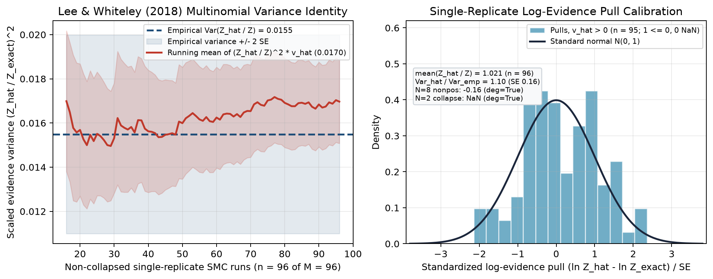
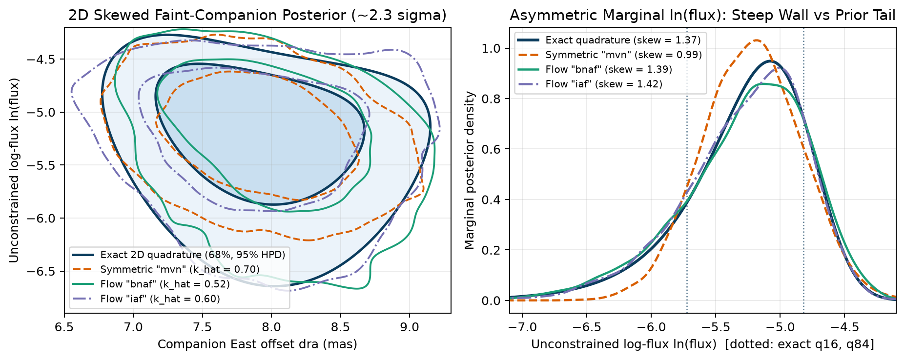

# Sampling

`numpyro_model` is checked by simulation-based calibration (Talts et al. 2018).
Truths are drawn from the priors, data are simulated from them with our own
code, and NUTS samples virgil's posterior. If that posterior is right, the rank
of each truth among the posterior draws is uniform. Script:
[`scripts/sbc_numpyro.py`](https://github.com/benjaminpope/virgil-validation/blob/main/scripts/sbc_numpyro.py); test:
[`tests/test_sbc_numpyro.py`](https://github.com/benjaminpope/virgil-validation/blob/main/tests/test_sbc_numpyro.py).

**Status: passes its registered criteria; not yet counted as checked.** All
1000 registered replicates are in, and every test fixed in advance in
[`design/sbc_addendum.yml`](https://github.com/benjaminpope/virgil-validation/blob/main/design/sbc_addendum.yml)
passes. The campaign ran on virgil 4afc5b8, so it counts only once a CI job
evaluates it against that commit. The sampler was rarely healthy (below), and
a second campaign is planned to fix that.

## Design

Each replicate draws a binary from Jeffreys priors:
- log-uniform diameter (0.5–3 mas), flux ratio (0.02–0.1), separation
  (5–25 mas) and V² error scale (0.7–1.5);
- a uniform position angle, sampled as an `AngleVector`.

Three VLTI UTs observe it; virgil runs NUTS with 4 chains × 1000 draws; each
truth is ranked among 99 thinned draws.

The campaign has two known limits. Every chain starts at the truth, so it
cannot reveal failures to find the right mode. And every companion is bright,
so the posteriors are nearly Gaussian. A second campaign is planned without
either limit.

## Results (1000 replicates)

| Parameter | χ² of ranks (p) | Mean rank (p) | ECDF (p) | 68% coverage | 95% coverage |
| --- | --- | --- | --- | --- | --- |
| diameter | 0.036 | 0.87 | 0.68 | 0.681 | 0.936 |
| flux ratio | 0.55 | 0.15 | 0.24 | 0.668 | 0.944 |
| separation | 0.70 | 0.13 | 0.38 | 0.687 | 0.944 |
| position angle | 0.55 | 0.52 | 0.31 | 0.685 | 0.941 |
| V² error scale | 0.064 | 0.75 | 0.31 | 0.666 | 0.932 |

The expected coverages are 0.68 and 0.94: with 99 draws, the central 95%
window holds 94 of the 100 possible ranks. The pass rule is a Holm correction
over all 25 tests at a family-wise rate of 1%; the smallest p-value, 0.036, is
far from rejection.

- **Diameter near the prior bound.** The 500 replicates seen first suggested
  low 95% coverage for true diameters below 0.9 mas. The registered
  confirmatory test on the unseen second 500 alone (163 replicates) does not
  reproduce it (χ² p = 0.25, coverage p = 0.51).
- **Divergences.** 978 of the 1000 replicates had at least one divergent
  transition (median 29 in 4000 draws). They rise with the companion's flux
  (Spearman ρ = 0.38), not with nearness to the prior bounds. The likely cause
  is the narrow position-angle posterior on the `AngleVector` ring. 111
  replicates had R̂ above 1.01 (worst 3.2). Only 11 replicates were fully
  healthy, too few to test on their own.

The ranks are uniform despite the divergences, but a calibration resting on
unhealthy chains is weak. The second campaign changes the mass matrix and the
ring width to remove them, starts chains away from the truth, and adds faint
companions.

## Tempered SMC, mode search, Gauss–Newton mass and variational inference

`tests/test_042_smc_modes_tempering.py` and `tests/test_042_svi_cv_likelihood.py`
validate `virgil.smc`, `virgil.mode_search`, `virgil.svi`,
`virgil.fitting.gauss_newton_mass`, and `virgil.likelihood.chain_init_params`
against `crosscheck.smc_tempering_ref` (`scipy`/`numpy` closed forms and
2D numerical quadrature).

| virgil | Reference | Tag | Agreement |
| --- | --- | --- | --- |
| `smc.tempered_smc`, `smc.SMCResult`, `smc.bridge_smc` | closed-form conjugate Gaussian `ln Z`, posterior moments, 96-trial single-run (`replicates=1`) and 32-trial pooled (`replicates=4`) [Lee & Whiteley (2018)](https://arxiv.org/abs/1509.00394) multinomial genealogy variance identities, sequential zero-log-likelihood (`PRNGKey(0..15)`) finite non-positive (`n_particles=8`) and collapsed (`n_particles=2`) `variance_degenerate` branches, dict particles with custom Gibbs `moves`, 2D bimodal Gaussian-mixture `ln Z` and mode weights, and unweighted + importance-weighted `bridge_smc` `ln(Z₂ / Z₁)`; controls: unnormalized `loglike` biases `ln Z` and swapped bridge negates `ln(Z₂ / Z₁)` | Mathematics, statistics | within 4 SE (conjugate), variance ratio within 3 Monte Carlo SE, < 0.08 nats (bimodal / bridge) |
| `mode_search.Mode`, `logmeanexp`, `laplace_log_evidence`, `distinct_modes` | Tierney–Kadane Laplace `ln Z` and two-sided Mahalanobis deduplication at documented squared distance 1.0 preserving sharp needle modes inside broad outlier footprints; control: one-sided Mahalanobis swallows needle modes | Mathematics | 1e-14 |
| `mode_search.DefensiveMixture`, `importance_evidence`, `Evidence`, `resample_move`, `Move` | SciPy multivariate Student-t + prior log-density, symmetry images, Kish ESS and delta-method SE, `at_floor`, `undersampled`, and `n_nonfinite` sentinels, `log_q` agreement, and HMC rejuvenation (`cov=` mass override) preserving bimodal target moments | Mathematics, statistics | 1e-13 (log q), < 0.03 nats (ln Z) |
| `fitting.FitResult`, `gauss_newton_mass`, `GaussNewtonMass`, `likelihood.chain_init_params` | unconstrained central-difference Gauss–Newton precision (including the Gaussian error-scale Fisher row for `vis_scale` and the `flat_coordinates=True` logistic log-flux reparameterization on `LogUniform`), correlation condition number, and multi-chain unconstrained initialization; control: measured ratio vs constrained-space finite-difference variance shows omitting the log-flux Jacobian mis-scales flux variance > 1000× | Mathematics | < 5e-6 relative |
| `svi.variational`, `svi.VariationalResult` | `"laplace"` (`log_joint`, `elbo is None`, unconstrained mean and 3 × 3 covariance) and warm-start + cold-start (`start=None`) `"mvn"` guides vs the Gauss–Newton posterior of `gauss_newton_mass` (k̂ < 0.5; virgil against virgil, with only the laplace `log_joint` compared with an independent `crosscheck` χ²) | Self-consistency | < 0.20 σ and < 12% cov (3D) |
| `svi.variational`, `svi.VariationalResult` | `"bnaf"` / `"iaf"` normalizing flows on a genuinely skewed ~2.3σ faint-companion 2D posterior vs 2D Simpson quadrature means, asymmetric quantiles, and 2 × 2 covariance (k̂ < 0.65) ; control: under-dispersed unconverged guide (`converged is False`) emits ELBO and PSIS warnings and flags k̂ > 0.7 | Mathematics, statistics | < 0.28 σ and < 20% cov (2D flows) |

### Genealogy variance identity under multinomial resampling

`virgil.smc.tempered_smc` resamples particles multinomially at each tempering stage (`bridge_smc` uses systematic resampling once when bootstrapping unweighted input draws). By Theorem 1 of [Lee & Whiteley (2018)](https://arxiv.org/abs/1509.00394) — which proves that tracking root-ancestor ("Eve") lineages yields an exact unbiased estimator of the normalizing-constant variance under multinomial SMC — and the non-asymptotic positivity analysis of [Du & Guyader (2021)](https://arxiv.org/abs/1909.13602) — which characterizes when finite-sample unbiased variance realizations can take negative values before converging — the product of `exp(2 * log_z)` and `SMCResult.log_z_variance` is unbiased for the variance of the normalizing-constant estimator across both single-replicate (`replicates=1`) and pooled multi-replicate (`replicates=4`, scaling as `1 / R`) runs when all non-collapsed (`isfinite(log_z_variance)`) realizations, including finite non-positive draws, are retained. Over sequential keys `PRNGKey(0..15)` on a constant zero log-likelihood (`Var(Z_hat) = 0`), `variance_degenerate` flags both degenerate regimes without HMC dependence: single-lineage collapse at `n_particles=2` (exact probability `3 / 4` per draw, returning `NaN` for both `log_z_variance` and `log_z_error`) and finite non-positive realizations `log_z_variance <= 0` at `n_particles=8` (keeping `log_z_variance` finite while returning `NaN` for `log_z_error`).

### Skewed faint-companion 2D posterior (`"mvn"` vs `"bnaf"` and `"iaf"`)

At ~2.3σ companion SNR (`flux = 0.010`, `sigma_v2 = 0.025`, `sigma_cp_deg = 2.2` on the 3-telescope `UTS3` VLTI array), the unconstrained `ln(flux)` likelihood is strongly asymmetric: above the peak, the interferometric perturbation grows exponentially and hits a steep chi-squared wall, whereas below the peak the companion signal vanishes below the noise floor and relaxes into the broad log-normal prior tail (`(q50 - q16) / (q84 - q50) = 1.37`). A Gaussian `"mvn"` guide in `(dra, ln flux)` is forced to remain symmetric (`skew = 1.00`), cutting off the faint-flux tail (`0.26 σ` quantile error, `30%` covariance error, and marginal `k̂ = 0.70`), whereas `"bnaf"` and `"iaf"` warp the base Gaussian to recover both the asymmetric marginal quantiles and the teardrop 68%/95% HPD contours:

| Posterior / guide | ΔRA q16 / q50 / q84 (mas) | ln(flux) q16 / q50 / q84 | Left/right ln(flux) width ratio | σ(ΔRA) (mas) | σ(ln flux) | Cov rel. error | Pareto k̂ |
| --- | --- | --- | --- | --- | --- | --- | --- |
| Exact 2D Simpson quadrature | 7.44 / 7.91 / 8.41 | −5.72 / −5.20 / −4.82 | 1.37 | 0.48 | 0.49 | — | — |
| `"mvn"` (`VariationalResult`) | 7.45 / 7.92 / 8.36 | −5.60 / −5.22 / −4.84 | 0.99 | 0.46 | 0.38 | 30% | 0.70 |
| `"bnaf"` (`VariationalResult`) | 7.53 / 8.00 / 8.48 | −5.76 / −5.20 / −4.80 | 1.39 | 0.48 | 0.48 | 11% | 0.52 |
| `"iaf"` (`VariationalResult`) | 7.40 / 7.90 / 8.42 | −5.74 / −5.21 / −4.83 | 1.42 | 0.51 | 0.46 | 8.6% | 0.60 |

