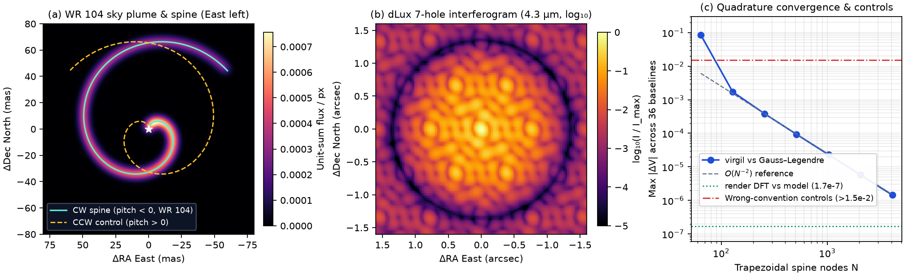
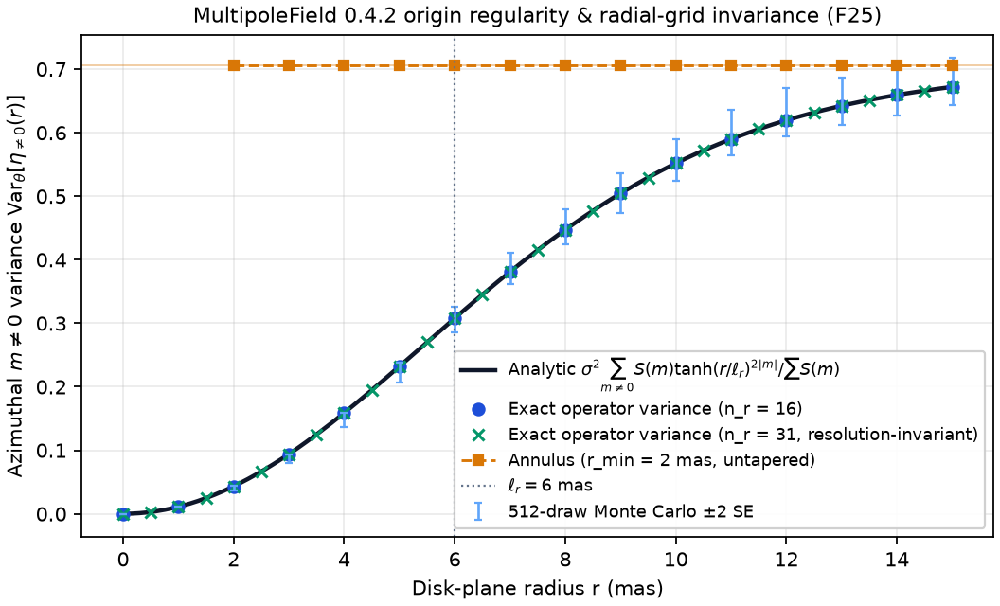

# Cones, fields and invariants

The truncated cone is compared with a direct Fourier sum over its documented
3-D geometry, and the Gaussian-process field with a dense covariance matrix
built from the reflecting-boundary Laplacian. A last set of checks holds every
analytic component to the identities any visibility must satisfy. Test:
[`test_cone_field.py`](https://github.com/benjaminpope/virgil-validation/blob/main/tests/test_cone_field.py).

## Truncated cone

| virgil | Reference | Agreement |
| --- | --- | --- |
| `TruncatedCone`: side-on; wide, with negative tilt and a stretched cross-section; seen down its axis; in the sky plane; offset | a Fourier sum over a 3-D cloud on the cone's walls (Gauss–Legendre in slant distance, trapezoid in azimuth), projected onto the sky and blurred by the shell's Gaussian | 2e-6 at 1024 rings |
| the sign of the tilt | ±tilt give the same visibilities (the cone is optically thin) | 1e-14 |

Doubling the rings from 64 to 128 cuts the error by 4.0, the second-order
convergence the docstring states.

## Archimedean spiral plumes

`virgil.models.ArchimedeanSpiral` models an inclined Wolf–Rayet ballistic dust
plume ([Tuthill et al. 2008, *ApJ* 675, 698](https://doi.org/10.1086/527286))
winding out from the origin in its orbital plane at radial rate `pitch` per
turn over `turns` revolutions, fading exponentially along the arm and blurred
isotropically in the arm plane by a Gaussian of full width at half maximum
`width`. External packages confirm the optical and blur-projection physics—`dLux`
validates 2D Fraunhofer wavefront propagation of the extended plume, and native
`PMOIRED` (`{'fwhm', 'incl', 'projang'}` with no `crosscheck` point cloud)
confirms the inclined FWHM Gaussian projection `(width, inc, node)` in the
`turns -> 0+` limit—while `virgil`'s internal parameter definitions (`pitch < 0`
winding clockwise on the sky as in WR 104 vs `pitch > 0` counter-clockwise,
exponential `fade` weighted by polar arc length, sky-tangent `pa` deprojection,
and the 1 px `render` floor) are pinned via graph `properties` and negative
controls (`tests/test_042_spiral_and_smearing.py`):

1. **Arc-length weighting.** Uniform emission per unit physical length along
   $r(\theta) = (|p| / 2\pi)\,\theta$ weights polar angle $\theta \in [0, 2\pi\,\text{turns}]$
   by the differential arc-length element $\sqrt{1 + \theta^2}$ alongside the
   exponential fade $\exp(-\text{fade}\cdot\theta / 2\pi)$. Omitting
   $\sqrt{1 + \theta^2}$ underweights the outer coils and shifts visibilities
   by $> 1.5\times 10^{-2}$.
2. **Sky departure angle vs line of nodes.** `pa` is the **on-sky** departure
   tangent at the origin, deprojected into the inclined plane relative to
   `node` before advancing azimuth, while `width` is foreshortened by $\cos i$
   perpendicular to `node`.
3. **Sub-pixel render floor & Fourier consistency.** `ArchimedeanSpiral.render`
   floors `width` at one pixel so narrow spines do not alias between pixel
   centres, and for resolved arms its direct Fourier transform (`crosscheck.sky.pixel_image`)
   matches `ArchimedeanSpiral.model` to `< 2e-6` (transpose or Dec-flip controls
   fail by `> 0.35`).

$$
V_{\text{spiral}}(u, v, \lambda) = G_{\text{plane}}(u, v, \lambda; \text{width}, i, \text{node})\,\frac{\int_0^{2\pi\,\text{turns}} \sqrt{1 + \theta^2}\,e^{-\text{fade}\,\theta/(2\pi)}\,e^{-2\pi i (u\,\alpha(\theta) + v\,\delta(\theta))/\lambda}\,\mathrm{d}\theta}{\int_0^{2\pi\,\text{turns}} \sqrt{1 + \theta^2}\,e^{-\text{fade}\,\theta/(2\pi)}\,\mathrm{d}\theta}
$$

| virgil | Reference | Agreement |
| --- | --- | --- |
| `ArchimedeanSpiral` (`nodes=4096` and default `nodes=256`), both winding signs (incl. WR 104 `pitch = -65.5` mas/turn CW vs `+65.5` CCW), inclined off-node departure `pa`, exponential `fade`, `System` mixing, and reverse-mode AD gradients | 512-node Gauss–Legendre arc-length quadrature (`crosscheck.spiral_smearing`), plus central finite differences (`check_grads`) | `< 5e-6` (`nodes=4096`), `< 4e-4` (default), $O(N^{-2})$ ratio `4.0` |
| `ArchimedeanSpiral` (`turns -> 0+`, `width = 6.5`, `inc = 52°`, `node = 37°`) | native `PMOIRED` `{'fwhm': 6.5, 'incl': 52.0, 'projang': 37.0}` (`roots=["pmoired"]`, no `crosscheck` cloud); `projang + 90°` and sky-isotropic controls fail by `> 0.30` | V² `< 2e-7` |
| `ArchimedeanSpiral` + central `PointSource` at 4.3 µm | 2D Gauss–Legendre × Gauss–Hermite plume propagated through `dLux`'s 7-hole Fraunhofer optical model (`roots=["dlux"]`) | V² `< 8e-4`, closure phase `< 0.08°` (signal `> 4°`) |
| `ArchimedeanSpiral.render` (Fourier consistency, resolved and sub-pixel widths) | `crosscheck.sky.pixel_image` DFT against `ArchimedeanSpiral.model` (`< 2e-6`; transpose/flip fail by `> 0.35`), and continuous Gaussian-ridge integration with 1 px width floor (unfloored control differs by `> 2e-3`) | `< 2e-6` (DFT & resolved), `< 2e-5` (floored) |
| negative controls (`kind="control"`) | flipped winding (`-pitch`), rotated departure (`pa + 90°`, `pa + 180°`), angle-only fade without $\sqrt{1+\theta^2}$, and sky-isotropic blur | all fail by `> 1.5e-2` |
| `crosscheck.spiral_smearing` (`kind="reference"`) | `turns -> 0+` limit against `EllipticalGaussian`, and closed-form hyperbolic arc length $\frac{1}{2}(\Theta\sqrt{1+\Theta^2} + \operatorname{arsinh}\Theta)$ | `< 1e-11` and `< 1e-14` (rel) |

## Polar interpolation, GP helpers and origin regularity

`tests/test_042_data_gains_angles.py` checks the polar-grid interpolator,
Gaussian-process prior builders, circular image masks, and unit-vector angle
helpers added or updated in `virgil 0.4.2`:

- **Origin regularity of `virgil.fields.MultipoleField`.** On a disk reaching
  the origin (`r_min_mas=0`), any non-axisymmetric azimuthal harmonic ($|m| \ge 1$)
  must vanish at $r = 0$ so the brightness is single-valued there. In `0.4.2`,
  harmonic $m$ is tapered by $\tanh(r / \ell_r)^{|m|}$ using the physical radial
  correlation length `length_r` (fixing [F25](../method/findings.md#F25)),
  giving exact azimuthal $m \neq 0$ variance $\sigma^2 \sum_{m \neq 0} S(m)\,\tanh(r / \ell_r)^{2|m|} / \sum_m S(m)$
  independently of radial grid resolution (`n_r = 16` vs `n_r = 31`), leaving
  only $m = 0$ free at $r = 0$ while keeping an annular field (`r_min_mas > 0`)
  stationary at its inner edge.

| virgil | Reference | Agreement |
| --- | --- | --- |
| `virgil.fields.polar_interpolate` | interior node recovery (`< 1e-14`), $2\pi$ azimuthal periodicity (`< 1e-14`), linear one-spacing edge ramp to `fill` (`< 2e-8` boundary epsilon clamp, `polar_interp_node_err`), and $O(h^2)$ refinement on a smooth polar function | `< 2e-8` (edge clamp; `< 1e-14` at interior nodes), refinement ratio `4.0` |
| `virgil.fields.multipole_field_priors` | bounded `LogUniform` scale invariance across `(sigma, length_r, length_theta)` | `< 1e-14` (`log_prob`) |
| `virgil.fields.MultipoleField` (`0.4.2` origin taper) | exact $90^\circ$ rotation invariance at $r = 0$ (`< 1e-15`), analytical harmonic variance $\sigma^2 \sum_{m \neq 0} S(m)\,\tanh(r / \ell_r)^{2\|m\|} / \sum_m S(m)$ and `n_r = 16` vs `n_r = 31` resolution invariance (`< 5e-5`), 512-draw Monte Carlo ring variance, and stationary annulus (`r_min_mas = 2` mas) | `< 1e-15` at $r = 0$, `< 5e-5` (`n_r` invariance & analytic curve) |
| `virgil.models.RadialGPFunction` & `virgil.models.gp_priors` | SciPy Matérn Cholesky ($\nu = 1/2, 3/2, 5/2, \infty$) + linear interpolation/clamping, chromatic `MultipoleDisk(spectral_index=...)` with non-zero latent $z$ at fixed spatial frequency against independent Gauss–Legendre + Jacobi–Anger quadrature (plus $z = 0$ wavelength-invariance control), and latent/hyperprior dictionary tree walk | `< 2e-12` (`5.4e-13` measured at RBF condition $10^6$; chromatic `MultipoleDisk` `< 1e-14`), `LogUniform` `< 1e-14` |
| `virgil.models.circular_support` | solid and annular masks (`inner_radius_mas <= r <= radius_mas`) about `((npix - 1)/2, (npix - 1)/2)` inside `Image` | `0` mismatched pixels, `0` outside flux |
| `virgil.angles.is_angle_vector`, `virgil.angles.vector_angle`, `virgil.angles.vector_site` | four-quadrant recovery in `[0, 360)` across batched vectors, `"{name}_vec"` naming, and `AngleVector` predicate | `< 1e-12°` |
| `virgil.models.Component` | base-class Fourier shift phase, `PowerLaw` chromatic `flux_at` inside `System`, negative-flux rejection, and opposite-shift sign control | `< 1e-14` (control fails by `> 0.5`) |

## Gaussian-process fields

| virgil | Reference | Agreement |
| --- | --- | --- |
| `GaussianField`, `field_spectrum`: orders 1–3, isotropic and anisotropic | the field's covariance against our dense Π(κ² + L)^(−order)Π, with L the reflecting-boundary Laplacian built from second differences, scaled to a mean pixel variance σ² | 2e-14 |
| `GaussianField`, order 1 | ½\|z\|² is proportional to \|η\|²/ℓ² plus the squared neighbour differences over h² | 1e-10 |
| `GaussianField` with a template, inside an `Image` | SciPy's orthonormal inverse DCT-II plus log(μ/max μ + ε); the image is the softmax of the field | 1e-12 |

## Invariants of every model

| virgil | Reference | Agreement |
| --- | --- | --- |
| `SourceModel` and `System`: six analytic components | V(0) = 1, V(−u, −v) = V(u, v)*, the shift theorem, and `System`'s flux-weighted mixing | 1e-12 |
