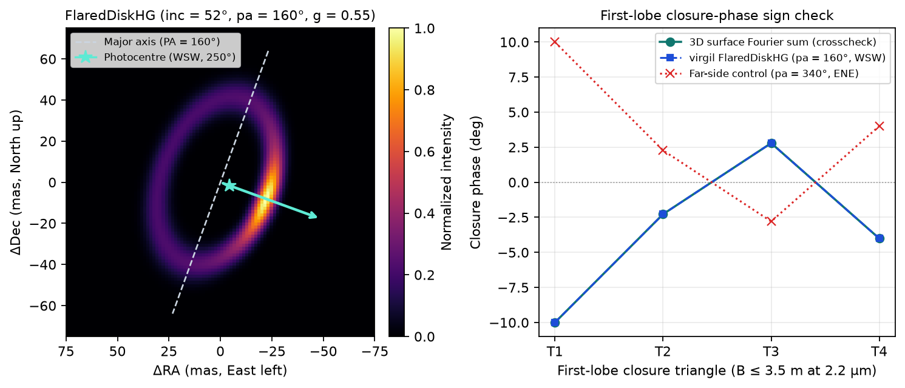

# Flared disks and harmonix

This page checks the flared-disk models against their documented brightness
([Blakely et al. 2025](https://doi.org/10.3847/1538-3881/ad9b94), eqs. 2–9: the
scattering surface, the three phase functions and the skewed Gaussian ring).
Our own code evaluates that brightness at the documented pixel centres and sums
it directly in Fourier space. Tests:
[`test_remaining_models.py`](https://github.com/benjaminpope/virgil-validation/blob/main/tests/test_remaining_models.py),
[`test_flared_disk_nearside.py`](https://github.com/benjaminpope/virgil-validation/blob/main/tests/test_flared_disk_nearside.py).

## Flared disks

| virgil | Reference | Agreement |
| --- | --- | --- |
| `FlaredDiskHG`, `FlaredDiskGaussian`, `FlaredDiskPowerLaw`: face-on and flat, inclined, inclined at PA 200°, offset | direct Fourier sum of our brightness | 1e-15 |
| the default pixel sampling | the same disk at twice the density, on baselines that resolve the ring | 1e-9 |
| `near_side` geometry (`inc = 52°`, `pa = 160°`, forward scattering) | 3D surface Fourier sum (`crosscheck.disks`) and 3D true-scattering-angle ring (`scattered_ring`) | `|ΔCP| < 1e-10°` on first-lobe triangles; photocentre in WSW (`250° = pa + 90°`) |

The shared base class `FlaredDisk` gets its evidence through these three; on
its own it has no phase function, and evaluating it raises
`NotImplementedError` (a guard).

At `(inc = 52°, pa = 160°)`, forward-peaked dust scattering brightens the near
rim at `pa + 90° = 250°` (West-Southwest, `ΔRA < 0, ΔDec < 0`), while negative
controls (`pa = 340°` or backward Henyey–Greenstein `g < 0`) move the
photocentre to East-Northeast (`70°`) and reverse every first-lobe closure
phase sign. Which half-plane corresponds to `inc ∈ (0°, 90°)` at a given `pa`
is an on-sky orientation, so per ledger **D24** (gate G1a, 2026-11-16) it stays a
`convention: [near_side]` on `FlaredDiskGaussian`, `FlaredDiskHG` and
`FlaredDiskPowerLaw`. Our 3D surface Fourier sum (`roots=["mathematics"]`) and the
wrong-sign negative controls pin virgil to the documented sign, but they are our own
transcription of it, so these parts read "convention from virgil's docs" until code or
a published result written by other people confirms which side is near.

## The harmonix wrapper

| virgil | Reference | Agreement |
| --- | --- | --- |
| `HarmonixModel` | stand-in sources with closed-form visibilities, in cycles per radian and in metres; weight 1 in a `System` | 1e-12 |

Only the wrapper is checked here. harmonix's maps are harmonix's to validate,
against starry or a direct surface quadrature.
