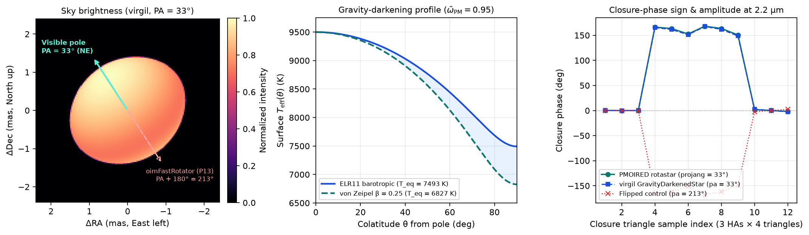

# Rapid rotators

This page checks `GravityDarkenedStar` against a rotating star that we wrote
from [Espinosa Lara & Rieutord (2011)](https://doi.org/10.1051/0004-6361/201117252),
independently of virgil and of Shashank Dholakia's code, whose values virgil's
own tests use, and confirms its polar position-angle convention (`pole_pa`)
against `PMOIRED`'s independent `rotastar` model. Our star has the Roche shape,
the effective gravity and the ELR11 flux F = |g| tan²ϑ / tan²θ, integrated over
a 400 × 800 grid on its surface. virgil sums a mesh of `n_lat` latitude rings.
Tests:
[`test_gravity_darkened_independent.py`](https://github.com/benjaminpope/virgil-validation/blob/main/tests/test_gravity_darkened_independent.py),
[`test_rotator_convention.py`](https://github.com/benjaminpope/virgil-validation/blob/main/tests/test_rotator_convention.py).

## Grey model

| `GravityDarkenedStar` | Agreement at `n_lat` 128 |
| --- | --- |
| ω = 0.6–0.95; inclinations 0° (pole-on), 30°, 60°, 85° and 90° (equator-on); five position angles | 1.4–3.4e-4 |

Each doubling of `n_lat` cuts the error by 3.8–4.4, so the mesh converges at
second order. The default `n_lat` of 32 is good to 2–6e-3.

## Chromatic model

| `GravityDarkenedStar`, `t_pole` = 9000 K, ω = 0.9, inclination 50° | Agreement at `n_lat` 128 |
| --- | --- |
| 0.7, 1.65 and 2.2 µm, each surface element radiating B_λ(T) with T⁴ ∝ F | 1.3–1.4e-4 |

## Pole orientation and external checks

`GravityDarkenedStar` defines `pa` as the sky position angle (degrees North
through East) of the visible rotational pole (`incl` in `(0°, 90°)`), placing
the hot polar cap at `pa` and the oblate equatorial major axis at `pa + 90°`.

At rapid rotation (`ω_PM = 0.95`, mapped via exact spherical-Roche geometry to
`ω_ELR = 0.750` with polar-to-equatorial radius ratio `r_p = R_pole / R_eq = 0.780`
and `T_pole = 9500 K`), `GravityDarkenedStar` and `PMOIRED`'s `rotastar.Vrota`
([Aufdenberg et al. 2006](https://doi.org/10.1086/504149)) share the same Roche
surface and sky pole orientation (`projang = pa`) while differing in three
surface-brightness prescriptions: ELR11 barotropic flux conservation (`T_eq = 7490 K`)
versus [von Zeipel (1924)](https://ui.adsabs.harvard.edu/abs/1924MNRAS..84..665V/abstract)
power-law gravity darkening at `β = 0.25` (`T_eq = 6820 K`), Planck blackbody
emission `B_λ(T)` versus ATLAS9 stellar-atmosphere fluxes `F_λ(T_eff, log g)`,
and isotropic surface intensity versus spherical SATLAS limb darkening:

$$
\left.\frac{F_{\mathrm{eq}}}{F_{\mathrm{pole}}}\right|_{\mathrm{ELR11}}
  = r_p^2 \exp\!\left(-\frac{2}{3}\omega_{\mathrm{ELR}}^2 r_p^3\right)
    \bigl(1 - \omega_{\mathrm{ELR}}^2\bigr)^{1/3},
\qquad
\left.\frac{F_{\mathrm{eq}}}{F_{\mathrm{pole}}}\right|_{\mathrm{von\ Zeipel}}
  = \bigl[r_p^2 \bigl(1 - \omega_{\mathrm{ELR}}^2\bigr)\bigr]^{4\beta}.
$$

Across all baselines and strong post-null closure phases (`168°` peak), those
three physical choices shift `V²` by `< 9.0e-3` and closure phase by `< 2.1°`,
whereas rotating `pa` by `+90°`, `+180°` or sign reversal misses by `60°–149°`.

| Check | Reference | Result |
| --- | --- | --- |
| `pole_pa` convention (`pa = 33°`, `incl = 55°`, `T_pole = 9500 K`, `ω_PM = 0.95` mapped to `ω_ELR = 0.750`) | `PMOIRED` native `rotastar.Vrota` (`projang = 33°`, [Aufdenberg et al. 2006](https://doi.org/10.1086/504149)) | `|ΔV²| < 9.0e-3`, `|ΔCP| < 2.1°` on `168°` closure phases (ELR11 vs von Zeipel `β = 0.25`, Planck vs ATLAS9, and SATLAS limb darkening); `pa + 90°`, `pa + 180°` and `−pa` controls miss by `60°–149°` |
| Wavefront synthesis (`pa = 33°`, `incl = 60°`, 7-hole non-redundant mask at 4.8 µm) | `dLux` optical diffraction from the ELR11 surface cloud (checks optical propagation without claiming `pole_pa`) | `|ΔV²| < 3e-3`, `|ΔCP| < 0.08°` across 21 baselines and 35 closure phases |
| `oimodeler.oimFastRotator` (`dim = 64`) | Translation-invariant first-lobe closure-phase signs (`crosscheck.elr.cloud`) and public `oimModel` equator-on `V²` anisotropy across `rot = 0.01..0.04` | Upstream bugs [`P13`](../method/findings.md#P13) (`np.rot90` flips pole PA by `180°`) and [`P14`](../method/findings.md#P14) (`rot**0.4` slow-rotation scaling, log-slope `0.45` vs physical `2.0`) |

## Our reference

We checked it against closed forms before using it: with ω = 0 it is a uniform
disk (to 2e-5); its fluxes at the pole and the equator take ELR11's limits,
e^(2ω²r_p³/3)/r_p² and (1 − ω²)^(1/3) (to 1e-6 and 1e-3); and its surface normal
lies along g (to 1e-10).
