# Period aliases in undersampled orbits

Where a binary is seen on a few nights spread over many periods, the number of
orbital cycles between nights is ambiguous. `virgil.aliases.fit_orbit_aliases`
labels each ridge of the likelihood by the band N = round(T/P) (T the span from
the first to the last epoch), fits every band directly to the closure phases
(and, for PIONIER, the V2) of all epochs with a Keplerian binary, and weighs the
bands by their marginal likelihoods, with a Jeffreys prior on each epoch's error
scale. Per-epoch positions only start the fits and are plotted as a diagnostic.

`scripts/reanalyse_orbits.py` runs it on the systems below. Every orbit track
drawn and every reference orbit comes from `crosscheck.orbits`, our own Kepler
solver; the fit is virgil's. A reference orbit is a published fit: where it
falls in a different band from the winner, or its elements sit outside the
posterior, that is a finding to record in the ledger, not to tune away.

How to read the tables: **χ²/N** is the raw value on the quoted errors at the
band's best orbit, before any error scale (a rescaled χ²/N of 1 is
tautological); **scales** is the range over epochs of the fitted error scale
(≫ 1 means a failed fit); **log Z** is the Laplace and **log Z (IS)** the
importance-sampling log evidence of the band; **p** is its posterior
probability; **ESS** is the importance-sampling effective sample size of the best
mode, and a flag means the two evidences disagree or the ESS is low.

!!! warning "The reference is not an independent test of the period"
    For every Track B system the prior window on the period is P_ref / 1.25 to
    1.25 P_ref, centred on the published period; for Gl 229 it is 10 to 14 d. A
    reference orbit in the winning band is therefore a choice among the few bands
    of that window, not an independent confirmation of the published period.
    The reference band's fit is also warm-started at the reference orbit (unless
    run with `--no-init`), so a sky-plane match there can mean the fit never
    moved; the page gives the offset from the start and the χ² gain over it.
    Orbits are compared by their positions on the sky, not by elements. A point
    reflection is accepted only when the fit swapped the stars' labels (or, for
    the near-equal-mass systems al_dor, hd41255 and hd188088, where closure
    phases barely separate the twins); otherwise it is UNEXPLAINED-FLIP.

!!! note "Results pending"
    Sections marked *placeholder* have no results yet: the fits run on OzSTAR
    (`ozstar_scripts/scripts/orbit_aliases`) and are pulled into this page by
    `scripts/pull_back_orbit_results.py`.

Under the current sky-plane rule (rms offset under 2% of the separation AND under 3 posterior spreads), 0 of 9 systems have a winning-band orbit on the reference's sky orbit. Verdicts are recomputed here from the stored statistics, not copied from the run.

## Gl 229 Ba-Bb

GRAVITY, 7 epochs, period range [10.0, 14.0] d; 12 alias bands.

virgil 0.3.0, commit `unknown`.

Reference period 12.1340 d lies in band N = 34 (p = 1.000); it is the winner.

| N | P (d) | χ²/N (raw) | error scales | log Z | log Z (IS) | p | ESS | flags |
| ---: | ---: | ---: | --- | ---: | ---: | ---: | ---: | --- |
| 34 | 12.1350 | 11.78 | 1.76–4.69 | -90191.05 | -90191.03 | 1.000 | 1534 | poor-fit |
| 35 | 11.7705 | 18.49 | 1.83–12.19 | -92569.42 | -92569.37 | 0.000 | 829 | hessian-not-positive-definite |
| 39 | 10.5756 | 20.32 | 1.99–12.25 | -93262.73 | -93262.72 | 0.000 | 1514 | hessian-not-positive-definite |
| 41 | 10.1403 | 18.59 | 1.72–12.98 | -93735.48 | -93735.36 | 0.000 | 1107 | near-prior-bound |
| 32 | 12.8844 | 16.13 | 2.00–7.00 | -93754.33 | -93754.30 | 0.000 | 1484 |  |
| 36 | 11.3395 | 18.43 | 1.75–8.95 | -94288.70 | -94293.32 | 0.000 | 32 | near-prior-bound, laplace-is-differ, low-ess |
| 33 | 12.6291 | 17.40 | 1.98–8.37 | -94551.52 | -94551.51 | 0.000 | 1487 | hessian-not-positive-definite |
| 38 | 10.8491 | 17.98 | 2.11–6.10 | -94629.75 | -94629.72 | 0.000 | 1530 |  |
| 30 | 13.7020 | 28.59 | 1.84–12.63 | -95091.09 | -95091.06 | 0.000 | 1454 | hessian-not-positive-definite |
| 37 | 11.1446 | 27.38 | 2.09–12.31 | -95693.40 | -95693.40 | 0.000 | 1482 | hessian-not-positive-definite |
| 40 | 10.3694 | 24.01 | 1.72–12.52 | -96183.02 | -96183.01 | 0.000 | 1469 |  |
| 31 | 13.2704 | 29.67 | 1.85–12.08 | -96647.47 | -96647.47 | 0.000 | 61 | hessian-not-positive-definite, near-prior-bound |

Orbits are compared on the sky, at the epochs, not by their elements (conventions and aliases give one sky orbit many element sets). Offsets are in mas; **mirror** = flip means the reference's point reflection matches, and **flipped** says whether the fit swapped the two stars' labels (flux ratio > 1): a mirror without a swap (and not a twin system) is UNEXPLAINED-FLIP, a sign error rather than agreement. The verdict is SAME-SKY-ORBIT only if the rms offset is under 2% of the separation and, with posterior samples, under 3 posterior spreads. Rows marked *warm-started* are in the band whose fit began at the reference orbit, so agreement there is not independent.

| band | N | P (d) | rms | max | rms / sep | rms / spread | mirror | flipped | verdict |
| --- | ---: | ---: | ---: | ---: | ---: | ---: | --- | --- | --- |
| winner | 34 | 12.1350 | 0.19 | 0.36 | 3% | 6.8 | none | no | DIFFERENT |
| reference | 34 | 12.1350 | 0.19 | 0.36 | 3% | 6.8 | none | no | DIFFERENT |

Winning band: flux ratio 0.475; per-epoch V² amplitudes 0.07–0.55.

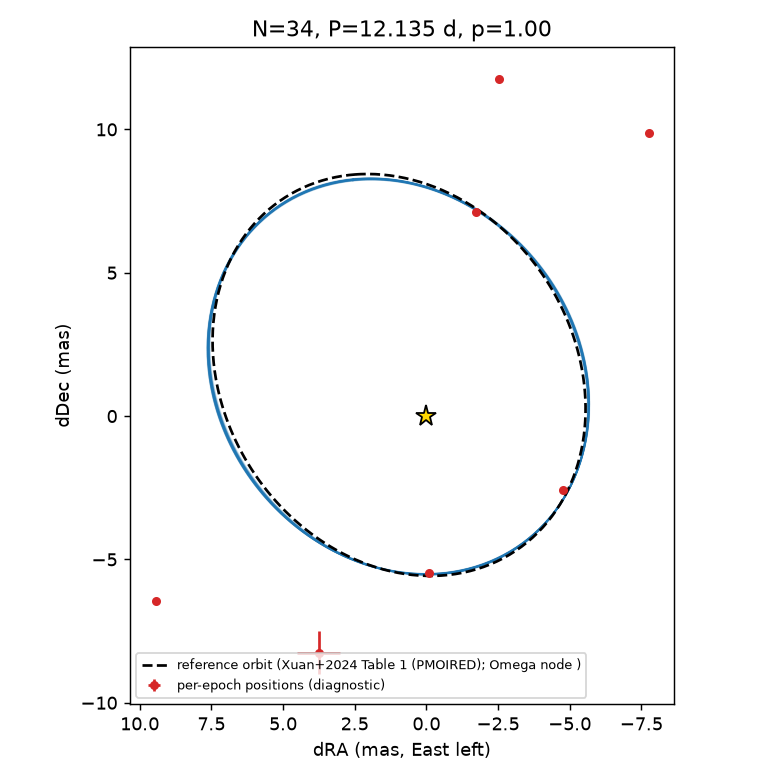

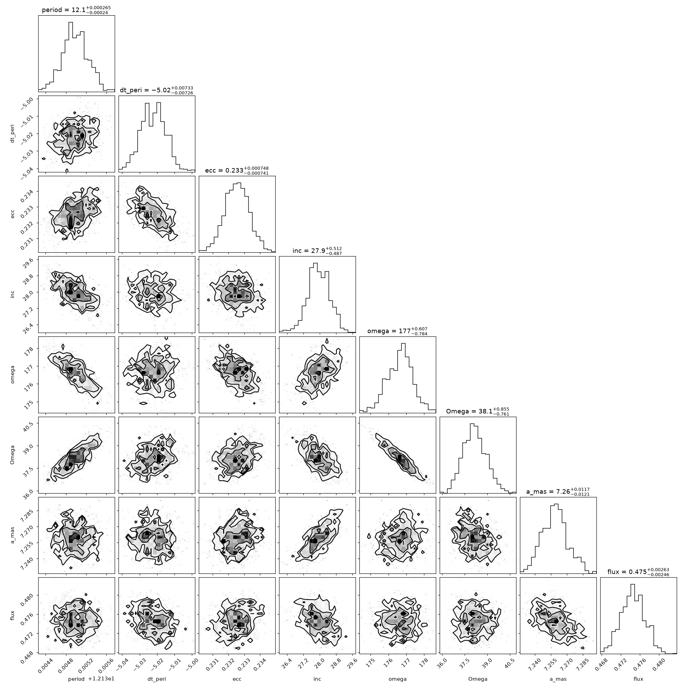

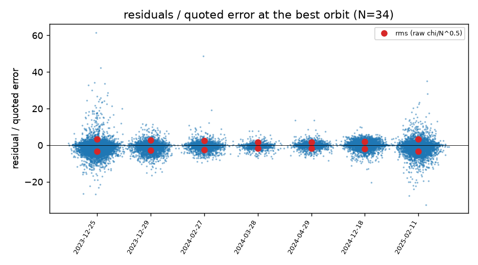

## AL Dor

PIONIER, 17 epochs, period range [11.924296, 18.6317125] d; 23 alias bands.

virgil 0.3.0, commit `unknown`.

Reference period 14.9054 d lies in band N = 49 (p = 1.000); it is the winner.

| N | P (d) | χ²/N (raw) | error scales | log Z | log Z (IS) | p | ESS | flags |
| ---: | ---: | ---: | --- | ---: | ---: | ---: | ---: | --- |
| 49 | 14.9058 | 0.93 | 0.63–1.48 | -5457.89 | -5450.90 | 1.000 | 14 | hessian-singular, near-prior-bound, laplace-is-differ, low-ess |
| 50 | 14.6607 | 88.89 | 0.66–37.84 | -7845.40 | -7835.69 | 0.000 | 6 | near-prior-bound, laplace-is-differ, low-ess |
| 40 | 18.2864 | 76.99 | 0.76–31.27 | -8112.82 | -8107.77 | 0.000 | 2 | hessian-not-positive-definite, laplace-is-differ, low-ess |
| 59 | 12.3776 | 146.59 | 0.63–43.55 | -8218.60 | -8150.14 | 0.000 | 1 | hessian-not-positive-definite, near-prior-bound, not-converged, laplace-is-differ, low-ess |
| 43 | 17.1506 | 281.60 | 0.65–67.38 | -8559.05 | -8559.05 | 0.000 | 109 | hessian-not-positive-definite, near-prior-bound, not-converged |
| 41 | 17.8867 | 242.26 | 0.84–65.02 | -8616.72 | -8616.14 | 0.000 | 74 | hessian-not-positive-definite, hessian-singular |
| 54 | 13.5086 | 117.66 | 0.63–46.30 | -8682.65 | -8682.65 | 0.000 | 75 | hessian-not-positive-definite, near-prior-bound |
| 60 | 12.2625 | 136.88 | 0.65–58.69 | -8707.08 | -8677.03 | 0.000 | 1 | hessian-not-positive-definite, near-prior-bound, laplace-is-differ, low-ess |
| 47 | 15.5547 | 174.80 | 0.63–46.30 | -8927.38 | -8927.38 | 0.000 | 134 | hessian-not-positive-definite, near-prior-bound, not-converged |
| 53 | 13.9166 | 280.77 | 0.81–71.29 | -9109.65 | -9101.97 | 0.000 | 2 | hessian-not-positive-definite, near-prior-bound, not-converged, laplace-is-differ, low-ess |
| 55 | 13.2028 | 195.33 | 0.62–58.69 | -9303.30 | -9275.65 | 0.000 | 1 | hessian-not-positive-definite, laplace-is-differ, low-ess |
| 45 | 16.2308 | 222.70 | 0.76–57.13 | -9309.91 | -9297.64 | 0.000 | 3 | hessian-not-positive-definite, near-prior-bound, laplace-is-differ, low-ess |

*11 further bands, each with p < 0, are in `bands.json`.*

Orbits are compared on the sky, at the epochs, not by their elements (conventions and aliases give one sky orbit many element sets). Offsets are in mas; **mirror** = flip means the reference's point reflection matches, and **flipped** says whether the fit swapped the two stars' labels (flux ratio > 1): a mirror without a swap (and not a twin system) is UNEXPLAINED-FLIP, a sign error rather than agreement. The verdict is SAME-SKY-ORBIT only if the rms offset is under 2% of the separation and, with posterior samples, under 3 posterior spreads. Rows marked *warm-started* are in the band whose fit began at the reference orbit, so agreement there is not independent.

| band | N | P (d) | rms | max | rms / sep | rms / spread | mirror | flipped | verdict |
| --- | ---: | ---: | ---: | ---: | ---: | ---: | --- | --- | --- |
| winner | 49 | 14.9058 | 0.01 | 0.01 | 0% | 3.7 | flip | no | DIFFERENT |
| reference | 49 | 14.9058 | 0.01 | 0.01 | 0% | 3.7 | flip | no | DIFFERENT |

Winning band: flux ratio 1.000; primary diameter 0.156 mas (fixed); per-epoch V² amplitudes 0.99–1.05.

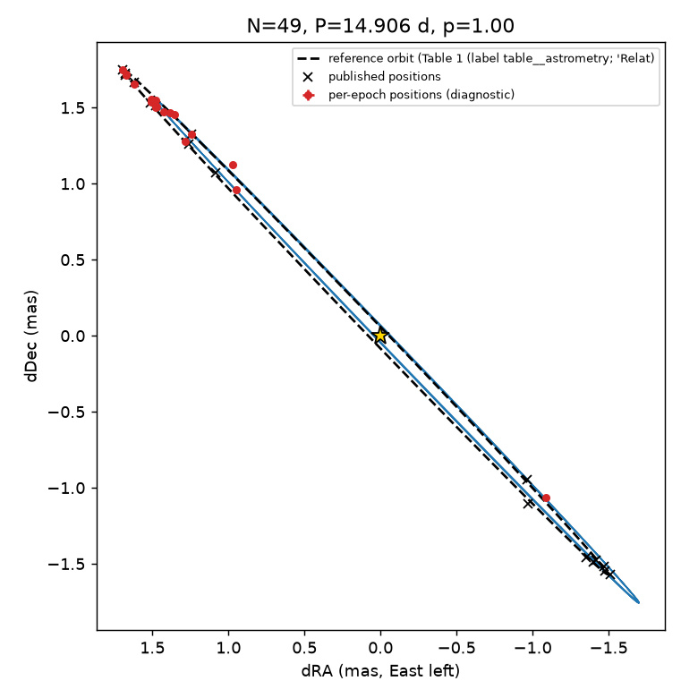

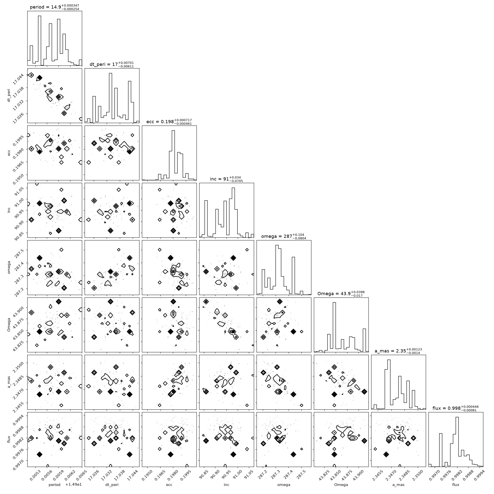

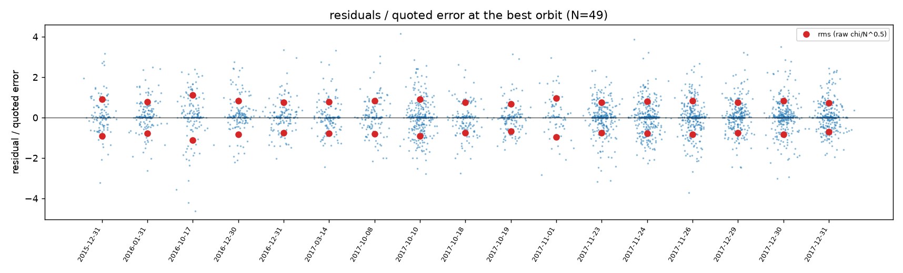

## alpha Equ

PIONIER, 7 epochs, period range [79.0436, 123.50562500000001] d; 1 alias bands.

virgil 0.3.0, commit `unknown`.

Reference period 98.8045 d lies in band N = 1 (p = 1.000); it is the winner.

| N | P (d) | χ²/N (raw) | error scales | log Z | log Z (IS) | p | ESS | flags |
| ---: | ---: | ---: | --- | ---: | ---: | ---: | ---: | --- |
| 1 | 98.7537 | 0.63 | 0.16–2.10 | -975.12 | -975.04 | 1.000 | 1404 |  |

Orbits are compared on the sky, at the epochs, not by their elements (conventions and aliases give one sky orbit many element sets). Offsets are in mas; **mirror** = flip means the reference's point reflection matches, and **flipped** says whether the fit swapped the two stars' labels (flux ratio > 1): a mirror without a swap (and not a twin system) is UNEXPLAINED-FLIP, a sign error rather than agreement. The verdict is SAME-SKY-ORBIT only if the rms offset is under 2% of the separation and, with posterior samples, under 3 posterior spreads. Rows marked *warm-started* are in the band whose fit began at the reference orbit, so agreement there is not independent.

| band | N | P (d) | rms | max | rms / sep | rms / spread | mirror | flipped | verdict |
| --- | ---: | ---: | ---: | ---: | ---: | ---: | --- | --- | --- |
| winner | 1 | 98.7537 | 0.08 | 0.11 | 1% | 8.9 | none | no | DIFFERENT |
| reference | 1 | 98.7537 | 0.08 | 0.11 | 1% | 8.9 | none | no | DIFFERENT |

Winning band: flux ratio 0.140; primary diameter 1.357 mas (fitted); per-epoch V² amplitudes 0.98–1.01.

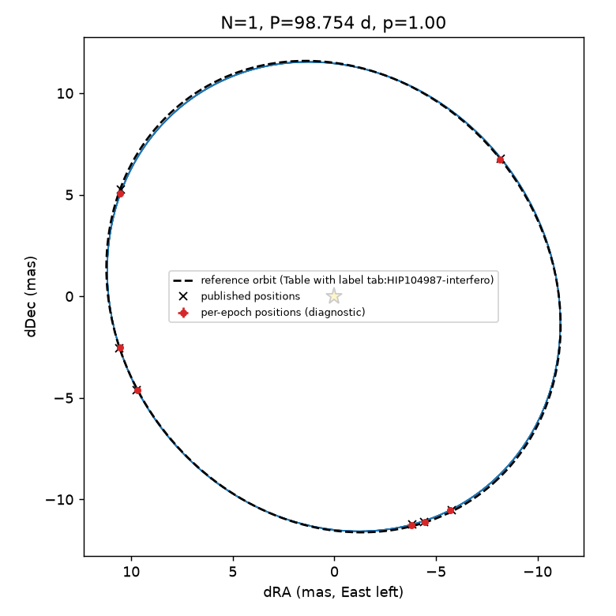

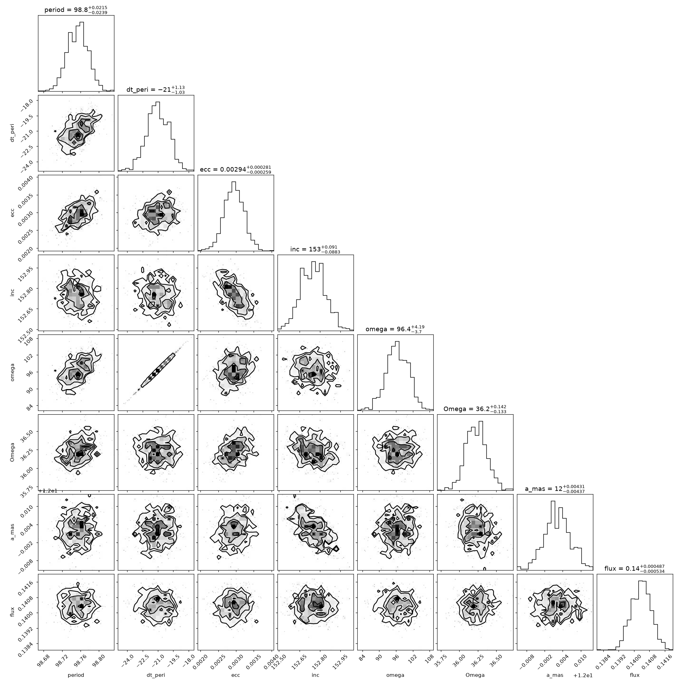

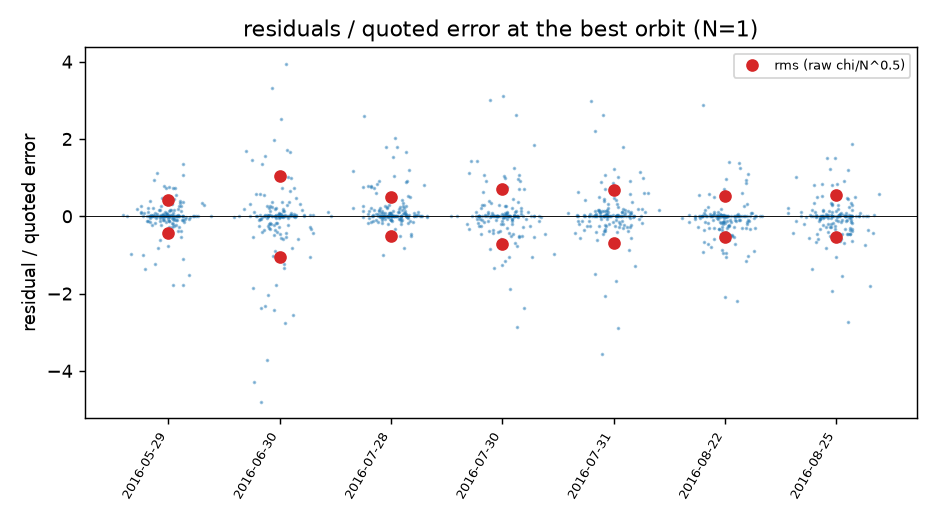

## HD 188088

GRAVITY, 16 epochs, period range [37.452912, 58.520174999999995] d; 6 alias bands.

virgil 0.3.0, commit `unknown`.

Reference period 46.8161 d lies in band N = 9 (p = 1.000); it is the winner.

| N | P (d) | χ²/N (raw) | error scales | log Z | log Z (IS) | p | ESS | flags |
| ---: | ---: | ---: | --- | ---: | ---: | ---: | ---: | --- |
| 9 | 46.8173 | 34.50 | 1.80–12.07 | -1623637.03 | -1623637.01 | 1.000 | 1505 | poor-fit |
| 11 | 41.6180 | 2324.45 | 1.84–124.13 | -1853999.76 | -1853999.77 | 0.000 | 1472 | hessian-not-positive-definite, near-prior-bound |
| 10 | 46.1903 | 1695.01 | 1.72–109.18 | -1884542.65 | -1884547.22 | 0.000 | 30 | near-prior-bound, laplace-is-differ, low-ess |
| 8 | 53.4523 | 2189.01 | 1.87–121.55 | -1895990.47 | -1895990.45 | 0.000 | 1493 |  |
| 12 | 38.1481 | 2676.32 | 3.80–101.29 | -2082725.64 | -2082730.13 | 0.000 | 34 | near-prior-bound, laplace-is-differ, low-ess |
| 7 | 58.5078 | 4194.02 | 2.82–149.10 | -2158146.35 | -2158171.33 | 0.000 | 1 | hessian-not-positive-definite, near-prior-bound, laplace-is-differ, low-ess |

Orbits are compared on the sky, at the epochs, not by their elements (conventions and aliases give one sky orbit many element sets). Offsets are in mas; **mirror** = flip means the reference's point reflection matches, and **flipped** says whether the fit swapped the two stars' labels (flux ratio > 1): a mirror without a swap (and not a twin system) is UNEXPLAINED-FLIP, a sign error rather than agreement. The verdict is SAME-SKY-ORBIT only if the rms offset is under 2% of the separation and, with posterior samples, under 3 posterior spreads. Rows marked *warm-started* are in the band whose fit began at the reference orbit, so agreement there is not independent.

| band | N | P (d) | rms | max | rms / sep | rms / spread | mirror | flipped | verdict |
| --- | ---: | ---: | ---: | ---: | ---: | ---: | --- | --- | --- |
| winner | 9 | 46.8173 | 0.02 | 0.03 | 0% | 25.9 | none | no | DIFFERENT |
| reference | 9 | 46.8173 | 0.02 | 0.03 | 0% | 25.9 | none | no | DIFFERENT |

Winning band: flux ratio 0.917; primary diameter 0.523 mas (fitted); per-epoch V² amplitudes 0.75–0.91.

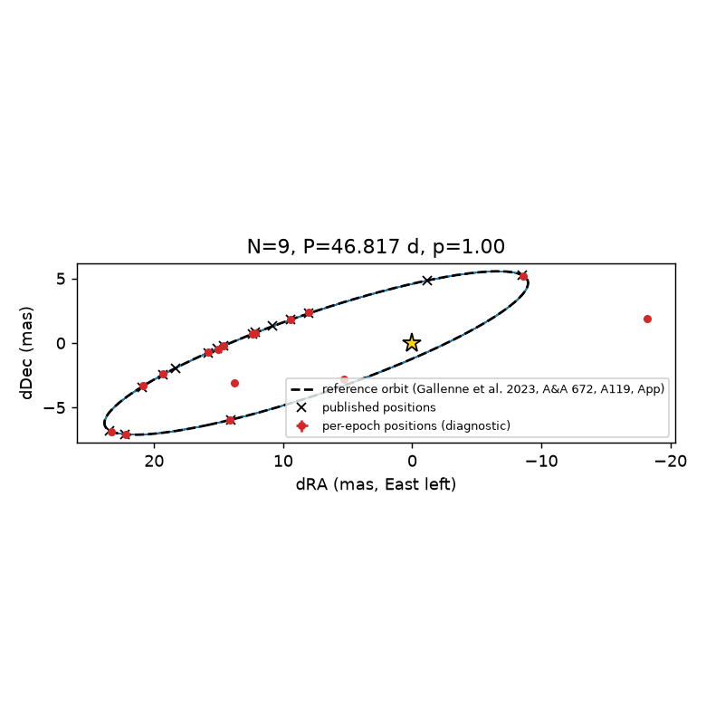

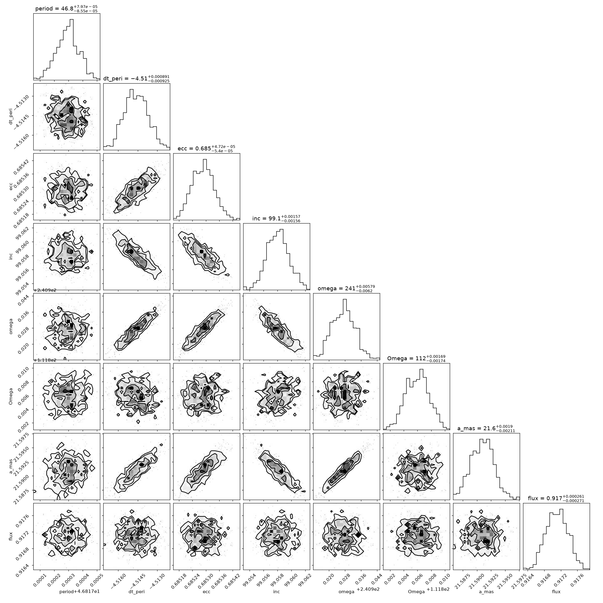

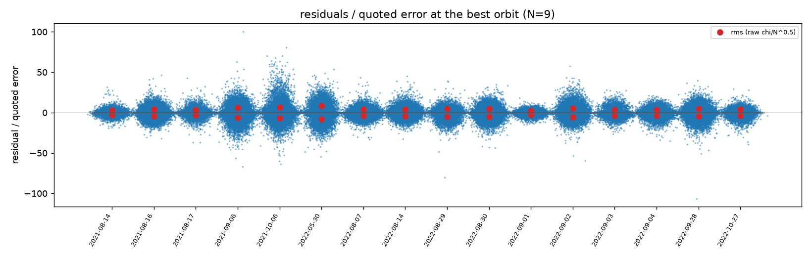

## HD 210763

GRAVITY, 7 epochs, period range [33.904904, 52.976412499999995] d; 5 alias bands.

virgil 0.3.0, commit `unknown`.

Reference period 42.3811 d lies in band N = 9 (p = 1.000); it is the winner.

| N | P (d) | χ²/N (raw) | error scales | log Z | log Z (IS) | p | ESS | flags |
| ---: | ---: | ---: | --- | ---: | ---: | ---: | ---: | --- |
| 9 | 42.3866 | 15.29 | 1.52–5.81 | -796213.55 | -796213.53 | 1.000 | 1556 | poor-fit |
| 10 | 37.6785 | 186.39 | 1.51–55.40 | -857138.07 | -857138.06 | 0.000 | 1530 | hessian-not-positive-definite |
| 11 | 33.9337 | 442.16 | 1.70–49.32 | -907789.52 | -907789.51 | 0.000 | 1425 | hessian-not-positive-definite, not-converged |
| 7 | - | - | - | - | - | 0.000 | 0 | hessian-not-positive-definite, no-valid-mode |
| 8 | - | - | - | - | - | 0.000 | 0 | hessian-not-positive-definite, no-valid-mode |

Orbits are compared on the sky, at the epochs, not by their elements (conventions and aliases give one sky orbit many element sets). Offsets are in mas; **mirror** = flip means the reference's point reflection matches, and **flipped** says whether the fit swapped the two stars' labels (flux ratio > 1): a mirror without a swap (and not a twin system) is UNEXPLAINED-FLIP, a sign error rather than agreement. The verdict is SAME-SKY-ORBIT only if the rms offset is under 2% of the separation and, with posterior samples, under 3 posterior spreads. Rows marked *warm-started* are in the band whose fit began at the reference orbit, so agreement there is not independent.

| band | N | P (d) | rms | max | rms / sep | rms / spread | mirror | flipped | verdict |
| --- | ---: | ---: | ---: | ---: | ---: | ---: | --- | --- | --- |
| winner | 9 | 42.3866 | 0.06 | 0.08 | 2% | 61.3 | none | no | DIFFERENT |
| reference | 9 | 42.3866 | 0.06 | 0.08 | 2% | 61.3 | none | no | DIFFERENT |

Winning band: flux ratio 0.374; primary diameter 0.367 mas (fixed); per-epoch V² amplitudes 0.83–0.91.

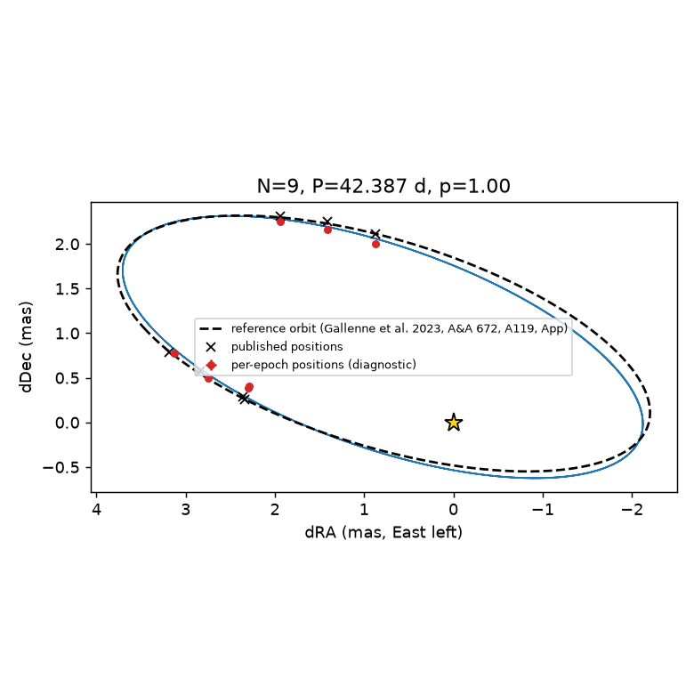

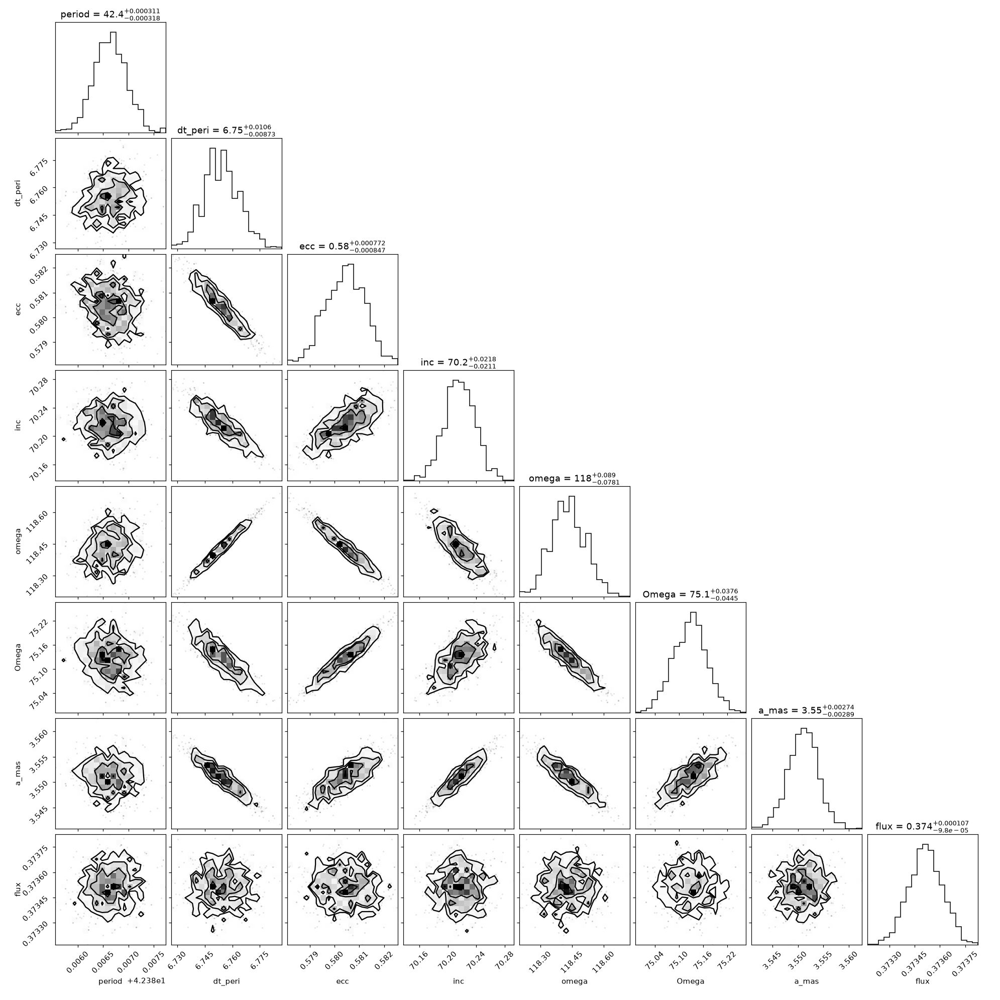

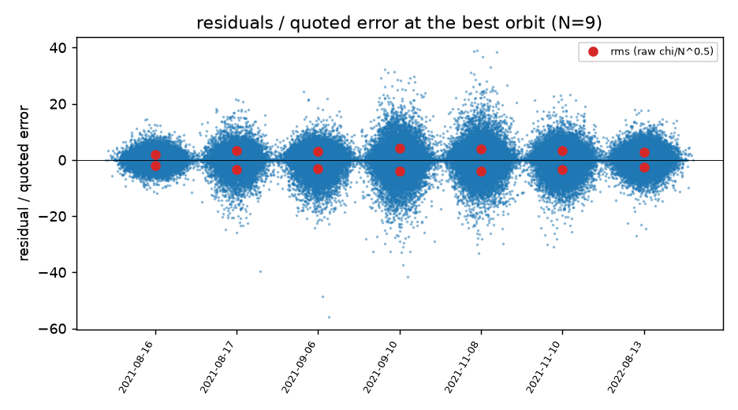

## HD 41255

GRAVITY, 14 epochs, period range [118.6632, 185.41125] d; 3 alias bands.

virgil 0.3.0, commit `unknown`.

Reference period 148.3290 d lies in band N = 5 (p = 1.000); it is the winner.

| N | P (d) | χ²/N (raw) | error scales | log Z | log Z (IS) | p | ESS | flags |
| ---: | ---: | ---: | --- | ---: | ---: | ---: | ---: | --- |
| 5 | 148.3202 | 44.43 | 1.48–17.09 | -177614.62 | -177614.63 | 1.000 | 1534 | poor-fit |
| 4 | 164.5831 | 3560.34 | 1.62–174.30 | -209493.38 | -209492.16 | 0.000 | 2 | hessian-not-positive-definite, near-prior-bound, laplace-is-differ, low-ess |
| 6 | 133.7717 | 3231.49 | 3.05–125.15 | -242311.79 | -242310.94 | 0.000 | 2 | hessian-not-positive-definite, near-prior-bound, not-converged, low-ess |

Orbits are compared on the sky, at the epochs, not by their elements (conventions and aliases give one sky orbit many element sets). Offsets are in mas; **mirror** = flip means the reference's point reflection matches, and **flipped** says whether the fit swapped the two stars' labels (flux ratio > 1): a mirror without a swap (and not a twin system) is UNEXPLAINED-FLIP, a sign error rather than agreement. The verdict is SAME-SKY-ORBIT only if the rms offset is under 2% of the separation and, with posterior samples, under 3 posterior spreads. Rows marked *warm-started* are in the band whose fit began at the reference orbit, so agreement there is not independent.

| band | N | P (d) | rms | max | rms / sep | rms / spread | mirror | flipped | verdict |
| --- | ---: | ---: | ---: | ---: | ---: | ---: | --- | --- | --- |
| winner | 5 | 148.3202 | 0.03 | 0.07 | 0% | 12.3 | none | no | DIFFERENT |
| reference | 5 | 148.3202 | 0.03 | 0.07 | 0% | 12.3 | none | no | DIFFERENT |

Winning band: flux ratio 0.959; primary diameter 0.245 mas (fixed); per-epoch V² amplitudes 0.81–0.91.

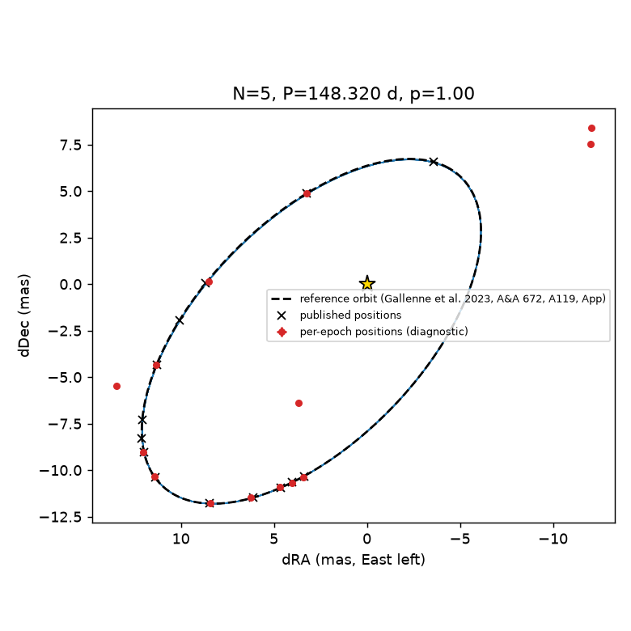

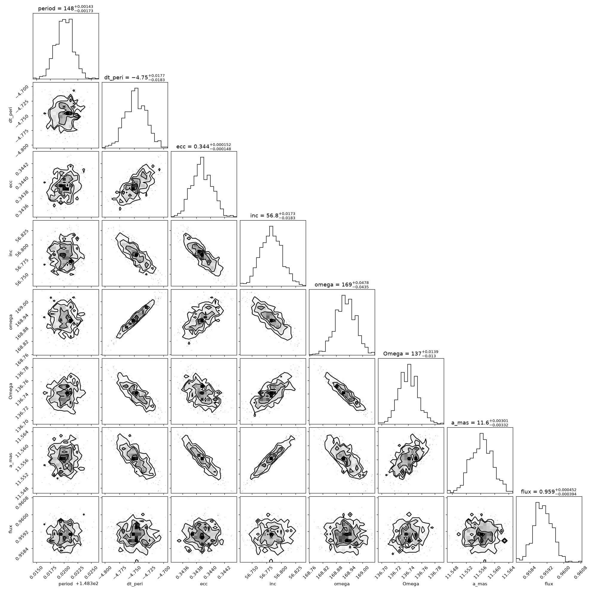

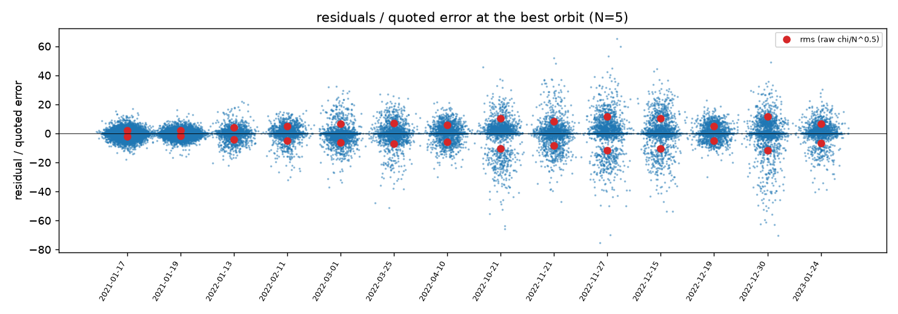

## HD 70937

GRAVITY, 10 epochs, period range [22.30864, 34.85725] d; 13 alias bands.

virgil 0.3.0, commit `unknown`.

Reference period 27.8858 d lies in band N = 26 (p = 1.000); it is the winner.

| N | P (d) | χ²/N (raw) | error scales | log Z | log Z (IS) | p | ESS | flags |
| ---: | ---: | ---: | --- | ---: | ---: | ---: | ---: | --- |
| 26 | 27.8899 | 17.96 | 1.46–6.61 | -578308.87 | -578308.87 | 1.000 | 1492 | poor-fit |
| 30 | 24.8947 | 478.43 | 1.52–54.81 | -664954.69 | -664954.68 | 0.000 | 1496 |  |
| 29 | 24.9476 | 485.34 | 1.77–49.37 | -666414.97 | -666414.97 | 0.000 | 1470 |  |
| 28 | 26.0343 | 525.63 | 1.83–60.87 | -666894.26 | -666894.27 | 0.000 | 1464 |  |
| 23 | 31.6088 | 412.96 | 1.65–52.88 | -674773.12 | -674773.16 | 0.000 | 1452 |  |
| 21 | 34.8365 | 484.21 | 1.49–50.09 | -678239.15 | -678239.14 | 0.000 | 1480 |  |
| 24 | 30.2408 | 419.24 | 2.00–53.25 | -678753.78 | -678753.78 | 0.000 | 66 | near-prior-bound |
| 31 | 23.6830 | 538.38 | 1.67–60.55 | -686471.71 | -686471.70 | 0.000 | 1495 | hessian-not-positive-definite |
| 33 | 22.6142 | 555.05 | 1.59–53.36 | -695749.76 | -695758.22 | 0.000 | 6 | near-prior-bound, laplace-is-differ, low-ess |
| 32 | 23.2130 | 675.70 | 1.60–53.85 | -697903.64 | -697903.64 | 0.000 | 1481 | near-prior-bound |
| 25 | 29.9984 | 737.56 | 1.70–45.40 | -719766.86 | -719775.98 | 0.000 | 3 | hessian-not-positive-definite, near-prior-bound, laplace-is-differ, low-ess |
| 22 | - | - | - | - | - | 0.000 | 0 | hessian-not-positive-definite, no-valid-mode |

*1 further bands, each with p < 0, are in `bands.json`.*

Orbits are compared on the sky, at the epochs, not by their elements (conventions and aliases give one sky orbit many element sets). Offsets are in mas; **mirror** = flip means the reference's point reflection matches, and **flipped** says whether the fit swapped the two stars' labels (flux ratio > 1): a mirror without a swap (and not a twin system) is UNEXPLAINED-FLIP, a sign error rather than agreement. The verdict is SAME-SKY-ORBIT only if the rms offset is under 2% of the separation and, with posterior samples, under 3 posterior spreads. Rows marked *warm-started* are in the band whose fit began at the reference orbit, so agreement there is not independent.

| band | N | P (d) | rms | max | rms / sep | rms / spread | mirror | flipped | verdict |
| --- | ---: | ---: | ---: | ---: | ---: | ---: | --- | --- | --- |
| winner | 26 | 27.8899 | 0.02 | 0.04 | 0% | 25.4 | none | no | DIFFERENT |
| reference | 26 | 27.8899 | 0.02 | 0.04 | 0% | 25.4 | none | no | DIFFERENT |

Winning band: flux ratio 0.583; primary diameter 0.876 mas (fitted); per-epoch V² amplitudes 0.89–1.00.

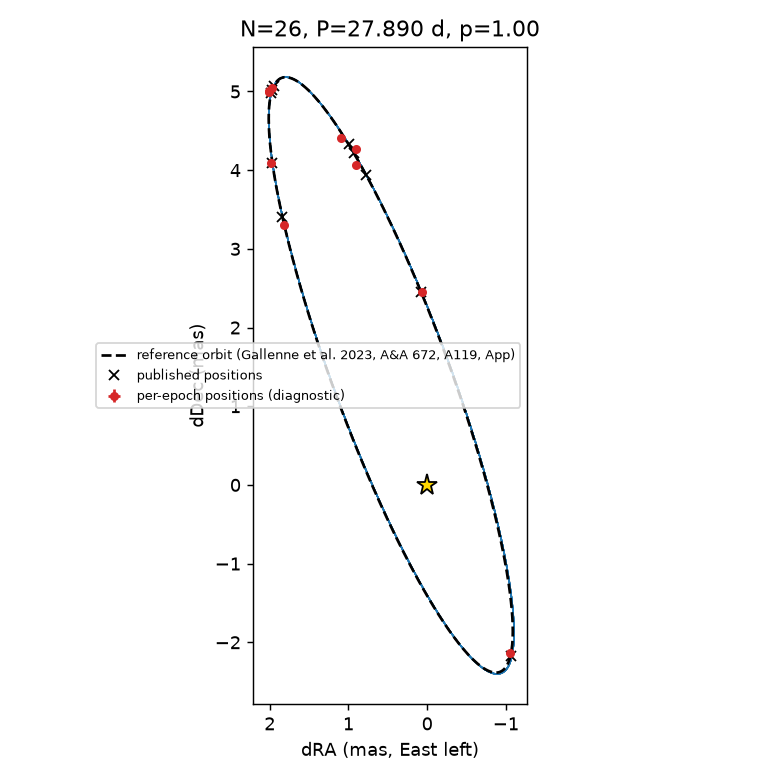

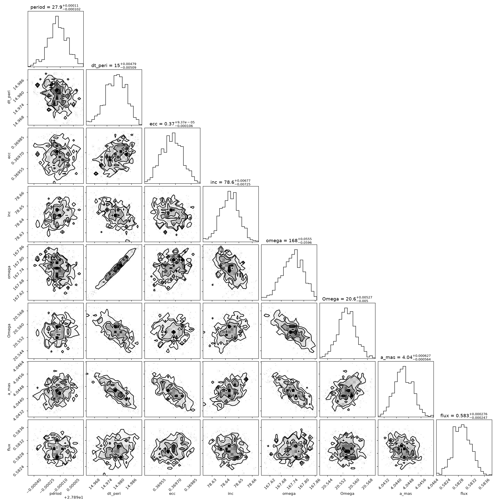

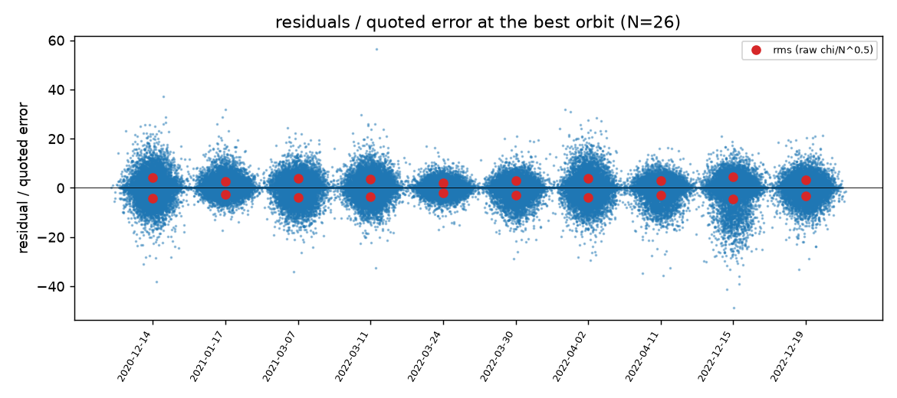

## o Leo

GRAVITY, 9 epochs, period range [11.5984544, 18.122585] d; 12 alias bands.

virgil 0.3.0, commit `unknown`.

Reference period 14.4981 d lies in band N = 23 (p = 0.000); it is not the winner.

| N | P (d) | χ²/N (raw) | error scales | log Z | log Z (IS) | p | ESS | flags |
| ---: | ---: | ---: | --- | ---: | ---: | ---: | ---: | --- |
| 24 | 13.8403 | 849.38 | 2.15–72.76 | -624315.62 | -624315.61 | 1.000 | 1511 | poor-fit |
| 22 | 15.2263 | 694.56 | 2.09–64.26 | -626134.12 | -626134.13 | 0.000 | 1473 |  |
| 25 | 13.2366 | 1076.09 | 2.38–80.01 | -629532.94 | -629532.94 | 0.000 | 1506 |  |
| 28 | 11.9050 | 521.46 | 2.27–46.67 | -645949.41 | -645949.43 | 0.000 | 1461 | near-prior-bound |
| 29 | 11.6868 | 980.94 | 2.37–65.94 | -665622.89 | -665627.66 | 0.000 | 25 | hessian-not-positive-definite, near-prior-bound, laplace-is-differ, low-ess |
| 19 | 17.5032 | 1665.07 | 2.03–68.67 | -682716.57 | -682716.57 | 0.000 | 1495 | hessian-not-positive-definite |
| 27 | 12.5241 | 1353.06 | 2.20–73.69 | -691304.35 | -691304.33 | 0.000 | 1459 | near-prior-bound, not-converged |
| 20 | 16.8185 | 1978.65 | 2.14–90.90 | -695721.90 | -695682.45 | 0.000 | 1 | near-prior-bound, not-converged, laplace-is-differ, low-ess |
| 26 | 13.0148 | 1273.61 | 2.32–58.08 | -700351.41 | -700351.41 | 0.000 | 1485 |  |
| 18 | - | - | - | - | - | 0.000 | 0 | hessian-not-positive-definite, no-valid-mode |
| 21 | - | - | - | - | - | 0.000 | 0 | hessian-not-positive-definite, no-valid-mode |
| 23 | - | - | - | - | - | 0.000 | 0 | hessian-not-positive-definite, no-valid-mode |

Orbits are compared on the sky, at the epochs, not by their elements (conventions and aliases give one sky orbit many element sets). Offsets are in mas; **mirror** = flip means the reference's point reflection matches, and **flipped** says whether the fit swapped the two stars' labels (flux ratio > 1): a mirror without a swap (and not a twin system) is UNEXPLAINED-FLIP, a sign error rather than agreement. The verdict is SAME-SKY-ORBIT only if the rms offset is under 2% of the separation and, with posterior samples, under 3 posterior spreads. Rows marked *warm-started* are in the band whose fit began at the reference orbit, so agreement there is not independent.

| band | N | P (d) | rms | max | rms / sep | rms / spread | mirror | flipped | verdict |
| --- | ---: | ---: | ---: | ---: | ---: | ---: | --- | --- | --- |
| winner | 24 | 13.8403 | 0.91 | 2.32 | 24% | 558.9 | none | no | DIFFERENT |

Winning band: flux ratio 0.230; primary diameter 1.524 mas (fitted); per-epoch V² amplitudes 0.58–0.97.

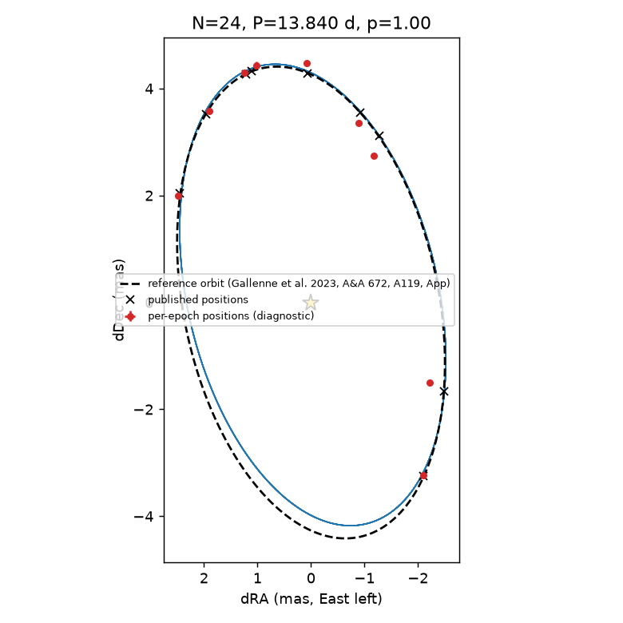

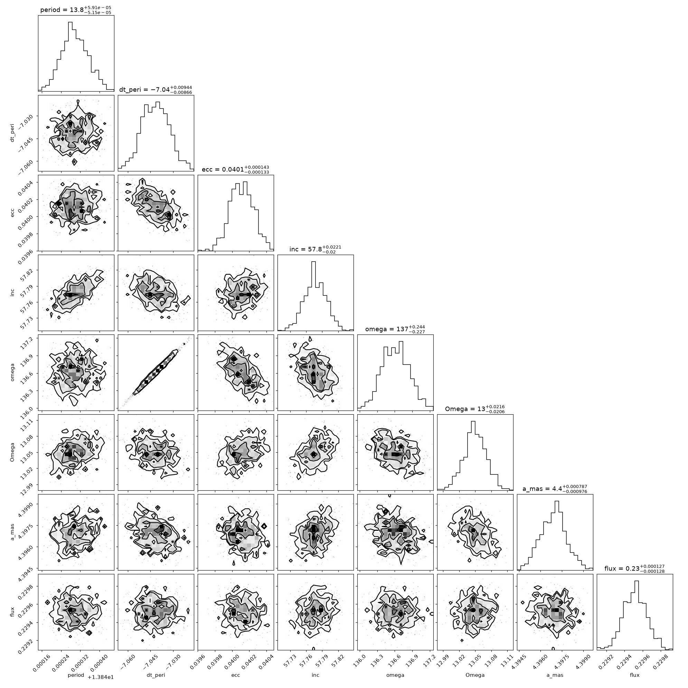

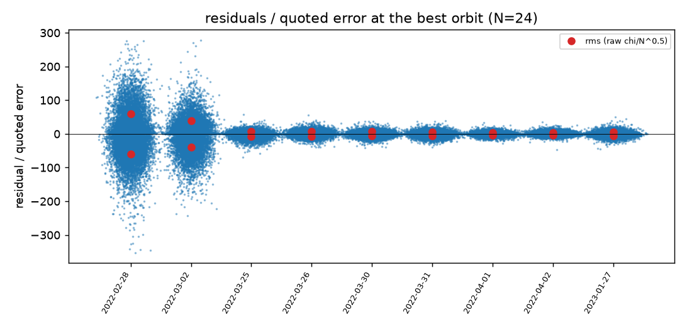

## psi Cen

PIONIER, 6 epochs, period range [31.049680000000002, 48.515125] d; 5 alias bands.

virgil 0.3.0, commit `unknown`.

Reference period 38.8121 d lies in band N = 9 (p = 1.000); it is the winner.

| N | P (d) | χ²/N (raw) | error scales | log Z | log Z (IS) | p | ESS | flags |
| ---: | ---: | ---: | --- | ---: | ---: | ---: | ---: | --- |
| 9 | 38.7994 | 1.37 | 0.65–2.52 | -1379.36 | -1379.25 | 1.000 | 1399 |  |
| 10 | 32.3794 | 70.99 | 0.70–32.19 | -1735.35 | -1735.24 | 0.000 | 359 |  |
| 7 | 44.7580 | 69.42 | 0.75–29.65 | -1800.39 | -1800.27 | 0.000 | 1445 | hessian-not-positive-definite, near-prior-bound |
| 8 | 39.6216 | 102.48 | 0.61–34.36 | -1872.57 | -1872.37 | 0.000 | 157 | hessian-not-positive-definite |
| 11 | 31.3845 | 82.81 | 0.61–29.67 | -1965.26 | -1965.46 | 0.000 | 185 |  |

Orbits are compared on the sky, at the epochs, not by their elements (conventions and aliases give one sky orbit many element sets). Offsets are in mas; **mirror** = flip means the reference's point reflection matches, and **flipped** says whether the fit swapped the two stars' labels (flux ratio > 1): a mirror without a swap (and not a twin system) is UNEXPLAINED-FLIP, a sign error rather than agreement. The verdict is SAME-SKY-ORBIT only if the rms offset is under 2% of the separation and, with posterior samples, under 3 posterior spreads. Rows marked *warm-started* are in the band whose fit began at the reference orbit, so agreement there is not independent.

| band | N | P (d) | rms | max | rms / sep | rms / spread | mirror | flipped | verdict |
| --- | ---: | ---: | ---: | ---: | ---: | ---: | --- | --- | --- |
| winner | 9 | 38.7994 | 0.03 | 0.04 | 0% | 4.2 | none | no | DIFFERENT |
| reference | 9 | 38.7994 | 0.03 | 0.04 | 0% | 4.2 | none | no | DIFFERENT |

Winning band: flux ratio 0.180; primary diameter 0.435 mas (fitted); per-epoch V² amplitudes 1.02–1.11.

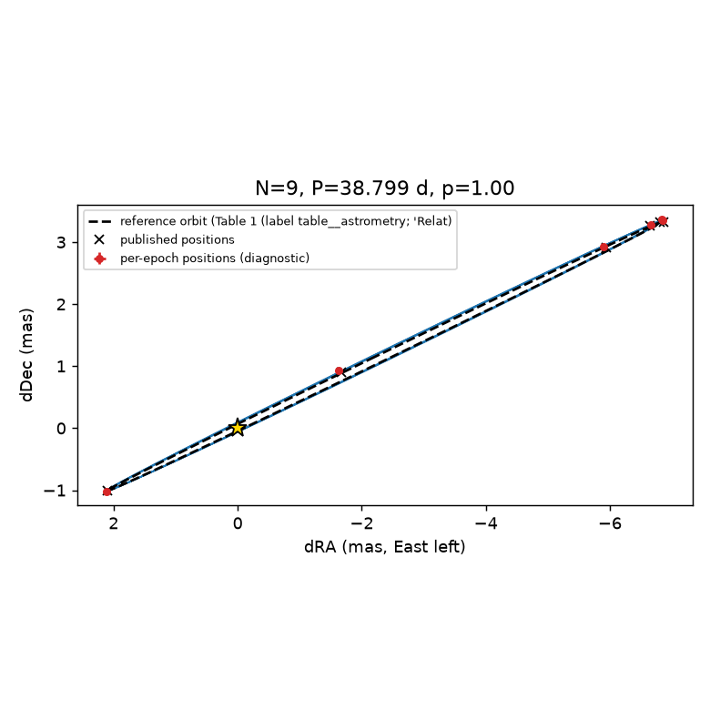

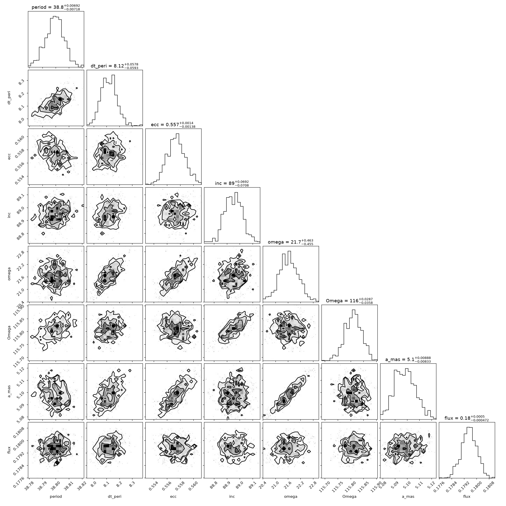

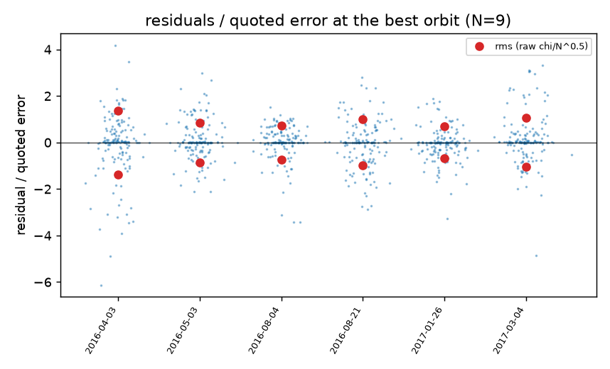

## Systems not included

- kappa Vel, NN Del (Track B): span shorter than the period, so only N = 0 and 1 exist and nothing is tested.
- Apep (GRAVITY, 6 nights): calibration is done by a script outside this repository and the calibrated OIFITS are not on /fred.
- Apep, 9 Sgr, delta Vel, HD 136164 (NACO SAM): one epoch, or four nights in one run: not an orbit.
- HR 4049 (PIONIER): no period; the analysis lives in notebooks, with no standalone loader.
- 9 Sgr, HD 152314, HD 168137, KQ Vel, CPD-71 172, TYC 1703-394-1 (Track B): one or two epochs.
- zeta Boo, eta Oph (Track B): no tabulated reference period to set the prior window.
- del Cir, TZ For (Track B): mixed GRAVITY and PIONIER epochs; a conflict between the manifest and the files.

The page is generated by `scripts/build_aliases_page.py` from this template
and the `bands.json` and `meta.json` of each system in `docs/assets/orbit_aliases/`.
