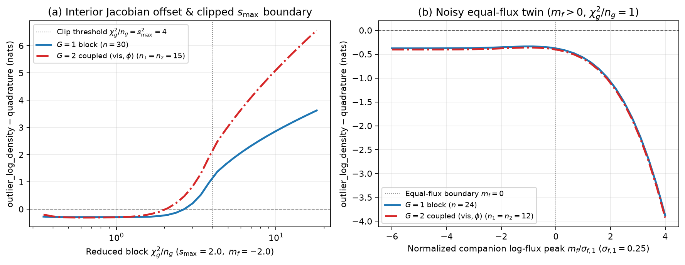

# Multi-epoch orbits

`tests/test_epochs.py` checks `virgil.epochs`, the tools that start and
score an orbit fitted to interferometric data from several epochs, against our own code and SciPy. The data
are three-telescope nights simulated by `crosscheck.simulate`, so every
closure phase is independent, and read with astropy. The reference is our
own χ² (`crosscheck.chi2`), our own Kepler positions (`crosscheck.orbits`)
and SciPy. One night's quoted errors are three times too small in the
orbit data, so that ranking on the quoted errors and ranking with
marginalized scales give different orders.

| virgil | Reference | Tag | Agreement |
| --- | --- | --- | --- |
| `marginal_loglike` | differences between models of ln ∫ L(s) ds/s, one scale per block (V², closure-phase chords), by `scipy.integrate.quad` in ln s; with `dof` = 0.5 the likelihood is tempered, L^dof | Mathematics | 1e-9 (measured 2e-13) |
| `marginal_loglike(s_max=10)` | the same integral bounded to [1/s_max, s_max], with the exact von Mises density exp(κ cos Δ)/(2π I₀(κ)), κ = 1/(sσ)², for weak (40°) closure phases | Mathematics | 1e-6 (measured 2e-7) |
| `marginal_loglike(s_max=1.2)`, bound binding | the mirror image's m difference, with the upper bound (s ≈ 1.1) and the lower bound (errors twice too large, s ≈ 0.5) each within about one posterior width of the peak; the bound moves the answer by 0.3 and 1.8, against the unbounded integral | Mathematics | 1e-6 (measured 2e-14) |
| control: wrong bounds | no upper limit, no lower limit, and [1/s_max², s_max], each on the data that reach it, must miss | Mathematics | misses by 0.1, 2.2 and 0.4 |
| steep edge | an offset model whose likelihood is cut off steeply by `s_max` ([F18](../method/findings.md), fixed in virgil#295) | Mathematics | 1e-6 (measured 5e-13; missed by 0.15-0.73 before virgil#295) |
| control: a uniform prior in s | ∫ L ds gives (ν − 1)/2 in place of ν/2 and must miss | Mathematics | misses by 1.5 |
| `epoch_positions`, `EpochPositions` | our grid search of m = −Σ_b (ν_b/2) ln χ²_b: the same best grid point and flux, `gap_marginal` (on m) and `gap` (on the quoted errors) | Mathematics | 1e-8 (measured 1e-15) |
| `epoch_positions` (refined) | the maximum of our m by SciPy; the covariance as the position block of the inverse curvature of m in position and flux (our Richardson-extrapolated finite differences); the flux-fixed inverse of the position block differs by 4% to 29%, so the flux is shown to be included; `chi2_raw` and `scale` | Mathematics | 1e-6 mas and flux; 1e-4 (measured 2e-6); 1e-6 |
| `epoch_positions` with every error three times too small | positions, covariances and `gap_marginal` unchanged; `gap` and χ²/N grow ninefold; the documented warning | Mathematics | 1e-6 (measured 1e-13) |
| `Epochs.loglike`, `OrbitalBinary` | the normalized Gaussian V² and von Mises closure-phase log likelihood of four epochs, the companion at our orbit position | Mathematics | 1e-10 |
| `rank_orbits(scales="quoted")`, `RankedOrbits` | −Δχ²/2 of eight trial orbits (the truth, its mirror, six perturbed) and the order; `positions` are our Kepler positions | Mathematics | 1e-6 relative (measured 6e-11) |
| `rank_orbits(scales="marginal")` | Δm summed over epochs, and the order | Mathematics | 1e-6 relative (measured 2e-12) |
| `chain_starts` | our greedy choice of distinct orbits over two clusters of trial orbits (one mode when every snapshot position agrees within half our λ/B_max): one start in each mode, never the mirror of the truth, and repeats in turn | Mathematics | exact |
| `start_from_positions`, `OrbitStart` (weekly, about 10 s) | the best fit's positions at each epoch match the true orbit's, and it fits at least as well as the truth by our χ² | Mathematics | 0.1 mas (measured 0.03 mas) |

## Alias bands, short arcs and night summaries

`tests/test_042_orbit_cells_arcs_aliases.py` checks the position-level and visibility-level orbit search primitives on both three-telescope (`UTS3`) and four-telescope (`UTS4`, four closure triangles of rank 3 per snapshot with station-correlated phase noise) synthetic nights against `crosscheck.orbit_cells_ref` (analytical Kepler sky velocities, [generalized least squares](https://en.wikipedia.org/wiki/Generalized_least_squares) Thiele–Innes [variable projection](https://en.wikipedia.org/wiki/Variable_projection), [Gauss–Jacobi quadrature](https://dlmf.nist.gov/3.5#v) on the Beta outlier-rate prior, and exact normal-CDF box integrals). In narrow-field regimes where the circular smearing bound falls below the observing block duration, `virgil`'s `period_window` and `period_cut` clamp at `night_length` (`0.600` d vs `0.314` d, matching `orbit_methods.md`), whereas their API docstrings state only `p_floor` (logged as open documentation finding [F28](../method/findings.md)). End-to-end `OrbitPipeline` and single-epoch pipeline tests are documented on [Scriptable pipelines](../inference/pipelines.md).

| virgil | Reference | Tag | Agreement |
| --- | --- | --- | --- |
| `AliasBand`, `alias_bands`, `period_cut`, `period_window` | exact half-integer cycle partition `T / (N + 0.5) <= P <= T / (N - 0.5)` plus long-period band `N = 0` (`P > 2T`); `2 * dt_min`, duplicate-epoch, `p_floor`, and narrow-field `night_length` clamp ([F28](../method/findings.md): API docstrings omit `night_length`) | Mathematics | 1e-13 (prose rule); [F28](../method/findings.md) |
| `position_profile`, `AliasBandResult`, `AliasResult` | generalized linear Thiele–Innes WLS on `PositionData` (including `sign_free` point reflection), 3-UT and 4-UT visibility alias fits, JSON `save`/`load` round-trip, and per-night rank-3 whitened residuals against correlated `crosscheck.chi2` | Mathematics | 1e-8; 1e-10 |
| `NightMotion`, `night_motion`, `CycleCounts`, `unwrap_cycles`, `arc_profile` | intra-night sky velocity on 3-UT and 4-UT moving multi-exposure OIFITS nights, cycle-count narrowing across seasonal gaps, and joint position-velocity Thiele–Innes seeding (control: negated velocities fail) | Mathematics | < 2.5 σ; 1e-8 |
| `NightPeak`, `NightSummary`, `keep_peaks`, `night_summaries` | closed-form block-scale precision and log-likelihood rescaling, Aitken WLS frame projection, independent per-frame jitter (`jitter² / n_frames` and `jitter² / t_ss`), 3-UT/4-UT linear track refinement, and smallest Gauss–Jacobi `Beta(1, 9)` node peak retention (control: `E[ε] = 0.1` drops boundary peaks) | Mathematics | 1e-12 |
| `SharedFlux`, `rank_scores`, `OrbitScores`, `score_orbits` | deterministic quantum-rounded tie-breaking (`1e-3` nats, non-finite last) and 3-UT/4-UT multi-epoch shared-flux plus chromatic-slope marginalization (control: non-linear or orbit-coupled `f = 0` scenes raise `ValueError`) | Mathematics | exact; 6% flux |
| `EpochPeaks`, `NightFlag`, `PrimaryDiameter`, `broad_loglike`, `estimate_primary_diameter`, `sidelobe_flags` | normalization-invariant log Bayes factors (`broad_loglike - marginal_loglike`) against textbook polar-disc Gaussian `V²` + von Mises `T3` quadrature (`s_max=10`, unbounded `s_max=None`, resolved `primary_diam = 2.5` mas, and numeric `with_gains` + `with_closure_offsets` `coarse_nats` screening), resolved vs point primary Δln L, and `orbit-prefers-secondary` sidelobe flagging | Mathematics | 0.025 nats; 1e-4 screening; 0.2 mas |

## Orbit cells and outlier densities

Each integer cycle-count cell `N = round(T / P)` between two anchor nights is searched in `virgil.orbit_cells` on the per-night `(dra, ddec, vra, vdec, ln f)` catalogues without evaluating raw visibility residuals. Convolving the log-uniform companion flux box `[ln_f_floor, 0]` against each peak's Gaussian measurement uncertainty `sigma_f` keeps peak outlier densities `b_k` finite even when measurement noise pushes the observed log-flux peak `m_f` slightly above zero:

$$
\ln \int_{\ell}^{0} \frac{1}{\lvert \ell \rvert}\,\mathcal{N}(x \mid m_f, \sigma_f^2)\,\mathrm{d}x
= \ln\!\left[\Phi\!\left(-\frac{m_f}{\sigma_f}\right) - \Phi\!\left(\frac{\ell - m_f}{\sigma_f}\right)\right] - \ln \lvert \ell \rvert.
$$

On standard rescalable OIFITS nights (`rescalable=True`, the default), scaling block errors by `s_g = exp(u_g)` across `G` observable blocks inverts the coupled precision `sum_g exp(-2 u_g) H_g` for the peak covariance `Sigma` and widens the convolved log-flux box to `Sigma_44^(1/2)`. Because `outlier_log_density` instead evaluates each block at the clipped joint profile scale `clip(sqrt(chi2_g / n_g), 1 / s_max, s_max)` and unconditionally adds the interior two-sided Gaussian width `0.5 ln(pi / n_g) - ln(2 ln s_max)`, it is a Laplace approximation that differs from our own bounded 1D (`G = 1`) and 2D (`G = 2`, `blocks=("vis", "phi")`) quadrature of the same integrand over `u_g = ln s_g` in `[-ln s_max, +ln s_max]`. The gap is large at the clip boundary and small in the interior, where it is comparable to the expected Laplace error (open finding [F27](../method/findings.md); the reference is not an independent implementation):

- **Interior finite-`n` offset**: On a single `n`-datum block (`G = 1`), [Laplace's method](https://dlmf.nist.gov/2.3#iii) and [Stirling's series](https://dlmf.nist.gov/5.11#E1) show that expanding at `sqrt(chi2 / n)` rather than `sqrt(chi2 / (n - d))` introduces `- (3 d² + 6 d + 2) / (12 n)` (`-0.41` nats at `n = 24, d = 5`). Across two coupled blocks `blocks=("vis", "phi")` (`G = 2`), [Jacobi's formula](https://en.wikipedia.org/wiki/Jacobi%27s_formula) — which gives the derivative of a matrix log-determinant as the trace of the inverse times the differential — ensures that the unit-scale determinant slopes `d_g = tr(H⁻¹ H_g)` partition the peak state (`d_1 + d_2 = d = 5`), giving `~ -0.40` nats total across two equal-information 12-datum blocks (`H_1 = H_2 = 0.5 H`).
- **Clipped `s_max` boundary ([Watson's lemma](https://dlmf.nist.gov/2.3#ii))**: Applying the full two-sided interior width on `u_g = ln s_max` overestimates `b_k` by `+ln 2` (`+0.69` nats per clipped boundary) when the stationary point sits on `s_max`, growing to `+2.9` to `+3.5` nats on a single block (`n = 30, s_max = 2, chi2 / n = 16`) and `+6.3` nats when both `("vis", "phi")` blocks clip simultaneously (`n_1 = n_2 = 15, s_max = 2, chi2_g / n_g = 16`).
- **Noisy equal-flux twins (`m_f > 0`)**: Rising `ln Phi(-m_f / Sigma_44^(1/2))` pulls the log-scale mode upward, causing `sqrt(chi2_g / n_g)` to underestimate `b_k` by `2.4` to `3.1` nats (`n = 24` single-block or `n_1 = n_2 = 12` two-block at `m_f = +0.90, sigma_f1 = 0.25`).

| virgil | Reference | Tag | Agreement |
| --- | --- | --- | --- |
| `PeriodDomain`, `period_domain`, `choose_anchors`, `Cell`, `make_cells` | Jeffreys log-uniform cell masses `ln[ln(p_hi / p_lo) / ln(p_max / p_cut)]` summing to 1 across default half-integer and custom `p_edges` partitions; end-quarter minimum-uncertainty anchors | Mathematics | 1e-14 |
| `OutlierPrior`, `outlier_prior` | sky-plane polar normalization (`3D` and `5D`), independent Monte Carlo Keplerian state KDE with polar-to-Cartesian Jacobians, and exact normal-CDF box convolution on `[ln_f_floor, 0]` (control: point indicator gives `-inf` for `m_f > 0`) | Mathematics | 1e-12 box; < 5e-3 norm |
| `outlier_log_density` | `rescalable=False` Laplace sum against independent MC KDE; `rescalable=True` bounded 1D (`G = 1`) and 2D (`G = 2`, `blocks=("vis", "phi")`) quadrature over `ln s_g` ([F27](../method/findings.md), Laplace error against our own quadrature: `-0.40` to `-0.41` nats interior at total `n = 24`, `+0.69` to `+6.3` nats clipped at `s_max`, `-2.4` to `-3.1` nats on `m_f > 0` twins; converges as `O(1/n)` at large interior `n = 384`) | Mathematics | < 0.14 nats (`rescalable=False`); [F27](../method/findings.md) (`rescalable=True`) |
| `search_plan`, `search_cell`, `position_leg`, `CellFit` | scale-equivariant conditional-MLE start preserving recovered period, physical scale, and inlier count across `ln s` in `{-2.0, 0.0, +0.8}` error rescalings | Mathematics | 1e-3 relative |
| `fit_jitter`, `position_cells`, `CellsResult`, `decode_particles` | type-II ML astrometric jitter recovery, shared neighbour modes across cell edges, `log_l_sup` negligible-cell upper bound (`omitted_bound < δ`), and blind posterior recovery of eccentric Keplerian elements (control: permuted epochs drop cell evidence to the all-outlier floor) | Mathematics | < 0.08 mas (clean), > 2.5× (noisy); 1% period |

