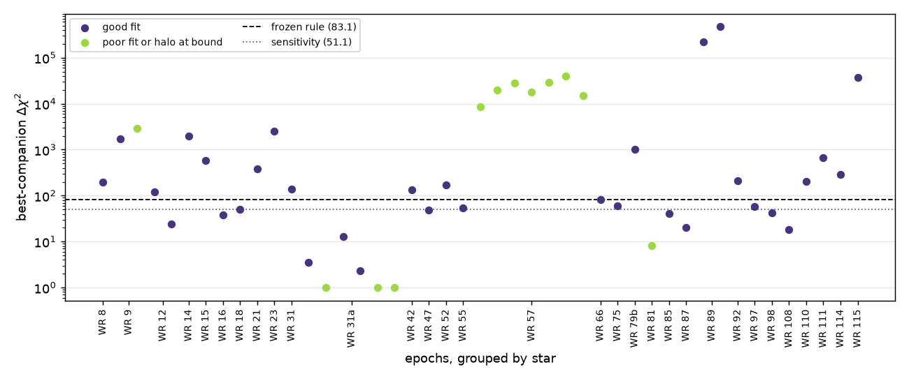
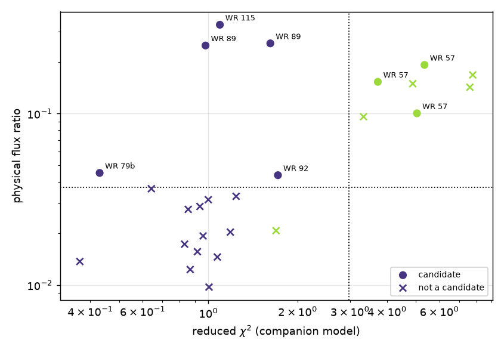

# Wolf-Rayet companions in GRAVITY data

A blind reanalysis of the 39-star VLTI/GRAVITY survey of Galactic Wolf-Rayet
stars (Deshmukh et al. 2024) with virgil, using an empirical null for the
detection threshold and flagging, rather than gating on, the treatments in
the original paper that we think are suboptimal. Status: working page, MED
data only; the numbers below come from the `real1` run of 45 epochs
(`catalogue.csv`, SHA-256 `b73a60c9…a58cc`, written 2026-10-30; the catalogue is
not committed, and the figures are made from it by `scripts/wr_gravity_figures.py`).

!!! note "Not validation evidence"
    This page is a science application of virgil. It has no independent root of
    trust and is not evidence that virgil is correct.

## What is different from the paper

| Issue | Paper | Here |
| --- | --- | --- |
| Detection | by eye / fixed significance | Δχ² of the best companion over a ±250 mas box, compared with 17 calibrator-on-calibrator nulls |
| Noise | white errors | per-frame gains and closure-phase offsets (`with_gains`, `with_closure_offsets`) |
| Fibre coupling | none | off-axis coupling response; the physical flux is the coupled flux divided by the response |
| Resolved flux | 5–35 % fully resolved component | fitted halo, reported with an at-the-edge flag |
| Calibrator table | errors noted | diameter and spectral-type problems carried as flags |

The resolved fraction in the paper correlates with the brightness difference
between the WR star and its calibrator, which points at an instrumental
origin. We treat it as a nuisance term and do not interpret it physically.

## Frozen detection rule (MED)

- Δχ² greater than **83.1**, the largest of the 17 nulls. The 51.1 value
  (excluding one null with a suspect night) is reported as a sensitivity
  column. A Gaia/SIMBAD check of that night's calibrator found no
  evidence of binarity, so the null stays in the rule.
- Physical flux above max(0.037, fibre-corrected Absil 3σ limit).
- The mirror solution (−r, 1/f) is rejected by the likelihood.
- Only an empirical rank among the nulls (resolution 1/18) is quoted: no
  false-alarm probability, GEV tail or σ claim from 17 nulls.
- The Bayes factor is dropped: it is uncalibrated (52–2161 on the nulls).

The rule was frozen before the real stars were run. The nulls are
equal-brightness calibrator pairs, so 83.1 has not been validated for a
faint WR star against a bright calibrator.

## Results (45 epochs, MED)

- 26 epochs pass the Δχ² rule.
- Over all 45 epochs, 11 have a poor fit (reduced χ² above 2.98, 1.5× the
  largest null value, from the 8 nulls available locally) and 8 have the fitted
  halo at its upper bound. The two sets overlap: the poor fits are WR 57 (seven
  nights), WR 31a (three) and WR 81; the halo cases are the same seven WR 57
  nights and WR 9 night 294.
- 8 of the 26 rule-passing epochs have a poor fit or halo at the bound, so 18
  survive the rule plus a good fit.
- Of 8 candidates (rule plus flux cut), 5 survive the fit-quality and halo
  cuts:

| Star | Night (MJD−60000) | Δχ² | Separation (mas) | Coupling | Physical flux | Reduced χ² | Flags |
| --- | --- | --- | --- | --- | --- | --- | --- |
| WR 89 | 108 | 2.2e5 | 6 | 1.00 | 0.25 | 0.98 | shared calibrator |
| WR 89 | 174 | 4.7e5 | 5 | 1.00 | 0.26 | 1.62 | shared calibrator |
| WR 115 | 179 | 3.7e4 | 199 | 0.18 | 0.33 | 1.09 | shared calibrator |
| WR 79b | 108 | 1.0e3 | 58 | 0.86 | 0.045 | 0.43 | paper calibration, paper poor |
| WR 92 | 145 | 2.1e2 | 7 | 1.00 | 0.044 | 1.71 | none |

The coupling is the fibre response at the fitted position (coupled flux over
physical flux). Only WR 115 lies outside the range where the fibre model is
trusted.

- WR 89 and WR 115 are the detections that match the paper. For WR 115 the
  fibre correction would raise the companion's flux from about the paper's 0.05
  to about 0.3, but WR 115 is at about 200 mas, outside the roughly 100 mas
  range where the fibre model is trusted, so this is not yet a disagreement
  with the paper.
- All three WR 57 candidates, and the other WR 57 nights, are model
  failures (reduced χ² 3.3–7.8, halo pinned at its bound with the likelihood
  still rising), not companions.
- WR 9 night 85 fits well (reduced χ² 1.24) but its flux, 0.033, is below the
  flux cut of 0.037; night 294 fits acceptably (reduced χ² 1.69) but has the
  halo at its bound and a flux of 0.021, also below the cut.

Figure 1 shows the statistic against the frozen thresholds for every epoch,
and figure 2 the physical flux against fit quality for the epochs that pass the
rule.

*Figure 1. Best-companion Δχ² per epoch, grouped by star. Dashed line: the
frozen 83.1 threshold (largest of the 17 nulls); dotted: the 51.1 sensitivity
value. Epochs with a poor fit or the halo at its bound are shown in yellow.*

*Figure 2. Physical flux against reduced χ² for the 26 epochs passing the
rule. Dotted lines: the reduced-χ² cut (2.98) and the nominal flux cut
(0.037). Circles are candidates (rule plus flux cut); crosses are not. Yellow
marks a poor fit or halo at its bound, as in figure 1.*

## Caveats and open items

- The bad-fit cut is self-chosen and rests on 8 of the 17 nulls.
- No brightness-split null set yet, which is what would show whether the WR 57
  deficit is a faintness effect rather than a model failure.
- The fibre model is trusted to about 100 mas; WR 115 is at about 200 mas
  where the coupling is about 0.17 and the physical flux is very sensitive.
- Epochs 19 and 20 (WR 57, three telescopes) have not been run; HIGH and
  UT-only stars (WR 22, 24, 78, 79, 79a, 113) are not yet included.
- Flux ratios and positions have not yet been compared with the paper's
  tables, and WR 93's flux ratio is unexplained.
- Paper-flagged stars are reported, not excluded, in all counts above.
